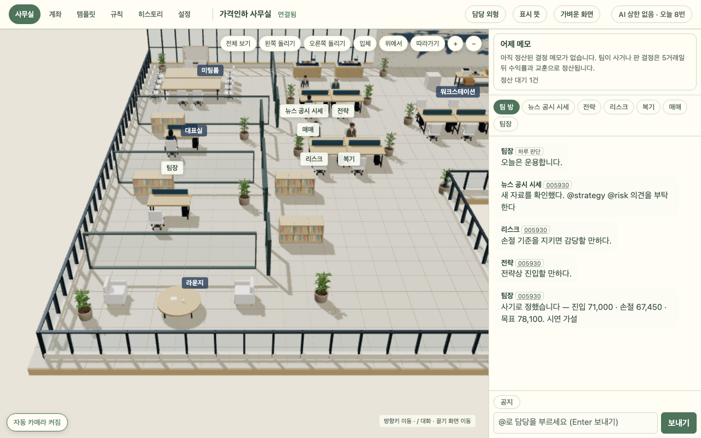
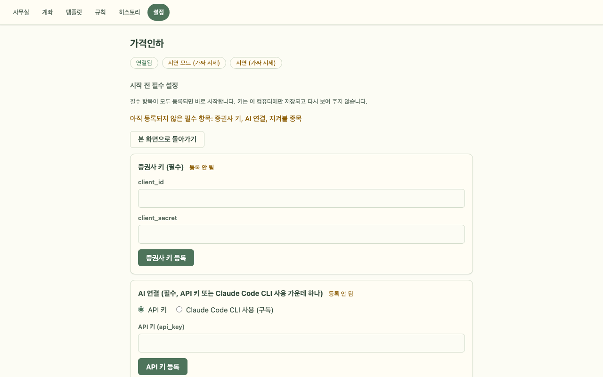
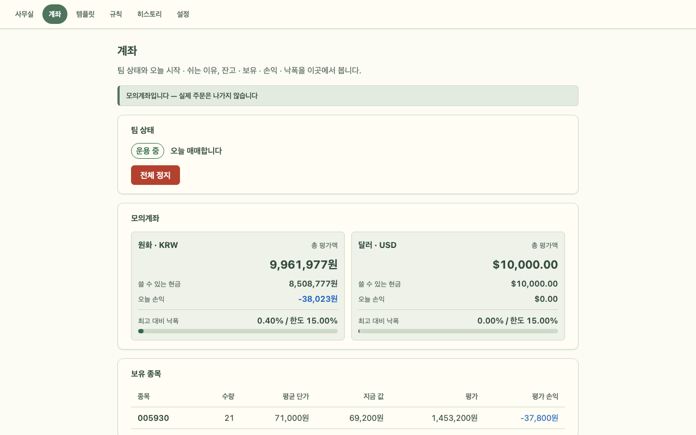
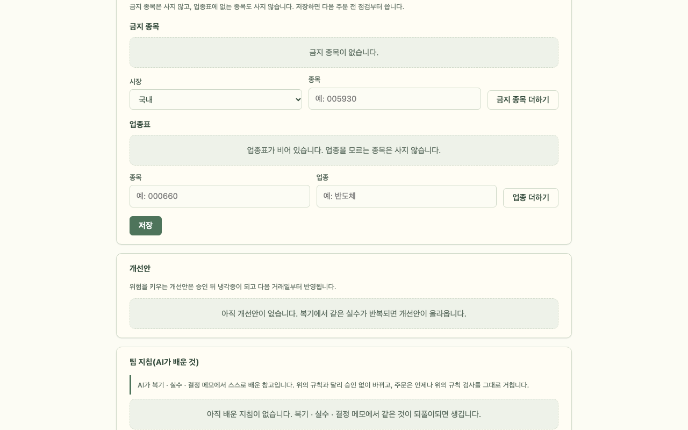
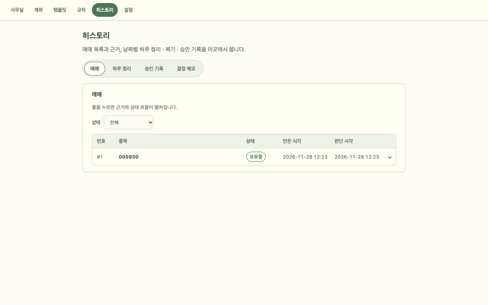
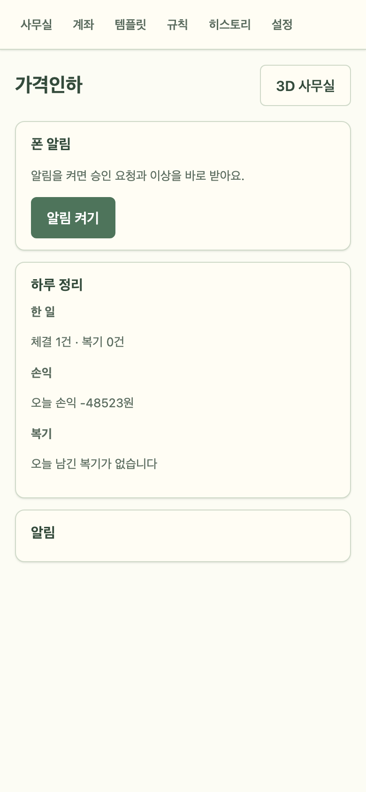

# 가격인하 (PriceInha)

> 가격은 인하, 수익은 인상.

**내 컴퓨터에서 24시간 도는 AI 주식 투자 팀.**
한도는 내가 정하고, 판단은 AI 팀이 하고, 원칙은 자동 규칙이 지킵니다.

MIT 라이선스의 무료 오픈소스입니다. 서버는 Rust 실행 파일 하나이고, 화면은 웹 브라우저로 봅니다.



> **개발 중입니다.** 계좌는 직접 만든 모의계좌(`pi-paper`)뿐이고 실제 돈은 움직이지 않습니다. 실제 증권사로 주문을 보내는 기능은 없습니다.

## 목차

- [30초 체험](#30초-체험)
- [무엇을 하나요](#무엇을-하나요)
- [설치](#설치)
- [처음 설정](#처음-설정)
- [사용법](#사용법)
- [안전 장치](#안전-장치)
- [문제 해결](#문제-해결)
- [개발](#개발)
- [라이선스](#라이선스)

## 30초 체험

키 · AI 계정 · 증권 계좌 없이 바로 돌려 봅니다.

```bash
price-inha demo
```

- 가짜 시세 · 가짜 AI로 서버를 켜고 브라우저로 **사무실 화면**(`/office/`)을 엽니다. 바깥(증권사 · AI · 공시 · 뉴스 · 메신저)으로는 요청을 보내지 않습니다.
- 기록은 실제 것과 섞이지 않게 **따로 둔 보관 폴더**(`~/.price-inha-demo`, 윈도는 `%USERPROFILE%\.price-inha-demo`)에 남습니다. `--home <폴더>`로 바꿀 수 있습니다.
- 기본 포트(`7878`)를 실제 서버가 쓰고 있으면 바로 뒤의 빈 포트를 골라 엽니다. 연 주소는 터미널에 찍힙니다.
- 템플릿을 아직 고르지 않은 체험 폴더면 스윙 템플릿(모의중)을 하나 골라 둡니다. 템플릿 화면에서 바꿀 수 있습니다.
- 브라우저를 열지 않으려면 `price-inha demo --no-open`. 끄려면 `Ctrl+C`.

켜고 몇 분 지나면 팀이 가짜 공시(3분마다)를 보고 모여 논의하고, 팀장이 판단하고, 주문 전 점검을 지난 주문이 모의계좌에서 체결됩니다(만든 사람의 컴퓨터에서 첫 논의까지 약 4분, 첫 체결까지 약 5~6분). 주문 금액이 템플릿의 자동 주문 한도(스윙 기본 15%) 안이면 승인 없이 나가고, 넘으면 승인 요청이 옵니다 — 템플릿 화면에서 한도를 낮추면 승인 요청을 직접 볼 수 있습니다.

| 체험판에서도 실제판과 같이 도는 것 | 실제판에서만 되는 것 |
|---|---|
| 사무실 화면 · 팀 방 대화 · 담당에게 말 걸기(답은 가짜 AI) | 실제 시세(증권사 시세 키) |
| 하루 흐름: 장 시작 판단 → 논의 → 팀장 판단 → 주문 전 점검 → 모의 주문 · 체결 → 익절 · 손절 감시 | 실제 AI 판단(Claude Code CLI 구독 로그인 또는 API 키) |
| 승인 요청(주문 금액이 자동 주문 한도를 넘을 때) · 웹에서 승인 · 거절 | 실제 공시 · 뉴스(DART · 네이버) |
| 모의계좌 · 템플릿 고르기와 값 맞추기 · 규칙 · 히스토리 · 폰 화면 | 텔레그램 알림 · 대화(체험판은 "시연 모드에서는 메신저를 쓰지 않습니다"라고 알립니다) |
| 설정 화면에서 바꾼 값(규칙 · 템플릿 · 알림 · 담당 모델 · AI 상한)은 체험 보관 폴더에 저장 | 자동 실행 등록(`price-inha service`) |

> 체험판의 장은 매일 00:05~23:55(시장 시각)에 열립니다. 장 마감 뒤 일(하루 정리 · 복기 · 결정 메모 정산 · 팀 지침 승격)도 체험판에서 돌지만, 마감(23:55) 뒤에야 보입니다.

설치하지 않고 소스에서 바로 보려면 `cargo run --release -- demo`입니다.

## 무엇을 하나요

**투자 팀 여섯**이 내 컴퓨터에서 일합니다.

| 담당 | 하는 일 |
|---|---|
| 뉴스 공시 시세 담당 | 시세 · 뉴스 · 공시를 지켜보고 일이 생기면 팀을 부릅니다 |
| 전략 담당 | 살 만한지 가설과 근거를 만듭니다 |
| 리스크 담당 | 잃을 수 있는 크기와 위험을 따집니다 |
| 매매 담당 | 주문 안을 만들고 주문을 냅니다 |
| 복기 담당 | 끝난 매매를 돌아보고 실수를 기록합니다 |
| 팀장 | 담당들의 점수를 모아 오늘 매매할지, 이 종목을 살지 정합니다 |

**하루 흐름**

```text
장 시작 판단 → 일이 생김 → 팀 논의 → 팀장 판단 → 주문 전 점검 → 주문 → 보유 → 익절 · 손절 → 장 마감 → 복기 · 정산
                                                 │
                                                 ├─ 근거 · 원칙에 걸리면 막힘
                                                 └─ 금액 한도를 넘으면 내 승인을 기다림
```

- **근거 없이는 사지 않습니다.** 매매마다 가설, 손절가, 목표가가 먼저 정해집니다. 수량과 가격은 AI가 아니라 규칙 엔진이 계산합니다.
- **승인은 내가 합니다.** 자동 주문 한도를 넘는 주문, 규칙 개선안, 전체 정지 뒤 다시 시작은 내 승인을 기다립니다. 돈이 움직이는 승인은 웹 화면에서만 합니다.
- **스스로 쉽니다.** 손실이 하루 한도에 닿으면 그날은 멈추고, 최대 손실에 닿으면 내가 확인할 때까지 멈춥니다.

**규칙은 두 층입니다.**

| 층 | 누가 정하나 | 무엇을 하나 |
|---|---|---|
| 1층 규칙 | 사람(템플릿 · 금지 종목 · 업종표, 원칙의 절대 상한 안에서) | 주문 전 점검이 강제합니다. AI가 사자고 해도 어기는 주문은 나가지 않습니다 |
| 2층 팀 지침 | AI 팀(복기 · 실수 · 결정 메모에서 되풀이된 것) | 판단 글에 참고로 들어갑니다. 한도 · 금지 · 승인 길은 바꾸지 못합니다. 규칙 화면에서 보고 끌 수 있습니다 |

## 설치

### 한 줄 설치 (macOS · Linux)

```bash
curl --proto '=https' --tlsv1.2 -fsSL https://raw.githubusercontent.com/YeongWon2/price-inha/main/install.sh | sh
```

- 운영체제 · CPU(macOS arm64 · x86_64, Linux x86_64 · arm64)에 맞는 릴리스 묶음을 받아 **SHA-256을 확인한 뒤** 실행 파일 하나를 `~/.local/bin/price-inha`에 놓습니다. 맞지 않으면 설치하지 않습니다.
- sudo를 쓰지 않고, 셸 설정 파일을 고치지 않고, 키를 묻지 않습니다. `~/.local/bin`이 PATH에 없으면 넣는 법만 알려 줍니다.
- 릴리스가 없으면 소스로 짓습니다(Rust가 있어야 합니다. 없으면 설치 안내만 합니다).
- 선택: `sh -s -- --version v0.1.0` · `--prefix <폴더>` · `--from-source` · `--dry-run`(무엇을 할지만) · `--help`. 받기 전에 내용을 보고 싶으면 `install.sh`를 먼저 내려받아 읽은 뒤 `sh install.sh`로 돌립니다.

### 한 줄 설치 (윈도)

PowerShell(5.1 이상, 관리자 아님)에서:

```powershell
irm https://raw.githubusercontent.com/YeongWon2/price-inha/main/install.ps1 | iex
```

- **git clone과 Rust가 필요 없습니다**(릴리스가 올라와 있을 때). 릴리스 묶음(`price-inha-<판>-windows-x86_64.zip`)과 `.sha256`을 https로 받아 **SHA-256을 확인한 뒤** `%LOCALAPPDATA%\price-inha\bin\price-inha.exe`에 놓습니다. 맞지 않으면 설치하지 않습니다.
- 그 폴더를 **사용자 PATH**(관리자 권한 없이)에 더하고, 끝에 `price-inha setup`을 실행할지 묻습니다.
- 필요한 것: **Claude Code CLI(구독) 로그인**. `price-inha setup`의 AI 연결이 `claude`(`claude.exe` · `claude.cmd`)를 찾고, 없으면 설치한 뒤 `claude auth login`으로 로그인하라고 안내하고 Enter를 누르면 다시 찾습니다(설치는 직접 합니다 — 스크립트가 대신 받아 돌리지 않습니다).
- 릴리스가 아직 없으면 소스로 짓지 않고 "아직 올라온 릴리스가 없습니다"와 릴리스 주소를 알려 주고 끝납니다.
- 선택: `& ([scriptblock]::Create((irm https://raw.githubusercontent.com/YeongWon2/price-inha/main/install.ps1))) -Version v0.1.0` · `-Prefix <폴더>` · `-NoPathUpdate` · `-NoSetup` · `-DryRun`(무엇을 할지만) · `-Uninstall`.
- 자동 실행(`price-inha service install`)은 윈도에서 로그온 때 시작하는 **작업 스케줄러** 작업으로 등록합니다(관리자 권한 없음). 보관 폴더는 `%USERPROFILE%\.price-inha`이고, 윈도에서는 0700 · 0600 권한 검사를 하지 않습니다(`price-inha doctor`가 그렇게 적고, 공용 폴더에 두면 경고합니다).
- 처음 실행할 때 **Windows SmartScreen**이 "Windows의 PC 보호" 창을 띄울 수 있습니다(서명하지 않은 실행 파일). 받은 묶음의 SHA-256이 릴리스의 `.sha256`과 같은지 확인했다면 "추가 정보" → "실행"으로 엽니다.

### 소스로 짓기

Rust(1.85 이상)와 Git이 필요합니다. macOS · Linux · Windows에서 같은 방법입니다.

```bash
git clone https://github.com/YeongWon2/price-inha.git
cd price-inha
cargo build --release          # 실행 파일: target/release/price-inha
sh install.sh --from-source    # (macOS · Linux) ~/.local/bin 에 놓기까지
```

따로 설치할 데이터베이스나 서비스는 없습니다. 릴리스 묶음은 [Releases](https://github.com/YeongWon2/price-inha/releases)에 있습니다.

### 처음 세팅 · 열기

```bash
price-inha demo         # 키 없이 체험(따로 둔 보관 폴더)
price-inha setup        # 터미널 마법사: AI 연결 · 증권 키 · 종목 · 메신저 · 자동 실행
price-inha open         # 화면을 브라우저로 연다
```

한 줄 설치는 끝에 터미널이 있으면 `price-inha setup`을 지금 실행할지 묻습니다. 필요한 키와 계정은 [docs/dev/keys-needed.md](docs/dev/keys-needed.md)에 있습니다.

### 지우기

```bash
price-inha service uninstall    # 자동 실행으로 등록했다면 먼저
curl --proto '=https' --tlsv1.2 -fsSL https://raw.githubusercontent.com/YeongWon2/price-inha/main/install.sh | sh -s -- --uninstall
```

윈도는 `price-inha service uninstall` 뒤에 `& ([scriptblock]::Create((irm https://raw.githubusercontent.com/YeongWon2/price-inha/main/install.ps1))) -Uninstall`입니다.

실행 파일만 지웁니다. 키 · 기록 · 모의계좌가 든 보관 폴더(`~/.price-inha`, 윈도는 `%USERPROFILE%\.price-inha`)는 그대로 두고 위치를 알려 줍니다. 자료까지 지우려면 그 폴더를 직접 지웁니다(되돌릴 수 없습니다). 체험 폴더(`~/.price-inha-demo`)도 같습니다.

## 처음 설정

```bash
price-inha setup
```

터미널 마법사가 구역마다 묻습니다. 한 구역만 다시 하려면 `price-inha setup ai` 처럼 구역 이름을 줍니다.

| 구역 | 필수 | 하는 일 |
|---|---|---|
| `ai` | 필수 | AI 연결을 고릅니다. **Claude Code CLI(구독 로그인)** 또는 Anthropic API 키 가운데 하나 |
| `broker` | 필수 | 토스증권 Open API 키(`client_id` · `client_secret`). **시세와 장 시간을 받는 데만** 씁니다 — 주문은 모의계좌로만 갑니다 |
| `symbols` | 필수 | 지켜볼 종목 코드(예: `005930,000660`) |
| `messenger` | 선택 | 텔레그램 봇 토큰 · 짝 맺기. 나중에 해도 됩니다 |
| `service` | 선택 | 로그인 때 자동으로 켜지게 등록합니다(`--dry-run`이면 할 일만 보여 줍니다) |
| `open` | 선택 | 서버를 켜고 화면을 엽니다 |

- **Claude Code CLI**를 고르면 공식 `claude`를 설치하고 `claude auth login`으로 구독 계정에 로그인해 둡니다. 가격인하는 구독 토큰을 받거나 보관하지 않습니다(로그인은 공식 CLI가 쥡니다). CLI는 도구 · 설정 · 플러그인을 끈 채 불리고, 증권 키와 가격인하의 비밀은 CLI에 넘기지 않습니다. 구독 약관은 자동화된 이용과 증권 매매 목적 이용을 제한할 수 있습니다. 판단은 사용자에게 있습니다.
- 키는 등록할 때 실제로 닿는지 확인하고, 확인된 것만 저장합니다. 등록한 키는 다시 볼 수 없고 화면 · 기록 · 알림 · AI 대화 어디에도 나오지 않습니다.
- 키와 종목 등록은 가격인하가 도는 그 컴퓨터에서 연 화면에서만 됩니다. 1분에 5번까지 시도할 수 있습니다.
- 자료 키(공시 · 거시 · 뉴스)는 선택입니다. 없어도 시작합니다.
- 마법사 대신 웹 설정 화면(`price-inha open`)에서 같은 것을 등록할 수도 있습니다. 마지막 필수 항목을 등록하면 다시 켜지 않아도 바로 시작합니다.

## 사용법

```bash
price-inha run          # 포그라운드로 켠다(인자 없는 price-inha 와 같다). 끄려면 Ctrl+C
price-inha open office  # 도는 서버의 사무실 화면을 연다
```

### 화면

| 화면 | 주소 | 하는 일 |
|---|---|---|
| 사무실 | `/office/` | 담당들이 자리에서 일하고 모여 회의하는 모습, 팀 방 대화, `@담당`으로 말 걸기 |
| 계좌 | `/account/` | 팀 상태와 전체 정지, 모의계좌의 현금 · 보유 · 손익 · 최고 대비 낙폭 |
| 템플릿 | `/templates/` | 투자 스타일(단타 · 스윙 · 중장기)을 고르고 원칙의 상한 안에서 값을 맞춥니다 |
| 규칙 | `/rules/` | 지금 규칙 · 절대 상한 · 금지 종목 · 업종표 · 개선안 승인, AI가 배운 팀 지침 |
| 히스토리 | `/history/` | 매매 목록과 근거 · 상태 흐름, 날짜별 하루 정리 · 승인 기록 · 결정 메모 |
| 설정 | `/` | 키 · 종목 · AI 연결 · 알림 · 담당 모델 · AI 사용 상한 · 진단 |
| 폰 | `/phone/` | 폰 알림 켜기(승인 요청 · 이상을 바로 받기) · 하루 정리(한 일 · 손익 · 복기) · 알림 |

| 설정 | 계좌 |
|---|---|
|  |  |

| 규칙 — 팀 지침 묶음 | 히스토리 |
|---|---|
|  |  |

<p align="center"></p>

### 명령

| 명령 | 하는 일 |
|---|---|
| `price-inha run [설정 인자들]` | 서버를 포그라운드로 켭니다(인자 없는 `price-inha`와 같습니다) |
| `price-inha demo [--no-open] [--home <폴더>] [--port <수>]` | 키 없이 체험 서버를 켜고 사무실을 엽니다(따로 둔 보관 폴더) |
| `price-inha setup [ai\|broker\|symbols\|messenger\|service\|open] [--dry-run]` | 처음 설정 마법사 |
| `price-inha open [home\|office\|account\|templates\|rules\|history] [--print]` | 도는 서버의 화면을 브라우저로 엽니다(`--print`면 주소만) |
| `price-inha doctor [--json]` | 설정 · 보관 폴더 · 서비스 · 기록 쓰임을 진단합니다. 문제가 남으면 종료 코드 1 |
| `price-inha service install\|uninstall\|start\|stop\|restart\|status` | 자동 실행(macOS launchd · Linux systemd 사용자 서비스 · 윈도 작업 스케줄러) |
| `price-inha access-key [--rotate]` | 다른 기기에서 접속할 키를 만들어 한 번만 보여 줍니다 |
| `price-inha restore <백업 파일> --identity <age 비밀키 파일> --into <빈 폴더>` | 암호화된 백업을 빈 폴더에 되살립니다 |
| `price-inha --version` | 판 번호 |

<details>
<summary>설정 인자 · 환경 변수</summary>

인자가 환경 변수보다 먼저입니다. 비밀 값(키 · 토큰)을 받는 인자와 환경 변수는 없습니다.

| 값 | 인자 | 환경 변수 | 기본값 |
|---|---|---|---|
| 보관 폴더 | `--home <폴더>` | `PRICE_INHA_HOME` | 홈 폴더 아래 `.price-inha` (`demo`는 `.price-inha-demo`) |
| 여는 주소 | `--bind <IP>` | `PRICE_INHA_BIND` | `127.0.0.1` |
| 여는 포트 | `--port <수>` | `PRICE_INHA_PORT` | `7878` |
| 지켜볼 종목 | `--symbols <a,b,c>` | `PRICE_INHA_SYMBOLS` | 설정 화면에서 등록한 종목 |
| 시장 | `--market <kr\|us>` | `PRICE_INHA_MARKET` | `kr` |
| 시세 간격 | `--interval-ms <수>` | `PRICE_INHA_QUOTE_INTERVAL_MS` | `1000` |
| 다시 시도 첫 간격 | `--retry-initial-ms <수>` | `PRICE_INHA_RETRY_INITIAL_MS` | `1000` |
| 다시 시도 최대 간격 | `--retry-max-ms <수>` | `PRICE_INHA_RETRY_MAX_MS` | `60000` |
| 장 시간표 다시 받는 간격 | `--calendar-retry-ms <수>` | `PRICE_INHA_CALENDAR_RETRY_MS` | `30000` |
| 키 등록 시도 횟수 | `--register-attempts <수>` | `PRICE_INHA_REGISTER_ATTEMPTS` | `5` |
| 키 등록 시도를 세는 시간 | `--register-window-ms <수>` | `PRICE_INHA_REGISTER_WINDOW_MS` | `60000` |
| 종목 등록 시도 횟수 | `--symbols-attempts <수>` | `PRICE_INHA_SYMBOLS_ATTEMPTS` | `10` |
| 종목 등록 시도를 세는 시간 | `--symbols-window-ms <수>` | `PRICE_INHA_SYMBOLS_WINDOW_MS` | `60000` |
| 기록 파일 | `--log-file <경로>` | 없음 | 표준 오류 |
| 시연 | `--demo` | 없음 | 끔 (`price-inha demo`는 늘 켬) |

보관 폴더에는 키 파일과 기록 파일(매매 · 복기 · 지식)이 들어갑니다. 이 폴더를 지우면 모든 상태가 사라집니다.

</details>

<details>
<summary>화면 위쪽의 상태 표시</summary>

| 상태 | 뜻 |
|---|---|
| 필수 설정이 필요함 | 필수 항목이 빠져 시작하지 않았습니다 |
| 연결 중 | 첫 시세를 기다립니다 |
| 증권사 시세 | 시세를 받고 있습니다 |
| 증권사가 키를 받지 않음 | 키가 틀렸거나 허용 IP가 아닙니다. 간격을 늘려 가며 다시 시도합니다 |
| 증권사가 요청을 거절함 | 받을 수 있는 종목이 없습니다. 종목 코드를 확인하세요 |
| 증권사에 닿지 않음 | 연결이 안 되거나 증권사 장애입니다. 간격을 늘려 가며 다시 시도합니다 |
| 시세 늦음 | 시세가 30초 넘게 오지 않았습니다 |
| 시연 (가짜 시세) | 체험판(`demo` · `--demo`)입니다 |

종목 코드 하나가 틀려도 나머지 종목의 시세는 나오고, 거절된 종목은 화면에 따로 보입니다. 끌 때는 `Ctrl+C`를 누릅니다. 다시 켜면 이전 상태에서 이어집니다.

</details>

## 안전 장치

- **모의계좌(`pi-paper`)뿐입니다.** 실제 증권사로 주문을 보내는 코드가 없습니다. 증권 키는 시세와 장 시간을 받는 데만 씁니다. 모의계좌는 실제 시세로 체결하고, 부분 체결 · 미체결 · 수수료 · 세금 · 장 닫힘 거부 · 시간 초과 취소를 실제 계좌처럼 다룹니다.
- **원칙은 규칙 엔진이 지킵니다.** 1회 위험 · 하루 손실 · 최대 낙폭 · 종목 비중 · 업종 비중에 절대 상한이 있고, 템플릿 값도 개선안도 이 상한을 넘을 수 없습니다.
- **돈이 움직이는 승인은 웹에서만 합니다.** 텔레그램으로는 알림을 받고 팀과 이야기하지만 승인하지 않습니다. 승인 요청에 답이 없으면 팀이 위험을 키우지 않는 쪽으로 판단합니다. 거절과 멈춤은 바로 됩니다.
- **비밀은 이 컴퓨터에만 있습니다.** 키는 보관 폴더의 본인만 읽는 파일(권한 0600)에 두고, 다시 볼 수 없으며 화면 · 기록 · 알림 · AI 대화 어디에도 나오지 않습니다. 매매 기록 · 복기 · 지식은 내 컴퓨터 밖으로 나가지 않습니다.
- **기본은 이 컴퓨터에서만 열립니다**(`127.0.0.1`). 다른 기기에서 보려면 `price-inha access-key`로 접속 키를 만듭니다. `--bind`로 다른 주소를 여는 것은 스스로 책임질 수 있을 때만 하세요.

## 문제 해결

먼저 진단을 돌립니다.

```bash
price-inha doctor          # 사람이 읽는 줄
price-inha doctor --json   # 기계가 읽는 JSON
```

보관 폴더 위치와 권한, 키 등록, AI 연결, 서비스 등록 · 도는지, 기록 쓰임(하루 · 10년 추정)을 보고 고칠 것을 알려 줍니다. 웹 설정 화면의 진단도 같은 내용입니다.

| 증상 | 해 볼 것 |
|---|---|
| `price-inha open`이 "도는 서버를 찾지 못했습니다" | `price-inha run`(또는 `price-inha service start`)으로 먼저 켭니다 |
| 필수 설정이 필요하다고 나옴 | `price-inha setup` 또는 설정 화면에서 빠진 항목을 등록합니다 |
| 증권사가 키를 받지 않음 | 토스증권 Open API의 허용 IP에 이 컴퓨터가 있는지 확인합니다 |
| 종목 파일 · AI 연결 파일을 읽을 수 없다고 하며 켜지지 않음 | 보관 폴더의 `watchlist.json` · `ai.json`을 손으로 고쳤다면 바로잡거나 지운 뒤 다시 켭니다(가격인하는 그 파일을 고치지 않습니다) |
| 체험이 실제 서버와 포트가 겹침 | `price-inha demo`는 빈 포트를 스스로 고릅니다. 직접 정하려면 `--port <수>` |

## 개발

| 폴더 | 내용 |
|---|---|
| `crates/` | Rust 워크스페이스. 모듈마다 한 crate(`server` · `paper` · `rules` · `agent` · `market` · `store` …), 화면은 `crates/server/web`(Vite) |
| `docs/` | 기획 · 스펙 · 원칙 · 구현 파이프라인 |
| `scripts/` | 기계 검사 · 릴리스 |

```bash
cargo test --workspace            # 테스트
bash scripts/verify.sh            # 기계 검사 전체 (모양 · clippy · 테스트 · 구조 · 비밀 글자)
bash scripts/verify.sh server     # 한 모듈만
```

명세를 먼저 쓰고, 테스트를 먼저 쓰고(red), 그 테스트를 통과하도록 구현합니다(green). 테스트는 실제 증권사 · AI를 부르지 않고 로컬 가짜 서버만 씁니다. 기여하기 전에 [구현 파이프라인](docs/dev/pipeline.md)을 읽어 주세요. 문서 지도는 [AGENTS.md](AGENTS.md)입니다.

| 문서 | 내용 |
|---|---|
| [기본 원칙](docs/product/principles.md) | 규칙 엔진이 강제하는 원칙 |
| [기획](docs/product/stock-team/prd.md) · [상세 스펙](docs/product/stock-team/spec.md) · [흐름](docs/product/stock-team/flow.md) | 무엇을 왜 만드는지 |
| [개발 스펙](docs/product/stock-team/dev.md) | 구조 · 계약 · 검증 |
| [구현 파이프라인](docs/dev/pipeline.md) | 테스트 먼저 → 구현 → 기계 검사 → 검토 |

## 알아 둘 것

가격인하는 투자 조언이 아닙니다. 특정 종목을 추천하지 않으며, 투자의 판단과 책임은 사용자에게 있습니다.

## 라이선스

[MIT](LICENSE)
