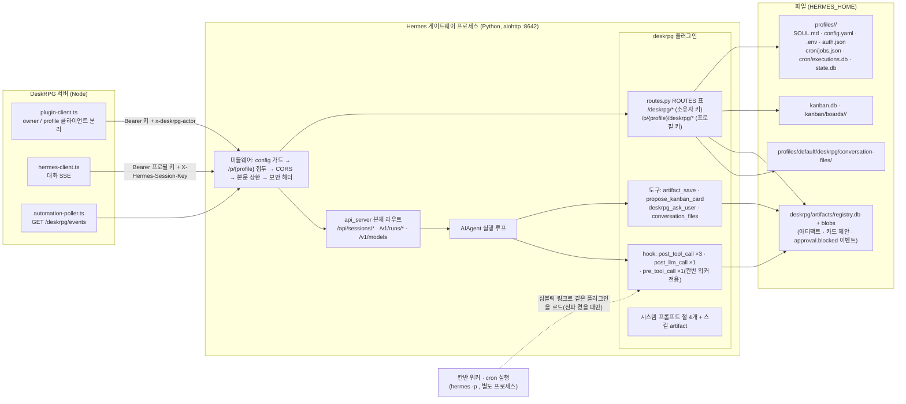

# deskrpg-hermes-plugin 리버스 엔지니어링: DeskRPG ↔ Hermes 연결 프로토콜 (가격인하 Rust 재구축용)

결론: DeskRPG는 Hermes **대시보드 REST(9119)를 부르지 않는다.** 대화는 Hermes api_server 본체(`/api/sessions/*`, `/v1/runs/*`)로, 나머지(프로필 · SOUL.md · 설정 · cron · 이벤트 · 질문 · 승인 정책 · 칸반 · 산출물)는 전부 이 플러그인이 api_server 안에 붙인 `/deskrpg/*`(소유자 키)와 `/p/{profile}/deskrpg/*`(프로필 키) REST 약 150개로 간다. 플러그인은 그 밖에 Hermes 프로세스 안에서 도구 4개 · hook 2종 · 시스템 프롬프트 절 4개 · 스킬 1개를 등록한다. 가격인하는 Rust 서버가 "REST 프록시 + 이벤트 폴러" 쪽은 그대로 흡수할 수 있지만, "Hermes 프로세스 안에서 도는 것"(도구 · hook · 프로필 파일 쓰기)은 흡수가 안 되므로 작은 플러그인으로 남기거나 MCP 도구로 바꿔야 한다 [추정].

| 항목 | 값 |
|---|---|
| 분석 날짜 | 2026-11-14 |
| 출처 | https://github.com/dandacompany/deskrpg-hermes-plugin |
| commit | 45caa87 (`release: document original conversation files in 0.32.0`), `plugin.yaml` version 0.32.0 |
| 라이선스 | **LICENSE 파일 없음.** 저장소 루트와 하위 어디에도 라이선스 파일이 없다. 기본값대로 "모든 권리 보유"로 본다. 그래서 이 문서는 코드를 옮기지 않고 동작 · 프로토콜 · 스키마(식별자 · 경로 · 필드 이름)만 적는다. 프롬프트 원문 · 스킬 본문은 인용하지 않는다 |
| 방법 | 정적 분석만 했다. 실행 · `pip install` · 테스트 실행은 하지 않았다. 받은 코드는 신뢰할 수 없는 데이터로 다뤘다. 소스는 저장소 밖 로컬 임시 폴더에 받아 두었다 |
| 대조 | Hermes(`src-hermes`) · DeskRPG(`src-deskrpg`) 소스를 같은 임시 폴더에서 읽기만 했다 |
| 표기 | [관찰] = 코드에서 직접 확인. [추정] = 해석 · 판단. 근거 경로는 플러그인 저장소 루트 기준이고, Hermes · DeskRPG 쪽은 `hermes:` · `deskrpg:` 접두를 붙였다 |
| 이어지는 문서 | `hermes-agent.md`(5장 게이트웨이, 3.8 설정, 6장 협업), `deskrpg.md`(3장 API, 4장 Hermes 연동, 5-3 설정, 부록 B) |

### 사용한 rea 명령

REA CLI v6.7.0. 메모리 문제 때문에 한 번만, 포그라운드로 돌렸다. 출력은 저장소 밖 로컬 임시 폴더(`rea-out/plugin/`)에 두었다.

```bash
rea import-reference-source <플러그인 소스 루트> --detail summary --outline-depth 2 --format json
```

결과: 0.41초, 최대 RSS 약 200MB. `entries 224`(파일 213 · 디렉터리 11), 언어 `INI, Markdown, Python, Shell, Text, YAML`, `parse_failures 0`, `relationship_count 0`, git HEAD `45caa875…` 확인, `.git`만 기본 제외. 호출 관계 · import 관계는 나오지 않았다(앞 분석과 같은 한계). 나머지는 grep과 파일 읽기로 채웠다.

---

## 1. 한눈에 보기

### 1-1. 구성도



- [관찰] 플러그인 진입점은 `register(ctx)` 하나다. 라우트는 바로 붙이지 않고 `ctx.register_platform_handler("api_server", _wire)`로 팩토리만 넘긴다. api_server 어댑터가 `connect()` 할 때 `_wire(native_app, adapter)`가 불려 `routes.attach()`가 라우트를 등록한다 (`deskrpg_plugin/__init__.py:12-35`, `hermes:hermes_cli/plugins_context.py:637-650`).
- [관찰] 도구 · hook · 프롬프트 절 · 스킬은 `register(ctx)` 안에서 바로 등록한다. 각 등록을 따로 `try`로 감싸 하나가 실패해도 나머지와 라우트는 산다 (`deskrpg_plugin/__init__.py:38-157`).
- [관찰] Hermes 내부 함수는 `_hermes_api.py` 한 곳에서만 import한다. `SPEC`의 심볼이 하나라도 없으면 플러그인 로드 자체를 포기하고(`MissingHermesApi`), `OPTIONAL_SPEC`의 심볼이 없으면 그 심볼을 쓰는 라우트만 통째로 등록하지 않는다 (`deskrpg_plugin/_hermes_api.py:1-30`, `deskrpg_plugin/routes.py:656-747`).
- [관찰] Hermes api_server는 인증을 미들웨어로 걸지 않고 핸들러마다 `_check_auth()`를 부른다. 그래서 플러그인은 라우트를 직접 등록하지 않고 `require_auth()` 래퍼를 거쳐서만 등록한다. 감싸지 않은 핸들러가 생길 수 없게 `attach()` 밖에서 `add_route`를 부르지 않는다 (`deskrpg_plugin/auth.py:1-41`, `deskrpg_plugin/routes.py:749-773`).
- [관찰] Hermes는 `/p/{profile}/{tail:.*}` 포괄 라우트를 자기 라우트 뒤에 마지막으로 건다. 플러그인 라우트는 그보다 더 늦게 붙어서 그대로면 포괄 라우트에 먼저 걸려 404가 된다. 그래서 `_raise_above_profile_catchall()`이 aiohttp 내부 `_resources`와 `_resource_index` 버킷 순서를 바꿔 플러그인 리소스를 포괄 라우트 앞으로 올린다(비공개 API, 모양이 다르면 아무것도 안 함) (`deskrpg_plugin/routes.py:775-817`, `hermes:gateway/platforms/api_server.py:3974-3978`).
- [관찰] Hermes가 프로필 접두 미러(`/p/{profile}/...`)를 자동으로 만드는 것은 자기 라우트뿐이다. 그래서 플러그인은 `/p/{profile}/deskrpg/...` 경로를 표에 직접 적는다 (`deskrpg_plugin/routes.py:217` 주석, `:761-762`).

### 1-2. 설치 · 활성화

| 단계 | 하는 일 | 근거 |
|---|---|---|
| 설치 | `hermes plugins install <저장소> --ref <태그 v0.32.0의 sha>` (루트 Hermes 홈) | `README.md:20-25` |
| 활성화 | `hermes plugins enable deskrpg` → 루트 `config.yaml`의 `plugins.enabled`에 들어간다. 빼면 플러그인 경로가 전부 없다(404) | `README.md:23`, `deskrpg_plugin/worker_plugin.py:1-10` |
| 점검 | `hermes plugins doctor deskrpg` | `README.md:24` |
| 재시작 | 게이트웨이를 다시 띄워야 HTTP 라우트가 붙는다(라우트는 `connect()` 때 붙기 때문) | `README.md:27` |
| 매니페스트 | `plugin.yaml`: `name: deskrpg`, `kind: standalone`, `requires_hermes: ">=0.21.1"`, `python_dependencies: PyYAML>=6,<7`(aiohttp는 api_server가 이미 요구), `provides_tools: conversation_files, artifact_save, propose_kanban_card, deskrpg_ask_user`, `provides_hooks: post_tool_call, post_llm_call`, `requires_env: []` | `plugin.yaml:1-22` |
| 로더 진입점 | 저장소 루트 `__init__.py`는 `deskrpg_plugin.register`를 다시 내보내기만 한다 | `__init__.py:10-18` |
| 기준 Hermes | 테스트한 Hermes는 Dante Labs 포크 `dandacompany/hermes-agent` 브랜치 `deskrpg/mixed-approval-v1`, commit `622a2f793f`(상류 `NousResearch/hermes-agent` 기반) | `.hermes-ref`, `.hermes-repo`, `.hermes-upstream-repo`, `README.md:75-80` |
| 워커 전파(선택) | 칸반 워커는 `hermes -p <profile>`, cron은 `HERMES_HOME=<프로필 홈>`으로 뜨는데 Hermes는 **그 홈의** `plugins/`와 `plugins.enabled`만 본다. 그래서 루트에만 설치하면 워커에는 hook · 도구가 없다. 운영자가 `plugins.entries.deskrpg.worker_propagation: true` 또는 `DESKRPG_WORKER_PROPAGATION=1`을 켜면, 프로필 생성 때와 `POST /deskrpg/worker-plugin` 때 `<프로필>/plugins/deskrpg` → 루트 설치 심볼릭 링크 + 그 프로필 `plugins.enabled`에 `deskrpg`를 추가한다(0600 백업). 기본 꺼짐이고, 꺼져 있으면 그 라우트는 409 `worker_propagation_disabled` | `deskrpg_plugin/worker_plugin.py:1-45`, `README.md:39-58` |

- [관찰] DeskRPG 쪽은 같은 명령을 한 줄로 보여 주고(`deskrpg:src/lib/hermes/plugin-install-command.ts`), 설정 마법사가 설치 · 활성화 · 재시작을 대신 한다 (`deskrpg.md` 4-2, 4-3).

---

## 2. 라우트 표

### 2-1. 공통 규칙

| 규칙 | 내용 | 근거 |
|---|---|---|
| 키 선택 | 경로에 `{profile}`이 있으면 `Scope.PROFILE`, 없으면 `Scope.DEFAULT`. 실제 키 선택은 Hermes `_expected_api_key()`가 한다: 접두가 없거나 `default`면 리스너 소유자 키(`API_SERVER_KEY`), 그 밖의 프로필이면 **그 프로필 `.env`의 `API_SERVER_KEY`**(16자 미만이면 빈 값 → 실패). 비교는 `hmac.compare_digest`(바이트) | `deskrpg_plugin/auth.py:14-24`, `hermes:gateway/platforms/api_server.py:1389-1435` |
| 매직 문자열 검사 | 경로 변수 이름이 정확히 `{profile}`이어야 인증이 프로필 키로 걸린다. 표의 `Scope`와 경로가 어긋나면 import 시점에 `AssertionError` | `deskrpg_plugin/routes.py:244-271` |
| 인증 실패 | 401 `{"error":{"message":"Invalid gateway API key (API_SERVER_KEY)","type":"gateway_auth_error","code":"gateway_auth_failed"}}` | `hermes:gateway/platforms/api_server.py:1406-1411` |
| 단일 프로필 게이트웨이 | 프로필 키 분리는 Hermes multiplex일 때만 된다. 단일 프로필이면 자기 접두를 소유자 키로 푼다 | `README.md:35` |
| 오류 본문 | 대부분 `{"error": <code>, "detail"?: ..., ...extra}`. `guarded`가 `RequestError`를 이 모양으로, 그 밖의 예외는 500 `internal_error`(detail = 예외 **타입 이름**만)로 바꾼다. 일부 오래된 핸들러(identity · config · profiles)는 aiohttp `HTTPBadRequest/NotFound`(텍스트 reason)를 쓴다 | `deskrpg_plugin/common.py:26-85`, `deskrpg_plugin/identity.py:48-61` |
| 사용자 표시 | 쓰기 요청의 `X-DeskRPG-Actor` 헤더(형식 검사 후)를 감사 기록 · 원장(ledger)에 남긴다. 인증에는 쓰지 않는다 | `deskrpg_plugin/skills_common.py:20`, `:102-104`, `deskrpg:src/lib/hermes/plugin-client.ts:562` |
| 블로킹 처리 | 파일 · sqlite 작업은 `run_blocking`(워커 스레드)으로 이벤트 루프 밖에서 돈다 | `deskrpg_plugin/common.py:86` |
| 조건부 라우트 | 이 Hermes 빌드에 필요한 심볼이 없으면 그 라우트는 아예 등록하지 않는다(등록 후 500 금지). `GET /deskrpg/info`의 `routes`가 실제로 뜬 목록이다 | `deskrpg_plugin/routes.py:656-747`, `:591-597` |
| DeskRPG 쪽 포장 | DeskRPG의 프록시 라우트는 플러그인 실패를 `200 + errorCode`로 바꿔 브라우저에 준다(Cloudflare 5xx 본문 교체 회피) | `deskrpg.md` 3-1 |

### 2-2. 소유자 키 경로 `/deskrpg/*`

가격인하 열은 [추정] 판단이다. 기준: 본인 1명, 투자 에이전트 팀(프로필 = NPC), 24시간, 메신저 없음, 모바일 웹앱, API 키 · 구독 OAuth 선택, 규칙 · 설정은 템플릿.

| 경로 | 메서드 | 요청 | 응답 | 오류 | 가격인하 + 이유 |
|---|---|---|---|---|---|
| `/deskrpg/info` | GET | — | `{plugin:"deskrpg", version, routes[], capabilities[], capabilities_fingerprint, started_at, timezone, dashboard_url, artifact_max_bytes, conversation_files?{max_bytes:5MiB,max_count:3,backends:["local","docker"]}, install{commit}, kanban{dispatcher_present, attachments:true, attachment_max_bytes, review_hooks, worker_launch}, worker_plugin}` (`routes.py:591-641`) | 느린 점검(워커 실행 · 프로필 링크)은 2초 기다린 뒤 "모름"(null), 30초 캐시. 무엇이 실패해도 500을 내지 않는다 | 가져옴. 게이트웨이 상태 · 시간대 · 기능 판정의 유일한 입구 |
| `/deskrpg/profiles` | GET | — | `{profiles:[{name, description, hasCustomPersona(true/false/null)}]}` (`profiles.py:28-70`) | SOUL.md 하나를 못 읽어도 그 항목만 `null` | 가져옴. 프로필 = 투자 에이전트 목록 |
| `/deskrpg/profiles` | POST | `{name, cloneFrom?:"default", cloneKeys?:"referenced"|"api_keys"}` | 201 `{name, cloned?{configKeys,envKeys,keyScope}, needsLogin?, cloneError?, workerPlugin?|workerPluginError?, apiKey, keyIssued, keyError?}` (`profiles.py:73-147`) | 400(이름 · cloneFrom · cloneKeys), 409 `already_exists`. 복제 · 워커 전파 · 키 발급 실패는 201 안에 사유로 | 가져옴. 역할 템플릿 적용의 첫 단계. `apiKey`는 이때 한 번만 나온다 |
| `/deskrpg/profiles/{name}` | DELETE | 쿼리 `confirm={name}` 필수 | `{name, removed{profileDir:true, wrapperScript}}` | 400(default · confirm 불일치), 404, 409 `profile_has_service`(systemd 등 서비스가 그 프로필을 씀) (`profiles.py:150-213`) | 나중에. 되돌릴 수 없음. DeskRPG "해고"는 이 경로를 부르지 않는다 |
| `/deskrpg/profiles/{name}/key` | POST | 본문 없음 또는 `{rotate:true}` | 201 `{name, apiKey, issued:true, rotated}` | 400 `default_profile`, 404 `no_profile`, 409 `key_exists`(rotate 없이 이미 있음) · `external_secret_provider`(`${`, `op://`, `bw://` 참조 또는 secrets 공급자 사용), 500 `key_issue_failed` (`profiles.py:218-296`) | 가져옴. 밖에서 만든 프로필에 키 발급 |
| `/deskrpg/worker-plugin` | POST | — | 전파 결과 | 409 `worker_propagation_disabled` | 안 가져옴(Rust 흡수 시). 플러그인을 남기면 필요 |
| `/deskrpg/events` | GET | 쿼리 `board`(필수, 슬러그), `cursor?`, `limit?`(기본 200, 최대 500), `include?`=`artifacts,card_proposals,approvals` | `{events[], cursor, has_more, capabilities_fingerprint, started_at}` (3-4) | 400 `unknown_cursor`, 404 `board_not_found` | 가져옴. 자동화 알림 · "일하는 중"의 원천 |
| `/deskrpg/events/handoff` | POST | `{board, board_cursor:string|null, carrier_cursor:string}` 정확히 이 키만 | `{cursor}` = 대상 보드의 `k`·`d` + 운반 보드의 `c`·`a` | 400 `invalid_body`·`invalid_board`·`invalid_handoff_cursor`, 404, 409 `carrier_cursor_incomplete`(`a` 없음) (`events.py:1003-1041`) | 나중에. 보드 여러 개일 때 "이벤트 운반 보드"를 바꾸는 용도. 보드 하나면 불필요 |
| `/deskrpg/kanban/boards` · `/{slug}` · `/{slug}/default-policy` | GET/POST · PATCH · GET/PUT | 보드 생성 `{slug, name, default_workdir?}`, 수정 `{name, description, default_workdir, archived}` | 보드 메타 `{slug, name, description, is_current, total, default_workdir, default_workspace_kind, project_id, project_name, archived}` | 400 · 404 · 409 | 나중에. 보드 하나면 생성만 |
| `/deskrpg/kanban/board` | GET | 쿼리 `board` | `{columns[{name,tasks}], tenants, assignees, latest_event_id, now}` (`contract_fields.py`) | 404 | 가져옴(보기) |
| `/deskrpg/kanban/tasks` · `/{task_id}` | POST · GET/PATCH/DELETE | 생성: `title` 필수 + `body, assignee, tenant, priority, workspace_kind, workspace_path, parents, triage, idempotency_key, max_runtime_seconds, skills, goal_mode, goal_max_turns, model_override, provider_override, reasoning_effort, project_id, initial_status("running"|"blocked"), review_policy`. 수정: 위에서 `idempotency_key` 빼고 `status`, `expected_revision` 추가 (`contract_fields.py:485-500`) | 카드 `{id, title, status, ...}`, 상세 `{task, comments, events, attachments, links, runs}` | 400 `expected_revision requires review_policy`, 409 정책 revision 불일치 (`kanban_board.py:660-720`) | 가져옴(만들기 · 보기 · `initial_status:"blocked"`로 실행 전 승인). 나머지 필드는 나중에 |
| `/deskrpg/kanban/tasks/{id}/{action}` | POST | `action` ∈ `reassign, reclaim, specify, decompose, estimate, approve, request-changes, unblock, terminate, archive` | 동작별 | 404 `unknown_action` (`routes.py:434-452`, `contract_fields.py`) | approve · unblock만 가져옴, 나머지 나중에 |
| `/deskrpg/kanban/tasks/{id}/comments` · `/attachments` · `/log` · `/blackboard` | POST · GET/POST · GET · GET | 첨부는 multipart `file` | 로그 `{exists, size_bytes, content, truncated}` | 413(상한 = min(api_server 본문 상한, 칸반 첨부 상한)) | log만 가져옴(실패 원인 확인), 나머지 나중에 |
| `/deskrpg/kanban/attachments` · `/{id}` | GET · GET/DELETE | 쿼리 `board, limit, cursor` | `{attachments, next_cursor}` / 바이트 / `{ok}` (`kanban_files.py:1-7`) | | 나중에 |
| `/deskrpg/kanban/links` · `runs` · `events` | GET (links는 POST/DELETE도) | 쿼리 | 링크 · run 기록 · 카드 이벤트 묶음 | | 나중에 |
| `/deskrpg/kanban/dispatch` · `swarm` · `orchestration` · `profiles` | POST · POST · GET/PUT · GET | 디스패치 1회, 스웜 생성, 동시 실행 상한(`max_in_progress`, `max_in_progress_per_profile`) | `{spawned:[{task_id, profile?, run_id?}]}` 등 | | 나중에. 투자 팀 1단계는 방 채팅 + cron으로 충분 |
| `/deskrpg/artifacts` · `/{id}` · `/{id}/versions/{v}/content` · `/{id}/versions` · `/{id}/rework` · DELETE | GET · GET · GET · POST · POST · DELETE | 목록 필터(쿼리), 새 버전 업로드 | 메타 · 버전 · 바이트 | 413 등 | 나중에. 일일 리포트 보관에 쓸 수 있다 |
| `/deskrpg/card-proposals/{id}/resolve` · `unresolve` · `task` | POST | resolve `{choice:"card"|"inline", task_id?}`, task `{task_id}` | `{resolved:true}` · `{resolved:false}` · `{recorded:true}` | 404 `card_proposal_not_found`, 409 `card_proposal_already_resolved` · `card_proposal_not_unresolvable` · `card_proposal_task_not_recordable` (`card_proposal_routes.py:21-102`) | 나중에 |
| `/deskrpg/conversation-files` (+ `/bindings/revoke`, `/{id}/content`, `/{id}/grant`, `/{id}/link`, DELETE `/{id}`) | POST · POST · GET · POST · POST · DELETE | 업로드는 multipart `file` + `conversationId`, `requestId`. grant `{conversationId, profileName, sessionKey, sessionId}`, link `{conversationId, messageId}`, revoke `{conversationId, profileName, sessionId}` — 키 집합이 정확히 맞아야 함 | 업로드 201/200(중복) 메타 `{id, name, mimeType, bytes, sha256}`, content는 `application/octet-stream` 첨부 다운로드, 삭제 `{deleted, pending}`(202 = pending) | 400 `attachment_invalid_file` · `attachment_invalid_selection`, 413 `attachment_too_large`(5MiB), 428 `attachment_feature_unavailable` (`conversation_files_routes.py:11-85`, `conversation_files_types.py`) | 나중에. 리포트 PDF 공유 때 |

### 2-3. 프로필 키 경로 `/p/{profile}/deskrpg/*`

| 경로 | 메서드 | 요청 | 응답 | 오류 | 가격인하 + 이유 |
|---|---|---|---|---|---|
| `identity` | GET | — | `{body, isDefaultTemplate, revision}` 또는 읽기 실패 시 `{body:null, isDefaultTemplate:null, revision:null, unreadable:true}` (`identity.py:78-100`) | 400 이름, 404 프로필 없음 | 가져옴. 역할 템플릿의 SOUL 부분 |
| `identity` | PUT | `{body:string, ifRevision}` | `{revision}` | 409 `revision_mismatch` + `{body(현재), revision(현재)}`, 409 `identity_unreadable` (`identity.py:103-161`) | 가져옴. 4-2 revision 규칙 그대로 |
| `config` | GET | — | `{model, provider, baseUrl, toolsets, reasoning_effort, enabledToolsets, disabledSkills}` 또는 `unreadable:true`(전부 null) (`config.py:241-287`) | | 가져옴 |
| `config` | PUT | 허용 키만: `model, provider, toolsets, reasoning_effort, enabledToolsets, disabledSkills, clearBaseUrl` (`config.py:19-29`) | `{applied:[키...], restartMayBeRequired:true}` | 400 모르는 키 · 빈 본문 · 값 타입 · 모르는 도구셋/스킬 · 필수 스킬 끄기, 409 `config_unreadable` (`config.py:290-420`) | 가져옴. revision 검사 **없음**(4-2) |
| `catalog` | GET | — | `{providers:[{id, name, authenticated, authType:"api_key"|"oauth_device"|"external", envVars[], cliCommand}], models:{공급자id:[모델]}(인증된 공급자만), reasoningEfforts:["minimal","low","medium","high","xhigh","max","ultra"]}` (`catalog.py:42-222`) | | 가져옴. 모델 선택 화면 |
| `toolsets` | GET | — | `{platform:"api_server", toolsets:[{name, label, description, enabled, configured}]}` (`picker.py:24`, `:84-138`) | | 가져옴 |
| `toolsets/{toolset}/providers` | GET | — | `{toolset, hasProviders, providers:[{name, badge, tag, envVars[{key,prompt,url,isSet}], active, status, setup}], activeProvider, cliCommand}` (`tool_providers.py:65-139`) | | 나중에(웹 검색 공급자 고르기 등) |
| `toolsets/{toolset}/provider` | PUT | `{provider, env:{키:값}}` | `{provider, isSet}` | `setup=="cli"` 공급자는 CLI 안내 | 나중에 |
| `skills` | GET | — | `{skills:[{name, category, description, disabled, essential}]}` (`picker.py:111-149`) | | 가져옴(보기 · 켜고 끄기는 config PUT `disabledSkills`) |
| `skills` 관리(POST, `enabled`, `archive`, `{name}`, `{name}/file`, `{name}/enabled`, `pinned`, `archive/{name}/restore`, DELETE `archive/{name}`) | 여러 개 | `{name}/file` PUT은 `{content, baseHash}`(`baseHash:null` = 새 파일) | 파일 `{path, content, hash}` | 409 `file_exists` · `skill_changed`, 410 `skill_reference_edit_removed`(SKILL.md 말고는 수정 불가) (`skills_admin.py:160-182`) | 나중에. 투자 규칙 스킬을 웹에서 고칠 때 |
| `skills/hub/*`, `curator/*`, `learning/*` | 여러 개 | Hub 설치는 `hermes -p <profile> skills install …`을 자식 프로세스로(프로필당 1개 작업), `force:true`면 `ask` 판정 설치 | 작업 `job_id` 폴링 | `block` 판정 거부, learning 편집 · 삭제는 `baseHash` 불일치 409 `node_changed` | 안 가져옴. 외부 스킬 허브 · 학습 관계도는 가격인하 범위 밖 |
| `skill-invocation` | POST | `{skills:[이름 ≤5], instruction}` | `{message, loaded[], missing:[]}` — Hermes 자체 빌더로 `/skill` 메시지를 펼친 결과 | 404 `skill_not_found`(+missing), 409 `skill_disabled`, 422 `skill_load_failed` (`skill_invocation.py:1-85`) | 나중에. api_server는 슬래시 스킬을 펼치지 않아서 생긴 경로 |
| `provider-keys/{provider}` | PUT | `{value}` (8~512자, dotenv 안전 문자만) | `{configured:true, envVar}` — 변수 이름은 서버가 `PROVIDER_REGISTRY[id].api_key_env_vars[0]`로 정한다 | 400 `invalid_key_value`, 500 `env_write_failed` (`provider_keys.py:1-77`) | 가져옴. "API 키 선택" 입력 |
| `provider-keys/{provider}` | DELETE | — | `{configured:false, removed[]}` | | 가져옴 |
| `oauth/{provider}/start` | POST | — | `{sessionId, userCode, verificationUrl, expiresIn, pollInterval}` | 400 `oauth_flow_unsupported` · `invalid_profile` · `oauth_start_rejected`, 502 `oauth_start_failed`, 504 `oauth_start_timeout` (`oauth.py:72-107`) | 가져옴. "구독 OAuth 선택"(디바이스 코드) |
| `oauth/{provider}/sessions/{session_id}` | GET | — | `{status, error(≤200자), expiresAt, retryable, retryAfter}` — 토큰 · 이메일은 싣지 않음 | 404 `oauth_session_not_found`, 400 `oauth_session_mismatch` (`oauth.py:110-136`) | 가져옴 |
| `oauth/sessions/{session_id}` | DELETE | — | `{ok}` | 400 `oauth_session_mismatch` | 가져옴 |
| `oauth/{provider}` | DELETE | — | `{ok}` (로그인 끊기) | | 가져옴 |
| `cron/jobs` | GET | 쿼리 플래그 | `{jobs:[작업]}` 작업 = `{id, name, prompt, schedule, schedule_display, repeat, enabled, state, next_run_at, last_run_at, last_status, last_error, deliver, skills, model, provider, created_at}`, `state` ∈ `scheduled, paused, running, error, completed, disabled` (`contract_fields.py:569-580`) | | 가져옴 |
| `cron/jobs` | POST | `{schedule(필수), prompt(script 없으면 필수), script?, name?, deliver?(기본 "local"), model?, provider?, skills?, paused?, repeat?(int 또는 문자열)}` | 201 `{job}`, `origin={source:"deskrpg"}`가 붙는다 | 400 `invalid_field` · `invalid_schedule` · `invalid_script`(script는 `<프로필 홈>/scripts/` 아래 실제 파일만), 424 `scheduler_registration_failed`(+저장된 job) (`cron.py:221-283`) | 가져옴. 장 시작 전 브리핑 · 시세 감시 |
| `cron/jobs/{id}` | GET · PUT · DELETE | PUT `{updates:{schedule, prompt, name, deliver, model, provider, enabled, skills, script}}` | `{job}` · 삭제 결과 | 400 `missing_field` · `invalid_update` · `invalid_job_id`, 404 `job_not_found` (`cron.py:38-41`, `:389-512`) | 가져옴 |
| `cron/jobs/{id}/runs` | GET | — | `{runs:[{id, started_at, ended_at, status, summary, result_text}]}` | 404 | 가져옴 |
| `cron/jobs/{id}/pause` · `resume` · `run` | POST | — | `{job}`; run은 202 `{accepted:true, job}` | 409 `job_terminal` · `job_paused`, 404 (`cron.py:419-486`) | 가져옴 |
| `cron/delivery-targets` | GET | — | 배달처 목록(`id` 등) | | 가져옴(값은 "local"/"origin"만 쓸 것) |
| `cron/blueprints` | GET | — | `{blueprints:[{key, title, description, category, tags[], fields[{name, type, label, default, options[], optional, strict, help}], source, plugin, schedule, scheduleHuman, command, appUrl}]}` — `deliver` 필드의 `options`는 배달처 id로 바꿔 끼운다 (`cron.py:537-566`) | | 가져옴(형식만). 4-4 |
| `cron/blueprints/instantiate` | POST | `{blueprint:key, values:{필드:값}}` | 201 `{job}`, `origin={source:"deskrpg", blueprint:key}` | 400, 404 `blueprint_not_found`, 422 `invalid_blueprint_values` (`cron.py:571-605`) | 가져옴 |
| `approval-policy` | GET | — | `{cronMode, singleQueryMode, allowlist[], timeoutSeconds, workerPropagation}` (`approval_policy.py:78-86`) | 409 `config_unreadable` | 가져옴. 무인 실행 승인 정책 |
| `approval-policy` | PUT | `{cronMode?, singleQueryMode?}` 값은 `"deny"|"approve"`만 | 새 뷰 | 400 `invalid_field` (`approval_policy.py:133-160`) | 가져옴 |
| `approval-policy/allowlist` | POST · DELETE | `{entry}`(1~200자, 제어 문자 없음. `/`·공백이 있어 경로가 아니라 본문으로) | 새 뷰 | 400 `invalid_allowlist_entry` (`approval_policy.py:88-96`, `:163-208`) | 가져옴. "허용 목록에 추가" 알림 버튼 |
| `ask-user/sessions` | POST | `{session_id, context?:object(≤1024바이트)}` | `{registered:true}` | 400 `invalid_field` (`ask_user.py:256-270`) | 가져옴 |
| `questions` | GET | 쿼리 `session_id?` | `{questions:[{id, session_id, question, choices, allow_other, created_at, context}]}` (생성 순) | | 가져옴 |
| `questions/{question_id}/answer` | POST | `{response}` | `{answered:true}` | 404 `question_not_found`(이미 답함 포함), 400 `invalid_response`(빈 값, 또는 `allow_other:false`인데 선택지 밖) (`ask_user.py:282-293`) | 가져옴 |
| `sessions/{session_id}/sources` | GET | — | 그 세션이 실제로 읽은 것(웹 페이지 url · title, 파일 경로, 위임 자식이 읽은 파일). 매번 `state.db`에서 계산, 저장 없음 | 400 `invalid_session_id`, 404 `session_not_found` (`session_sources.py:1-15`, `:283-304`) | 나중에. "근거 링크" 보여 주기에 좋다 |
| `mcp/*` (servers CRUD · `enabled` · `trust` · `tools` · `secrets/{key}` · `test` · `oauth` · `catalog` · `reload` · `export` · `jobs`) | 여러 개 | 수정 · 삭제는 `baseRevision` = 서버 항목 JSON(키 정렬)의 sha256 앞 16자 | 서버 목록 · 상세(읽기는 `${VAR}`를 펼치지 않은 원본 config에서) | 409 `revision_conflict` (`mcp_admin.py:1-10`, `:254-269`, `mcp_state.py:40-42`) | 나중에. 시세 · 증권 API를 MCP로 붙일 때 |
| `conversation-files/prepare` · `leases/{id}/renew` · `leases/{id}/release` | POST | prepare `{grant, requestId}`, renew/release `{sessionId, requestId}` | 실행용 복사본 경로 · 상태(202 = pending) | 413 `attachment_quota_exceeded`(프로필당 256MiB), 422 `attachment_backend_unsupported`(터미널 백엔드가 local/docker가 아니면) | 나중에 |

### 2-4. DeskRPG가 실제로 부르는 경로 (대조)

- [관찰] DeskRPG 소스(테스트 제외)에서 Hermes로 가는 경로 문자열은 세 무리뿐이다: api_server 본체(`/api/sessions`, `/api/sessions/{id}/chat/stream`, `/v1/runs`, `/v1/runs/{id}/events|stop|steer|approval`, `/v1/models`), 플러그인 소유자 경로(`/deskrpg/info · profiles · profiles/{n}/key · worker-plugin · kanban/* · events · events/handoff · artifacts · card-proposals · conversation-files`), 플러그인 프로필 경로(`/p/{p}/deskrpg/identity · config · catalog · toolsets · provider-keys · oauth · skills · cron · ask-user/sessions · questions · skill-invocation · sessions/{id}/sources · conversation-files · curator · learning`) (grep 집계, `deskrpg:src/lib/hermes/plugin-client.ts`).
- [관찰] 대시보드 REST(`/api/cron/*`, `/api/skills/*`, `/api/plugins/kanban/*`, `/api/profiles/*`, `X-Hermes-Session-Token`)를 부르는 곳은 없다. 9119는 `gateway-probe.ts`가 "이 URL이 대시보드인지" 가려내는 데만 나온다(`/v1/models`가 text/html이면 대시보드) (`deskrpg:src/lib/hermes/gateway-probe.ts:15`). `dashboard_url`은 화면의 바로가기 링크일 뿐이다 (`deskrpg:src/app/gateways/page.tsx:795-797`).
- [관찰] api_server의 cron API(`/api/jobs`)도 부르지 않는다. cron은 플러그인 `/p/{p}/deskrpg/cron/*`만 쓴다.
- [관찰] 이벤트 운반 보드는 `include=artifacts,card_proposals,approvals`를 붙여 폴링한다 (`deskrpg:src/lib/event-carrier-handoff.ts:11`, `deskrpg:src/server/automation-poller.ts:371`).

---

## 3. 도구 · hook · 이벤트

### 3-1. 도구 4개 (툴셋 `deskrpg` 3개 + `conversation_files`)

모든 도구는 예외를 밖으로 내지 않고, 실패를 `{"error", "detail"}` JSON **문자열**로 돌려준다. Hermes가 그 문자열을 모델에게 주면 모델이 읽고 고쳐 다시 부른다. `session_id` 등은 Hermes가 kwargs로 주는 값만 믿고, 모델 인자에 같은 이름이 있어도 무시한다 [관찰] (`artifacts_tool.py:1-7`, `card_proposal_tool.py:1-6`).

| 도구 | 입력(모델 인자) | 출력 | 언제 | DeskRPG에서 보이는 것 | 가격인하 |
|---|---|---|---|---|---|
| `artifact_save` | `kind`(필수, `document, image, media, web, react, data, file, link`), `summary`(필수, ≤600), `title`(link 말고 필수, ≤200), `url`(link 전용), `path` 또는 `content`+`filename` 중 하나, `supersedes`(이전 artifact_id), `note`(≤400) (`artifacts_tool.py:26-48`, `artifacts_policy.py:19`) | `{artifact_id, version, deduped, ...}` 또는 `artifact_incomplete` · `artifact_too_large`(+max_bytes)(종류가 `supersedes` 대상과 다를 때도 `artifact_incomplete`) | 사용자가 "저장해" 할 때 | 이벤트 `artifact.created/versioned` → `artifact:event` → 산출물 화면 | 나중에. 리포트 보관 |
| `propose_kanban_card` | `title`(필수, ≤200), `summary`(필수, ≤600), `body?`(≤4000), `acceptance?`(≤1000). 담당 프로필은 모델이 못 고른다(실행 중인 홈으로 정함) (`card_proposal_tool.py:16-79`) | `{proposed:true, proposal_id}` | 대화 중 "카드로 남길 만한 요청"을 모델이 발견했을 때. **카드를 만들지 않는다** | 이벤트 `card_proposal.created` → 방 알림 카드(등록/여기서 처리 버튼) → `card-proposals/{id}/resolve` | 나중에 |
| `deskrpg_ask_user` | `question`(필수, ≤500), `choices`(필수, 2~4개, 각 ≤80), `allow_other?`(기본 true) (`ask_user.py:47-66`) | 답: `{question, user_response}` / 중단: `{user_response:null, cancelled:true}` / 답할 사람 없음: `{user_response:null, unattended:true, note}` | DM run 중 모델이 선택지 질문이 필요할 때 | `npc:question` 카드 → 답은 `questions/{id}/answer` | 가져옴. 주문 전 확인 질문 |
| `conversation_files` | `action`(`list`|`prepare`), `fileId?`, `offset?`, `limit?`(1~50) (`conversation_files_tool.py:10-20`) | list `{files, nextOffset}`, prepare = 실행용 사본 경로(`agentPath`) | 사용자가 첨부한 원본을 도구로 읽어야 할 때 | 첨부한 파일을 NPC가 읽음 | 나중에 |

`deskrpg_ask_user` 동작 [관찰] (`ask_user.py:1-14`, `:125-254`):

1. 세션 출처가 `chat`이 아니면(cron · 칸반 워커) 바로 "unattended" 답을 준다.
2. 등록(`POST ask-user/sessions`)을 최대 5초(`REGISTRATION_GRACE_SECONDS`) 50ms 간격으로 기다린다. 없으면 "unattended". 회의 run · 다른 api_server 클라이언트 · 위임 자식은 등록이 없어서 여기서 빠진다.
3. 질문을 메모리에 넣고(`uuid4().hex` id) 1초 조각으로 기다린다. 기다리는 동안 활동 신호를 보내 무응답 감시를 막고, 중단 신호면 질문을 지우고 `cancelled`. **상한 시간이 없다**.
4. 답이 오면 그 질문을 목록에서 빼므로 두 번째 답은 404.
5. 저장은 프로세스 메모리뿐이다(재시작하면 run도 죽으니 영속할 이유가 없음). 등록 TTL 24시간. Hermes가 디렉터리 플러그인을 프로필 범위마다 다른 모듈 이름으로 여러 번 import하므로, 상태를 `sys.modules`의 공유 모듈 하나(`deskrpg_ask_user_shared_state`)에 둔다.

### 3-2. hook

| hook | 등록 모듈 | 받는 인자(Hermes) | 하는 일 | 결과 |
|---|---|---|---|---|
| `post_tool_call` | `artifacts_hook.make_hook` | `tool_name, args, result, task_id, session_id, tool_call_id, turn_id, api_request_id, duration_ms, status, error_type, error_message, middleware_trace` (`artifacts_hook.py:9-12`) | 산출 도구(`PRODUCER_TOOL_RE`)가 만든 **파일**, 도구 결과 JSON의 강한 키 · 약한 키에 걸린 **링크**를 자동 저장. 호출당 파일 8개 · 링크 8개, 후보 64개까지 스캔 (`artifacts_hook.py:42-47`) | `artifact.created/versioned`, 실패 시 `artifact.capture_failed` |
| `post_tool_call` | `approval_blocked.make_hook` | 같음 | cron · 칸반 워커의 도구 결과에서 "정책으로 막힘"을 찾는다: 위험 명령(`BLOCKED: … approvals.cron_mode` / `single_query_mode`), untrusted MCP 쓰기 거부. 정책으로 풀 수 없는 막힘(하드라인 · `approvals.deny`)과 대화 중 사람이 거절한 것은 남기지 않는다. 같은 막힘은 프로세스당 1번 (`approval_blocked.py:1-22`, `:151-211`) | `approval.blocked` 이벤트 |
| `post_tool_call` + `pre_tool_call` | `review_hooks` | 같음 | 칸반 워커(`HERMES_KANBAN_TASK` 있음)에서만 동작. 카드별 승인 정책(`human, agent, mixed`)이면 `kanban_complete`나 셸의 `hermes kanban complete`를 막고 `kanban_request_review`로 돌린다. 게이트웨이에서는 등록만 되고 쉰다 (`__init__.py:126-142`, `review_contract.py`, `review_rules.py:13-14`) | 카드 상태가 review로 |
| `post_llm_call` | `artifacts_hook.make_response_hook` | `session_id, task_id, turn_id, user_message, assistant_response, conversation_history, model, platform` (`artifacts_hook.py:212-219`) | 턴의 **최종 답**에서 큰 코드 블록(HTML 문서 ≥160자, HTML 조각 ≥1200자, SVG ≥2000자, 코드 ≥48줄 또는 ≥3000자)과 링크(최대 30개)를 자동 저장. 중간 메시지는 보지 않는다. 끄기: `HERMES_DESKRPG_CAPTURE_RESPONSES=0`, `HERMES_DESKRPG_CAPTURE_LINKS=0` (`artifacts_fences.py:21-25`, `artifacts_hook.py:42-49`) | `artifact.*` |

- [관찰] `post_llm_call`은 DeskRPG 화면에 "에이전트 활동"을 보내는 hook이 **아니다**. 앞 문서(`hermes-agent.md` 5.1)의 추정("에이전트 활동을 사무실로 보냄")은 틀렸다. 활동 표시는 DeskRPG가 대화 SSE의 `tool.started/progress`를 읽어서 만든다 (`deskrpg.md` 4-6).
- [관찰] hook은 절대 던지지 않는다. 던지면 도구 호출 자체가 흔들리기 때문이다. 비용은 첫 줄의 문자열 검사에서 끊는다 (`artifacts_hook.py:9-14`, `approval_blocked.py:21`).
- [관찰] 출처 판정은 모델 인자가 아니라 실행 환경으로 한다: 환경 변수 `HERMES_KANBAN_TASK`가 있으면 `kanban`, 세션 DB의 `source`가 `cron/scheduler/cron_scheduler`면 `cron`, 아니면 `chat`. 프로필은 `HERMES_HOME`이 `profiles/<name>`이면 그 이름, 아니면 `default`. hook에 오는 `task_id`는 카드 id가 아니다(실행 범위 id) (`artifacts_context.py:1-74`).

### 3-3. 시스템 프롬프트 절 · 스킬

| 이름 | 위치 | 하는 일 | 근거 |
|---|---|---|---|
| `deskrpg.artifacts` | `after_memory` | 저장 요청 시 `artifact_save`를 부르라는 짧은 규칙 | `artifacts_prompt.py:5-16` |
| 카드 제안 절 | `after_memory` | `propose_kanban_card`를 언제 부르는지 | `card_proposal_prompt.py`, `__init__.py:79-81` |
| ask_user 절 | `after_memory` | 선택지 질문 도구 안내. Hermes Tool Search가 플러그인 도구를 뒤로 미뤄서 설명만으로는 모델이 도구를 모르기 때문에 절이 꼭 있어야 한다 | `__init__.py:90-112` |
| `deskrpg-conversation-files` | `after_memory` | 첨부는 `conversation_files`로 목록 → 준비 → 읽기, 내용은 신뢰하지 않는 자료 | `conversation_files_tool.py:21-23` |
| 스킬 `artifact` | `skills/artifact/SKILL.md`(44줄) | 종류별 "완성된 형태" 표와 `artifact_save` 호출 예. 상시 절은 짧게, 상세는 스킬로 나눈 두 겹 구조 | `artifacts_prompt.py:1-6`, `__init__.py:55-56` |

- [관찰] `skills/` 폴더는 이 스킬 하나뿐이다. 플러그인이 `ctx.register_skill("artifact", <경로>)`로 등록한다. 프로필의 `~/.hermes/skills/`에 복사하지 않는다.

### 3-4. 이벤트 스트림 `GET /deskrpg/events`

**네 출처를 한 시간순 목록으로 합친다** [관찰] (`events.py:1-19`):

| 출처 | 커서 키 | 읽는 곳 | 만드는 이벤트 |
|---|---|---|---|
| 칸반 | `k`(정수, task_events.id) | 보드의 `task_events`를 `id > k`로 | `task.created, task.comment, task.link, task.run.started, task.run.finished, task.status, task.updated` |
| 삭제 기록 | `d`(정수, 줄 번호) | 플러그인이 카드를 지울 때 남기는 `<보드 폴더>/deskrpg_deleted.jsonl` (Hermes는 task_events도 같이 지우므로 유일한 흔적) | `task.deleted` |
| cron | `c` = `{프로필: {t, o}}` | **모든 프로필**의 `<home>/cron/executions.db`를 `claimed_at <= t`까지, `o`(아직 안 끝난 실행 `{exec_id: status}`)와 비교. 장부가 없는 프로필은 jobs.json의 `fire_claim · last_run_at`으로 대체 | `cron.run.started`, `cron.run.finished` |
| 아티팩트 레지스트리 | `a`(정수, artifact_events.id) | `registry.db`의 `artifact_events` — 옵트인한 종류만 | `artifact.created · versioned · deleted · capture_failed · delete_partial`(`include=artifacts`), `card_proposal.created`(`include=card_proposals`), `approval.blocked`(`include=approvals`) |

- **커서 형식** [관찰]: `v1.` + base64url(JSON, 패딩 없음). 상태는 `{k, d, c:{profile:{t, o}}, a?}`. 버전 · 인코딩 · 모양이 틀리면 400 `unknown_cursor` (`events.py:114-158`).
- **커서 없음** [관찰]: 이벤트를 주지 않고 "지금" 위치만 준다(`{events:[], cursor, has_more:false}`). 과거를 재생하지 않는다. `a`는 옵트인했을 때만 커서에 넣는다 (`events.py:910-921`, `:983-989`).
- **전진 규칙** [관찰]: 각 출처의 위치는 **실제로 응답에 실은 이벤트까지만** 전진한다. 잘린 이벤트는 다음 호출에 다시 나온다. 한 행 더 읽어서 `has_more`를 정한다. 같은 시각이면 출처 순서 `k < d < c < a`. 칸반 한 행이 `run.finished` + `status` 두 이벤트로 갈리면 둘을 쪼개지 않는다 (`events.py:41-48`, `:738-760`, `:923-962`).
- **이벤트 모양** [관찰]: `{id, ts(epoch 초), kind, payload, board?, task_id?, run_id?, profile?, job_id?, artifact_id?}`. 내부 키(`_src, _pos, _profile, _exec, _claimed`)는 뗀다. id 규칙: 칸반 `k:<row id>`(상태 파생은 `k:<row id>:status`), cron `c:<profile>:<exec_id>:started|finished`, 레지스트리 `a:<row id>` (`events.py:238-251`, `:406-421`, `:697-700`, `:850-852`).
- **payload** [관찰]:
  - `task.status` = `{from, to, parent_count, title, assignee}`. payload에 status가 없는 Hermes kind는 정해진 결과 상태를 쓴다(`promoted/unblocked/review_reopened → ready`, `blocked → blocked`, `completed → done` 등) (`events.py:73-87`, `:253-264`).
  - `task.run.finished` = Hermes payload + `outcome`(`completed, reclaimed, gave_up, timed_out, crashed, stale, spawn_failed, rate_limited`) (`events.py:52-57`, `:292-298`).
  - `task.updated` = payload + `fields`(예: `attached → ["attachments"]`, `reprioritized → ["priority"]`) (`events.py:88-95`, `:288-291`).
  - `cron.run.started` = `{job_id, job_name, profile, session_id, started_at}`, `cron.run.finished` = 위 + `{status:"ok"|"error", ended_at, result_text}` (`contract_fields.py`, `events.py:489-521`).
  - `artifact.created/versioned` = `{artifact_id, version, kind, title, profile, source_kind, board, task_id, captured_via, supersedes?}` (`artifacts_store.py:364-369`).
  - `card_proposal.created` = `{proposal_id, title, summary, body, acceptance, profile}` (`card_proposal_store.py:74-75`).
  - `approval.blocked` = `{profile, source:"cron"|"kanban", jobId?, jobName?, taskId?, runId?, tool, kind:"command"|"mcp", patternKey?, patternDescription?, command?(가린 문자열 ≤300자, 가리는 함수가 없으면 아예 안 실음), mcpServer?, mcpTool?, at}` (`approval_blocked.py:151-178`).
- **버리는 Hermes kind** [관찰]: `claimed, claim_rejected, claim_extended, dependency_wait, block_loop_detected, respawn_guarded, reconciled, reclaim_deferred, pr_acceptance, suspected_hallucinated_references, completion_blocked_hallucination` (`events.py:63-67`).
- **신선도 표지** [관찰]: 모든 이벤트 페이지와 `/deskrpg/info`가 `capabilities_fingerprint`(기능 목록 정렬 후 sha256 앞 16자)와 `started_at`(플러그인 로드 시각, epoch 초)을 싣는다. DeskRPG는 이 값이 바뀌면 info를 다시 읽는다 (`contract_fields.py:362-375`, `events.py:999-1000`).
- [관찰] 계약 상수 `EVENT_KINDS`에는 `task.updated`가 빠져 있지만 `events.py`는 그것을 낸다 (`contract_fields.py:524-544`, `events.py:291`). DeskRPG 타입에는 있다 (`deskrpg.md` 4-8).

---

## 4. 설정 · 템플릿

### 4-1. 무엇을 어디에 쓰나

| 설정 | 읽기 · 쓰기 경로 | 저장 위치 | 쓰기 규칙 | 근거 |
|---|---|---|---|---|
| 정체성 | `identity` GET/PUT | `<프로필 홈>/SOUL.md` | `ifRevision` 필수. 쓰기 전 `SOUL.md.bak-YYYYmmdd-HHMMSS-<마이크로초>` 백업, 원자 쓰기 | `identity.py:103-161` |
| 모델 · 공급자 · base_url | `config` PUT `model`, `provider`, `clearBaseUrl` | `config.yaml`의 `model.default`, `model.provider`, `model.base_url/api_base`(지우기만) | 허용 키 목록, 값 타입 검사, 빈 문자열 거절, 백업 + 원자 쓰기(`yaml.safe_dump`, 키 순서 유지). 응답 `restartMayBeRequired:true` | `config.py:19-29`, `:69-110`, `:160-170`, `:381-417` |
| reasoning | `config` PUT `reasoning_effort` | `config.yaml` **최상위** `reasoning_effort`(빈 문자열 = 지우기) | 허용값 `minimal, low, medium, high, xhigh, max, ultra` | `config.py:31-34`, `catalog.py:42` |
| 도구셋 | `config` PUT `enabledToolsets`(화면용) 또는 `toolsets`(원시) | `platform_toolsets.{api_server, cron, cli}` 셋에 **같은 목록**(대화 · cron · 칸반 워커가 각자 다른 목록을 읽어서), `known_plugin_toolsets`, `known_builtin_toolsets` 기록, 방금 켠 것은 `agent.disabled_toolsets`에서 뺌, MCP 서버 이름 등 설정 불가 항목은 보존 | Hermes `hermes tools` 저장과 같은 규칙을 따라 함 | `config.py:36-40`, `:193-229` |
| 스킬 켜고 끄기 | `config` PUT `disabledSkills` | `skills.disabled`(정렬, 중복 제거) | 필수 스킬은 끌 수 없음, 모르는 이름 400 | `config.py:183-190`, `:362-380` |
| 공급자 API 키 | `provider-keys/{provider}` PUT/DELETE | `<프로필 홈>/.env`의 `PROVIDER_REGISTRY[id].api_key_env_vars[0]` | 이름은 서버가 정함(클라이언트가 고르면 `API_SERVER_KEY` 덮어쓰기가 되므로). 기존 줄 보존, 0600, 원자 교체. 재시작 없이 다음 턴부터 | `provider_keys.py:1-7`, `envfile.upsert_lines` |
| 구독 OAuth | `oauth/*` | Hermes가 그 프로필 홈의 `auth.json`에 저장 | 플러그인은 세션을 두지 않고 Hermes 대시보드 내부 함수(`_start_device_code_flow`, `poll_oauth_session`)를 프로필 키 경로로 감싼다 | `oauth.py:1-11` |
| 도구 공급자 | `toolsets/{t}/provider` PUT | `config.yaml` + `.env` | `setup=="cli"`면 CLI 명령 안내 | `tool_providers.py:142-211` |
| MCP | `mcp/*` | `config.yaml`의 MCP 서버 항목, 비밀은 `.env` | `baseRevision` 검사, 저장 전 Hermes 보안 검사 | `mcp_admin.py:1-10`, `:254-269` |
| 무인 승인 정책 | `approval-policy` | `config.yaml`의 `approvals.cron_mode`, `approvals.single_query_mode`, 최상위 `command_allowlist`. 감사 기록 `<프로필 홈>/plugin-data/deskrpg/policy-audit.jsonl`(0600, append) | 값은 `deny/approve`만. 읽을 때 `approve, off, allow, yes` → approve, 나머지(YAML 불리언 포함) → deny, 기본 deny. 타임아웃은 `approvals.timeout`(기본 300초). `unattended_mode`(대화 경로)는 건드리지 않는다. 프로세스 락 하나로 직렬화 | `approval_policy.py:1-12`, `:29-36`, `:44-86`, `:110-118` |
| cron 작업 | `cron/*` | 프로필 홈의 cron 저장소(`jobs.json`, `executions.db`) | 모든 Hermes cron 호출을 `set_hermes_home_override(home)` + `use_cron_store(home)` 범위 안에서 | `cron.py:1-13`, `:70-84` |
| 프로필 메타 | 프로필 목록 | `profile.yaml`의 `description` | 읽기만 | `profiles.py:56-63` |
| 프로필 키 | `profiles` POST, `profiles/{n}/key` | 그 프로필 `.env`의 `API_SERVER_KEY` | 5장 | `keyissue.py` |

- [관찰] 프로필 복제(`cloneFrom:"default"`)는 Hermes `create_profile(clone_config=True)`를 쓰지 않는다. 그것은 `.env` 전체(봇 토큰, `API_SERVER_KEY`)와 SOUL.md · 메모리까지 복사하기 때문이다. 대신 `config.yaml`의 `model, providers, custom_providers, fallback_providers, reasoning_effort, auxiliary`만 옮기고, 키는 범위를 고른다: `referenced`(기본, 복제한 설정이 가리키는 공급자 키만) / `api_keys`(api_key 방식 공급자 키 전부). `auth.json`(OAuth)은 복사하지 않고 `needsLogin`으로 알린다(리프레시 토큰을 공유하면 회전 때 한쪽이 죽음) (`cloneprofile.py:1-40`).

### 4-2. revision 규칙 (경로별로 다르다)

| 대상 | 방식 | 값 | 충돌 시 |
|---|---|---|---|
| SOUL.md | 낙관적 잠금 `ifRevision` | 본문 UTF-8의 sha256 앞 16자(정규화 없음) | 409 `revision_mismatch` + 현재 `body` · `revision`. 파일이 없을 때는 빈 문자열의 revision이 상수라 GET 없이도 첫 생성 가능 (`identity.py:27-29`, `:103-161`) |
| config.yaml | **없음**. 마지막 쓰기가 이긴다(필드 병합) | — | 깨진 파일 위에는 안 씀(409 `config_unreadable`) |
| 승인 정책 | 없음(서버 락 + 멱등 추가/삭제) | — | — |
| 스킬 SKILL.md | `baseHash` | 내용 sha256(`sha256_text`) | 409 `skill_changed` / `file_exists` (`skills_admin.py:162-182`) |
| learning 노드 | `baseHash` | 내용 해시 | 409 `node_changed` (`learning_routes.py:106`, `:133`) |
| MCP 서버 항목 | `baseRevision` | 항목 JSON(키 정렬, 구분자 압축)의 sha256 앞 16자 | 409 `revision_conflict` (`mcp_state.py:40-42`) |
| 칸반 카드 승인 정책 | `expected_revision`(정수 ≥1, `review_policy`와 같이만) | 정책 revision | 409 (`kanban_board.py:660-690`) |
| cron 작업 | 없음 | — | — |

### 4-3. 저장 위치 요약 [관찰]

| 무엇 | 경로 | 근거 |
|---|---|---|
| 아티팩트 · 카드 제안 · `approval.blocked` 이벤트 | `<게이트웨이 루트 홈>/deskrpg/artifacts/registry.db` + `blobs/` (`HERMES_DESKRPG_ARTIFACTS_ROOT`로 바꿈). 프로필 홈에서 돌아도 조상 두 단계 위 루트를 찾아 **게이트웨이당 하나**. WAL. 테이블 `artifacts`, `artifact_versions`, `artifact_events`, `card_proposals`. 버전 상한 기본 20(`HERMES_DESKRPG_ARTIFACT_MAX_VERSIONS`, 넘치면 blob만 지우고 `pruned_at`) | `artifacts_store.py:1-13`, `:42-58`, `:90-118`, `card_proposal_store.py:22-34` |
| 대화 첨부 원본 | `<default 프로필 홈>/deskrpg/conversation-files/` (blobs, 쿼터 기본 1GiB), 실행용 사본 `<프로필 홈>/cache/documents/deskrpg/<대화 해시>/`(프로필당 256MiB, lease 600초, grant 300초, 링크 없는 원본 86400초) | `conversation_files_store.py:32-40`, `conversation_files_types.py`, `README.md:170-175` |
| 칸반 카드 승인 사이드카 | `plugin-data/deskrpg-shared/review.sqlite`(`DESKRPG_SHARED_DIR`) | `review_contract.py` |
| 카드 삭제 기록 | `<보드 폴더>/deskrpg_deleted.jsonl` | `events.py:5-6` |
| 질문 · 세션 등록 | 프로세스 메모리 | `ask_user.py:12-14` |

### 4-4. cron 블루프린트 정의 형식 [관찰]

- **정의는 플러그인이 아니라 Hermes 코어**에 있다: `hermes:cron/blueprint_catalog.py`의 `CATALOG`(내장 16개: `morning-brief, important-mail, weekly-review, workday-start, custom-reminder, evening-winddown, news-digest, bill-renewal-watch, price-watch, competitor-watch, habit-checkin, hydration-move, meal-plan, learn-daily, gratitude-journal, on-this-day` 등). 플러그인은 목록을 내보내고 `fill_blueprint`로 채워 cron을 만들 뿐이다 (`cron.py:537-605`, `_hermes_api.py:145-146`). 앞 문서(`deskrpg.md` 4-8)의 "블루프린트 정의는 플러그인에 있다"는 반만 맞다.
- `AutomationBlueprint` = `key, title, description, category, schedule_template`(예: `{minute} {hour} * * {dow}`, 자리표시 없으면 고정 cron), `prompt_template`(`{slot}` 포함), `slots[]`, `deliver_default`(기본 `origin`), `skills[]`(실행 전 로드), `tags[]`, `plugin`(플러그인 등록분이면 이름) (`hermes:cron/blueprint_catalog.py:67-90`).
- `BlueprintSlot` = `name, type ∈ {time, enum, text, weekdays}, label, default, options[], optional, help, strict`(false면 options는 제안일 뿐) (`hermes:cron/blueprint_catalog.py:46-64`).
- 채우기 규칙 (`hermes:cron/blueprint_catalog.py:690-791`):
  1. 모르는 슬롯 이름은 거부(오타가 기본값으로 조용히 만들어지지 않게).
  2. 값이 없으면 기본값, 그것도 없고 `optional`이 아니면 오류.
  3. `strict` enum은 options 안의 값만.
  4. 일정: `schedule` 값이 있으면 그대로. `time`은 `HH:MM`(24시) → `{hour}` `{minute}`. `recurrence` ∈ `everyday(*), weekdays(1-5), weekends(0,6)` 또는 `day`(요일 이름) → `{dow}`, 둘 다 없으면 `*`. `{interval_min}`은 양의 정수. 나머지 자리표시는 검증된 값으로 채움.
  5. 결과 spec = `{prompt, schedule, name:title, deliver, skills?, origin?}` → cron 생성.
- 플러그인이 자기 블루프린트를 넣으려면 `ctx.register_automation_blueprint(key, …)`(키는 `<플러그인>:<key>`)를 쓴다. 이 플러그인은 쓰지 않는다. 그리고 목록 라우트는 `api.CATALOG`(내장만)를 돌기 때문에 플러그인 등록분은 목록에 안 나오고 instantiate(`get_blueprint`)로만 잡힌다 (`hermes:hermes_cli/plugins_content.py:69-100`, `hermes:cron/blueprint_catalog.py:556-572`, `cron.py:541`).

### 4-5. 가격인하 템플릿으로 바꿔 쓸 지점 [추정]

| 원본 지점 | 가격인하 템플릿 | 적용 방법 |
|---|---|---|
| `SOUL.md`(identity PUT, `ifRevision`) | 에이전트 역할 템플릿의 정체성 본문(`roles/<역할>.toml`의 soul) | "적용" 명령이 GET → revision 비교 → PUT. 템플릿 해시와 현재 revision이 다르면(사람이 손댐) 덮어쓰지 말고 알림 |
| `config` PUT(`model, provider, reasoning_effort, enabledToolsets, disabledSkills`) | 역할 템플릿의 모델 · 공급자 · 추론 · 도구셋 · 끌 스킬 | 허용 키만 그대로 쓴다. revision이 없으므로 적용 전 GET 결과를 템플릿과 비교해 차이만 PUT |
| `approval-policy`(`cronMode`, `singleQueryMode`, `allowlist`) | 투자 규칙 템플릿의 "무인 실행에서 허용할 명령" | 기본 `deny` 유지, 시세 수집 스크립트만 허용 목록에. 주문 실행 도구는 절대 허용 목록에 넣지 않고 `deskrpg_ask_user` 또는 카드 `initial_status:"blocked"`로 사람 승인 |
| cron 블루프린트(`AutomationBlueprint` 형식) | `schedules/<일정>.toml`: 장 시작 전 브리핑(time + weekdays), 시세 감시(interval + 조건 text), 일일 손익(time) | Rust가 같은 필드 · 같은 채우기 규칙으로 spec을 만들어 `cron/jobs` POST. `script` + wake gate(`hermes-agent.md` 6.1)로 "조건이 맞을 때만 깨우기" |
| 프로필 복제 `cloneFrom/cloneKeys` | 역할마다 프로필 하나, 모델 키는 `referenced` | 구독 OAuth는 복제 안 되므로 역할마다 `oauth/*` 로그인(`needsLogin`) |
| 스킬(`skills.disabled`, SKILL.md `baseHash`) | 공통 투자 규칙을 스킬로 두고 모든 역할에 켬 | 스킬 파일은 템플릿 저장소에서 관리, 웹 편집은 나중에 |
| 시스템 프롬프트 절(`after_memory`) | 투자 규칙의 짧은 상시 요약 | 플러그인을 남기면 `register_system_prompt_section`으로, 아니면 DeskRPG식 `instructions` 층으로(`deskrpg.md` 4-5) |

---

## 5. 인증 · 보안

### 5-1. 키 두 종류

| 키 | 누가 만드나 | 어디 있나 | 검증 | 쓰는 경로 |
|---|---|---|---|---|
| 소유자 키 | 운영자(Hermes 설정). 16자 이상이어야 api_server가 뜬다 | 루트 홈 `.env`의 `API_SERVER_KEY` | `_expected_api_key()`가 접두 없음/`default`일 때 `self._api_key` | `/deskrpg/*`(프로필 관리 · 칸반 · 이벤트 · 산출물 · 첨부 원본) |
| 프로필 키 | 플러그인이 발급(`secrets.token_urlsafe(32)`, 43자 정도) | `<프로필 홈>/.env`의 `API_SERVER_KEY` | 프로필 범위 안에서 `get_secret("API_SERVER_KEY")`, `has_usable_secret(min_length=16)`. 없으면 fail-closed 401(소유자 키로 대체하지 않음) | `/p/{profile}/...` 전부(대화 포함) |

- [관찰] **왜 플러그인이 키를 발급하나**: Hermes `create_profile`은 `.env`를 빈 파일로 만든다. 그런데 이름 있는 프로필의 인증은 자기 `.env`의 `API_SERVER_KEY`를 요구하므로 갓 만든 프로필은 아무도 말을 걸 수 없다. Hermes에는 프로필 `.env`에 값을 쓰는 공개 함수가 없어서 플러그인이 직접 쓴다: 기존 줄은 하나도 잃지 않고, 같은 키의 중복 줄은 정리하고, 0600, 원자 교체 (`keyissue.py:1-20`, `:51-79`).
- [관찰] 발급 시점: 프로필 생성(`POST /deskrpg/profiles`) 응답에 한 번, 또는 밖에서 만든 프로필에 `POST /deskrpg/profiles/{name}/key`. 이미 키가 있으면 `rotate:true` 없이는 409. 키가 외부 비밀 공급자 참조(`${`, `op://`, `bw://` 또는 `secrets.*.enabled`)면 409로 건드리지 않는다. 기존 키를 **다시 읽어 주는 경로는 없다** (`profiles.py:218-296`).
- [관찰] 값을 응답 · 로그 · 예외에 싣지 않는다. 로그에는 프로필 이름만, 예외 사유에는 예외 타입 이름만 남기고 체인을 끊는다(`from None`). YAML 파서 오류도 줄 · 열 위치만 낸다(오류 문구가 키가 든 줄을 인용하므로) (`keyissue.py:18-19`, `:62-72`, `config.py:54-67`, `cloneprofile.py:11-12`).
- [관찰] DeskRPG는 받은 키를 즉시 AES-256-GCM으로 암호화해 DB에 둔다. 키 재료는 `INTERNAL_RPC_SECRET` 또는 `JWT_SECRET` (`deskrpg.md` 4-1).

### 5-2. OAuth 경로가 하는 일 [관찰] (`oauth.py`)

1. `start`: 그 공급자가 디바이스 코드 방식인지 확인 → Hermes의 디바이스 코드 시작 함수로 세션을 만들고 `{sessionId, userCode, verificationUrl(http/https만), expiresIn, pollInterval}`을 준다. 사용자는 다른 기기의 브라우저에서 `verificationUrl`에 `userCode`를 넣는다.
2. `poll`: 상태 · 오류(200자로 자름) · 만료 · 재시도 여부만 옮긴다. **토큰 · 계정 이메일은 응답에 없다.**
3. 저장: 토큰 교환과 저장은 Hermes 폴러 스레드가 시작할 때 받은 프로필의 홈(`auth.json`)에 한다. 그래서 시작 때 넘기는 프로필이 곧 저장 위치다.
4. 안전장치: `default`는 게이트웨이 프로세스 홈이 진짜 default 홈일 때만 받는다(`hermes -p noah gateway`처럼 다른 홈으로 떠 있으면 토큰이 엉뚱한 곳에 저장되므로 400). Hermes가 `current` 같은 이름을 default로 바꿔 버리는 경우도 거부한다. 다른 프로필의 세션을 폴링 · 취소하면 400 `oauth_session_mismatch`.
5. 대시보드 라우트(`start_oauth_login` 등)는 대시보드 세션 토큰을 요구하고 웹 서버 전체를 끌어와서 부르지 않는다.
6. `disconnect`: 그 공급자 로그인 상태를 지운다.

### 5-3. 그 밖의 보안 규칙 [관찰]

- 프로필 이름은 Hermes `validate_profile_name`을 통과한 것만 `get_profile_dir`에 넘긴다. 문자열로 경로를 잇지 않는다 (`identity.py:48-61`).
- 프로필 삭제는 `?confirm=<이름>`이 경로와 같아야 한다(Hermes `delete_profile(yes=True)`의 확인 책임을 넘겨받음) (`profiles.py:150-170`).
- cron `script`는 `<프로필 홈>/scripts/` 아래 실제 파일만(심볼릭 탈출 · 명령줄 문자열 거부) (`cron.py:119-140`).
- 아티팩트 저장은 민감한 파일 이름 · 폴더(`.ssh`, `.gnupg`, `.aws`, `mcp-tokens`, `pairing`, DB 파일 접미사)를 거른다 (`artifacts_policy.py:21-27`).
- 첨부 원본은 심볼릭 링크 경로를 거부하고 0700 폴더, 다운로드는 `nosniff` · `no-store` · 첨부 다운로드 헤더. 실행용 사본은 서버가 만든 절대 경로만 셸 명령에 넣는다(사용자 문자열은 실행 안 됨) (`conversation_files_store.py:18-30`, `conversation_files_routes.py:44-54`, `conversation_files_prepare.py`).
- 플러그인은 게이트웨이 프로세스의 파일 시스템 권한을 그대로 가진다. 소유자 키 경로는 모든 프로필을 관리하고 워커를 띄우고 끌 수 있다. README는 "소유자 키는 서버 쪽에만 두고 게이트웨이 접근을 막으라"고 한다 (`README.md:31-37`).
- 스킬 Hub · curator는 Hermes 실행 파일(`DESKRPG_HERMES_BIN` → `HERMES_BIN` → PATH의 `hermes` → `python -m hermes_cli.main`)을 자식 프로세스로 돌린다. 플러그인 자체는 네트워크 요청을 하지 않는다 (`README.md:60-69`).

---

## 6. 두 문서의 미확정 사항 정리

| 질문 (출처) | 이제 확인된 답 | 근거 |
|---|---|---|
| DeskRPG가 api_server · 대시보드 REST · 플러그인 REST 중 어느 경로를 부르나 (`hermes-agent.md` 5.1, 못 본 부분 1) | 대화 = api_server 본체(`/api/sessions/*/chat/stream`, `/v1/runs/*`). 나머지 전부 = 플러그인 REST. **대시보드 REST와 api_server `/api/jobs`는 부르지 않는다.** JSON-RPC(tui_gateway)도 안 쓴다 | 2-4, `routes.py:81-251`, `deskrpg:src/lib/hermes/plugin-client.ts`, `deskrpg:src/lib/hermes/gateway-probe.ts:15` |
| `post_llm_call` · `post_tool_call`에서 무엇을 보내나 (`hermes-agent.md` 5.1, 못 본 부분 1) | 밖으로 "보내지" 않는다. 둘 다 플러그인 자기 저장소(`registry.db`의 `artifact_events`)에 쓰고, DeskRPG가 `/deskrpg/events` 폴링으로 가져간다. `post_tool_call`: 파일 · 링크 자동 저장, 무인 실행 막힘 기록, (칸반 워커) 카드 승인 강제. `post_llm_call`: 최종 답의 큰 코드 블록 · 링크 자동 저장 | 3-2 |
| 플러그인 도구는 2개인가 (`hermes-agent.md` 5.1 카탈로그 v0.16.0) | 0.32.0은 4개: `artifact_save, propose_kanban_card, deskrpg_ask_user, conversation_files` (+ `pre_tool_call` hook도 등록) | `plugin.yaml:13-20`, `__init__.py:29-35`, `:126-142` |
| 프로필 경로 각 라우트의 메서드 · 요청 · 응답 · 오류 · 키 (`deskrpg.md` 4-1) | 2-3 표. `{profile}`이 든 경로는 전부 그 프로필 키 | `routes.py:81-251`, `auth.py` |
| `ifRevision`은 어떻게 계산 · 비교하나 (`deskrpg.md` 4-5) | SOUL.md 본문 UTF-8 sha256 앞 16자. 정확히 같지 않으면 409 + 현재 본문 · revision. 파일이 없으면 빈 문자열의 revision으로 첫 생성 가능. config에는 revision이 없다 | `identity.py:27-29`, `:103-161`, 4-2 |
| cron 블루프린트 정의는 어디에, 어떤 형식으로 (`deskrpg.md` 4-8) | Hermes 코어 `cron/blueprint_catalog.py`의 `CATALOG`. 형식은 `AutomationBlueprint` + `BlueprintSlot`(4-4). 플러그인은 목록 · instantiate만 감싸고 `deliver` 옵션을 배달처 id로 바꾸며 `origin`을 `deskrpg`로 붙인다 | `cron.py:537-605`, `hermes:cron/blueprint_catalog.py:46-791` |
| 이벤트 생성 규칙과 커서 (`deskrpg.md` 4-8, 부록 B) | 네 출처(`k` 칸반, `d` 삭제 기록, `c` 프로필별 cron 장부, `a` 레지스트리) 병합. 커서 = `v1.` + base64url JSON. 응답에 실은 것까지만 전진. 커서 없으면 "지금"만. 옵트인 `include` 3종 | 3-4, `events.py` |
| `unknown_cursor`는 언제 나오나 (`deskrpg.md` 4-8) | 커서 버전 접두가 `v1.`이 아니거나, base64/JSON 해석 실패, 상태 모양(`k`,`d` 정수, `c` 객체 등)이 틀릴 때 400 | `events.py:120-158` |
| 승인 타임아웃 기본값 (`hermes-agent.md` 못 본 부분 4, `deskrpg.md` 4-7) | 플러그인은 `approvals.timeout`을 읽고 없거나 0 이하이면 300초로 보고한다 | `approval_policy.py:31`, `:66-72` |
| `approval.blocked`는 어떻게 만들어지나 (`deskrpg.md` 4-7) | cron · 칸반 워커 프로세스의 `post_tool_call` hook이 도구 결과 문구(위험 명령 BLOCKED + 정책 이름, untrusted MCP 쓰기 거부)를 알아보고 레지스트리에 기록. 워커에 플러그인이 있어야 하므로 **워커 전파가 꺼져 있으면 안 생긴다** | `approval_blocked.py:1-22`, `worker_plugin.py:1-25` |
| 질문(`deskrpg_ask_user`)의 기다림 · 저장 (`deskrpg.md` 4-7) | 등록 유예 5초, 기다림 상한 없음, 1초 조각, 메모리 저장, 두 번째 답 404, 출처가 chat이 아니면 즉시 "unattended" | 3-1 |
| 첨부 업로드 방식 (`deskrpg.md` 5-2, 부록 B) | 소유자 키 `POST /deskrpg/conversation-files` multipart(`file` + `conversationId` + `requestId`), 5MiB, 보내기당 3개. 원본은 default 홈 아래 플러그인 저장소. 실행 때는 grant(300초) → 프로필 키 `prepare` → 프로필 캐시에 사본 + lease(600초) → 셸 해시로 사본 검증 | 2-2, 2-3, `conversation_files_*.py`, `README.md:170-175` |
| 플러그인 설치 · 활성화가 실제로 하는 일 (`deskrpg.md` 4-3) | install은 루트 홈 `plugins/`에, enable은 루트 `config.yaml` `plugins.enabled`에. 라우트는 게이트웨이 `connect()` 때 붙으므로 재시작 필요. 워커에는 기본으로 안 뜬다(전파는 선택) | 1-2 |
| skills 폴더가 하는 일 | `skills/artifact/SKILL.md` 하나. 플러그인이 스킬로 등록해 `artifact_save` 상세 규칙을 준다. 상시 짧은 절 + 상세 스킬의 두 겹 | 3-3 |
| README "edit SOUL.md from the web" vs i18n "호스트에서 직접 편집" (`deskrpg.md` 2장) | 플러그인에는 `identity` PUT이 있다. 읽기 실패(`unreadable:true`)나 라우트 없음(구버전)일 때 대체 문구로 보는 [추정]이 맞아 보인다 | `identity.py:78-100`, `routes.py:100-101` |
| `deskrpg-hermes-plugin` 라이선스 (`deskrpg.md` 9-4) | LICENSE 파일 없음 → 모든 권리 보유로 본다. 코드를 고쳐 쓰거나 옮기면 안 되고, HTTP 경로를 부르는 클라이언트를 독립 구현하는 것만 안전한 쪽 [추정] | 저장소 루트 |
| 플러그인이 요구하는 Hermes | 상류 Hermes main에서도 돌지만 카드 승인 정책(`kanban_review_policy_v1`)만은 Dante Labs 포크 브랜치가 있어야 한다 | `README.md:75-80`, `contract_fields.py:316-317` |

---

## 7. Rust 재구축 시사점 [추정]

가격인하 서버(Rust) 하나로 DeskRPG 서버 역할을 하고 Hermes는 에이전트 실행기로 남길 때, 이 플러그인의 일은 세 갈래로 나뉜다.

### 7-1. 갈래 나누기

| 갈래 | 이 플러그인의 것 | Rust로 흡수 | 이유 |
|---|---|---|---|
| A. 파일만 읽고 쓰는 REST | identity, config, catalog(일부), toolsets(일부), provider-keys, approval-policy, cron 작업 · 기록, 블루프린트 채우기, profiles 목록 · 키 발급, 이벤트 병합 · 커서 | **흡수 가능**(Rust와 Hermes가 같은 호스트 · 같은 `HERMES_HOME`을 볼 때) | 대부분 YAML · dotenv · SQLite 읽기 쓰기다. 단 Hermes 내부 규칙(도구셋 저장 규칙, cron 저장소 락 · `next_run_at` 계산, 공급자 목록)을 그대로 베껴야 해서 Hermes가 바뀌면 어긋난다 |
| B. Hermes 내부 함수가 꼭 필요한 REST | catalog의 인증 상태 · 모델 목록, OAuth 디바이스 로그인, cron 생성(스케줄러 등록 · 일정 파싱), 스킬 펼치기, MCP 보안 검사, 칸반 쓰기(디스패처와 같은 DB 락) | **흡수 어려움** | Python 내부 API(`_start_device_code_flow`, `create_job_with_scheduler_registration`, `build_skill_invocation_message` 등)를 부른다. Rust에서 같은 결과를 내려면 Hermes CLI를 자식 프로세스로 부르거나 이 부분만 Hermes 쪽에 남겨야 한다 |
| C. Hermes 프로세스 안에서 도는 것 | 도구 4개, hook 4개, 시스템 프롬프트 절, 스킬 등록 | **흡수 불가** | 에이전트 루프 안에서 실행된다. 밖에서 대신할 수 없다 |

### 7-2. 권장 구조 [추정]

1. **작은 Hermes 플러그인을 남긴다(이름을 바꾼 가격인하 전용).** 남길 것: `deskrpg_ask_user`에 해당하는 질문 도구 + 그 세 라우트, 무인 실행 막힘 hook(`approval.blocked`), 공급자 OAuth · catalog 프록시, cron 생성 프록시, 프로필 생성 + 키 발급. 원본 코드는 라이선스가 없어서 **가져다 쓰지 않고** 이 문서의 동작 명세대로 새로 쓴다.
2. **질문 도구는 MCP로 바꾸는 길도 있다.** Rust 서버가 MCP 서버(`ask_user`, `propose_card`, `save_report`)를 열고 각 프로필 `config.yaml`의 MCP 항목으로 붙이면 플러그인 없이 C의 도구 부분이 해결된다. 단 MCP 도구는 Hermes 승인 정책(untrusted 쓰기 거부)에 걸리므로 그 서버를 trust로 둬야 하고, hook(막힘 감지)은 여전히 플러그인이 있어야 한다.
3. **Rust가 바로 흡수할 것**(A 갈래, 원본과 같게):
   - 이벤트 폴러와 커서: `v1.` + base64url JSON, 출처 4개, "응답에 실은 것까지만 전진", 커서 없으면 "지금", `unknown_cursor` → 커서 없이 다시. 가격인하는 보드 하나 · 프로필 몇 개라 handoff는 뺀다. Rust가 Hermes 파일을 직접 읽으면 플러그인 이벤트 라우트도 필요 없다(같은 호스트일 때).
   - SOUL.md 쓰기: sha256 앞 16자 revision, 409 + 현재 본문, 쓰기 전 타임스탬프 백업, 원자 쓰기(임시 파일 → rename).
   - config 쓰기: 허용 키 7개만, 값 타입 검사, `reasoning_effort`는 최상위, 도구셋은 `api_server · cron · cli` 셋에 같은 목록 + `known_*_toolsets` 기록 + `agent.disabled_toolsets`에서 빼기, 백업 + 원자 쓰기, 깨진 파일 위에는 쓰지 않기.
   - `.env` 쓰기: 기존 줄 보존, 같은 키 중복 정리, 주석 줄은 그대로, 0600, 원자 교체. 변수 이름은 서버가 정함. 값 문자 집합 `[A-Za-z0-9._~+/=:@,%!*^()\[\]{}|<>?-]` 8~512자.
   - 프로필 키: 32바이트 urlsafe 난수, 16자 이상, 다시 읽어 주는 경로 없음, 로그에 값 금지.
   - 무인 승인 정책: `approvals.cron_mode` · `single_query_mode` 두 값 + `command_allowlist`, 읽기 정규화(approve/off/allow/yes → approve), 감사 기록 append.
   - 블루프린트: `AutomationBlueprint` · `BlueprintSlot` 형식과 채우기 규칙 5단계를 Rust 타입으로. 목록은 가격인하 템플릿 파일(`schedules/*.toml`)에서 읽고, 결과 spec만 cron 생성으로 넘긴다.
4. **안 가져올 것**: 스킬 Hub · curator · learning 관계도, 스웜 · 오케스트레이션 · 디스패치 수동 호출, 칸반 카드 승인 hook(포크 Hermes 필요), 워커 전파(플러그인을 안 쓰면 불필요, 쓰면 필요), 대화 첨부 lease 체계(리포트 공유는 나중에 단순 업로드로), 링크 · 코드 블록 자동 산출물 캡처.
5. **주의할 함정**(원본이 겪은 것):
   - 라우트 순서: Hermes `/p/{profile}/{tail:.*}` 포괄 라우트가 플러그인 라우트를 먹는다. 플러그인을 남기면 같은 문제가 생긴다.
   - 워커에는 플러그인이 기본으로 안 뜬다. cron에서 hook이 필요하면(막힘 알림) 프로필마다 링크 + `plugins.enabled`.
   - Hermes가 디렉터리 플러그인을 프로필 범위마다 여러 번 import하므로 프로세스 공유 상태는 모듈 전역에 두면 갈라진다.
   - 프로필 키가 없으면 fail-closed 401. 프로필을 만들면 반드시 키를 같이 발급.
   - `config` PUT은 `restartMayBeRequired`. SOUL.md · 도구셋 변경은 **다음 세션부터** 반영(`hermes-agent.md` 3.8). 템플릿 "적용" 뒤 세션을 새로 열어야 한다.
   - 여러 프로필이 한 게이트웨이를 쓰면 multiplex여야 프로필 키 분리가 된다. 가격인하가 프로필 여러 개(역할별)를 쓰면 multiplex를 켠다.

### 7-3. 가격인하 판정 요약

| 묶음 | 판정 |
|---|---|
| info, profiles(목록 · 생성 · 키), identity, config, catalog, toolsets, skills(보기), provider-keys, oauth, cron(작업 · 기록 · 블루프린트 · 배달처), approval-policy, ask-user · questions, events | 가져옴 |
| kanban(보기 · 생성 · approve · unblock · log) | 가져옴(1단계 범위 최소) |
| kanban 나머지, artifacts, card-proposals, conversation-files, sessions/sources, tool providers, skills 관리, MCP, events/handoff | 나중에 |
| skills hub · curator · learning, review hooks, swarm · orchestration, 응답 자동 캡처 | 안 가져옴 |

---

## 부록 A. rea가 해 준 것과 못 한 것

| 해 준 것 | 못 한 것 |
|---|---|
| 파일 213개 · 디렉터리 11개 인벤토리, 크기 합 1,924,265바이트, 언어 목록, git HEAD `45caa875…` 확인, 비밀값으로 가린 파일 0, 파싱 실패 0. 0.41초, RSS 약 200MB(앞 분석의 600MB보다 작음) | Python 함수 · 호출 그래프 · import 관계(`relationship_count: 0`). 라우트 표 · 요청 · 응답 모양 · 오류 코드 · 커서 규칙 · hook 인자는 전부 grep과 파일 읽기로 채웠다 |

## 부록 B. 못 본 부분

- `kanban_board.py`(855줄), `kanban_actions.py`, `kanban_views.py`, `kanban_ops.py`, `kanban_swarm*.py`의 각 동작별 요청 · 응답 세부. 2-2 표는 계약 상수(`contract_fields.py`)와 라우트 표 수준이다.
- `mcp_admin.py` · `mcp_oauth_routes.py` · `mcp_catalog_routes.py` · `mcp_probe.py`의 요청 본문 필드 전체.
- `skills_admin.py` · `skills_hub_routes.py` · `learning_routes.py` · `skill_jobs.py`의 응답 모양(안 가져옴 판정이라 훑기만 했다).
- `artifacts_routes.py`의 목록 필터 쿼리 · `rework` 동작, `artifacts_detect.py`의 강한 키 · 약한 키 정규식 목록.
- `cron_results.py`의 `result_text` 만드는 규칙(세션 DB에서 어떤 메시지를 고르는지), `cron_tail`의 대체 경로(장부 없는 프로필) 세부.
- `conversation_files_store.py`의 lease 상태 전이와 정리(`conversation_files_cleanup.py`) 세부.
- `tests/`(약 60개 파일)와 `tests/integration/*_real.py`는 읽지 않았다. 실측 근거가 거기 있을 수 있다.
- 실행해서 확인한 것은 없다. 라우트 순서 끌어올리기가 실제 aiohttp 버전에서 되는지, multiplex 아닌 게이트웨이에서 프로필 키가 어떻게 동작하는지는 코드 근거의 추정이다.
- Hermes `cron/blueprint_plugins.py`, `hermes_cli/web_routers/oauth.py`(디바이스 코드 흐름 내부)는 열지 않았다.
