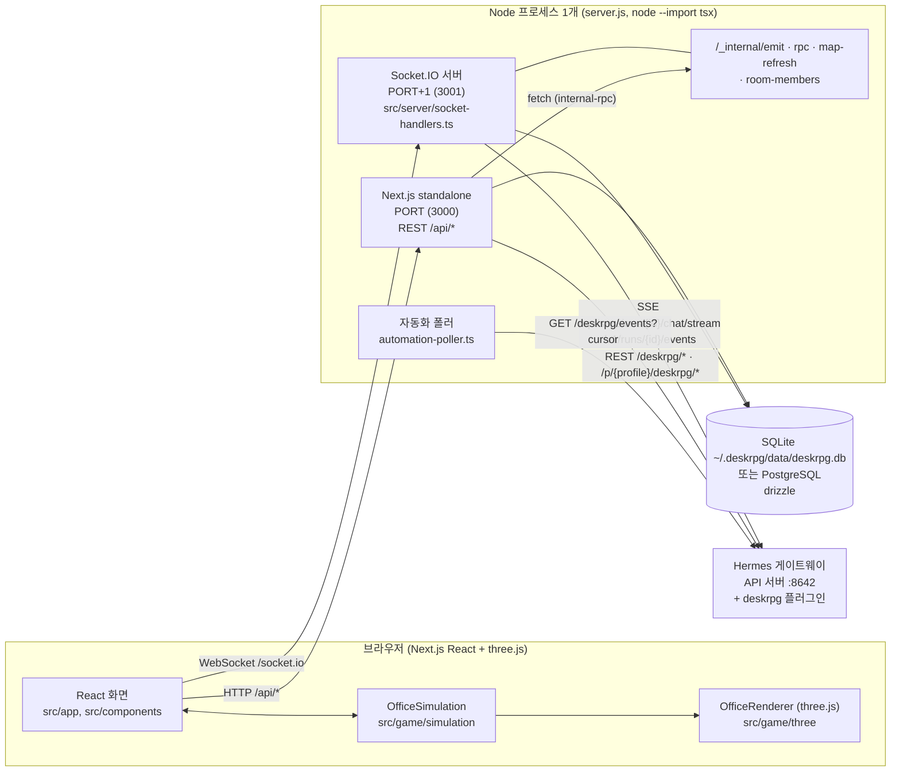
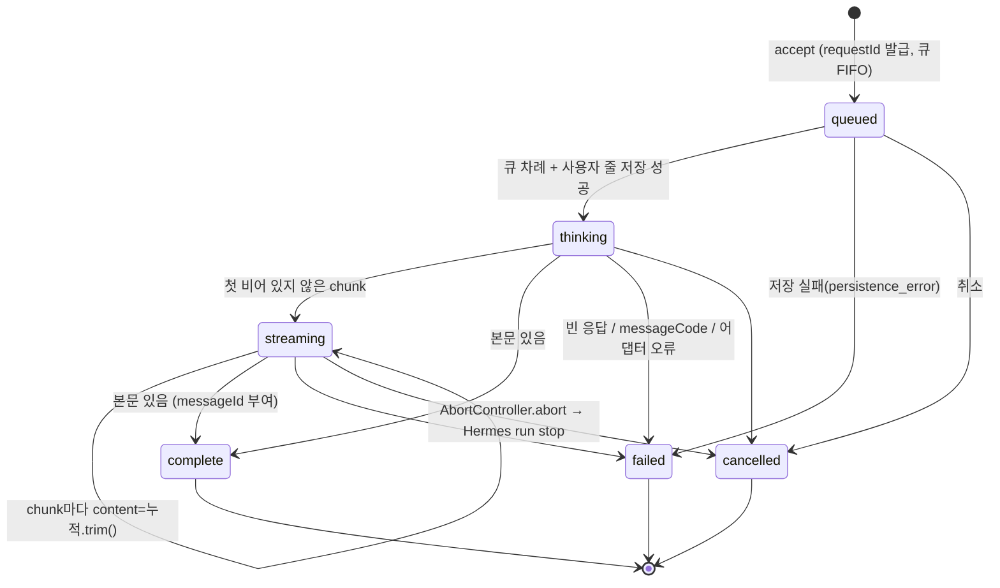

# DeskRPG 리버스 엔지니어링: 기능 목록과 구조 (가격인하 Rust 재구축용)

> 2026-11-14에 더 깊게 다시 뜯었다. 같은 주제는 `office-deep.md`이 우선이다. 이 문서에서 바로잡은 곳은 "(바로잡음 …)"으로 표시했다.

결론: 가격인하에 필요한 핵심(사무실 채팅 · 멘션 · NPC끼리 이어 말하기 · 응답 수명주기 · 승인/알림 · 칸반/cron 이벤트 · NPC 이동 상태)은 서버 쪽이 Socket.IO 이벤트 약 60개, Hermes HTTP 호출 두 갈래(대화 SSE · 플러그인 REST), SQLite 테이블 약 15개로 정리된다. Rust로 옮길 수 있는 크기다. 3D 화면(three.js)은 서버와 "스냅샷 + 이벤트"로만 이어져 있어서 웹에 그대로 남길 수 있다.

| 항목 | 값 |
|---|---|
| 분석 날짜 | 2026-11-13 |
| 출처 | https://github.com/dandacompany/deskrpg |
| commit | 5d80963 (`docs: add installation-specific update instructions`), package version `2026.1019.1` |
| 라이선스 | Sustainable Use License 1.0 (`LICENSE.md`). 아래 "라이선스" 참고 |
| 방법 | 정적 분석만 했다. 실행 · 설치(npm install 포함)는 하지 않았다. 받은 코드는 신뢰할 수 없는 데이터로 다뤘다 |
| 표기 | [관찰] = 코드에서 직접 확인. [추정] = 해석 · 판단. 근거 경로는 저장소 루트 기준 |

### 라이선스 조건 (LICENSE.md)

- 사용 · 수정은 "자기 내부 업무 목적 또는 비상업 · 개인 용도"로만 된다.
- 배포는 "비상업 목적으로 무료일 때만" 된다.
- 라이선스 · 저작권 고지를 바꾸거나 지우거나 가리면 안 된다. 상표 사용은 관련 법을 따른다.
- 서드파티 구성요소는 각자 원래 라이선스를 따른다 (캐릭터 GLB는 CC0 Quaternius 기반: `public/assets/characters/LICENSES.md`, README "What You Can Do").

### 사용한 rea 명령

REA CLI v6.7.0. 모듈별로 한 번에 하나씩 순서대로 돌렸다. 테스트 파일(`*.test.*`)과 `src/lib/i18n/locales/*`는 뺐다. 출력(JSON, 요약, 추출본, 로그)은 저장소 밖 로컬 임시 폴더에 두었다.

```bash
# 공통 형식 (작업 디렉터리 = 소스 루트, 각 그룹의 파일마다 --source-path 반복)
rea analyze-javascript-application . --artifact-format directory \
  --source-path <파일> [--source-path <파일> ...] --max-heap-mb 1024 --format json
```

| 묶음 | 대상 | 파일 수 | 걸린 시간 |
|---|---|---|---|
| 00-root | `server.js`, `dev-server.ts` | 2 | 4초 |
| 01-server | `bin/deskrpg.js`, `src/server/*` (fixtures 제외) | 32 | 10초 |
| 02-db | `src/db/*` | 18 | 6초 |
| 03-lib-hermes | `src/lib/hermes/**` | 58 | 9초 |
| 04-lib-top | `src/lib/*.ts|js` (최상위) | 154 | 14초 |
| 05-lib-sub | `src/lib/*/` (hermes · i18n · fixtures 제외) | 40 | 6초 |
| 06-app-api | `src/app/api/**` | 138 | 9초 |
| 07-app-pages | `src/app/**` (api 제외) | 63 | 9초 |
| 08-game | `src/game/**` (three 제외) | 30 | 7초 |
| 09-game-three | `src/game/three/**` | 82 | 13초 |
| 10/11-components | `src/components/**` 앞 · 뒤 절반 | 110 + 105 | 13초 + 11초 |

12개 묶음(832개 파일) 모두 `parse_failures: 0`으로 끝났다. 메모리 문제 없이 끝났다.

---

## 1. 한눈에 보기



- [관찰] 운영 모드(`server.js`)는 Next.js를 `PORT`(기본 3000)에, Socket.IO를 별도 HTTP 서버 `PORT+1`(3001)에 띄운다. 같은 프로세스다 (`server.js:75-97`, `:259-262`).
- [관찰] 개발 모드(`dev-server.ts`)는 한 포트에 Next와 Socket.IO를 같이 붙인다 (`dev-server.ts:57-92`).
- [관찰] 브라우저는 운영에서 `현재 포트 + 1`로 소켓을 연다. `NEXT_PUBLIC_SOCKET_URL`로 덮어쓸 수 있다 (`src/app/game/GamePageClient.tsx:238-250`). Traefik은 `/socket.io` 경로를 3001로 보낸다 (`docker-compose.yml:35-39`).
- [관찰] REST 라우트가 소켓 쪽 상태를 바꾸려면 `/_internal/emit`(이벤트 발사) · `/_internal/rpc`(첨부) · `/_internal/map-refresh` · `/_internal/room-members`로 HTTP를 보낸다. 인증은 `isInternalRequestAuthorized` (`server.js:111-242`, `src/lib/internal-rpc.ts`, `src/lib/internal-transport.js`).
- [관찰] 운영 컨테이너는 `node --import tsx server.js`로 TS 파일을 실행 중에 변환한다 (`docker-entrypoint.sh`, `bin/deskrpg.js:622-626`). 소켓 서버 코드(`src/server`, `src/lib`, `src/db`, `src/game/three` 일부)를 이미지에 원본 TS 그대로 복사한다 (`Dockerfile:44-81`).
- [관찰] 브라우저는 Hermes를 직접 부르지 않는다. 모든 Hermes 호출은 서버를 거친다 (`src/server/automation-poller.ts:5` "R26").

---

## 2. 기능 목록

"가격인하" 열은 [추정] 판단이다. 기준: 본인 1명 전용, 투자 에이전트 NPC가 자리 · 회의 · 대화하는 모습, 사무실 채팅 · 알림(체결 · 승인 요청 · 이상 상황), 응답 스트리밍 수명주기, 칸반 · cron 표시, 규칙 · 설정 템플릿, 모바일 웹앱. 메신저(텔레그램 등) 연동은 하지 않는다.

| 기능 | 하는 일 | 관련 경로 | 가격인하 [추정] |
|---|---|---|---|
| 게이트웨이 등록 · 테스트 | URL + 소유자 키 저장(암호화), `/v1/models` · `/deskrpg/info`로 점검 | `src/app/api/gateways/**`, `src/lib/gateway-resources.ts`, `src/lib/hermes/gateway-probe.ts`, `plugin-capability.ts` | 가져옴. Hermes에 붙는 유일한 입구 |
| 설정 마법사(로컬 · SSH 발견) | Hermes 설치 확인 · 설치 · 플러그인 준비 · 프로필 가져오기 | `src/lib/hermes/setup/**`, `src/app/api/gateways/setup`, `src/components/gateway/GatewaySetupWizard.tsx` | 나중에. 로컬 1대면 URL 입력으로 충분. SSH · Windows 분기는 크다 |
| 프로필 → NPC 고용 | 게이트웨이의 프로필마다 채널에 NPC 1명 자동 생성 · 자리 배정 | `src/lib/npc-roster.ts`, `src/lib/npc-seating.ts` | 가져옴. 투자 에이전트 = 프로필 = NPC |
| NPC 고용 마법사 | 프로필 생성(복제) → SOUL.md → 외형 → 모델 · 공급자 · 도구셋 · reasoning | `src/components/hermes/NpcHireWizard.tsx`, `hire-wizard-steps.ts`, `src/app/api/gateways/[id]/plugin/profiles/**` | 가져옴. "에이전트 역할 템플릿"의 바탕 |
| SOUL.md 웹 편집 | 플러그인 `identity` GET/PUT (revision 충돌 검사) | `.../profiles/[name]/identity/route.ts`, `src/lib/hermes/plugin-client.ts:272-275` | 가져옴 |
| 모델 · 공급자 · 도구셋 · reasoning | 플러그인 `config` · `catalog` · `toolsets` · `provider-keys` · OAuth | `.../profiles/[name]/{config,catalog,toolsets,...}` | 가져옴(키 입력 · OAuth는 나중에) |
| 1:1 대화(DM) | NPC와 대화, 스트리밍, 기록 DB 저장 | `src/server/socket-handlers.ts:1647-2100`, `dm-response-runtime.ts` | 가져옴 |
| 사무실 방 채팅 · 멘션 | 사무실 방(멘션한 NPC만 답), `@[이름]` 파싱 | `src/server/room-socket.ts`, `room-runtime.ts`, `src/lib/chat-rooms*.ts`, `src/lib/conversation/mention.ts` | 가져옴. 본인 연락 창구 |
| NPC끼리 이어 말하기 | NPC 답에 `@[다른 NPC]`가 있으면 그 NPC가 이어서 답. 예산 6회 | `src/lib/conversation/open-chat-runtime.ts:249-307`, `chat-quota.ts` | 가져옴. "트리거 → 관련 에이전트에게 전달" 그대로 |
| 그룹방 | 초대한 NPC · 사람만 있는 방, 멘션 없으면 전원 답 | `room-socket.ts` create/invite/leave/rename/delete | 나중에. 주제별 방(예: 종목별)으로 쓸 수는 있다 |
| 응답 수명주기 | queued → thinking → streaming → complete / failed / cancelled, 취소 버튼 | `src/server/chat-response-tracker.ts`, `src/lib/chat-response.ts` | 가져옴 |
| 도구 사용 표시 | 지금 쓰는 도구 이름 → 활동 키 | `socket-handlers.ts:681-685` (`npc:activity`) | 가져옴 |
| 도구 실행 승인(실시간) | 위험 명령 · MCP 쓰기를 사람에게 묻기 (once/session/deny) | `src/server/tool-approvals.ts`, `src/lib/tool-approval-types.ts` | 가져옴. "승인 요청" 알림 |
| NPC 질문(선택지) | `deskrpg_ask_user` 도구로 NPC가 선택지 질문 | `src/server/ask-user.ts`, `src/components/npc-question/*` | 가져옴 |
| 카드 실행 전 승인 게이트 | 카드를 blocked로 만들고 approvals 테이블에 기록 | `src/lib/approvals.ts`, `src/app/api/channels/[id]/approvals/**` | 가져옴. 주문 실행 전 승인에 맞다 |
| 주의 수신함(Attention) | 사람이 답해야 할 것만 모은 목록(저장하지 않는 조립 결과이고 읽음 개념이 없으며 머리줄 단추에 숫자 배지가 없다 `src/lib/attention-inbox.ts:1-9` (바로잡음 2026-11-14: office-deep.md 기존 문서에서 바로잡을 곳)) | `src/lib/attention-inbox.ts`, `src/app/api/channels/[id]/attention/**` | 가져옴. 모바일 알림 목록 |
| 방 알림 카드(notice) | 카드 완료 · 막힘 · 검토, 승인 요청, cron 결과, 실행 차단 등 8종 | `src/lib/chat-rooms-policy.ts:34-128`, `src/server/automation-events.ts` | 가져옴. 체결 · 이상 상황 알림 틀 |
| 칸반 보기 · 조작 | Hermes 소유 카드 보기 · 만들기 · 승인 · 재배정 등 | `src/app/api/channels/[id]/kanban/**`, `src/components/kanban/*` | 가져옴(보기 · 상태 알림 우선, 세부 조작은 나중에) |
| cron 관리 | 작업 목록 · 생성 · 일시정지 · 즉시 실행 · 기록 · 블루프린트 | `src/app/api/channels/[id]/cron/**`, `src/components/cron/*` | 가져옴 |
| 자동화 이벤트 폴러 | `/deskrpg/events` 커서 폴링 → 소켓 · 방 알림 · "일하는 중" | `src/server/automation-poller.ts`, `automation-events.ts` | 가져옴 |
| 회의 | 회의 공간으로 모이기, 손들기 폴링, 모드(auto/manual/directed), 회의록 | `src/server/meeting-*.ts`, `src/lib/conversation/channel-runtime.ts`, `floor-controller.ts` | 가져옴(핵심 흐름), 회의록 내보내기는 나중에 |
| NPC 이동(불러오기 · 복귀) | 부르면 걸어와 보고, 끝나면 자리로 | `src/server/npc-coordination.ts`, `src/game/simulation/*` | 가져옴 |
| 3D 사무실 · 5개 환경 | three.js 장면, Tiled 형식 맵 | `src/game/three/*`, `office-environments.ts` | 가져옴(웹에 남김). 환경은 trading 하나부터 |
| 캐릭터 외형 50종 | GLB 한 개당 외형 하나 | `public/assets/characters/office/*.glb`, `office-looks*.ts` | 가져옴(에셋 라이선스 확인 필요) |
| 출퇴근 도시 장면 | 접속 화면의 도시 · 차량 연출 | `commute-*.ts`, `CommuteCityScene.tsx` | 안 가져옴. 꾸밈 |
| 첨부 파일 | 원본 바이트를 Hermes 플러그인에 올리고 대화에 연결 | `src/lib/conversation-attachments/**`, `src/server/conversation-attachment-*.ts` | 나중에. 리포트 PDF 공유에 쓸 수 있다 |
| 산출물(Artifacts) | 플러그인이 만든 결과물 보기 · 버전 | `src/app/api/channels/[id]/artifacts/**` | 나중에 |
| 프로젝트 레지스트리 | 보드 = 프로젝트, 상태 · 리드 NPC | `channel_projects`, `channel_subprojects` | 나중에 |
| 스킬 · MCP 커넥터 관리 | 프로필별 스킬 · MCP 서버 관리 | `.../npcs/[npcId]/skills`, `connectors` | 나중에(Hermes 쪽에서 관리 가능) |
| 스킬 칩(`/skill`) | 메시지에 스킬 이름을 붙여 보내기 | `src/lib/chat/skill-chips.ts`, `src/server/skill-expansion.ts` | 나중에 |
| 링크 미리보기 | URL 카드 | `src/lib/link-preview/*` | 나중에 |
| 계정 · 로그인 | ID/비밀번호, JWT 쿠키 7일 | `src/app/api/auth/**`, `src/lib/jwt.ts` | 가져옴(1명용으로 단순화) |
| 멀티플레이어 | 여러 사람 동시 접속, 1계정 1세션 | `socket-handlers.ts:1419-1431` | 안 가져옴. 본인 1명 |
| 그룹 · 역할 권한(RBAC) | 그룹, 초대, 가입 요청, 권한 키 | `src/lib/rbac/*`, `src/app/api/groups/**` | 안 가져옴. 1명 |
| 게이트웨이 · 공급자 공유 | 다른 사용자에게 공유 | `gateway_shares`, `provider_shares` | 안 가져옴 |
| 맵 편집 브로드캐스트 | 소유자의 오브젝트 추가 · 삭제 실시간 전파 | `socket-handlers.ts:1617-1644` | 안 가져옴 |
| 다국어 4개 | ko/en/ja/zh | `src/lib/i18n/*` | 안 가져옴(한국어만) |
| 피드백 · 설문 전송 | 외부로 설문 · 버그 보고 | `DESKRPG_FEEDBACK_URL`, `src/app/api/app-meta` | 안 가져옴 |
| 메신저(텔레그램 등) 연동 | DeskRPG에 없다 | — | 안 가져옴. 사무실 채팅만 쓴다 |
| Docker · npm 런타임 · Hostinger | 배포 경로 6가지 | `Dockerfile`, `docker/*`, `deploy/*`, `bin/deskrpg.js` | 나중에(Rust 단일 바이너리로 대체) |

README의 "What You Can Do" 9개 항목은 모두 코드에서 찾았다. 차이 하나: README는 "edit their SOUL.md from the web"이라고 하지만, i18n 문구 `npc.personaManagedHint`는 "Hermes 호스트에서 SOUL.md를 직접 편집하세요"라고 한다 (`src/lib/i18n/locales/ko.ts:2230`). [추정] 플러그인에 `identity` 경로가 없거나 읽기 실패일 때 보이는 대체 문구다.

---

## 3. 서버 API

### 3-1. REST 라우트 (`src/app/api/**/route.ts`)

인증은 모두 `token` 쿠키(JWT)다. 가격인하 열은 [추정].

| 경로 | 메서드 | 용도 | 가격인하 |
|---|---|---|---|
| `/api/auth/login` · `logout` · `register` · `status` | POST · POST · POST · GET | 로그인, 쿠키 발급 | 가져옴(register는 1회) |
| `/api/account/password`, `/api/admin/**` | POST, GET/POST | 비밀번호 변경, 관리자 | 나중에 |
| `/api/health`, `/api/app-meta` | GET | 상태, 앱 정보 | 가져옴 / 안 가져옴 |
| `/api/characters`, `/me`, `/[id]` | GET/POST, GET, GET/PATCH/DELETE | 내 캐릭터 | 가져옴 |
| `/api/channels` | GET/POST | 채널(사무실) 목록 · 생성(`environmentId` 필수) | 가져옴 |
| `/api/channels/[id]` | GET/PUT/DELETE | 채널 맵 · 설정 | 가져옴 |
| `/api/channels/[id]/gateway` | GET/PUT/DELETE | 채널에 게이트웨이 연결 → 프로필 고용 / 해제 → NPC 재움 | 가져옴 |
| `/api/channels/[id]/save-position` | POST | 마지막 위치 저장 | 가져옴 |
| `/api/channels/[id]/join`, `/members/**`, `/api/channels/join/[code]` | | 참여 · 멤버 · 초대코드 | 안 가져옴 |
| `/api/channels/test-gateway` | POST | 채널 설정 화면의 연결 테스트 | 가져옴 |
| `/api/channels/[id]/attention` · `/questions/[qid]/answer` | GET · POST | 주의 수신함, NPC 질문 답 | 가져옴 |
| `/api/channels/[id]/approvals/[aid]/decide` | POST | 카드 실행 전 승인 결정 | 가져옴 |
| `/api/channels/[id]/automation/status` | GET | 폴러 상태 | 가져옴 |
| `/api/channels/[id]/report-acks` | GET/POST | 보고 읽음 표시 | 가져옴 |
| `/api/channels/[id]/kanban/board` · `events` · `runs` · `links` · `settings` | GET (links·settings는 쓰기도) | 칸반 보기 | 가져옴 |
| `/api/channels/[id]/kanban/tasks` · `/[taskId]` | POST · GET/PATCH/DELETE | 카드 생성 · 수정 | 가져옴 |
| `/api/channels/[id]/kanban/tasks/[taskId]/{approve,request-changes,unblock,reassign,reclaim,terminate,archive,comments,log,blackboard,specify,decompose,estimate,attachments,runs/[runId]/sources}` | POST/GET | 카드 조작 | 나중에(approve · unblock · log만 먼저) |
| `/api/channels/[id]/kanban/{dispatch,swarm,proposals/[pid]/resolve,attachments}` | POST/GET | 디스패치 · 스웜 · 제안 처리 | 나중에(proposals는 가져옴) |
| `/api/channels/[id]/cron/jobs` · `/[jobId]` | GET/POST · GET/PUT/DELETE | cron 작업 | 가져옴 |
| `/api/channels/[id]/cron/jobs/[jobId]/{pause,resume,run,runs}` | POST · GET | 일시정지 · 재개 · 즉시 실행 · 기록 | 가져옴 |
| `/api/channels/[id]/cron/{blueprints,blueprints/instantiate,delivery-targets}` | GET · POST · GET | 템플릿에서 일정 만들기 | 가져옴 |
| `/api/channels/[id]/npcs/[npcId]/panel-reads` | GET/POST | NPC 패널 읽음 | 나중에 |
| `/api/channels/[id]/npcs/[npcId]/{approval-policy,skills,connectors}/[[...path]]` | GET/PUT/POST/DELETE | 플러그인 프록시 | approval-policy 가져옴, 나머지 나중에 |
| `/api/channels/[id]/{artifacts,conversation-attachments,conversation-files,projects}/**` | 여러 개 | 산출물 · 첨부 · 프로젝트 | 나중에 |
| `/api/gateways` · `/[id]` · `/test` · `/restart` · `/shares` · `/local-discovery` · `/setup` | | 게이트웨이 관리 | 가져옴(shares 제외, setup 나중에) |
| `/api/gateways/[id]/profiles` · `/[profileId]` · `/test` · `/probe` | GET/POST · GET/PATCH/DELETE · POST · POST | 기존 프로필 등록(키 직접 입력) | 가져옴 |
| `/api/gateways/[id]/plugin/profiles` · `/importable` · `/[name]` | GET/POST · GET/POST · DELETE | 플러그인으로 프로필 생성 · 가져오기 · 삭제 | 가져옴 |
| `/api/gateways/[id]/plugin/profiles/[name]/{identity,config,catalog,toolsets,toolsets/[t]/providers,toolsets/[t]/provider,skills,import}` | GET/PUT | NPC 설정 | 가져옴 |
| `/api/gateways/[id]/plugin/profiles/[name]/{provider-keys/[p],oauth/**}` | PUT/DELETE, POST/GET/DELETE | 공급자 키 · OAuth | 나중에 |
| `/api/gateways/[id]/plugin/{update,worker-plugin,worker-propagation}` | POST | 플러그인 갱신 · 워커 전파 | 나중에 |
| `/api/npcs`, `/api/npcs/[id]` | GET, PATCH/PUT | NPC 목록, 자리(positionX/Y · direction) | 가져옴 |
| `/api/meetings` · `/[id]` · `/summarize` · `/register` · `/export` | | 회의록 | 가져옴(export 나중에) |
| `/api/quick-start` | POST | 캐릭터 → 채널 → 자리를 한 번에 (멱등) | 가져옴 |
| `/api/providers/**` | | 공급자 리소스 · CLI 로그인 | 안 가져옴 |
| `/api/groups/**` | | 그룹 · RBAC | 안 가져옴 |
| `/api/link-preview` · `/image` | GET | 링크 미리보기 | 나중에 |

[관찰] 플러그인 프록시 라우트는 실패를 `200 + errorCode`로 돌려준다. Cloudflare가 5xx 본문을 바꿔치기해서다 (`src/app/api/gateways/[id]/plugin/profiles/route.ts` 주석).

### 3-2. 실시간 이벤트 (Socket.IO, path `/socket.io`)

연결: 핸드셰이크 쿠키의 `token`을 `jose.jwtVerify`로 검사, 실패면 끊음 (`socket-handlers.ts:1027-1069`, `:1305-1310`). 연결되면 모든 소켓이 `user:<userId>` 방에 들어가고, 대기 중인 도구 승인 카드를 다시 받는다 (`:1313-1316`). 클라이언트는 `transports: ["websocket"]`, 무한 재연결, 지연 0.5~3초 (`GamePageClient.tsx:689-696`). 버퍼 상한 20MB (`server.js:96`). 소켓은 웹과 다른 포트(`PORT+1`)의 HTTP 서버이고 (`server.js:90-97`), 화면 설정에 `upgrade:false`, `timeout:10000`이 더 있다 (`src/app/game/GamePageClient.tsx:689-698`) (바로잡음 2026-11-14: office-deep.md 기존 문서에서 바로잡을 곳)

Socket.IO 방 이름 [관찰]: `<channelId>`(맵 전체), `room-<roomId>`(채팅방), `user:<userId>`(개인), `meeting-<channelId>`(회의), `dm-response:<userId>:<characterId>:<npcId>`(DM 응답) (`src/server/room-broadcast.ts`, `socket-handlers.ts:235-236`).

**입장 · 이동** (가져옴)

| 방향 | 이벤트 | 페이로드 모양 | 근거 |
|---|---|---|---|
| C→S | `player:join` | `{ mapId(uuid), mapRevision?, characterId?, x, y }` | `socket-handlers.ts:1332-1588` |
| S→C | `player:spawn` | `{ x, y, direction, animation, restored, motion }` | `:1555` |
| S→C | `players:state` | `{ players: PlayerState[] }` | `:1579` |
| S→C(타인) | `player:joined` / `player:left` / `player:moved` | `PlayerState` / `{ id }` / `{ id, x, y, direction, animation }` | `:1586`, `:1437`, `:1606` |
| C→S | `player:move` | `{ x, y, direction, animation, motion? }` | `:1591` |
| S→C | `channel:access-denied` | `{ channelId, action, reason, errorCode }` | `:1349` |
| S→C | `join-error`, `session:kicked`, `map:refresh{channelId,protocolVersion:1,phase:"begin"|"ready"}` | | `:1425`, `:1247` |
| S→C | `npc:working`, `gateway:health` (입장 직후 1회 + 변화 시) | `{ npcId, working, sources:{runningCards,cronRuns} }` | `:1567-1572`, `automation-events.ts:65` |

입장 순서 [관찰]: 형식 검사 → 채널 접근 검사 → 서버가 "내 캐릭터"를 정함(클라이언트가 보낸 이름 · 외형은 믿지 않음) → 같은 계정의 이전 세션 끊기(**입장한** 소켓만 끊는다. 입장하지 않은 같은 사용자의 소켓은 남아 승인 카드를 받는다 `src/server/socket-handlers.ts:359-365, 1421`) (바로잡음 2026-11-14: office-deep.md 기존 문서에서 바로잡을 곳) → 위치 복원(메모리 → `channel_members.last_x/y` → 맵 spawn) → 빈 칸 찾기 → `player:spawn` → NPC 이동 상태 → `npc:working` 스냅샷 → `players:state` → 다른 사람에게 `player:joined`. 방 목록은 서버가 먼저 보내지 않고 클라이언트가 `room:list`를 부른다 (`:1581-1583`).

**1:1 대화(DM)** (가져옴)

| 방향 | 이벤트 | 페이로드 | 근거 |
|---|---|---|---|
| C→S | `npc:chat` | `{ npcId, message(≤500자), sourceMessageId?, skills?, attachmentIds?, ... }` | `:1647` |
| S→C | `npc:response` | `{ npcId, chunk, done, messageCode?, responseRequestId }` | `:674`, `:693` |
| S→C | `npc:response-state` | `{ response: ChatResponse }` | `:254-256` |
| S→C | `npc:response-complete` | `{ npcId, npcName }` | `:1954` |
| S→C | `npc:activity` | `{ npcId, activityKey | null }` | `:684`, `:709` |
| C→S / S→C | `npc:history` | `{ npcId }` / `{ npcId, messages }` + `npc:response-snapshot{ npcId, responses }` | `:1971-2001` |
| C→S | `npc:cancel-response`, `npc:reset-chat`, `npc:dm-threads`, `conversation:read` | | `:2003-2093` |

위 표에서 화면의 표시 경로는 `npc:response`가 아니다. 화면은 요청 id가 있는 `npc:response`를 **무시**하고 `npc:response-state`만 쓴다. `npc:response-complete`는 화면에서 빈 핸들러다. `npc:response`에는 `attachmentRequest`, `errorCode` 칸도 있다 (`src/app/game/GamePageClient.tsx:1173, 1197-1198`) (바로잡음 2026-11-14: office-deep.md 기존 문서에서 바로잡을 곳)

**사무실 · 그룹 방 채팅** (가져옴, 그룹 조작은 나중에)

| 방향 | 이벤트 | 페이로드 | 근거 |
|---|---|---|---|
| C→S | `room:list` | `{ channelId }` → 사무실 방을 없으면 만들고 구독 | `room-socket.ts:237-269` |
| S→C | `room:list-response` | `{ channelId, viewerUserId, rooms: RoomSummary[] }` | `:255` |
| S→C | `room:history` | `{ roomId, messages: RoomMessage[] }` (최근 60줄. 개인 대화 기록 `npc:history`는 **개수 제한 없이 전체**를 보내고, 어느 쪽도 쪽 나누기가 없다 `src/lib/npc-chat-history.ts:153-169` (바로잡음 2026-11-14: office-deep.md 기존 문서에서 바로잡을 곳)) | `:265`, `:49` |
| C→S | `room:open` / `room:close` | `{ roomId }` | `:271-294` |
| S→C | `room:response-snapshot` | `{ roomId, responses }` | `:283` |
| C→S | `room:send` | `{ roomId, message(≤500자), skills?, attachment* }` | `:296-479` |
| S→C | `room:message` | `{ roomId, message: RoomMessage }` (알림 카드 포함) | `room-broadcast.ts:39-44` |
| S→C | `room:response-state` | `{ roomId, response: ChatResponse }` | `room-runtime.ts:270` |
| S→C | `room:npc-aborted` | `{ roomId, npcId, npcName, reason }` | `room-runtime.ts:308`, `:348` |
| S→C | `room:mention-skipped` | `{ roomId, npcId?, npcName?, reason: "backend_failing" | "no_match" }` | `:386`, `:396` |
| S→C | `room:error` | `{ roomId, code }` (`not_joined`이면 클라이언트가 다시 join) | `room-socket.ts:185`, `:321` |
| C→S | `room:cancel-response` | `{ roomId, requestId }` (보낸 사람만 취소 가능) | `room-runtime.ts:405-410` |
| C→S / S→C | `room:create · invite · leave · rename · delete` / `room:created · updated · deleted · activity` | | `room-socket.ts:500-640` |
| S→C(채널) | `npc:come-to-player` | `{ npcId, targetPlayerId(socketId), reason:"map-chat", roomId }` | `room-runtime.ts:330` |

`RoomMessage` = `{ id, roomId, senderKind:"user"|"npc"|"system", senderId, senderName, content, createdAt, notice? }` (`src/lib/chat-rooms-policy.ts:17-27`).

**승인 · 질문** (가져옴)

| 방향 | 이벤트 | 페이로드 | 근거 |
|---|---|---|---|
| S→승인자 | `tool-approval:request` | `ToolApprovalRequest` (아래 4-6) | `src/lib/tool-approval-types.ts` |
| S→승인자 | `tool-approval:resolved` | `{ key, status }` | 같은 곳 |
| S→회의/방 | `tool-approval:pending` | `{ key, npcId, approverName, roomId? }` 또는 `{ key, cleared:true }` | 같은 곳 |
| C→S | `tool-approval:decide` | `{ key, choice: "once"|"session"|"deny" }` + ack | `socket-handlers.ts:2287` |
| S→C | `npc:question` / `npc:questions-closed` / `npc:question-answered` | 질문 카드 | `src/server/ask-user.ts:15-20` |
| C→S | `npc:answer` | 답 + ack | `socket-handlers.ts:2296` |

**자동화(칸반 · cron)** (가져옴): S→채널 `kanban:event`, `cron:event`, `artifact:event`, `npc:working` (`automation-events.ts:52-57`).

**NPC 이동** (가져옴): S→C `npc:motion-state`(채널 스냅샷), `npc:come-to-player`, `npc:returning{npcId}`, `npc:position-sync`, `npc:stop-moving{npcId}`, `npc:added/removed/updated`; C→S `npc:call`, `npc:return-home`, `npc:position-update`, `npc:continuation-update`, `npc:arrived`, `npc:spatial-failed`, `seat:claim`, `seat:release`(모두 응답 있음), `npc:set-active` (`npc:motion-state`와 `npc:come-to-player`는 서버 → 화면 전용이다 `src/server/npc-coordination.ts:635-928`) (바로잡음 2026-11-14: office-deep.md 기존 문서에서 바로잡을 곳), `npc:broadcast-add/update/remove` (`src/server/npc-coordination.ts:452-837`, `socket-handlers.ts:2095-2160`).

**회의** (가져옴): C→S `meeting:availability · join · leave · chat · start-discussion · user-speak · stop · cancel-preparation · set-mode · next-turn · direct-speak · abort-turn`; S→C `meeting:state · participant-joined/left · message · npc-stream · npc-turn-start · poll-status · waiting-input · mode-changed · turn-aborted · mention-skipped · spatial-state · end · error` (`src/server/meeting-socket.ts`, `meeting-discussion.ts:581-1180`).

**맵 편집** (안 가져옴): `map:object-add/remove`, `map:tiles-update`, `map:layout-saved` → `map:object-added/removed`, `map:tiles-updated`.

**REST가 `/_internal/emit`으로 쏘는 이벤트**: `member:kicked`, `channel:deleted` 등 (`server.js:189-220`, `src/app/api/channels/[id]/route.ts:419`).

이벤트 이름 다수(예: `chat:bubble`, `npc:arrived`, `scene-ready`)는 브라우저 내부 `EventBus` 이벤트이고 소켓 이벤트가 아니다 (`src/game/EventBus.ts`).

---

## 4. Hermes 연동 프로토콜

### 4-1. 두 갈래 연결과 키

| 갈래 | 경로 접두사 | 쓰는 키 | 용도 |
|---|---|---|---|
| 대화 (Hermes API 서버 본체) | `{baseUrl}` 또는 `{baseUrl}/p/{profile}` (default 프로필이면 접두사 없음) | 프로필 키 | 세션 · 스트리밍 · run 중지 · 승인 응답 |
| 플러그인 소유자 경로 | `{baseUrl}/deskrpg/*` | 게이트웨이 소유자 키(`API_SERVER_KEY`) | `info`, `profiles` 생성 · 삭제, `kanban/*`, `events`, `artifacts`, `card-proposals`, `conversation-files` |
| 플러그인 프로필 경로 | `{baseUrl}/p/{profile}/deskrpg/*` | 프로필 키 | `identity`, `config`, `catalog`, `toolsets`, `skills`, `oauth`, `provider-keys`, `cron/*`, `approval-policy`, `ask-user`, `questions`, `mcp/*` |

- [관찰] 헤더: `Authorization: Bearer <키>`, 대화에는 `X-Hermes-Session-Key: <sessionKey>` (`src/lib/hermes/hermes-client.ts:65-92`). 플러그인 쓰기 요청에는 `x-deskrpg-actor: <userId>` (`plugin-client.ts:562`).
- [관찰] 소유자 키와 프로필 키를 섞지 않도록 클라이언트를 셋으로 나눴다: `createPluginClient`, `createOwnerPluginClient`, `createProfilePluginClient` (`plugin-client.ts:231-709`). 프로필 키를 소유자 경로에 쓰면 `plugin_unauthorized` (README "Hermes Connection").
- [관찰] 재시도: 429 등 재시도 가능한 상태면 `Retry-After`를 따라 기다렸다 다시 보냄 (`hermes-client.ts:80-119`, `retry-policy.ts`). 플러그인 호출 기본 타임아웃 15초 (`plugin-client.ts:105`).
- [관찰] 키는 DB에 AES-256-GCM으로 암호화 저장, 형식 `v1:<iv>:<tag>:<암호문>`(base64url). 키 재료는 `INTERNAL_RPC_SECRET` 또는 `JWT_SECRET` (`src/lib/gateway-resources.ts:50-80`). JWT_SECRET을 바꾸면 저장된 키를 못 푼다 [추정].

### 4-2. 등록 · 발견

1. **URL 등록** (`/api/gateways` POST): 등록은 확인 없이 저장하고 실패한 키도 남는다 (`D:src/app/api/gateways/route.ts:28-48`) (바로잡음 2026-11-14: conformance.md 조사 문서에서 바로잡을 곳) 표시 이름 · URL · 소유자 키 저장 → 테스트에서 `/v1/models`의 content-type이 JSON인지로 API 서버(8642/8643)와 대시보드(9119)를 구분 (`gateway-probe.ts:14-17`, `:55`) → `GET /deskrpg/info`로 플러그인 상태(`plugin_ready | plugin_unauthorized | plugin_absent | unknown`) 판정, 결과를 `gateway_resources.plugin_status/version/info_json`에 캐시 (`plugin-capability.ts:27`, `:506-520`, `src/db/schema-sqlite.ts:102-110`).
2. **프로필 등록**: 기존 프로필은 이름 + 프로필 키 직접 입력(`/api/gateways/[id]/profiles`), 또는 플러그인으로 새로 생성(아래 4-4).
3. **채널에 연결** (`/api/channels/[id]/gateway` PUT): `channel_gateway_bindings` 1행(채널당 1개) → 이전 게이트웨이 NPC 재우기(`sleepChannelNpcs`) → 새 게이트웨이의 모든 프로필 고용(`hireGatewayProfilesIntoChannel`) (`route.ts:185-191`).
4. **로컬 발견** (`DESKRPG_LOCAL_DISCOVERY_ENABLED`, 루프백 URL일 때만): 호스트의 `~/.hermes/profiles`를 읽어 프로필 · 키를 가져옴 (`src/lib/hermes/local-discovery*.ts`, `ENVIRONMENT.md`).
5. **설정 마법사** (`DESKRPG_HOST_SETUP_ENABLED`, system_admin): 모드 `local | ssh | url` (`setup/types.ts`). 작업 단계 순서 [관찰] (`setup/service.ts:317-549`):
   `installing_hermes`(선택) → `inspecting` → (prepareHost 안의 플러그인 설치 · 활성화 · 포트 · 시간대 단계) → `verifying_gateway`(`plugin_ready` 아니면 실패) → `checking_model` → `saving_gateway` → `importing_profiles` → `applying_worker_plugin`(선택).
   작업은 서버 메모리의 job(`running | succeeded | failed | cancelled`, `steps`, `completed`, `warnings`)이고 실패 지점부터 이어하기(`resumeFrom`)가 된다. 호스트별 잠금. SSH는 터널을 만들어 그 주소로 등록한다.

### 4-3. 플러그인 설치

- [관찰] kanban · cron · 이벤트 스트림은 `deskrpg-hermes-plugin`이 있어야 된다. 대화는 없어도 된다 (README "Hermes Connection" 4단계).
- 설치: `hermes plugins install <repo> --ref <commit>` → `hermes plugins enable deskrpg` → 게이트웨이 재시작. enable을 빼면 모든 플러그인 경로가 404. 업그레이드는 disable → install --force → enable → restart. 루트(default) Hermes 홈에서 해야 한다 (README "Upgrading an installed plugin").
- 이 버전은 플러그인 0.32.0을 요구한다 (README 버전 줄). 화면에 설치 명령 한 줄을 보여 준다 (`src/lib/hermes/plugin-install-command.ts`).
- `/deskrpg/info` 응답 = `{ plugin:"deskrpg", version, capabilities[], timezone, kanban:{dispatcher_present, attachments, review_hooks?, worker_launch?}, dashboard_url?, worker_plugin?, capabilities_fingerprint? }` (`src/lib/hermes/deskrpg-plugin-types.ts:26-56`). 이벤트 페이지가 fingerprint 변화를 알리면 캐시를 다시 읽는다 (`automation-poller.ts`).

### 4-4. 프로필 ↔ NPC 매핑

- [관찰] NPC 1명 = 채널 × Hermes 프로필 1개. `npcs(channel_id, hermes_profile_id)` 유니크 (`schema-sqlite.ts:479-509`).
- [관찰] 이름 · 외형의 정본은 프로필 쪽(`hermes_profiles.display_name/appearance`). `npcs.name/appearance`는 남아 있지만 안 쓴다 (`schema-sqlite.ts:158`, `socket-handlers.ts:535-537`).
- [관찰] 프로필이 등록되면 그 게이트웨이가 연결된 모든 채널에 자동 "출근"(행 생성 또는 `active=true`), 빈 책상에 자동 배치. 비활성(`active=false`)은 자리를 기억한 채 맵에서 빠진다 (`src/lib/npc-roster.ts`, `npc-seating.ts`, `npc-roster-socket.ts`).
- 고용 마법사 단계: `profile → identity → appearance → config` (`src/components/hermes/hire-wizard-steps.ts:11`).
  - profile: `POST /deskrpg/profiles { name, cloneFrom?:"default", cloneKeys? }` (소유자 키, system_admin만) → 응답의 `apiKey`를 **즉시** 암호화 저장(다시 읽을 방법이 없음) → `hermes_profiles.provisioned_by_deskrpg=true` → 연결된 채널에 출근 (`plugin-client.ts:246-260`, `.../plugin/profiles/route.ts` 주석).
  - identity: SOUL.md (4-5).
  - config: `PUT /p/{name}/deskrpg/config { model, provider, toolsets, reasoning_effort }`. 고를 수 있는 값은 `GET catalog` = `{ providers[{id,name,authenticated,authType,envVars,cliCommand}], models{provider:[...]}, reasoningEfforts[] }` (`plugin-client-types.ts:278-288`, `NpcHireWizard.test.tsx:60-117`). 도구셋은 `GET toolsets` = `{ platform, toolsets[] }`, 도구별 공급자 `PUT toolsets/{t}/provider { provider, env }`.
- [관찰] 이 설정들은 DeskRPG DB에 복사하지 않는다. Hermes 프로필 파일이 정본이고 DeskRPG는 프록시만 한다. DeskRPG DB에 남는 것은 `npcs.agent_config`(JSON: `meetingProtocol`, `locale`, `passPolicy`, `sessionKeyPrefix`)와 `npcs.adapter_config`뿐 (`socket-handlers.ts:530-563`).

### 4-5. SOUL.md 편집과 지시문 층

- [관찰] `GET /p/{name}/deskrpg/identity` → `{ body, isDefaultTemplate, revision, unreadable? }`; `PUT` 본문 `{ body, ifRevision }` → `{ revision }`. 낙관적 잠금 (`plugin-client-types.ts:45-50`, `:334-339`).
- [관찰] 쓰기는 게이트웨이 소유자만, 공유 사용자는 읽기만(403). 프로필 키로만 호출하고 기본 키로 대체하지 않는다 (`.../identity/route.ts` 주석).
- [관찰] 대화마다 붙는 것은 세 층이다 (`src/lib/npc-prompt-layers.ts`, `src/lib/report-format.ts`, `src/lib/user-context.ts`, `socket-handlers.ts:618-625`):
  1. 정체성: SOUL.md (Hermes가 자기 시스템 프롬프트에 넣음. DeskRPG는 손대지 않음).
  2. `instructions`(= Hermes `system_message`): 회의 규칙(`meetingProtocol`) + 카드 등록 확인 층 + DM이면 질문 도구 안내(`ASK_USER_INSTRUCTIONS`). Hermes는 이것을 기존 시스템 프롬프트 **뒤에 덧붙인다**.
  3. 메시지 앞머리: "누구와 말하는지"(사용자 이름 · 소개) → "보고 형식 규칙"(마크다운 · 이미지) → 실제 본문.
- [추정] 가격인하의 "에이전트 역할 템플릿"은 1층(SOUL.md) + config(모델 · 도구셋)로, "투자 규칙 템플릿"은 2층(`instructions` 층 하나 추가, 예: 리스크 한도 · 주문 전 승인 규칙)과 3층(보고 형식)으로 옮기면 된다. 층 구조(태그로 경계 구분)를 그대로 쓰면 규칙과 정체성이 서로 덮어쓰지 않는다.

### 4-6. 대화 호출과 응답 스트리밍 수명주기

**Hermes 호출** [관찰] (`hermes-client.ts`, `src/lib/adapters/hermes-adapter.ts`, `src/lib/hermes/sse.ts`):

| 경우 | 요청 | 스트림 이벤트 |
|---|---|---|
| 세션 만들기 | `POST /api/sessions { title: sessionKey }` → 응답 `session.id`(중첩) 또는 `session_id`/`id`. 제목 중복(`invalid_title`)이면 `GET /api/sessions`에서 같은 제목을 찾아 이어 씀 | — |
| 1:1 · 방 대화 | `POST /api/sessions/{id}/chat/stream { message, system_message? }` | `event:` 줄 있음. `assistant.delta{delta}`, `assistant.completed{content, completed}`, `tool.started/progress{tool_name}`, `approval.request`, `run.failed`, `error` |
| 회의(다자) | `POST /v1/runs { input, session_id?, conversation_history?, instructions? }` → `GET /v1/runs/{id}/events` | `event:` 줄 없음, 이름은 data JSON의 `event`. `message.delta`, `run.completed{output}` |
| 중지 · 조향 · 승인 | `POST /v1/runs/{id}/stop`, `/steer {text}`, `/approval {choice, request_id?}` | — |

- 최종 본문: completed 이벤트의 `content` > `run.completed.output` > 누적 delta 순. `run.failed`/`error`는 HTTP 200이어도 `HermesError("run_failed")` (`hermes-client.ts:181-280`).
- 종료 이벤트를 받으면 reader를 기다리지 않고 cancel한다. 회의 경로는 서버가 연결을 안 닫아서 기다리면 영원히 멈춘다 (`hermes-client.ts:258-268`).
- 세션 키 [관찰]: DM `{prefix}-dm-{userId}`, 방 `room-{roomId}` 범위, 작업 `{prefix}-task-{taskId}`, 회의 `<접두 또는 npcId>-meeting-meet-<ms>`(손들기는 뒤에 `-poll`, 요약은 따로 `src/server/meeting-discussion.ts:295-350, 692-698`) (바로잡음 2026-11-14: office-deep.md 기존 문서에서 바로잡을 곳). prefix 기본값은 npcId. 세션 ID는 `npc_sessions(npc_id, user_id, context_key)`에 저장해 재시작 뒤에도 이어간다 (`hermes-dispatch.ts:30-107`). 어댑터 인스턴스는 대화마다 새로 만든다(공유 금지) (`:109-126`).

**수명주기 상태 기계** [관찰] (`src/lib/chat-response.ts`, `src/server/chat-response-tracker.ts`, `dm-response-runtime.ts`):



- `ChatResponse = { requestId, sourceMessageId, npcId, npcName, status, content(누적, 추론 제외), updatedAt(단조 증가), messageId?, error? }`. 상태가 바뀔 때마다 전체 객체를 보낸다(DM: `npc:response-state`, 방: `room:response-state`). 종료 상태가 되면 더 바뀌지 않는다.
- 트래커는 종료된 응답을 최근 100개만 남긴다. DM 트래커는 범위(사용자 × 캐릭터 × NPC)마다 하나, 최대 256개, 넘치면 쉬고 있는 것만 지운다 (`socket-handlers.ts:237-258`).
- 큐: 개인 대화만 NPC × 사용자마다 FIFO이고 방은 방 안의 NPC별 큐다 (`src/lib/conversation/open-chat-runtime.ts:102, 286`) (바로잡음 2026-11-14: office-deep.md 기존 문서에서 바로잡을 곳) 대기 최대 8 (`SessionQueue(8)`, `src/lib/conversation/request-queue.ts`). 넘치면 `wait_before_sending`. 같은 소켓 연속 전송 간격 2초 (`CHAT_COOLDOWN_MS`, `socket-handlers.ts:303`).
- 타임아웃: 무응답 180초, 전체 600초. 승인 대기 중에는 무응답 타이머를 멈춘다 (`dm-response-runtime.ts:102-170`, `room-runtime.ts:285`).
- 순서 규칙: DB에 저장한 메시지 ID를 `complete` 상태에 먼저 실어 보낸 다음 `room:message`를 보낸다. 화면이 초안을 저장본으로 바꾸게 하려는 것 (`room-runtime.ts:366-372`).
- 도구 활동: `tool.started/progress`의 도구 이름만 `npc:activity{activityKey}`로, 끝나면 `null`. delta 본문은 활동 경로로 보내지 않는다(답이 두 번 나오던 버그 때문) (`socket-handlers.ts:676-685`, `:707-710`).
- 재연결: 끊기면 화면의 임시 응답을 지우고 방을 다시 연다. 다시 열면 `room:response-snapshot` / `npc:response-snapshot`으로 진행 중인 응답을 받는다 (`GamePageClient.tsx:725-740`, `room-socket.ts:283`, `socket-handlers.ts:1997-2000`).

### 4-7. 도구 승인 · 질문 · 실행 차단

- **실시간 도구 승인** [관찰] (`src/server/tool-approvals.ts`, `src/lib/tool-approval-types.ts`): Hermes 스트림의 `approval.request` → 승인자(일을 시킨 사람, 방이면 그 턴을 부른 사람, 없으면 방 만든 사람)의 모든 탭에 `tool-approval:request`. 카드 키 `${runId}:${requestId ?? "0"}`. 선택지 `once | session | deny` (`always`는 제공 · 수락 안 함). 만료 시각 = Hermes `approvals.timeout`(플러그인으로 읽음, 기본 300초). 같은 대화 · 같은 명령은 1시간 안에서 한 카드로 묶고 반복 횟수를 보인다. 결정은 `POST /v1/runs/{id}/approval`. 대기 목록은 메모리에만 있고, 재시작되면 Hermes가 자기 타임아웃으로 거부한다. 승인자의 언어로 한 줄 요약을 NPC로 만들어 붙인다 (`tool-approval-summary.ts`).
- **NPC 질문** [관찰] (`src/server/ask-user.ts`): run 시작 시 세션을 플러그인에 등록(`POST /p/{p}/deskrpg/ask-user/sessions`) → `deskrpg_ask_user` 도구가 시작되면 질문을 최대 20회 × 300ms 폴링(`GET questions?session_id`) → `npc:question`을 그 사용자에게만 → 답은 `POST questions/{id}/answer`로 플러그인에 바로 → run이 끝나면 열린 질문 닫기(`npc:questions-closed`).
- **실행 차단(approval.blocked)** [관찰]: 사람이 없는 cron · 칸반 실행이 승인 정책에 걸리면 플러그인 이벤트 `approval.blocked` → 시킨 사람만 보는 비공개 방 알림(`audience`) → 알림에서 "허용 목록에 추가" (`POST /p/{p}/deskrpg/approval-policy/allowlist`) (`chat-rooms-policy.ts:94-117`, `plugin-client.ts:678-687`).
- **카드 실행 전 승인** [관찰] (`src/lib/approvals.ts`): 실제로 부르는 곳은 **회의 후속 작업 등록 하나**다. 판에서 직접 만든 카드와 받아들인 제안은 승인을 타지 않는다 (`src/lib/approvals.ts:29`, `src/app/api/meetings/[id]/register/route.ts:69`) (바로잡음 2026-11-14: office-deep.md 기존 문서에서 바로잡을 곳) 회의 후속 작업 등록에서 만든 카드는 `initial_status="blocked"`로 만들고 `approvals`(status `pending`) + `approval_targets`(카드별 결정)를 기록 → 방 알림 `approval_requested` → 결정 시 `unblock`. cron · swarm · 워커가 만든 카드는 이 길을 안 거친다.

### 4-8. 칸반 · cron 연동

- **이벤트 폴러** [관찰] (`src/server/automation-poller.ts`): 채널의 **모든 보드**를 보드별 커서로 읽는다: `GET /deskrpg/events?board=&cursor=&limit=`. 예약 일 이벤트는 수신 보드에서만 받는다 (`src/server/automation-poller.ts:329-410`) (바로잡음 2026-11-14: office-deep.md 기존 문서에서 바로잡을 곳) 접속 소켓이 있으면 5초, 없으면 60초(`AUTOMATION_POLL_ACTIVE_MS/IDLE_MS`). 한 번에 최대 200개 × 10페이지. 커서는 `channel_kanban_boards.event_cursor`. 커서가 없거나 `unknown_cursor`(400)면 과거를 재생하지 않고 "지금" 커서만 받는다. 실패는 `last_error`에 남기고 던지지 않는다. 화면 조작 직후 `pollNow`. 모든 타이머 `unref()`.
- **이벤트 종류**: `task.created · status · comment · run.started · run.finished · deleted · link · updated`, `cron.run.started · run.finished`, `artifact.created · versioned · deleted`, `card_proposal.created`, `approval.blocked` (`deskrpg-plugin-types.ts:490-506`). 이벤트 = `{ id, ts(epoch초), kind, board?, task_id?, profile?, job_id?, run_id?, payload }`.
- **처리 3가지** [관찰] (`src/server/automation-events.ts:1-25`): (a) `task.*`→`kanban:event`, `cron.*`→`cron:event`, `artifact.*`→`artifact:event` 채널 방송(이 채널 NPC의 프로필 · 이 채널 보드만), (b) NPC에 진행 중 카드 run 또는 cron run이 하나라도 있으면 "일하는 중"(`npc:working`, 값이 바뀔 때만. 빼는 조건에 "카드 상태가 `running`이 아니게 됨"과 카드 삭제가 있고, 다시 시작한 뒤 판에서 복원한다 `src/server/automation-events.ts:396-418` (바로잡음 2026-11-14: office-deep.md 기존 문서에서 바로잡을 곳)), (c) 방 알림: 카드 blocked 진입(대기 중 승인의 대상인 카드의 막힘은 알리지 않는다), 검토로 감(`card_review`), 최상위 카드 done(승인 묶음에 들었던 카드의 끝남은 부모가 있어도 알린다) (`src/server/automation-events.ts:493-525`) (바로잡음 2026-11-14: office-deep.md 기존 문서에서 바로잡을 곳), 이 채널에서 만든 cron 결과(본문 최대 2000자), 카드 제안, 실행 차단(비공개). 같은 이벤트 ID는 채널당 최근 1000개로 중복 제거.
- **칸반 카드 상태**: `triage, todo, scheduled, ready, running, blocked, review, done, archived` (`deskrpg-plugin-types.ts:125-135`). 채널당 보드 여러 개, 이벤트 운반 보드는 하나(`is_event_carrier` 부분 유니크 인덱스).
- **cron** [관찰] (`plugin-client.ts:536-557`, `deskrpg-plugin-types.ts:620-717`): 프로필 키로 `/p/{p}/deskrpg/cron/jobs`. 작업 = `{ id, name, prompt, schedule, schedule_display, repeat, enabled, state, next_run_at, last_run_at, last_status, last_error, deliver, skills[], model, provider, created_at }`. 생성 본문 `{ schedule, prompt? | script?, name, deliver?, model?, provider?, skills?, paused?, repeat? }`. 기록 `{ id, started_at, ended_at, status, summary, result_text }`. DeskRPG DB에는 "이 채널에서 만든 작업"만 `cron_job_origins(gateway, profile, job_id, channel)`로 남긴다. 결과 알림은 만든 채널의 사무실 방으로 간다.
- **cron 블루프린트(템플릿)** [관찰]: `GET /p/{p}/deskrpg/cron/blueprints` → `AutomationBlueprint = { key, title, description, category, tags[], fields: BlueprintField[], command, appUrl }`, `BlueprintField = { name, type: "enum"|"text"|"time"|"weekdays", label, default?, options?, optional?, strict?, help? }`. 만들기 `POST blueprints/instantiate { blueprint: key, values: {필드: 값} }`. 블루프린트 정의는 **플러그인(Hermes 쪽)** 에 있고 DeskRPG에는 없다.
- [추정] 가격인하의 "장 시작 전 브리핑", "체결 확인", "일일 손익 리포트" 같은 일정은 이 블루프린트 형식(필드 타입 4가지 + 명령 템플릿)으로 정의하면 된다. Hermes 플러그인 대신 Rust 서버가 블루프린트 목록을 갖고, instantiate 결과만 Hermes cron에 `CreateCronJobBody`로 넣는 구조가 단순하다.

---

## 5. 데이터 저장

### 5-1. 데이터베이스

- [관찰] drizzle ORM. PostgreSQL 스키마 `src/db/schema.ts`, SQLite 스키마 `src/db/schema-sqlite.ts`(같은 테이블). `DB_TYPE` · `DATABASE_URL` · `SQLITE_PATH`로 고른다 (`src/db/index.ts:54-59`). 마이그레이션 `drizzle/`, 시작 시 `migrate.js`. SQLite 추가 보정 스크립트 `src/db/sqlite-*.js`.
- SQLite 기본 위치: `~/.deskrpg/data/deskrpg.db` (npm 런타임), 저장소 실행이면 `data/deskrpg.db` (README).
- 시각은 SQLite에서 ISO 문자열 텍스트, id는 UUID 텍스트, JSON은 텍스트 칸.

| 테이블 | 주요 필드 | 가격인하 [추정] |
|---|---|---|
| `users` | id, login_id(유니크), nickname, password_hash(bcrypt), system_role, must_change_password | 가져옴(1행) |
| `characters` | user_id, name, appearance(JSON), bio | 가져옴 |
| `channels` | name, owner_id, map_data(Tiled JSON), map_config, gateway_config, motion_config, is_public, invite_code, max_players, password, group_id | 가져옴(공개 · 초대 · 그룹 칸은 뺌) |
| `channel_members` | channel_id, user_id, role, last_x, last_y | 가져옴(마지막 위치만) |
| `gateway_resources` | owner_user_id, display_name, base_url, token_encrypted, last_validation_*, plugin_status, plugin_version, plugin_info_json, local_discovery_* | 가져옴 |
| `hermes_profiles` | gateway_id, profile_name(게이트웨이 안 유니크), token_encrypted, display_name, description, appearance, provisioned_by_deskrpg | 가져옴 |
| `channel_gateway_bindings` | channel_id(유니크), gateway_id, bound_by_user_id | 가져옴 |
| `npcs` | channel_id, hermes_profile_id, position_x/y, direction, adapter_type(기본 hermes), adapter_config, agent_config(JSON), active | 가져옴 |
| `npc_sessions` | npc_id, user_id, adapter_type, session_type(dm/task/meeting), session_ref, context_key, last_summary | 가져옴 |
| `chat_messages` | character_id, npc_id, role(player/npc), content, created_at | 가져옴 |
| `chat_rooms` | channel_id, kind(office/group), name, reply_policy(mention/members), created_by, last_message_at. 채널당 office 1개(부분 유니크) | 가져옴 |
| `chat_room_members` | room_id, member_kind(user/npc), member_id | 나중에(그룹방) |
| `chat_room_messages` | room_id, sender_kind(user/npc/system), sender_id, sender_name, content, notice_json | 가져옴 |
| `meeting_minutes` | channel_id, topic, transcript, participants, total_turns, duration_seconds, key_topics, conclusions, outcome_json, summary_status | 가져옴 |
| `channel_kanban_boards` | channel_id, gateway_id, board_slug, is_event_carrier, event_cursor, event_carrier_handoff_json, last_polled_at, last_error | 가져옴 |
| `cron_job_origins` | gateway_id, profile_name, job_id, channel_id, created_by_user_id | 가져옴 |
| `approvals` / `approval_targets` | channel_id, type, status, requested_by(프로필명), title, source_json, payload_json, decided_by/at, decision_note / approval_id, task_id, decision | 가져옴 |
| `conversation_reads` / `npc_panel_reads` | user_id, kind(room/dm/report) · target_id · read_at · seen_ids / npc_id · tab(cron/cards) | 가져옴(읽음 배지) |
| `conversation_attachment_*` (3개) | 첨부 문맥 · 링크(plugin_file_id, sha256, status) · 요청(lease_state_json) | 나중에 |
| `channel_projects` / `channel_subprojects` | board_link_id, status, lead_npc_id, target_date, color, icon, pause_reason, origin_meeting_id | 나중에 |
| `groups`, `group_members`, `group_invites`, `group_join_requests`, `group_permissions`, `user_permission_overrides` | RBAC | 안 가져옴 |
| `gateway_shares`, `provider_resources`, `provider_shares` | 공유 · 공급자 리소스 | 안 가져옴 |

### 5-2. 파일 저장

- [관찰] 런타임 홈 `~/.deskrpg/`(또는 `DESKRPG_HOME`): `.env.local`, `data/deskrpg.db`, `uploads/`, `logs/deskrpg.log` (README, `src/lib/runtime-paths.ts:40-125`). Docker는 `DESKRPG_HOME=/app/data`, `DESKRPG_DATA_DIR=/var/deskrpg`(어댑터 작업공간) (`Dockerfile` 끝).
- [관찰] 첨부 원본 바이트는 DeskRPG 디스크가 아니라 Hermes 플러그인 `POST /deskrpg/conversation-files`(multipart)에 올리고, DB에는 `plugin_file_id`와 메타만 둔다. 파일당 5MB (`plugin-client.ts:712-744`, `src/lib/conversation-attachments/policy.ts`). `uploads/` 폴더는 만들기만 하고 `src` 안에서 쓰는 곳을 찾지 못했다.
- [관찰] 맵 백업 `DESKRPG_MAP_BACKUP_DIR` (`src/lib/channel-map-backup.ts:12`).
- [관찰] 설정 마법사의 SSH 호스트 · 키 · 작업 상태는 `DESKRPG_HOME` 아래 파일 (`src/lib/hermes/setup/store.ts`, `ssh-hosts.ts:417`).

### 5-3. 설정의 기본값과 저장 위치 (템플릿화 관점)

| 설정 | 저장 위치 | 기본값 · 근거 |
|---|---|---|
| NPC 정체성(SOUL.md) | Hermes 프로필 파일 | 플러그인 기본 템플릿(`isDefaultTemplate`) |
| 모델 · 공급자 · 도구셋 · reasoning_effort | Hermes 프로필 config | 생성 시 `cloneFrom:"default"`면 default 프로필 값 복제 |
| 회의 규칙 · 언어 · pass 정책 | `npcs.agent_config` JSON | 없으면 `getDefaultMeetingProtocol(locale)` (`socket-handlers.ts:505-523`) |
| 보고 형식 규칙 | 코드 상수 | `src/lib/report-format.ts` (모든 대화 경로 공통) |
| 방 응답 정책 | `chat_rooms.reply_policy` | office=`mention`, 그룹=`members` (`src/lib/chat-rooms.ts:87`, `:330`) |
| NPC 걷는 속도 | `channels.motion_config` | 비면 기본 (`src/lib/npc-motion-config.ts`) |
| 맵 · 환경 | `channels.map_data`(Tiled JSON 복사본) | 생성 시 `buildOfficeEnvironment(environmentId)` |
| 승인 정책(모드 · 허용 목록) | Hermes 프로필(플러그인) | `/p/{p}/deskrpg/approval-policy` |
| 승인 타임아웃 | Hermes `approvals.timeout` | 못 읽으면 300초 |
| 폴링 주기 등 | 환경 변수 | 8장 표 |

[추정] 가격인하에서는 이 표 전체를 "템플릿 파일 한 묶음"으로 바꿀 수 있다: `roles/<역할>.toml`(SOUL 본문 · 모델 · 도구셋 · 자리 · 외형) + `rules/<규칙>.md`(instructions 층) + `schedules/<일정>.toml`(블루프린트 필드 + 값) + `office.toml`(환경 · 방 정책). Rust 서버가 시작할 때 읽어서 Hermes에 반영(identity PUT · config PUT · cron 생성)하는 "적용" 명령을 두면 된다.

---

## 6. 사무실 · 회의 모델

- **채널 = 사무실 하나.** 맵(Tiled JSON), 게이트웨이 1개, NPC 여러 명, 방 여러 개 (README "How DeskRPG Works").
- **방** [관찰]: `office`(채널당 1개, 처음 `room:list` 때 채널 소유자 이름으로 생성, 모든 소켓이 듣고 있음)와 `group`(초대 멤버만) (`room-socket.ts:242-254`). 응답 대상 결정 (`chat-rooms-policy.ts:181-189`):
  - office(`mention`): 멘션한 멤버 NPC만.
  - group(`members`): 멘션이 있으면 그 NPC, 없으면 멤버 NPC 전원.
- **멘션 형식** [관찰] (`src/lib/conversation/mention.ts`): `@[이름]`(이름 안의 `\`, `[`, `]`는 백슬래시로 이스케이프). 자유 문장 파싱은 하지 않는다(한국어 조사 · 부분 일치 문제). 회의에서는 첫 줄 `TO: 이름`도 인정. 자기 멘션은 무시.
- **NPC끼리 이어 말하기** [관찰] (`open-chat-runtime.ts:207-307`, `chat-quota.ts`): 사람이 보낸 멘션 대상에게 동시에 턴을 준다(NPC별 큐). NPC 답에 다른 NPC 멘션이 있으면 그 NPC에게 이어서 턴. 사람이 말하면 예산이 6으로 다시 찬다. NPC→NPC 한 번마다 1 소모. 이미 말하는 중인 NPC는 연쇄로 다시 부르지 않음. 큐가 차면 `room:npc-aborted(queue_full)`, 백엔드가 계속 실패한 NPC는 `room:mention-skipped(backend_failing)`. 이어진 턴의 언어 · 승인자는 처음 사람을 그대로 따른다.
- **턴 시작 = 걸어오기** [관찰]: 방 턴이 시작되면 그 NPC가 부른 사람에게 걸어온다(`npc:come-to-player`). 걷기와 말하기는 동시에 시작한다 (`room-runtime.ts:321-336`).
- **회의** [관찰] (`meeting-discussion.ts`, `channel-runtime.ts`, `floor-controller.ts`, `meeting-spatial-coordinator.ts`):
  - 시작 `meeting:start-discussion { channelId, topic, settings{maxTotalTurns?, initialMode?}, selectedNpcIds? }`. 채널당 한 회의.
  - 공간: 참가 NPC를 맵의 회의 공간 자리로 모으고(`meeting:spatial-state`), 모두 도착해야 시작(120초 한도, 자리가 없으면 서서 참가, **후보 한 명이라도 어댑터를 못 만들면 열지 않는다** `src/server/meeting-discussion.ts:974-981`) (바로잡음 2026-11-14: office-deep.md 기존 문서에서 바로잡을 곳). 사람도 회의 공간 안에 있어야 참가(`not_in_meeting_space`).
  - 모드 `auto | manual | directed`. 발언권: 사람이 준 턴은 예산을 안 쓰고, 멘션으로 넘긴 턴은 예산을 지킨다. 다음 발언자는 "손들기 폴링"으로 정한다: 각 NPC에게 `SPEAK:` / `PASS` 형식으로 묻고(병렬), 연결 실패는 PASS와 따로 센다. 끝 이유는 5가지이고 전원 PASS는 **연속 2바퀴**, 아무에게도 닿지 못한 것은 따로 세어 연속 3바퀴다 (`src/lib/conversation/channel-runtime.ts:436-487`) (바로잡음 2026-11-14: office-deep.md 기존 문서에서 바로잡을 곳)
  - 진행 제어: `next-turn`, `direct-speak(npcId)`, `abort-turn`, `set-mode`, `stop`, 사람 발언 `user-speak`. `abort-turn`은 서버는 받지만 화면에 보내는 곳이 없고, 모드 `directed`는 화면에서 고를 수 없으며, `meeting:turn-aborted`는 서버가 보내지 않는다 (`src/components/MeetingRoom.tsx:280, 859-860`) (바로잡음 2026-11-14: office-deep.md 기존 문서에서 바로잡을 곳)
  - 끝나면 첫 NPC(별도 요약 세션)로 회의록 요약(60초 타임아웃) → `meeting_minutes` 저장 → 후속 작업이 있으면 방 알림 `meeting_outcome`. 마지막 사람이 나감 · 예외 · 지도 새로 고침으로 끝난 회의는 요약도 회의록도 없고, 알림은 요약 성공 + 후속 작업이 있을 때만 간다 (`src/server/socket-handlers.ts:2353-2361`) (바로잡음 2026-11-14: office-deep.md 기존 문서에서 바로잡을 곳)
- **NPC 이동 권한** [관찰] (`npc-coordination.ts`): NPC 위치는 서버가 계산하지 않고, 채널의 한 브라우저 소켓이 "주인"(`ownerSocketId`)이 되어 시뮬레이션하고 `npc:position-sync`로 알린다. 주인이 나가면 다음 사람(leader)에게 넘긴다. 상태 `idle | called | waiting | returning | ambient`, 리비전 번호. 멈춘 이동은 주기적으로 정리(stall sweep). 경로 찾기는 공용 `src/game/navigation.ts`(A*).
- **멀티플레이어 · 권한** (안 가져옴): 1계정 1세션(새로 들어오면 이전 소켓에 `session:kicked`), 채널 접근은 공개 · 비밀번호 · 그룹 규칙, 맵 편집은 채널 소유자만, 게이트웨이 공유 role `use`, 시스템 역할 `system_admin`.

---

## 7. 3D 화면

- **구조** [관찰]: React(`src/components/ThreeGame.tsx`) → `OfficeSimulation`(`src/game/simulation/office-simulation.ts`, `tick-loop.ts`는 `requestAnimationFrame`이고 실제 경과 시간(상한 200ms)을 쓴다. 탭이 숨었을 때만 250ms 타이머다 `src/game/simulation/tick-loop.ts:14-114` (바로잡음 2026-11-14: office-deep.md 기존 문서에서 바로잡을 곳)) → `OfficeBridge` 인터페이스 → `OfficeRenderer`(`src/game/three/office-renderer.ts`, requestAnimationFrame). 렌더러는 브리지에서 스냅샷만 읽는다 (`src/game/three/bridge.ts`).
  - `ActorSnapshot = { id, userId?, name, kind:"player"|"npc"|"remote", x, y(픽셀, 타일 32px), direction, walking, appearance?, bubble?, active?, phase?: "idle"|"queued"|"thinking"|"streaming"|"done"|"attention", working?, workingCount?, states?, stateLabel? }`.
  - `MapSnapshot = { meetingSpace?, cols, rows, floor[][], walls[][], blocked[], objects[], tiled, environment?, environmentVersion? }`.
  - 이름표 옆 표시 하나: 대화 응답 상태(queued/thinking/streaming)가 우선, 없으면 "일하는 중" (`bridge.ts` `actorIndicator`).
- **렌더러 설정** [관찰]: `WebGLRenderer({antialias:true})`, 픽셀 비율 최대 1.75, PCFSoft 그림자 (`office-renderer.ts:230-237`). FPS < 55 또는 p95 > 25ms가 두 번 이어지면 해상도 배율을 0.25씩 내림(최저 0.75) (`render-scale.ts`). `prefers-reduced-motion` 반영. 정적 배칭 · BVH 레이캐스트(`static-batching.ts`, `raycast-acceleration.ts`, `three-mesh-bvh`). WebGL 생성 실패 · 컨텍스트 손실은 부모에 알림 (`ThreeGame.tsx:121-130`).
- **캐릭터** [관찰]: 외형 50종 = GLB 50개(`public/assets/characters/office/office-*.glb`, 21MB). `GLTFLoader`로 로드, Draco/KTX2 압축은 안 쓴다 (`gltf-actor.ts:2`, `scene-asset-catalog.ts:25`). 맵 · 명단 · 회의실이 같은 GLB를 쓴다.
- **맵 · 환경 5종** [관찰] (`src/game/three/office-environments.ts:104-148`): `trading`(종합상사), `agency`(크리에이티브 스튜디오), `tech`(테크 스타트업), `executive`(임원 오피스), `publishing`(출판사).
  - 주의: `trading`은 "종합상사(Trading company)"다. 주식 트레이딩룸이 아니다. 설명은 "책상 섬과 임원석, 회의 공간이 어우러진 정통 오피스".
  - 정의 형식: 코드가 결정적으로 만드는 표준 Tiled 맵(JSON, `orthogonal`, 타일 32px). 레이어 `Floor`(0) · `Walls`(1) · `Foreground`(10000) · `Collision`(-1) · `Objects`(objectgroup). 오브젝트 = `{ name=type, x, y, width, height, properties[direction, variant, destinationTags] }` (`office-environments.ts:30-100`, `:206-260`).
  - trading 크기 44×30, 입구 열 36~38(행 29, 스폰 37,27), 가운데 빈 공간(18,19 / 8×11), 방(`TRADING_ROOMS`, 예: conference 0~9열 × 0~10행)과 구역(`work` 10,5 24×12, `entry-lounge`), 외벽 `cubicle_wall` variant `trading-perimeter`, 가구는 `furnishTrading`(chair 7, reception_desk 3, meeting_table 3, conference_table 2, whiteboard 2 등) (`trading-layout.ts:9-104`). 장면 꾸밈은 `trading-scene.ts`, `trading-assets.ts`.
  - 채널을 만들 때 `environmentId`로 맵을 만들어 `channels.map_data`에 복사본을 넣는다. 예전 `mapTemplateId`는 거부 (`src/app/api/channels/route.ts:303-330`, `:377-389`). 환경 ID는 저장하지 않고 맵 내용에서 판별 (`detectOfficeEnvironmentId`, `:184-185`).
- **서버 ↔ 화면 상태** [관찰]: 서버가 주는 것 = 맵 JSON(REST GET 채널) + `mapRevision`, 플레이어 목록 · 이동, NPC 이동 스냅샷 · 동기화, 응답 상태(`*:response-state`), 활동(`npc:activity`), 일하는 중(`npc:working`), 회의 공간 상태. 화면이 주는 것 = 내 위치(`player:move`), 주인일 때 NPC 위치(`npc:motion-state`, `npc:position-sync` 경로), 회의 입장 의사.
- [추정] 가격인하에서 "트레이딩 데스크"가 필요하면 trading 레이아웃(책상 섬 + 임원석 + 회의실)을 바탕으로 모니터 · 시세판 오브젝트를 더하는 편이 새 환경을 만드는 것보다 싸다.

### 7-1. 모바일 · 웹앱 대응 [관찰]

| 항목 | 있음/없음 | 근거 |
|---|---|---|
| 반응형 CSS | 일부 있음. 사무실 화면의 분기는 1199 · 1000 · 767 · 700px이고 **좌우 서랍 화면이 있다**. 760px는 로그인 화면 것이다 (`src/game/three/office.css:66-157`) (바로잡음 2026-11-14: office-deep.md 기존 문서에서 바로잡을 곳) | `src/**/*.css` |
| 터치로 3D 조작 | 있음. 한 손가락 끌기는 **카메라** 이동이고 캐릭터는 짧게 눌러 이동한다 (`src/game/three/pointer-gesture.ts:3-26`) (바로잡음 2026-11-14: office-deep.md 기존 문서에서 바로잡을 곳) 두 손가락 확대 · 회전. pointer 이벤트 사용 | `office-renderer.ts:280`, `:307-313` |
| 3D 끄기 · 저사양 모드 | 없음. 자동 해상도 낮춤(최저 0.75배)만 있음. 3D 없이 채팅만 쓰는 화면은 찾지 못함 | `render-scale.ts` |
| manifest | 파일은 있음(`display: standalone`, 아이콘 192/512). 하지만 `src/app/layout.tsx` metadata에 manifest 연결을 찾지 못함 | `public/manifest.json`, `src/app/layout.tsx:23-40` |
| service worker | 없음 | `serviceWorker` 검색 결과 없음 |
| 웹 푸시 알림 | 없음 (`PushManager`, `Notification` 없음) | 같은 검색 |
| 홈 화면 추가 | manifest가 연결 안 되어 있으면 제대로 안 된다 [추정]. `apple-icon.png`은 있음 | `src/app/apple-icon.png` |
| 로그인 · 세션 | `POST /api/auth/login` → `token` 쿠키(httpOnly, sameSite=lax, 7일, HTTPS면 Secure). JWT HS256 7일. 갱신(refresh) 없음 | `src/app/api/auth/login/route.ts:47-51`, `src/lib/jwt.ts` |
| 소켓 인증 | 같은 쿠키를 핸드셰이크에서 읽음 | `socket-handlers.ts:1027-1069` |
| 밖에서 접속 | Hostinger VPS + Traefik(Let's Encrypt, `websecure`)으로 HTTPS. `/socket.io`는 3001로 따로 라우팅. Hermes API는 밖으로 안 연다. 터널(Cloudflare Tunnel · Tailscale) 안내는 없음 | `docker-compose.yml:35-45`, `deploy/hostinger/README.md`, `deploy/office/README.md` |
| HTTP에서 쿠키 | `COOKIE_SECURE=true`면 HTTP 로그인이 저장 안 됨(Safari는 localhost 포함) | `ENVIRONMENT.md` |

[추정] 가격인하에서 추가로 만들 것: (1) 3D 없이 쓰는 "채팅 · 승인 · 알림" 모바일 화면(3D는 켜기 버튼), (2) manifest 연결 + service worker(최소한 앱 셸 캐시), (3) 웹 푸시(VAPID) — 승인 요청 · 체결 · 이상 상황을 앱을 닫아도 받으려면 필요, iOS는 홈 화면에 추가한 PWA에서만 된다, (4) 세션 7일 만료 대비 갱신 또는 긴 만료 + 기기 등록, (5) 홈서버 외부 접속은 HTTPS가 필수(웹 푸시 · Secure 쿠키) — Tailscale이나 Cloudflare Tunnel 같은 터널이 Traefik보다 단순하다, (6) 소켓을 같은 포트 같은 경로로 합치기(지금은 포트+1 규칙이라 터널 하나로 묶기 번거롭다).

---

## 8. 배포

- **배포 경로 6가지** (README "Quick Start"): npm 런타임(`npx deskrpg init/start`, `~/.deskrpg`), 저장소 + PostgreSQL, 저장소 + SQLite, Docker + PostgreSQL(`docker/docker-compose.external.yml`, 3102), Docker + SQLite(`docker/docker-compose.lite.yml`, 3102:3000 · 3103:3001), Docker + Hermes 한 대(`docker/docker-compose.hermes.yml`). 루트 `docker-compose.yml`은 Hostinger 원클릭(Traefik, HTTP 포트 없음, `COOKIE_SECURE=true`). `deploy/office/`는 DeskRPG + Hermes를 한 컨테이너(s6)에.
- **이미지**: `node:22-bookworm-slim` 다단계, Next standalone + 원본 TS 일부 복사, `EXPOSE 3000 3001`, 엔트리포인트에서 `node /app/migrate.js` 뒤 `exec node --import tsx server.js` (`Dockerfile`, `docker-entrypoint.sh`).
- **npm 런타임**: `bin/deskrpg.js`가 `node --import <tsx 로더> server.js`를 자식 프로세스로 띄움(포그라운드 또는 데몬 + PID 파일 + `logs/deskrpg.log`) (`bin/deskrpg.js:622-660`). `deskrpg doctor`로 점검.

### 8-1. 환경 변수 목록 (값은 적지 않음)

| 분류 | 변수 | 근거 |
|---|---|---|
| 필수 | `JWT_SECRET` (세션 서명 + 게이트웨이 키 암호화), `HERMES_API_KEY`(동봉 Hermes 소유자 키), `HERMES_DASHBOARD_PASSWORD`, `HERMES_DASHBOARD_USER` | `ENVIRONMENT.md` |
| 모델 공급자(하나) | `OPENROUTER_API_KEY`, `OPENAI_API_KEY`, `ANTHROPIC_API_KEY` | 같은 곳 |
| 배포 | `DESKRPG_IMAGE`, `HERMES_IMAGE`, `TRAEFIK_HOST`, `COMPOSE_PROJECT_NAME`, `COOKIE_SECURE`, `PORT`, `HOSTNAME`, `INTERNAL_HOSTNAME`, `NEXT_PUBLIC_SOCKET_URL` | 같은 곳, `server.js`, `Dockerfile`, `GamePageClient.tsx:238` |
| 가입 | `REGISTRATION_DISABLED`, `NEXT_PUBLIC_REGISTRATION_DISABLED` | 같은 곳 |
| DB | `DATABASE_URL`, `POSTGRES_PASSWORD`, `DB_TYPE`, `SQLITE_PATH` | `src/db/index.ts:54-59` |
| 경로 | `DESKRPG_HOME`, `DESKRPG_DATA_DIR`, `DESKRPG_MAP_BACKUP_DIR` | `runtime-paths.ts`, `workspace-manager.ts:5`, `channel-map-backup.ts:12` |
| 호스트 Hermes | `DESKRPG_LOCAL_DISCOVERY_ENABLED`, `DESKRPG_HOST_SETUP_ENABLED`, `DESKRPG_SETUP_SSH_HOSTS`, `HERMES_BIN` | `ENVIRONMENT.md`, README |
| 자동화 | `AUTOMATION_POLL_ACTIVE_MS`(5000), `AUTOMATION_POLL_IDLE_MS`(60000), `AUTOMATION_POLL_PAGE_LIMIT`(200), `AUTOMATION_POLL_MAX_PAGES`(10), `AUTOMATION_RESULT_MAX_CHARS`(2000), `AUTOMATION_EVENT_DEDUPE_LIMIT`(1000) | 같은 곳 |
| 내부 | `INTERNAL_RPC_SECRET` | `gateway-resources.ts:50` |
| 진단 | `DEBUG_CHAT`, `DEBUG_MEETING`, `DESKRPG_STREAM_DIAGNOSTICS`, `NEXT_PUBLIC_DESKRPG_MOTION_DIAGNOSTICS`, `DESKRPG_CAPTURE_MODE`, `NEXT_PUBLIC_README_CAPTURE` | rea config-source 추출 |
| 기타 | `DESKRPG_FEEDBACK_URL`, `ENABLE_OPENCODE`(빌드 인자) | README, `Dockerfile` |

### 8-2. 메모리를 많이 쓰는 지점

| 지점 | 근거 | 판단 |
|---|---|---|
| 실행 중 TS 변환 | `node --import tsx server.js` (`docker-entrypoint.sh`, `bin/deskrpg.js:622-626`). 소켓 서버의 TS 모듈 수백 개를 시작 때 메모리에서 변환 | [추정] 시작 메모리와 상주 메모리를 키운다. Rust로 바꾸면 사라진다 |
| Next.js + Socket.IO 한 프로세스 | `server.js:75-105` | [추정] Next 서버 런타임(React SSR, 라우트 번들)이 같이 상주 |
| DM 기록 캐시 무제한 | `npcChatHistory`는 `캐릭터:NPC`마다 DB의 **전체 기록**을 읽어(`loadNpcChatHistory`, LIMIT 없음, `src/lib/npc-chat-history.ts:153-169`) 메모리에 두고 계속 push, 지우지 않음 (`socket-handlers.ts:229-231`, `:384-432`, `:1979-1990`) | [관찰] 오래 쓸수록 커진다. 가장 분명한 누수 후보 |
| 응답 트래커 | DM 범위 최대 256 × 종료 응답 100개(각 `content` 전체 문자열) (`socket-handlers.ts:237-258`, `chat-response-tracker.ts:55-59`) | [관찰] 상한은 있지만 큼 |
| 방 런타임 · 최근 캐시 | 방마다 `OpenChatRuntime` + `RecentCache` + 스트림 버퍼 (`room-runtime.ts:138`, `:262-273`) | [관찰] 방 수에 비례 |
| 회의 메시지 | 회의방당 메시지 100개 (`socket-handlers.ts:851-852`) | 상한 있음 |
| 자동화 상태 | 채널당 이벤트 ID 1000개 + NPC별 진행 집합 (`automation-events.ts:80-115`) | 상한 있음 |
| 소켓 버퍼 | `maxHttpBufferSize: 20e6`(20MB) — 한 메시지가 20MB까지 메모리에 올라옴 (`server.js:96`) | [관찰] |
| 파일 추출 라이브러리 | `xlsx`, `pdf-parse`, `mammoth`, `sharp`를 서버 프로세스 안에서 사용 (`src/lib/file-extractor.ts`, `chat-file-link.ts`) | [추정] 첨부 처리 때 순간 메모리가 크다 |
| 설정 마법사 · 어댑터 자식 프로세스 | `spawn`(ssh, 설치 스크립트, `subprocess-pool.ts`) (rea child-process 추출) | 별도 프로세스 |
| 권장 사양 | Hostinger KVM 2 "8GB 권장"(Hermes 포함) (README:9, `deploy/hostinger/README.md:35`, `:45`) | |
| 브라우저 | GLB 50개 21MB + 가구 12MB + 공용 11MB, 그림자 맵, 픽셀 비율 1.75 | [추정] 모바일에서 무겁다 |

---

## 9. Rust 재구축 시사점 ("가져옴" 기능 기준)

### 9-1. 서버에서 Rust로 옮길 것 [추정]

| 영역 | 옮길 동작 (원본과 같게) | 메모 |
|---|---|---|
| 인증 | ID/비밀번호(bcrypt) → HS256 JWT 쿠키 `token`(httpOnly, lax, 7일). 소켓 핸드셰이크에서 같은 쿠키 검사 | 1명용이면 register는 첫 실행 때만 |
| 실시간 채널 | Socket.IO 프로토콜 호환(브라우저 `socket.io-client` 유지) 또는 순수 WebSocket + 같은 이벤트 이름 · 페이로드 | [추정] 화면 코드를 덜 고치려면 Socket.IO 호환 서버(Rust 크레이트 `socketioxide` 등)가 낫다. 방 이름 규칙(`room-*`, `user:*`, `meeting-*`, `dm-response:*`)도 유지 |
| 입장 · 이동 | 3-2의 입장 순서와 위치 복원 우선순위 그대로 | 1계정 1세션 강제는 단순화 가능 |
| 방 채팅 · 멘션 | `@[이름]` 파서, 응답자 결정(office=mention), 메시지 ≤500자, 간격 2초, 최근 60줄 | |
| NPC 이어 말하기 | 큐(NPC별 FIFO, 대기 8), 예산 6(사람이 말하면 초기화), 말하는 중 NPC 재호출 금지, 승인자 · 언어 승계 | 투자 팀의 "트리거 → 전달 → 논의" 핵심 |
| 응답 수명주기 | 4-6 상태 기계, 전체 객체 방송, 종료 후 불변, 최근 100개, 저장 ID를 complete에 먼저 싣기, 스냅샷으로 재연결 복원 | |
| Hermes 대화 클라이언트 | 두 SSE 방언 파서, 세션 생성 · 제목 충돌 처리, 종료 이벤트 후 즉시 읽기 중단, 429 `Retry-After` 재시도, 무응답 180초 / 전체 600초, 승인 대기 중 타이머 정지, run stop | tokio + reqwest 스트림 |
| 세션 이어가기 | `npc_sessions(npc,user,context_key)`에 session_ref 저장 | |
| 도구 승인 · 질문 · 실행 차단 · 카드 승인 | 4-7 흐름 그대로. 승인 카드 묶기(1시간), 만료 시각, 결정은 `/v1/runs/{id}/approval` | 주문 실행 승인의 바탕 |
| 방 알림(notice) | 8종 형식 그대로 저장(`notice_json`) + `room:message` 하나로 방송, `audience`면 개인 방만 | 체결 · 이상 상황용 kind를 추가 [추정] |
| 자동화 폴러 | 커서 폴링(5초/60초), 과거 재생 안 함, `unknown_cursor` 재시작, 중복 제거 1000, `npc:working` 변화 시만, 실패는 `last_error` | |
| cron · 칸반 프록시 | 플러그인 REST 프록시(소유자 키 / 프로필 키 분리), `cron_job_origins` 기록, 블루프린트 instantiate | |
| NPC 설정 프록시 | identity(ifRevision), config, catalog, toolsets | 템플릿 "적용" 명령 추가 [추정] |
| 프로필 → NPC 고용 · 자리 배정 | 유니크 (channel, profile), 출근 · 재움, 빈 책상 자동 배정 | |
| 회의 | 손들기 폴링(`SPEAK:`/`PASS`), 모드 3가지, 회의 공간 모이기, 요약 · 회의록 | 시간이 많이 드는 부분. 2단계로 미뤄도 된다 |
| DB | SQLite 하나(sqlx 또는 rusqlite). 5-1의 "가져옴" 테이블만 | PostgreSQL 이중 지원은 버림 |
| 메모리 | DM 기록은 최근 N개만(LIMIT) 읽고 캐시 상한 · 만료 두기, 소켓 메시지 상한 낮추기(첨부는 REST 업로드로) | 8-2의 누수 후보를 처음부터 막음 |

### 9-2. 웹에 남길 것 [추정]

- three.js 장면 전체(`src/game/three/*`), 시뮬레이션(`src/game/simulation/*`), 경로 찾기(`src/game/navigation.ts`), 캐릭터 GLB, trading 환경. 서버와는 맵 JSON + 3-2 이벤트로만 이어지므로 서버 언어와 상관없다.
- NPC 이동은 지금처럼 "주인 브라우저가 시뮬레이션"을 유지할 수 있다. 본인 1명이면 주인은 늘 본인 화면이다. 화면이 닫혀 있으면 NPC가 안 움직여도 된다.
- 채팅 · 승인 · 칸반 · cron 화면(React). 서버 렌더링(Next SSR)은 필요 없으니 정적 SPA로 빌드해 Rust가 파일로 서빙하면 Node가 서버에서 빠진다.
- 모바일: 7-1의 추가 항목(3D 끄기, manifest 연결, service worker, 웹 푸시).

### 9-3. 안 가져오는 것 [추정]

멀티플레이어 · 그룹 · RBAC · 공유, 맵 편집 방송, 다국어, 피드백 전송, 설정 마법사의 SSH · Windows · Hermes 설치, 출퇴근 도시 장면, 프로젝트 레지스트리, OpenClaw · registry 어댑터 잔재(`adapterType` 분기), 메신저 연동.

### 9-4. 라이선스상 주의 [추정]

- 가격인하가 **본인 개인 · 비상업 용도**로 남는 한 DeskRPG를 고쳐 쓰는 것은 허용 범위다. 투자 수익이 나도 "자기 내부 목적"이면 된다고 읽히지만, 남에게 서비스로 팔거나 유료 배포하면 안 된다.
- Rust 서버를 새로 쓰더라도 이 문서의 프로토콜 · 이벤트 이름 · 상태 기계를 그대로 따라 만든 것은 파생물로 볼 여지가 있다. 웹 화면(three.js 장면, 레이아웃, React 컴포넌트)을 가져다 쓰면 분명히 파생물이다. 그래서 가져온 파일에는 원 라이선스 · 저작권 고지를 지우지 말고 저장소에 `LICENSE.md`(Sustainable Use License)를 같이 둔다.
- 공개 GitHub 저장소에 올리는 것은 "무료 · 비상업 배포"로는 가능하지만, 고지를 유지해야 하고 상업적 사용을 허락하는 다른 라이선스(MIT 등)로 바꿔 붙이면 안 된다.
- 캐릭터 GLB(CC0 Quaternius 기반을 재구성) · 가구 · 폰트 등 에셋은 각자 라이선스를 따른다. `public/assets/characters/LICENSES.md`, `public/third-party-licenses.html`을 확인하고 같이 둔다.
- `deskrpg-hermes-plugin`(별도 저장소)의 라이선스는 이번에 보지 않았다. Rust 서버가 그 플러그인 경로를 부르는 것과, 플러그인 코드를 고쳐 쓰는 것은 따로 확인해야 한다.

---

## 부록 A. rea가 해 준 것과 못 한 것

| 해 준 것 | 못 한 것 |
|---|---|
| 832개 파일을 12묶음(00~11)으로 나눠 파싱 실패 0으로 끝냄, 묶음당 4~14초, 1GB 힙 안에서 | URL · 이벤트 이름 같은 문자열 인자를 대부분 못 뽑음(`fetch` 위치만, 경로는 없음). 소켓 `emit/on` 이름도 일부만 |
| 타이머(setTimeout/setInterval) 위치 목록 → 폴링 · 타임아웃 지점 확인 | 실행 흐름 · 상태 기계 · 페이로드 모양 복원 |
| 자식 프로세스(spawn) 위치 → 설정 마법사 · npm 런타임 · subprocess-pool | Next.js 라우트(파일 경로 기반) 인식. Electron 전용 요약(BrowserWindow, IPC)은 전부 0 |
| 환경 변수 읽는 곳(config-source) → 8-1 표의 진단 변수 보완 | 묶음 밖 파일과의 관계(문서 그대로 "unknown"으로 남김) |
| 모듈 import 그래프(정적 · require · 동적 import) → `server.js`가 `socket-handlers.ts`를 동적 import, `tsx` 로더 경로 | 미리 막은 것: 결과 JSON이 묶음마다 50~120MB라 필요한 부분만 파이썬으로 뽑아 읽음 |

나머지(이벤트 페이로드, 상태 전이, 스키마, 프로토콜)는 grep과 파일 읽기로 채웠다.

## 부록 B. 못 본 부분

- `deskrpg-hermes-plugin` 저장소(플러그인 쪽 구현, 블루프린트 정의, 이벤트 생성 규칙)는 이 저장소에 없어 보지 못했다. `src/lib/hermes/fake-plugin-server.ts`(테스트용 가짜 서버)로 모양만 확인 가능하다.
- `GamePageClient.tsx`(4,195줄)와 `office-simulation.ts`(3,166줄)는 이벤트 이름 · 재연결 부분만 봤다. 화면 상태 관리 세부는 안 읽었다.
- 회의 손들기 폴링 프롬프트 원문, 요약 프롬프트, `meeting-spatial-coordinator.ts`의 세부 타이밍은 훑기만 했다.
- `src/lib/hermes/setup/host-helper.ts`(1,600줄), `host.ts`의 prepareHost 내부 단계 이름은 다 확인하지 않았다.
- 첨부(conversation-attachments) 상태 전이 · lease 규칙은 깊게 보지 않았다("나중에" 판정).
- PostgreSQL 스키마와 SQLite 스키마의 차이는 테이블 이름 목록만 대조했다(같은 이름 · 순서).
- 실제 메모리 사용량은 실행하지 않아 측정하지 않았다. 8-2는 코드 근거의 추정이다.
- `public/assets` 에셋별 라이선스 파일 내용은 열어 보지 않았다.
