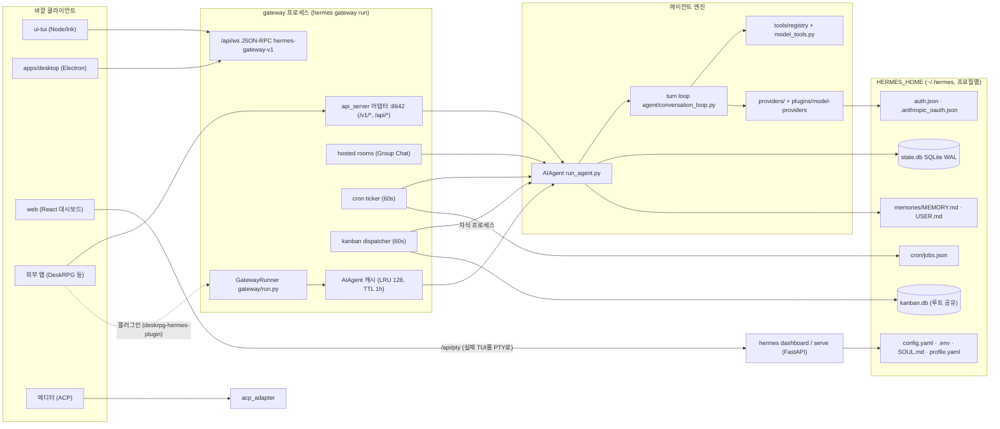
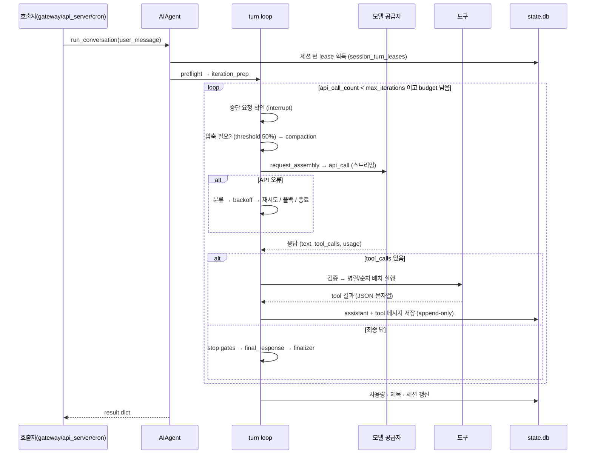

# Hermes Agent 리버스 엔지니어링: 가격인하 Rust 재구축용 기능 목록과 구조

- 분석 날짜: 2026-11-13
- 출처: https://github.com/NousResearch/hermes-agent
- commit: `5c1abd25` (2026-11-13, "Merge pull request #153698 ...")
- 라이선스: MIT (`LICENSE`)
- 분석 방식: 소스 읽기만 했다(실행 · 설치 없음). 코드를 옮기지 않고 구조 · 흐름 · 스키마 · 프로토콜만 적는다.
- 규모 [관찰]: 테스트 제외 Python 약 110만 줄, 테스트 약 60만 줄(`find . -name '*.py' | xargs wc -l`). 파일 약 25,500개.

## 범위 (가격인하 기준으로 좁힘)

가격인하에 필요한 것만 깊게 본다. 기준은 다음과 같다.

- 본인 1명 전용
- 투자 에이전트 팀이 트리거를 받으면 관련 에이전트에게 넘기고 논의한다
- cron으로 24시간 돈다
- 본인 연락은 **DeskRPG 사무실 채팅만** 쓴다. 텔레그램 같은 메신저는 쓰지 않는다
- AI 연결은 API 키와 구독 OAuth 중에서 고른다
- 모든 OS(집 PC · 노트북 · 미니 PC)와 VPS에서 돈다
- 규칙과 설정은 템플릿처럼 다룬다

분류는 세 가지다. 판단은 모두 [추정]이다.

| 분류 | 뜻 | 적는 깊이 |
|---|---|---|
| 가져옴 | Rust에서 원본과 **똑같이 동작**하게 만든다 | 입력 · 출력, 상태 변화, 순서, 실패 · 재시도 · 타임아웃, 저장 형식, 메시지 모양 |
| 나중에 | 1차에는 빼고 구조만 열어 둔다 | 몇 줄 |
| 안 가져옴 | 가격인하에 필요 없다 | 한 줄 |

표기: [관찰]은 소스에서 직접 본 것, [추정]은 추론이다. 근거는 저장소 루트 기준 경로(필요하면 `:줄`)로 적는다.

## 사용한 rea 명령

REA CLI v6.7.0. 메모리 때문에 모듈 하나씩 차례로 돌렸고, 동시에 돌리지 않았다. 출력(JSON)은 저장소 밖 로컬 임시 폴더에 두었다.

| # | 명령 | 결과 |
|---|---|---|
| 0 | `rea --help`, `rea analyze --help`, `rea import-reference-source --help`, `rea inspect-artifact --help` | 쓸 수 있는 명령 확인 |
| 1 | `rea analyze <repo> --source-path run_agent.py --format json` | **실패**: `invalid_request` "Select an exact relevant file path from the artifact inventory". `analyze`는 디렉터리를 JavaScript 앱으로 보고 Python 파일은 목록에 넣지 않는다. 실패한 이 한 번에도 최대 RSS 약 600MB (`/usr/bin/time -l`) → `01-analyze-run_agent.json` |
| 2 | `rea inspect-artifact <repo>/cron --format json` | **실패**: 파일이나 앱 번들만 받는다(`directory_requires_file`) → `03-inspect-artifact-cron.json` |
| 3 | `rea import-reference-source <repo>/cron --detail summary --outline-depth 2 --format json` | 성공: 파일 목록 · 크기 · 언어 · git HEAD. 관계(import 그래프)는 0개 → `02-import-ref-cron.json` |
| 4 | 같은 명령을 `--outline-depth 1`로 모듈 17개에 하나씩: `agent gateway tui_gateway acp_adapter apps providers tools plugins hermes_cli hermes_platform hermes_agent web ui-tui docker nix skills optional-mcps` | 성공, 모듈당 0.4~7.8초 → `11-…`~`27-import-ref-<모듈>.json` |
| 5 | `rea analyze <repo>/web --source-path src/lib/api.ts --format json` | 성공(11MB JSON): JS 모듈 22개, 네트워크 endpoint 4개(`/api/auth/ws-ticket`, `/auth/logout` 등), sessionStorage 키 1개(`hermes.lastLocation`) → `40-analyze-web-api.json` |

rea가 Python에 대해 해 준 일은 **파일 목록과 크기**뿐이다. 구조 · 흐름 · 스키마는 grep과 파일 읽기로 채웠다(아래 "rea 결과와 못 본 부분").

rea로 본 모듈 크기 [관찰]:

| 모듈 | 파일 | 바이트 | 언어 |
|---|---|---|---|
| `agent/` | 431 | 7.95MB | Python |
| `gateway/` | 392 | 7.75MB | Python, YAML |
| `tools/` | 397 | 7.85MB | Python, Shell |
| `hermes_cli/` | 865 | 15.8MB | Python, JSON |
| `plugins/` | 533 | 8.28MB | Python, JS |
| `tui_gateway/` | 129 | 2.47MB | Python |
| `cron/` | 57 | 0.99MB | Python |
| `acp_adapter/` | 22 | 0.35MB | Python |
| `providers/` | 3 | 0.09MB | Python |
| `apps/` | 5,035 | 53.2MB | TS, Rust(Tauri), C#, Obj-C 등 |
| `web/` | 266 | 2.95MB | TS/TSX |
| `ui-tui/` | 664 | 4.69MB | TS/TSX |
| `skills/` | 307 | 2.93MB | Markdown 등 |

---

## 1. 한눈에 보기

Hermes는 에이전트 엔진 하나(`run_agent.py` + `agent/`)를 여러 화면(CLI · TUI · 데스크톱 · 웹 대시보드 · 에디터 ACP · 메신저 게이트웨이)이 같이 쓰는 개인 AI 에이전트다. 기능은 코어를 키우지 않고 플러그인과 스킬로 붙인다(`AGENTS.md:10-24`) [관찰].

### 프로세스와 서비스 단위

| 단위 | 실행 | 하는 일 | 근거 |
|---|---|---|---|
| `cli` | `hermes` (`cli.py`, `hermes_cli/main.py`) | REPL, 슬래시 명령, 모든 관리 하위 명령(`profile`, `cron`, `kanban`, `auth`, `config`, `skills`, `tools` ...) | `hermes_cli/AGENTS.md` |
| `gateway` | `hermes gateway run` (`gateway/run.py`, `asyncio.run(start_gateway)` `gateway/run.py:5123`) | 장기 실행 데몬. 플랫폼 어댑터(api_server 포함), 세션 · 에이전트 캐시, cron ticker, kanban dispatcher, hosted rooms를 한 프로세스에서 돌린다. 여러 프로필을 한 프로세스가 맡는다(multiplex) | `gateway/AGENTS.md`, `cron/AGENTS.md:51-63` |
| `tui_gateway` | gateway 안의 핸들러 + `ui-tui` | TUI · 데스크톱이 붙는 JSON-RPC(WebSocket `/api/ws` 또는 stdio). 화면은 TS, 세션 · 도구 · 모델 호출은 Python | `tui_gateway/AGENTS.md:7-45` |
| `web` | `hermes dashboard` (FastAPI/uvicorn, `hermes_cli/web_server.py`) | 브라우저 대시보드. 채팅은 실제 `hermes --tui`를 PTY로 띄워 xterm.js로 보여 준다. 설정 · 프로필 · cron · 스킬 · 칸반 REST | `web/AGENTS.md:7-38` |
| `serve` | `hermes serve` | 데스크톱 앱이 띄우는 헤드리스 백엔드(SPA 없음). 앱과 같이 죽는다. 게이트웨이는 분리 실행돼 앱이 꺼져도 산다 | `web/AGENTS.md:30-36`, `gateway/AGENTS.md:79-88` |
| `cron` | gateway 안의 ticker 스레드, 또는 `hermes cron tick`(외부 스케줄러용 headless) | 예약 작업 실행 · 전달 | `cron/AGENTS.md` |
| kanban dispatcher | gateway 안(`kanban.dispatch_in_gateway: true`) 또는 systemd 단독 | 칸반 카드를 담당 프로필 워커 프로세스로 띄운다 | `cron/AGENTS.md:136-138` |
| `acp_adapter` | `python -m acp_adapter` | 에디터(Zed 등)용 Agent Communication Protocol 서버 | `acp_adapter/__init__.py` |
| `apps/desktop` | Electron | 데스크톱 앱. `hermes gateway ensure --json`으로 게이트웨이에 붙는다. Bot Mode(봇 = 프로필) | `apps/desktop/src/AGENTS.md:6-13` |
| `apps/bootstrap-installer` | Tauri(Rust + TS) | 설치기 | `apps/bootstrap-installer/src-tauri` |
| `apps/shared` | TS 라이브러리 | JSON-RPC 클라이언트, 생성된 계약 타입(`gateway-contract.generated.ts`) | `tui_gateway/AGENTS.md:51-56` |

---

## 2. 기능 목록

| 기능 | 하는 일 | 관련 모듈 | 분류 [추정] | 이유 한 줄 [추정] |
|---|---|---|---|---|
| 에이전트 턴 루프 | 메시지 → 모델 → 도구 → 결과 반복, 중단 · 예산 · 재시도 | `run_agent.py`, `agent/conversation_loop.py`, `agent/turn_*.py` | 가져옴 | 모든 에이전트의 심장 |
| 도구 레지스트리 · 병렬 실행 | 도구 스키마 수집, 호출 분배, 병렬 배치 | `tools/registry.py`, `model_tools.py`, `agent/tool_executor.py` | 가져옴 | 투자 도구(시세 · 주문 조회 등)를 붙일 자리 |
| 시스템 프롬프트 조립 | SOUL.md + 지침 + 컨텍스트 파일 + 메모리 + 스킬 색인, 3단 캐시 | `agent/system_prompt.py`, `agent/prompt_builder.py` | 가져옴 | 역할 · 규칙 템플릿이 들어가는 곳 |
| 컨텍스트 압축 | 50% 넘으면 오래된 도구 결과 정리 → 요약 | `agent/context_compressor*.py`, `agent/compression_facade.py` | 가져옴 | 24시간 세션에 필수 |
| 세션 · 메시지 저장 | SQLite WAL, FTS5 검색, 사용량 | `hermes_state.py`, `hermes_state_*.py` | 가져옴 (축소) | 상태 지속. 70여 개 파일 중 핵심만 |
| 메모리 (MEMORY.md · USER.md) | 에이전트가 쓰는 짧은 장기 메모 | `tools/memory_tool*.py` | 가져옴 | 에이전트별 맥락 유지 |
| 외부 메모리 공급자 | Honcho · RetainDB 등 플러그인 | `plugins/memory/` | 나중에 | 1차는 파일 메모리로 충분 |
| 프로필 | 에이전트 하나 = 독립 HERMES_HOME | `hermes_cli/profiles.py`, `hermes_constants.py` | 가져옴 | 에이전트별 책임 · 컨텍스트 분리 |
| 프로필 배포(distribution) | git/폴더에서 SOUL · config · skills · cron을 묶어 설치 | `hermes_cli/profile_distribution.py` | 가져옴 | "역할 템플릿" 그대로 |
| 설정 체계 | config.yaml · .env · managed overlay, 로더 3개, 캐시 무효화 | `hermes_cli/config*.py`, `cli-config.yaml.example` | 가져옴 | 규칙 · 설정 템플릿 |
| 스킬 | SKILL.md 지침 묶음, 켜고 끄기 | `skills/`, `agent/skill_*.py`, `hermes_cli/skills_config.py` | 가져옴 | 투자 절차를 스킬로 |
| optional-skills · 스킬 허브 | 무거운 스킬 설치 | `optional-skills/`, `tools/skills_hub*.py` | 나중에 | 1인용이라 직접 관리 |
| 스킬 curator | 스킬 자동 정리 · 보관 | `agent/curator*.py` | 안 가져옴 | 1인 소규모엔 과함 |
| 도구셋 | 도구 묶음 이름, 플랫폼별 켜기 | `toolsets.py`, `toolset_distributions.py` | 가져옴 | 역할별 도구 제한 |
| 플러그인 (일반) | hook · 도구 · CLI 명령 등록 | `hermes_cli/plugins*.py`, `plugins/` | 가져옴 (hook과 도구만) | DeskRPG 플러그인이 이 계약으로 붙는다 |
| 플러그인 host 격리 | 사용자 플러그인을 별도 프로세스에서 | `hermes_cli/plugin_host*.py` | 나중에 | 1인용이면 in-process로 시작 |
| MCP 클라이언트 | 외부 MCP 서버를 도구로 | `tools/mcp_tool*.py`, config `mcp_servers` | 나중에 | 시세 · 뉴스 MCP를 쓸 때 |
| shell hooks | 도구 전후에 셸 명령 | `agent/shell_hooks.py`, config `hooks` | 나중에 | 주문 차단 같은 가드에 쓸 수 있음 |
| 모델 공급자 레지스트리 | ProviderProfile 40여 개 | `providers/`, `plugins/model-providers/` | 가져옴 (Anthropic · OpenAI 호환 · Codex만) | API 키 / 구독 선택 |
| Anthropic 인증 | API 키, Hermes PKCE, Claude Code 자격 증명 빌려 쓰기 | `agent/anthropic_credentials.py`, `agent/anthropic_adapter.py` | 가져옴 | 구독 OAuth 요구 |
| 자격 증명 풀 | 키 여러 개 순환, 모델별 쿨다운 | `agent/credential_pool*.py`, `hermes_cli/auth.py` | 가져옴 (단순화) | rate limit 회피 |
| 보조 LLM(auxiliary) | 압축 · 제목 · 라우터 등을 싼 모델로 | `agent/auxiliary_client*.py` | 가져옴 | 압축 · 그룹 라우터가 의존 |
| 폴백 모델 | 실패 시 다른 공급자로 | `fallback_providers`, `agent/turn_recovery*.py` | 가져옴 | 24시간 안정성 |
| api_server (HTTP) | OpenAI 호환 `/v1/*`, 세션 · runs · jobs API | `gateway/platforms/api_server*.py` | 가져옴 | DeskRPG가 붙는 주 접점 |
| runs SSE 이벤트 | 실행 진행을 이벤트 스트림으로 | `gateway/platforms/api_server_runs.py` | 가져옴 | 사무실 채팅 실시간 표시 |
| 승인(approval) | 위험 명령 실행 전 사람 확인 | `gateway/platforms/base_exec_approval.py`, runs `/approval` | 가져옴 | 주문 같은 행동 전 확인 |
| JSON-RPC 게이트웨이(tui_gateway) | TUI · 데스크톱용 소켓 프로토콜 | `tui_gateway/` | 나중에 | DeskRPG가 HTTP로 붙으면 불필요 |
| 대시보드 REST (FastAPI) | 프로필 · SOUL · 스킬 · cron · 칸반 관리 API | `hermes_cli/web_server*.py`, `hermes_cli/web_routers/` | 가져옴 (필요 엔드포인트만) | DeskRPG 관리 화면이 쓴다 |
| 웹 대시보드 UI | React SPA, PTY로 TUI 내장 | `web/` | 안 가져옴 | 화면은 DeskRPG |
| TUI | Ink 터미널 UI | `ui-tui/` | 안 가져옴 | 화면은 DeskRPG |
| 데스크톱 앱 | Electron | `apps/desktop/` | 안 가져옴 | 화면은 DeskRPG |
| ACP 어댑터 | 에디터 연동 | `acp_adapter/` | 안 가져옴 | 코딩 에디터용 |
| 메신저 플랫폼 어댑터 25종 | 텔레그램 · 디스코드 · 슬랙 · 왓츠앱 · 이메일 · SMS 등 | `plugins/platforms/*`, `gateway/platforms/base*.py` | 안 가져옴 | 본인 연락은 DeskRPG 채팅만 쓴다 |
| cron 예약 작업 | 간격 · cron식 · 일회성, 스크립트 wake gate, 전달 | `cron/` | 가져옴 | 24시간 트리거 |
| 칸반 | SQLite 작업 보드, 프로필 워커 자동 배정 | `hermes_cli/kanban*.py`, `tools/kanban_tools.py`, `plugins/kanban/` | 가져옴 | 에이전트 간 작업 넘기기 |
| delegate_task (subagent) | 자식 에이전트를 띄워 요약 받기 | `tools/delegate_tool*.py` | 가져옴 | 분석 분담 |
| Bot Mode `message_agent` | 에이전트끼리 DM | `tools/bot_mode_dm*.py`, `agent/bot_chain.py` | 가져옴 | "관련 에이전트에게 전달" |
| hosted rooms (Group Chat) | 여러 봇이 한 방에서 논의, 라우팅(everyone/lead/auto) | `gateway/hosted_room*.py`, `tui_gateway/hosted_room_router_call.py` | 가져옴 | "논의하고 판단" 그 자체 |
| 원격 peer · RoomLink | 다른 머신 게이트웨이와 방 공유 | `gateway/hosted_room_peer.py`, `/v1/room-members/*` | 나중에 | 여러 기기 연동 시 |
| 터미널 · 파일 도구 | 셸 실행, 파일 읽기 · 쓰기 | `tools/terminal*.py`, `tools/file_*.py` | 가져옴 (축소) | 스크립트 실행에 필요 |
| 브라우저 · computer use | Chromium CDP, 화면 제어 | `tools/browser*.py`, `computer_use` | 안 가져옴 | 메모리 큼, 투자 팀엔 불필요 |
| 웹 검색 · 추출 | 검색 공급자 | `tools/web_*.py` | 나중에 | 뉴스 수집 때 |
| execute_code (커널) | Python 커널 실행 | `tools/code_*.py` | 나중에 | 분석용 |
| 이미지 · 영상 생성, TTS · STT, vision | 미디어 | `tools/*`, `plugins/image_gen` 등 | 안 가져옴 | 필요 없음 |
| i18n | 다국어 문구 | `agent/i18n*.py`, `locales/` | 안 가져옴 | 한국어 1개 |
| skin · 테마 | CLI 색 | `hermes_cli/skin_engine.py` | 안 가져옴 | 화면 없음 |
| 업데이트 · PM | 자체 업데이트, 의존성 생성 관리 | `hermes_cli/update_cmd*.py`, `pm/` | 안 가져옴 | Rust는 단일 바이너리 배포 |
| 텔레메트리 | 옵트인 집계 | `hermes_cli/observability/` | 안 가져옴 | 1인용 |
| Nous 무료 tier · /login | Nous Portal 익명 로그인 | `hermes_cli/anon_auth.py` | 안 가져옴 | 쓰지 않는 공급자 |
| batch runner · RL · trajectory | 학습 데이터 생성 | `batch_runner.py`, `trajectory_compressor.py` | 안 가져옴 | 연구용 |
| 백업 · 복원 · 프로필 export | tar 백업 | `hermes_cli/backup*.py` | 나중에 | 운영 편의 |
| 서비스 설치 | systemd · launchd · Windows 작업 | `hermes_cli/gateway*.py` | 가져옴 (단순화) | 모든 OS 24시간 |

---

## 3. 에이전트 실행 루프와 설정 체계

### 3.1 입출력 계약 (가져옴)

- 진입: `AIAgent.run_conversation(user_message, system_message=None, conversation_history=None, task_id=None) -> dict` (`agent/AGENTS.md:18-19`). 세션 턴 lease를 먼저 잡고 `agent/conversation_loop.py::run_conversation`(`:1809`)로 넘긴다(`agent/AGENTS.md:9-11`) [관찰].
- 생성자 인자는 약 60개다. 주로 쓰는 것: `base_url, api_key, provider, api_mode, model, max_iterations(기본 500, 자식과 공유), enabled_toolsets/disabled_toolsets, platform, session_id, skip_context_files, skip_memory, credential_pool` (`agent/AGENTS.md:12-17`) [관찰].
- 반환 dict 필드(`agent/turn_finalizer.py:805-829`) [관찰]: `final_response, last_reasoning, messages, api_calls, completed, turn_exit_reason, failed, partial, interrupted, response_transformed, pre_transform_response, response_previewed, response_reused, model, provider, base_url`, 세션 토큰 수, `last_prompt_tokens`.
- 메시지는 OpenAI 형식 `{"role": "system|user|assistant|tool", ...}`이다. reasoning은 `assistant_msg["reasoning"]`에 둔다(`agent/AGENTS.md:48-49`) [관찰].

### 3.2 한 턴의 순서 (가져옴)

- 루프 본체는 동기식이다. 중단 확인, 예산 추적, 예산 끝난 뒤 1회 grace 호출이 있다(`agent/AGENTS.md:21-36`) [관찰].
- 단계마다 파일 하나다: `turn_preflight*`, `turn_iteration_prep`, `turn_request_assembly`/`turn_api_request`, `turn_api_call`, `turn_api_error`, `turn_response_intake`/`turn_response_check`, `turn_empty_response`, `turn_tool_round`/`turn_tool_validation`, `turn_overflow`, `turn_truncation`, `turn_scripted_prelude`, `turn_context_compaction`, `turn_recovery`, `turn_recovery_autorecover`, `turn_retry_state`, `turn_stop_gates`, `turn_liveness`, `turn_usage`, `turn_final_response`, `turn_finalizer`, `turn_summary` (`agent/AGENTS.md:38-46`) [관찰]. Rust에서는 같은 단계를 상태 기계의 상태로 두면 된다 [추정].

**지켜야 할 불변식** (`agent/AGENTS.md:55-75`) [관찰]

1. 대화 중에는 시스템 프롬프트를 바이트 단위로 고정한다. 과거 메시지 수정, 도구셋 교체, 메모리 재로딩을 하지 않는다. 예외는 압축 하나다. 대화 중 넣어야 할 내용은 user 메시지나 tool 결과에 싣는다(프롬프트 캐시 보호).
2. 같은 role이 두 번 연속 오지 않는다. 루프 중간에 가짜 user 메시지를 넣지 않는다. `/steer`만 `assistant(tool_calls) → tool → user` 순서로 허용한다.
3. cron 전달은 자기 세션을 따로 쓴다(역할 교대 보호).

**도구 실행** [관찰]

- 도구 파일은 import될 때 `registry.register()`로 등록된다. 핸들러는 **항상 JSON 문자열**을 돌려준다. 예외는 멀티모달 봉투 `{"_multimodal": True, "content": [...], "text_summary": str}`다(`tools/AGENTS.md:9-21`).
- `todo`, `memory` 같은 에이전트 수준 도구는 `agent/inline_tool_executors.py`의 `INLINE_TOOL_EXECUTORS` 표에서 먼저 가로챈다(`agent/AGENTS.md:51-53`).
- 병렬 실행: 배치당 워커 최대 8개(`agent/tool_executor.py:136`), 배치 타임아웃 420초(`:139`), 시작 순서 게이트 120초(`:141`), 승인 게이트 락 360초(`:143`, `approvals.timeout`에서 유도). `clarify` 같은 도구는 절대 병렬로 돌리지 않는다(`agent/tool_dispatch_helpers.py:30`). 읽기 전용 도구 목록은 `_PARALLEL_SAFE_TOOLS`(`:33`).
- 도구 결과 크기 예산은 모델 컨텍스트 창에 비례한다. 큰 창은 100K/200K 문자(`agent/tool_executor.py:120-134`).

**실패 · 재시도 · 타임아웃** [관찰]

| 항목 | 값 | 근거 |
|---|---|---|
| 앱 수준 API 재시도 | `agent.api_max_retries` 기본 3, 최소 1 | `agent/agent_init.py:1292`, `cli-config.yaml.example:1315-1321` |
| 기본 backoff | `min(5 × 2^(n-1), 120)` + 균등 jitter `[0, 0.5 × delay]` | `agent/retry_utils.py:121-133` |
| Retry-After | 모든 재시도 가능 오류에서 우선, 상한 600초. 라이브 공지 상한 60초 | `agent/turn_recovery.py:1465-1487`, `agent/retry_utils.py:179-182` |
| 자동 복구 주기 | 재시도와 폴백을 다 쓰고 아무것도 전달하지 않았을 때 5주기 더(15/30/60/60/60초, Retry-After는 120초까지). 인증 · 형식 · 과금 · 정책 오류는 제외 | `cli-config.yaml.example:1323-1330`, `agent/turn_recovery_autorecover.py:26` |
| 폴백 | `fallback_providers` 체인. 위임 자식도 따로 지정 | `cli-config.yaml.example:1907, 1933` |
| 바깥 루프 오류 한도 | 8 | `agent/conversation_loop.py:239` |
| 턴 무활동 타임아웃 | 600초 | `agent/turn_liveness.py:23` |
| 게이트웨이 무활동 타임아웃 | `agent.gateway_timeout` 1800, 경고 900 | `cli-config.yaml.example` agent 구간 |
| 세션 정지 감시 | 300초 | 같은 곳 `session_stall_timeout` |

### 3.3 시스템 프롬프트와 SOUL.md (가져옴)

`agent/system_prompt.py:751-826`의 `build_system_prompt_parts`가 세 층으로 만든다. 한 번 만들면 `agent._cached_system_prompt`에 두고, 압축 뒤에만 다시 만든다 [관찰].

| 층 | 순서대로 들어가는 것 |
|---|---|
| stable | ① `SOUL.md`(정체성 1번 칸, HERMES_HOME에서 읽음, `agent/prompt_builder.py:1521-1541`) ② Hermes 도움말 지침 ③ 일반 지침(`_guidance_parts`) ④ 고정(pinned) 스킬 ⑤ 코딩 지침 앞부분 |
| context | ⑥ 호출자 `system_message` ⑦ 프로젝트 컨텍스트 파일(작업 폴더의 AGENTS.md · CLAUDE.md · .cursorrules 등, 크기 상한) ⑧ 워크스페이스 스냅샷 |
| volatile | ⑨ 스킬 색인 ⑩ 메모리(MEMORY.md) · 사용자 프로필(USER.md) · 외부 메모리 ⑪ 플러그인 섹션(`after_memory`) ⑫ 활성 프로필 줄 ⑬ 시각 줄 ⑭ 런타임 환경 힌트 |

- 기본 `SOUL.md`(저장소 루트, 667바이트)는 첫 줄에 정체성을 적고, 이어서 답 길이 · 말투 · 정직성 같은 행동 규칙을 산문으로 적는다 [관찰]. 형식 규칙은 없다. 그냥 Markdown 산문이다 [관찰].
- SOUL.md는 사용자가 쓴 파일로 보고 주입 탐지에 걸려도 **경고만** 하고 읽는다. 프로필 배포로 들어온 SOUL.md는 별도로 취급한다(`agent/prompt_builder.py:85-96`) [관찰].
- 컨텍스트 파일은 시작할 때 CWD에서만 읽는다. 하위 폴더 AGENTS.md 힌트는 도구 결과에 붙인다(앞뒤 잘라 32,000자 상한) (`agent/AGENTS.md:60-72`) [관찰].
- [추정] 가격인하 매핑: `SOUL.md` = **에이전트 역할 템플릿**(정체성 · 책임 · 말투 · 금지 사항), 프로젝트 컨텍스트 파일 또는 고정 스킬 = **투자 규칙 템플릿**(손절 기준, 포지션 한도 등). 규칙을 stable 층에 두면 프롬프트 캐시가 깨지지 않는다.

### 3.4 컨텍스트 압축 (가져옴)

- 두 겹이다: 게이트웨이 세션 위생(85%)과 에이전트 `ContextCompressor`(50%, 설정 가능) (`agent/AGENTS.md:83-84`) [관찰].
- 순서 [관찰] (`agent/AGENTS.md:84-91`):
  1. 오래된 도구 결과를 먼저 잘라 낸다(LLM 호출 없음).
  2. 경계를 고른다(앞 `protect_first_n` 3개, 뒤 `protect_last_n` 20개, 최소 user 1개 보호).
  3. `auxiliary` 압축 모델로 구조화된 요약을 만든다.
  4. 요약 스트림이 멈추면 `auxiliary.compression.fallback_chain`으로 한 번 재시도, 또 멈추면 결정론적 대체 요약.
  5. 공급자가 컨텍스트 초과를 증명하면 실패 쿨다운을 건다(세션 컬럼 `compression_failure_cooldown_until` 등).
- 기본값(`cli-config.yaml.example:683-872`) [관찰]: `enabled: true, threshold: 0.50, target_ratio: 0.20, protect_last_n: 20, protect_first_n: 3, min_tail_user_messages: 1, max_attempts: 3, proactive_prune_min_result_chars: 8000, proactive_prune_min_reclaim_tokens: 4096`.
- 제자리 압축은 세션 id를 그대로 둔다. 이전 방식은 `parent_session_id` 사슬로 세션을 쪼갰다(`hermes_state.py:1-6`) [관찰].
- 수동 `/compress`: `here [N]`, focus, `--preview`, `--aggressive` (`agent/AGENTS.md:79-81`) [관찰].

### 3.5 세션 · 상태 저장 (가져옴, 축소)

`hermes_state.py`(SessionDB 파사드)와 형제 파일 약 70개. 역할로 묶으면 다음과 같다 [관찰, 각 파일 docstring].

| 묶음 | 파일 | 하는 일 | 가격인하 |
|---|---|---|---|
| 스키마 | `_common`(DDL, `SCHEMA_VERSION = 33` `:296`), `_schema`, `_reconcile`, `_fts`, `_identity` | 테이블 · 컬럼 맞추기, FTS5 | 가져옴 |
| 연결 · WAL | `_wal`, `_readpool`, `_registry`, `_lockguard`, `_lockowners`, `_holders`, `_pidns`, `_dbfile`, `_guard`, `_health` | WAL 모드, 읽기 연결 예산, 프로세스 공유 레지스트리, 락 보유자 | 일부(WAL · 단일 writer) |
| 세션 수명 | `_sessions`, `_sessions_model_config`, `_ids`(id 형식 `YYYYMMDD_HHMMSS_<hex>`), `_titles`, `_session_list`, `_portability` | 생성 · 종료 · 목록 · 제목 · export | 가져옴 |
| 메시지 | `_messages`, `_api_content`, `_rewind`, `_timeline`, `_stored_reads`, `_todo`, `_detached_results` | append · 교체 · 되감기(`/undo` `/retry`) · 이어 붙이기 | 가져옴 |
| 압축 | `_compression`, `_coverage`, `_compaction_display`, `_prune_rewrite`, `_worker_compression` | 압축 계보 · 락 · 턴 lease | 가져옴 |
| 게이트웨이 | `_gateway`, `_keys`, `_telegram` | 라우팅 색인, heartbeat, 핸드오프 | 일부 |
| 변경 영수증 | `_runtime`, `_runtime_workers`, `_mutation*`, `_worker_context`, `_worker_lifecycle`, `_local*` | 다중 writer 경합 방지 트랜잭션 | 안 가져옴 [추정] (Rust 단일 프로세스면 단순화) |
| 유지보수 | `_maintenance`, `_repair`, `_profile_repair`, `_legacy_refusal`, `_media`, `_terminal` | 보존 기간 삭제, VACUUM, 수리 | 나중에 |
| 사용량 | `_usage` | 토큰 · 비용 기록(백그라운드 writer) | 가져옴 |
| 검색 | `_search` | FTS · trigram · CJK 검색 | 가져옴 (`session_search` 도구) |
| 문구 | `_errors`, `_user_copy` | 오류 분류, 사용자 문구 | 안 가져옴 |

테이블 스키마는 7장.

### 3.6 메모리 (가져옴)

- 위치: `<HERMES_HOME>/memories/MEMORY.md`(에이전트 메모)와 `USER.md`(사용자 프로필) (`tools/memory_tool.py:38-40`, `tools/memory_tool_store.py:306`) [관찰].
- 항목 구분자: `"\n§\n"` (`tools/memory_tool_store.py:26`) [관찰].
- 동작: `add` / `replace` / `remove` / `batch`, `old_text`로 대상 지정. 쓰기 게이트(사람 확인 단계)가 있다(`tools/memory_tool.py:70-140`) [관찰].
- 한도: `memory_char_limit: 2200`(약 800토큰), `user_char_limit: 1375`(약 500토큰), `nudge_interval: 10` (`cli-config.yaml.example:1033-1063`) [관찰].
- 메모리는 시스템 프롬프트 volatile 층에 들어간다. 대화 중 다시 읽지 않는다(캐시 불변식) [관찰].
- cron 세션은 `skip_memory=True`로 메모리 공급자를 돌리지 않는다(`cron/AGENTS.md:107`) [관찰].

### 3.7 스킬 · 도구셋 · 플러그인 · MCP

**스킬** (가져옴) [관찰]

- `skills/<category>/<name>/SKILL.md`. frontmatter: `name, description, version, author, license, platforms`(OS 제한), `metadata.hermes.tags / category / related_skills / config` (`skills/AGENTS.md:16-22`).
- 위치: 번들 `skills/`(기본 켜짐), `optional-skills/`(설치해야 켜짐), 사용자 `~/.hermes/skills/`, `skills.external_dirs`(읽기 전용, 이름 충돌 시 로컬 우선) (`cli-config.yaml.example:1212-1225`).
- 켜고 끄기: `skills.disabled`(전역) ∪ `skills.platform_disabled.<platform>` (`hermes_cli/skills_config.py:28-50`). 대시보드 `PUT /api/skills/toggle`, `PUT /api/skills/lock`.
- 프롬프트에는 스킬 **색인**만 들어가고(volatile), 본문은 `skill_view` 도구로 읽는다. 슬래시로 부른 스킬은 user 메시지로 들어간다(`agent/AGENTS.md:60-61`).
- 스킬 설치 · 변경은 다음 세션부터 반영된다. 바로 반영하려면 `--now` (`AGENTS.md:18-21`).

**도구셋** (가져옴) [관찰]

- `toolsets.py`의 `TOOLSETS` dict 하나. 키: `browser, clarify, code_execution, cronjob, debugging, delegation, file, image_gen, kanban, memory, messaging, safe, search, session_search, skills, terminal, todo, tts, video, vision, web` 등 (`tools/AGENTS.md:70-77`).
- 코어 도구 목록 `_HERMES_CORE_TOOLS`(`toolsets.py:11-36`): `web_search, web_extract, terminal, process_manage, read_file, write_file, patch, search_files, ... memory, session_search, clarify, execute_code, delegate_task, cronjob_manage, kanban_*` 등.
- 플랫폼별 도구셋: `platform_toolsets: {cli: [hermes-cli], ...}` (`cli-config.yaml.example:1476-1484`), `tools.<platform>.enabled/disabled`, `agent.disabled_toolsets`.
- 도구는 `check_fn`으로 가용성을 판단하고, 결과를 프로세스 전체에서 TTL 캐시한다(`tools/AGENTS.md:16-17`).

**플러그인** (hook · 도구만 가져옴) [관찰]

- 종류: 일반(`plugins/<name>/`, `~/.hermes/plugins/`, `./.hermes/plugins/`, pip entry point, 나중 것이 이김) / 메모리 공급자 / 모델 공급자 / 컨텍스트 엔진 · 이미지 생성 · 위임 / 플랫폼 어댑터 (`plugins/AGENTS.md:86-92`).
- 일반 플러그인은 `register(ctx)`에서 hook, 도구, CLI 명령을 등록한다. `PluginContext`의 주요 메서드(`hermes_cli/plugins_context.py`): `register_tool, register_hook, register_command, register_cli_command, register_platform, register_system_prompt_section, register_middleware, inject_message, post_message, dispatch_tool, call_mcp, emit, subscribe, register_delegation_provider, register_memory_provider` 등.
- 유효한 hook(`hermes_cli/plugins.py:113-125`): `pre_tool_call, post_tool_call, transform_terminal_output, transform_tool_result, transform_llm_output, pre_llm_call, post_llm_call, on_stream_start, on_stream_delta, on_stream_end, on_interim_message, pre_verify, pre_api_request, post_api_request, api_request_error, pre/post_auxiliary_call, on_session_start, on_session_end` 등.
- `post_llm_call` 인자(`agent/turn_finalizer.py:495-506`): `session_id, task_id, turn_id, user_message, assistant_response, conversation_history, model, platform, side_question_token`.
- hook 인자는 키워드로만 늘어난다. 콜백 서명을 보고 선언한 필드만 넘긴다(`plugins/AGENTS.md:154-155`).
- 새로 켠 플러그인: 핸들러는 바로, 도구 · 프롬프트는 다음 세션, MCP 서버는 `mcp.reload` 때 (`plugins/AGENTS.md:99-101`).

**MCP** (나중에) [관찰]: `mcp_servers.<name>`에 `command/args/env` 또는 `url`. 서버별 `sampling`(모델 · 토큰 상한 · rpm), 실험적 `events` (`cli-config.yaml.example:1652-1690`).

### 3.8 설정 체계 (가져옴, 깊게)

#### 파일 위치

프로필 하나 = HERMES_HOME 폴더 하나다. 기본 프로필은 `~/.hermes`, 이름 있는 프로필은 `~/.hermes/profiles/<name>/` (`hermes_cli/profiles.py:292-295, 442-446`) [관찰].

| 파일 | 내용 | 근거 |
|---|---|---|
| `config.yaml` | 동작 설정 전부 | `AGENTS.md:91` |
| `.env` | **비밀값만**(키 · 토큰 · 비밀번호). 동작 설정을 넣으면 안 된다 | `hermes_cli/AGENTS.md:82-89` |
| `SOUL.md` | 정체성 · 성격 · 규칙 산문 | `hermes_constants.py:411` |
| `profile.yaml` | 프로필 설명(1~2문장 역할), Bot Mode 제목 · `ui_meta` | `hermes_cli/profiles.py:672-680` |
| `auth.json` | 공급자별 인증 상태 · 자격 증명 풀(0600, 프로세스 간 flock) | `hermes_cli/auth.py:1-10, 477-484` |
| `.anthropic_oauth.json` | Hermes PKCE OAuth 토큰 | `agent/anthropic_credentials.py:741-742` |
| `state.db` | 세션 · 메시지 | `hermes_constants.py:332` |
| `memories/MEMORY.md`, `USER.md` | 메모리 | 3.6 |
| `skills/` | 설치한 스킬 | 3.7 |
| `cron/jobs.json` | 예약 작업 | `hermes_cli/profile_distribution.py:51` |
| `mcp.json` | MCP 정의(배포 단위) | `hermes_cli/profile_distribution.py:42` |
| `gateway_state.json` | 게이트웨이 런타임 상태(code_sha 등) | `gateway/AGENTS.md:88` |
| `logs/` | 로그 | `AGENTS.md:91` |
| `<root>/active_profile` | 고정 활성 프로필 이름 | `hermes_cli/profiles.py:306` |
| `<root>/kanban.db`, `<root>/kanban/boards/<slug>/` | 칸반(프로필 사이에 **공유**) | `hermes_cli/kanban_db.py:401-415` |
| `/etc/hermes/config.yaml` | 관리자 overlay(모든 프로필보다 우선) | `hermes_cli/managed_scope.py:31-49` |

프로필의 "정체성 표지"는 `config.yaml / .env / SOUL.md / profile.yaml / auth.json / state.db` 중 하나다. 표지가 없는 폴더는 프로필로 보지 않는다(`hermes_constants.py:411`, `hermes_cli/AGENTS.md:164-169`) [관찰].

#### config.yaml 최상위 구조

`_config_version: 53`(`cli-config.yaml.example:10`). 새 키는 자동 deep-merge되고, 버전은 키 이름을 바꾸는 등 이전 설정을 고쳐야 할 때만 올린다(`hermes_cli/AGENTS.md:75-76`) [관찰].

| 구간 | 주요 키 (예시 파일 기준) | 가격인하 |
|---|---|---|
| `model` | `default`(모델), `provider`(`auto` / `anthropic` / `openai-codex` / `openrouter` / `custom` ...), `base_url`, `context_length` | 가져옴 |
| `agent` | `max_turns: 500`, `reasoning_effort: "medium"`(`xhigh/high/medium/low/minimal/none` 또는 dict), `reasoning_overrides`(모델별), `api_max_retries: 3`, `auto_recovery_cycles: 5`, `gateway_timeout`, `disabled_toolsets`, `agent_cache.*` | 가져옴 |
| `compression` | 3.4 참고 | 가져옴 |
| `auxiliary.<task>` | 작업별 보조 모델 `provider/model/base_url/reasoning_effort` (`cli-config.yaml.example:938-958`) | 가져옴 |
| `memory` | `memory_enabled, user_profile_enabled, memory_char_limit, user_char_limit, nudge_interval, provider` | 가져옴 |
| `skills` | `creation_nudge_interval: 15`, `external_dirs`, `disabled`, `platform_disabled`, `config.<key>` | 가져옴 |
| `platform_toolsets`, `tools.<platform>` | 도구셋 선택 | 가져옴 |
| `delegation` | `max_iterations: 250`, `max_concurrent_children`, `max_spawn_depth`, `orchestrator_enabled`, `subagent_auto_approve`, `model/provider`, `fallback_providers`, `backend`, `backends.profile_routes` / `model_map` (`:1888-1938`) | 가져옴 |
| `cron` | `catch_up_missed: true`, `max_parallel_jobs` | 가져옴 |
| `kanban` | `review_dispatch: true`, `dispatch_in_gateway`, `failure_limit` | 가져옴 |
| `hosted_rooms` | `discussion.max_rounds: 3`, `discussion.max_messages: 10` (`:1084-1087`) | 가져옴 |
| `gateway` | `multiplex_profiles`, `api_server.max_concurrent_runs`, `bot_loop_guard.max_hops` | 가져옴 (일부) |
| `streaming`, `display` | 출력 표시 | 나중에 |
| `terminal` | 실행 백엔드(local/docker/ssh 등), `cwd` | 가져옴 (local만) |
| `hooks` | `pre_tool_call / post_tool_call / pre_llm_call / subagent_stop`에 `matcher, command, timeout` (`:2190-2203`) | 나중에 |
| `mcp_servers` | 3.7 | 나중에 |
| `plugins` | `clone_timeout_seconds`, `isolation` | 나중에 |
| `browser, tts, stt, image_gen, telemetry, updates, dashboard, privacy, lsp, ...` | | 안 가져옴 |

#### 로더 3개와 우선순위

`hermes_cli/AGENTS.md:100-107`, `hermes_cli/config_effective.py:1-12` [관찰]:

| 로더 | 쓰는 곳 | 기본값 병합 |
|---|---|---|
| `load_cli_config()` | CLI | CLI 전용 |
| `load_config()` | 대부분의 하위 명령 | `DEFAULT_CONFIG`(`hermes_cli/config.py:588`) 먼저 병합 |
| `load_user_config_effective()` | 게이트웨이 · cron · TUI 게이트웨이 | **기본값 없음**(키가 없으면 "설정 안 함"으로 본다) |

우선순위 (높은 것부터) [관찰 + 일부 추정]:

1. 관리자 overlay `/etc/hermes/config.yaml`(프로필이 못 끈다. 단 `telemetry`는 예외) (`plugins/AGENTS.md:143-145`, `cli-config.yaml.example:2231-2240`)
2. 요청 · 작업 단위 덮어쓰기: CLI 플래그(`--model`), API 요청 body의 `model`, cron 작업의 `model/provider/reasoning_effort`, 칸반 카드의 `model_override/provider_override/reasoning_effort`, 위임 route
3. 프로필의 `config.yaml`(사용자 층, `${VAR}` 확장은 overlay 적용 **전에**)
4. `DEFAULT_CONFIG`(로더가 병합할 때만)
5. 환경 변수: 비밀값만. multiplex 아래에서는 프로세스 env가 프로필 YAML을 절대 덮지 않는다(`hermes_cli/AGENTS.md:113`)

#### 언제 다시 읽나 (재시작 필요 여부)

- 설정 파일은 파일 서명(mtime 등)으로 캐시한다. 바뀌면 다음 읽기에서 새로 읽는다. 읽다가 YAML이 깨져 있으면 마지막 정상본을 쓴다(`hermes_cli/config_effective.py:24-29`) [관찰].
- 게이트웨이는 세션별 `AIAgent`를 캐시한다(LRU 128개, 유휴 1시간, `gateway/run.py:53-54`). 지정된 키가 바뀌면 캐시를 버리고 다음 턴에 새로 만든다. 예: `model.context_length`, `compression.*`, `agent.disabled_toolsets`, 도구 레지스트리 세대(`gateway/run.py:4057-`, `gateway/run_agent_cache.py:51-69`) [관찰].
- 시스템 프롬프트에 들어가는 것(SOUL.md, 스킬 색인, 메모리, 도구셋)은 **현재 대화에는 반영되지 않는다**. 다음 세션(`/new`)이나 `--now`에서 반영된다(`AGENTS.md:18-21`) [관찰].
- 플러그인: 핸들러는 즉시, 도구 · 프롬프트는 다음 세션(`plugins/AGENTS.md:99-101`) [관찰].
- cron 작업: 매 tick(60초)에 `jobs.json`을 다시 읽는다 [추정: tick마다 store를 연다는 서술 `cron/AGENTS.md:56-60`].
- 쓰기는 `atomic_config_write`(빠뜨린 키를 지우지 않음) 또는 `atomic_config_replace`(전체 상태) 한 곳으로만 한다. ruamel round-trip으로 주석과 형식을 보존한다(`hermes_cli/AGENTS.md:90-97`) [관찰].

#### 프로필 만들기 · 복제 · 전환

- 만들기: `create_profile(name, clone_from, clone_all, clone_config, no_alias, no_skills, description, clone_channels, sync_imports, soul, seed_model)` (`hermes_cli/profiles.py:1343-1360`) [관찰].
  - `--clone`: config.yaml · .env · SOUL.md · 설치 스킬 · 정체성 파일 복사. `--clone-all`: 상태 전부 복사.
  - 복제는 메신저 채널(봇 토큰 · 허용 목록 등)을 지운다(`--clone-channels`로만 유지).
  - `profiles/.<name>.staging-<pid>`에서 만든 뒤 `os.rename` 한 번으로 공개한다(`hermes_cli/AGENTS.md:160-162`).
  - `default`라는 이름은 쓸 수 없다.
- 프로필은 서로 독립된 섬이다. 설정 상속이 없다. 복제는 만들 때 한 번 복사할 뿐이다(`hermes_cli/AGENTS.md:154-155`) [관찰].
- 전환: `hermes -p <name> <cmd>`(import 전에 HERMES_HOME 설정), `<root>/active_profile`(고정), 대시보드 `POST /api/profiles/active`. 게이트웨이는 프로필마다 contextvar로 범위를 잡아 한 프로세스에서 여러 프로필을 돌린다(`hermes_cli/AGENTS.md:149-154`) [관찰].
- 관리 API(대시보드): `GET/POST /api/profiles`, `PATCH/DELETE /api/profiles/{name}`, `GET/PUT /api/profiles/{name}/soul`, `PUT /api/profiles/{name}/model`, `PUT /api/profiles/{name}/description`, `POST /api/profiles/{name}/export`, `POST /api/profiles/import` (`hermes_cli/web_routers/profiles.py`) [관찰].

#### 프로필 배포 = 템플릿

`hermes_cli/profile_distribution.py` [관찰]

- 원천: git URL 또는 `distribution.yaml`이 있는 로컬 폴더.
- 배포가 소유하는 기본 파일: `SOUL.md, config.yaml, mcp.json, skills/, cron/, distribution.yaml` (`:42`).
- 매니페스트 필드: `name, version, license, env_requires[{name, ...}]` 등. `env_requires`로 `.env.template`을 만든다(`:89-149, 211-216`).
- cron 작업은 `JOB_DEFINITION_FIELDS`만 배포에서 갱신하고, 실행 상태(다음 실행 시각 등)는 로컬 것을 지킨다(`cron/job_definition.py:13-28`).
- [추정] 가격인하 지점: "애널리스트 / 리스크 매니저 / 트레이더 / 리서처" 같은 **에이전트 역할 템플릿**을 distribution 하나씩으로 만들고, 공통 **투자 규칙 템플릿**은 별도 스킬(또는 `skills.external_dirs`의 공유 폴더)로 두면 모든 역할에 같은 규칙을 꽂을 수 있다.

#### 프로필별 모델 · 공급자 · reasoning effort

- 프로필 `config.yaml`의 `model.default / model.provider / agent.reasoning_effort / agent.reasoning_overrides` [관찰].
- 보조 작업은 `auxiliary.<task>.provider/model/reasoning_effort` [관찰].
- 위임은 `delegation.backends.profile_routes`로 "이 프로필의 subagent는 그 프로필의 자격 증명 · 풀 · SOUL.md · 터미널 정책을 쓴다" (`cli-config.yaml.example:1903-1906`), 또는 `model_map`으로 작업 종류별 모델 선택 [관찰].
- [추정] 가격인하: 리스크 관리 역할은 `reasoning_effort: high`, 시세 요약 역할은 싼 모델 + `low`처럼 역할 템플릿마다 고정.

---

## 4. 모델 공급자와 인증

### 4.1 공급자 구조 (가져옴: Anthropic, OpenAI 호환, Codex)

- `providers/base.py`의 `ProviderProfile` 필드: `name, api_mode(기본 "chat_completions"), aliases, display_name, description, signup_url, hidden, env_vars, base_url, models_url, auth_type(api_key | oauth_device_code | oauth_external | external_process | aws_sdk | plugin), supports_streaming, supports_health_check, supports_model_listing, auth_handler, refresh_credential, classify_api_error` 그리고 훅 메서드 `fetch_models, prepare_messages, build_extra_body, build_api_kwargs_extras` (`providers/base.py:146-185`, `providers/README.md`) [관찰].
- 실제 공급자 정의는 `plugins/model-providers/<name>/`(40개: anthropic, openai-codex, openrouter, gemini, bedrock, ollama-cloud, lmstudio, custom 등) [관찰]. 사용자 폴더 정의가 번들을 이긴다(last-writer-wins) (`plugins/AGENTS.md:90`).
- API 방식(`api_mode`): `anthropic_messages`, `chat_completions`, `codex_responses`, `codex_app_server`, `bedrock_converse` (`agent/transports/*.py`) [관찰].
- Anthropic 모델 목록: `x-api-key` + `anthropic-version: 2023-06-01`, `/v1/models`를 `has_more/last_id` 커서로 페이지 넘김 (`plugins/model-providers/anthropic/__init__.py`) [관찰].
- OpenAI Codex(ChatGPT 구독): `base_url=https://chatgpt.com/backend-api/codex`, `auth_type="oauth_external"` (`plugins/model-providers/openai-codex/__init__.py:9`) [관찰].
- 공급자 선택 우선순위는 `hermes_cli/auth.py::resolve_provider()`. OAuth 흐름은 `auth_nous/auth_codex/auth_xai/auth_qwen/auth_minimax/auth_openrouter` (`hermes_cli/auth.py:1-10`) [관찰].

### 4.2 Anthropic 토큰 순서 (가져옴)

`agent/anthropic_credentials.py:1-9, 700-718` [관찰]. 비밀값 자체는 적지 않는다.

| 순서 | 원천 | 저장 위치 | 비고 |
|---|---|---|---|
| 1 | env `ANTHROPIC_TOKEN` 또는 `CLAUDE_CODE_OAUTH_TOKEN` | 프로필 `.env` | 새로 고칠 수 있는 Claude Code 자격 증명이 같이 있으면 그쪽을 우선(`_prefer_refreshable_claude_code_token`) |
| 2 | env `ANTHROPIC_API_KEY` | 프로필 `.env` | 명시한 API 키는 발견된 OAuth에 가려지지 않는다 |
| 3 | Hermes 소유 OAuth grant | `auth.json` 자격 증명 풀 | 빌려 온 항목은 건너뜀(`skip_borrowed=True`) |
| 4 | Claude Code 자격 증명 (빌려 쓰기) | `~/.claude/.credentials.json`(`CLAUDE_CONFIG_DIR` 존중) 또는 macOS Keychain 일반 암호 항목 `Claude Code-credentials` | 둘 다 있으면 하나를 고르는 규칙 `read_claude_code_credentials` (`:359-377`) |

- 모델을 넘기면 그 모델에 대해 풀이 쉬게 한 토큰은 `None`으로 돌린다(rate limit 직후 같은 토큰을 다시 주지 않음) (`:681-705`) [관찰].
- Hermes PKCE 로그인 흐름(`run_hermes_oauth_login_pure`, `:763-816`) [관찰]:
  1. `code_verifier`/`code_challenge`(S256) 생성, `state` = 랜덤 32바이트.
  2. `https://claude.ai/oauth/authorize?code=true&client_id=…&response_type=code&redirect_uri=https://console.anthropic.com/oauth/code/callback&scope=org:create_api_key user:profile user:inference&code_challenge=…&code_challenge_method=S256&state=…` 를 보여 주고(GUI면 브라우저 열기)
  3. 사용자가 `code#state`를 붙여 넣는다. state가 다르면 중단(CSRF).
  4. 토큰 엔드포인트 `https://platform.claude.com/v1/oauth/token`(실패 시 `console.anthropic.com` 대체)에 JSON `{grant_type: authorization_code, client_id, code, state, redirect_uri, code_verifier}` POST, 타임아웃 15초. 이 요청의 User-Agent는 `axios/1.7.9`(claude-code/로 시작하면 429) (`:35-44`).
  5. `{accessToken, refreshToken, expiresAt(ms)}`를 `<HERMES_HOME>/.anthropic_oauth.json`에 0600 + fsync + 원자적 교체로 쓴다(`:119-125, 824-835`).
- 갱신(`_refresh_oauth_token`, `:473-541`) [관찰]:
  - 자격 증명 파일 경로 단위 프로세스 간 락 안에서 읽기 → 판단 → POST → 쓰기를 한다(refresh 토큰은 1회용). 갱신 타임아웃 기본 20초(`HERMES_ANTHROPIC_REFRESH_TIMEOUT_SECONDS`), 락 타임아웃은 그보다 5초 길게.
  - 다른 프로세스(Claude Code)가 이미 갱신했으면 그 토큰을 채택한다.
  - `invalid_grant / invalid_token / refresh_token_reused`(400/401)는 영구 실패로 보고 지문을 기억해 다시 쓰지 않는다(`:390-410`).
  - POST는 성공했는데 쓰기가 실패하면 그 쌍을 "소비됐지만 커밋 안 됨"으로 사이드카에 표시하고 실패로 닫는다(`CredentialPersistError`, `:100-230`).
  - Keychain 원천이면 갱신 결과를 Keychain에도 다시 쓴다(`:567-618`).
- 추론 요청에서 OAuth 경로는 베타 헤더 `claude-code-20250219, oauth-2025-04-20`, `user-agent: claude-code/<버전> (external, cli)`, `x-app: cli`, 시스템 프롬프트 앞에 Claude Code 정체성 문장을 붙인다(`agent/anthropic_adapter.py:238, 318, 427-428`) [관찰].
- `claude setup-token`을 대화형으로 돌리는 경로도 있다(`run_oauth_setup_token`, `:721-738`) [관찰].
- [추정] 구독 OAuth로 Claude Code 신원을 흉내 내는 방식은 공급자 약관 위험이 있다. 가격인하는 API 키를 기본으로 하고, 구독 OAuth는 사용자가 직접 고르는 선택지로 두는 편이 안전하다.

### 4.3 자격 증명 풀 (가져옴, 단순화)

- 전략: `fill_first, round_robin, random, least_used` (`agent/credential_pool.py:118-124`) [관찰].
- 모델별 쿨다운(`credential_pool_model_cooldowns.py`), 싱글톤 파일(`.anthropic_oauth.json`, Claude Code 파일)은 `load_pool()` 때마다 다시 읽는다(`agent/anthropic_credentials.py:6-9`) [관찰].
- `auth.json` 쓰기는 프로세스 간 flock + 원자적 0600 쓰기 한 경로(`hermes_cli/auth.py:4-6`) [관찰].

---

## 5. 게이트웨이와 외부 접점 (DeskRPG)

메신저 어댑터(텔레그램 · 디스코드 · 슬랙 등 25종, `plugins/platforms/*`)는 **안 가져옴**이다. 본인 연락은 DeskRPG 사무실 채팅만 쓴다.

### 5.1 DeskRPG가 붙는 방식 [관찰]

- 플러그인 카탈로그 `plugin-catalog/deskrpg.yaml`: 저장소 `dandacompany/deskrpg-hermes-plugin`(sha `1e9914a6…`, v0.16.0, community, `requires_hermes: ">=0.21.1"`, 기본 꺼짐). 설명은 "Hermes gateway integration for DeskRPG virtual offices, with profiles, kanban, cron, artifacts and NPC skill management". 제공 도구 `artifact_save, propose_kanban_card`, 제공 hook `post_tool_call, post_llm_call`, `platforms: []`.
- 플러그인 코드 자체는 이 저장소에 없다. 그래서 DeskRPG가 실제로 어떤 HTTP 경로를 부르는지는 여기서 확정할 수 없다(→ 못 본 부분).
- [추정] 접점은 세 가지다. ① 플러그인(`post_llm_call` · `post_tool_call`로 에이전트 활동을 사무실로 보냄, 도구 2개로 산출물 · 칸반 카드 제안) ② api_server HTTP(`/v1/runs` + SSE로 대화, `/api/jobs`로 cron) ③ 대시보드 REST(프로필 · SOUL · 스킬 · 칸반 관리). DeskRPG 분석 쪽과 맞춰 볼 것.

### 5.2 api_server (가져옴)

`gateway/platforms/api_server.py` [관찰]

- aiohttp 서버. 기본 `127.0.0.1`(`API_SERVER_HOST`), 포트 8642(`API_SERVER_PORT`) (`:155-169`).
- 인증: `Authorization: Bearer <API_SERVER_KEY>`, `hmac.compare_digest` (`:1414-1432`). 키가 없거나 16자 미만이면 시작을 거부하고 재연결 대기열에서 뺀다(`:3925-3962`). 재시도로 두면 연결이 새어 EMFILE까지 갔던 사고(#38803) 때문.
- 미들웨어 순서: 설정 가드 → 프로필 prefix → CORS(`API_SERVER_CORS_ORIGINS`) → 본문 크기 제한 → 보안 헤더 (`:3966-3969`).
- 모든 경로에 `/p/{profile}` 접두 미러가 붙는다(`:3973-3978`).
- 요청 헤더: `X-Hermes-Session-Key`(대화 키), `X-Hermes-Session-Id`, `Idempotency-Key`(1~255 보이는 ASCII) (`:57-58, 633`).
- heartbeat 30초(`:174`), 동시 run 상한 `gateway.api_server.max_concurrent_runs` 기본 10, 0은 무제한(`:1214-1216`), 고아 run 정리 300초(`:3841`).
- 요청마다 에이전트를 새로 만들지만 메모리 매니저는 세션별로 빌려 주고 돌려받는다(`gateway/AGENTS.md:175-181`).

엔드포인트 (`:60-80`, `_http_route_table`) [관찰]:

| 메서드 · 경로 | 용도 |
|---|---|
| `GET /health`, `/health/detailed`, `/v1/health` | 상태 |
| `GET /v1/models`, `/api/model/options`, `/v1/capabilities`, `/v1/skills`, `/v1/toolsets` | 목록 · 기능 |
| `POST /v1/chat/completions` | OpenAI 호환 채팅 |
| `POST /v1/responses`, `GET/DELETE /v1/responses/{id}` | OpenAI Responses 호환, `previous_response_id` 체인 |
| `POST /v1/runs` | 비동기 실행 시작, run_id 즉시 반환 |
| `GET /v1/runs/{id}`, `GET /v1/runs/{id}/events` | 상태, SSE 이벤트 |
| `POST /v1/runs/{id}/approval`, `/steer`, `/clarify`, `/stop`, `/resolve-unknown` | 진행 중 개입 |
| `GET/POST /api/sessions`, `GET/PATCH/DELETE /api/sessions/{id}`, `GET …/messages`, `POST …/fork`, `POST …/chat`, `POST …/chat/stream`, `POST …/model` | 세션 |
| `GET/POST /api/jobs`, `GET/PATCH/DELETE /api/jobs/{id}`, `POST …/pause`, `…/resume`, `…/run`, `POST /api/cron/fire` | cron API |
| `POST /api/platforms/{platform}/events` | 플랫폼 HTTP 이벤트 콜백(어댑터의 verifier 통과 필요) |
| `/v1/room-members/*` | 원격 방 멤버(나중에) |

`POST /v1/runs` 처리 순서 (`gateway/platforms/api_server_runs.py:768-900`) [관찰]:

1. `X-Hermes-Session-Key` 파싱 → JSON body → 방 dispatch 정규화
2. `Idempotency-Key` 검사. 같은 키 + 같은 지문이면 이전 결과 재생, 다르면 충돌
3. `input` → user 메시지, 작성자(`author`) 검증, 체인 이력(`previous_response_id`) 해석
4. 세션 선택 우선순위: body `session_id` > response 체인 > `X-Hermes-Session-Key` 대화 > run_id
5. 모델 route 충돌 검사 → 동시 run 상한 검사(새 run만)
6. `run_id = "run_<uuid hex>"`, 상태 `queued` 기록, 스트림 큐 생성, 비동기 실행 → `started`로 수락 응답

SSE 이벤트 형식 [관찰]:

- 페이로드: `{"event": <이름>, "run_id": ..., "timestamp": <float>, ...필드, "seq": <n>}`. 키 순서도 wire 형식이다(`api_server_runs.py:224-226, 1294-1297`).
- 연결하자마자 `: open\n\n` 주석 프레임을 먼저 보낸다(헤더 지연 방지). 재접속 시 `last_seq` 이후를 재생하고, 버퍼가 잘렸으면 잘림 이벤트를 보낸다(`:1300-1310`).
- 이벤트 이름: `run.queued, run.started, run.steered, run.interrupted, run.stopping, run.completed, run.failed, run.cancelled, message.started, message.delta, message.interim, reasoning.available, tool.started, tool.progress, tool.completed, tool.failed, approval.request, approval.responded` (grep 집계).

### 5.3 스트리밍 전달 계약 (가져옴, DeskRPG 채팅 표시용)

`gateway/AGENTS.md:29-56` [관찰]. 메신저용으로 쓰인 규칙이지만 DeskRPG 채팅에도 그대로 적용된다 [추정].

1. 초안 프레임은 앞 프레임의 접두사여야 한다(prefix-stable). 매 틱마다 고치지 않는다.
2. 최종본은 소비자가 `finish(final_text)`로 선언한다. 어댑터가 추측하지 않는다.
3. 최종이 아닌 중간 전송은 `metadata["_interim_send"] = True`.
4. 봉인된 스트림 옆에 최종본을 낼 때는 먼저 편집을 시도하고, 편집할 메시지가 없을 때만 새로 보낸다.

### 5.4 대시보드 REST · 칸반 이벤트 (가져옴, 필요한 것만)

- 인증: `X-Hermes-Session-Token` 헤더(임시 세션 토큰). 브라우저 WebSocket은 `?token=` (`hermes_cli/web_server.py:226-227`, `web/AGENTS.md:13-14`) [관찰].
- cron: `GET/POST /api/cron/jobs`, `GET/PUT/DELETE /api/cron/jobs/{id}`, `GET …/runs`, `POST …/pause|resume|trigger|cancel`, `GET /api/cron/delivery-targets`, `GET /api/cron/blueprints`, `POST /api/cron/blueprints/instantiate` [관찰].
- 스킬: `GET/POST /api/skills`, `GET/PUT /api/skills/content`, `PUT /api/skills/toggle`, `PUT /api/skills/lock` [관찰].
- 칸반 플러그인 API(`/api/plugins/kanban/...`, `plugins/kanban/dashboard/plugin_api.py`): `GET /board`, `GET/POST /boards`, `POST /boards/{slug}/switch|export`, `POST /boards/import`, `POST /tasks`, `POST /tasks/bulk`, `GET/PATCH/DELETE /tasks/{id}`, `POST /tasks/{id}/comments|attachments|reassign|reclaim|decompose|specify|estimate`, `GET /tasks/{id}/log` [관찰].
- 칸반 이벤트 WebSocket `/events?since=<event_id>&board=<slug>`: 서버가 0.3초마다 `task_events`를 폴링해 `{"events": [...], "cursor": n}`을 보낸다. `since`가 없으면 현재 끝부터, `since=0`이면 전체 재생(`plugin_api.py:1697-1835`) [관찰].

### 5.5 메신저 어댑터 (안 가져옴)

`BasePlatformAdapter`(`connect/disconnect/send`)를 플랫폼마다 구현해 메시지를 받고 보낸다(`gateway/platforms/base.py:2624-2634`). 가격인하는 쓰지 않는다.

---

## 6. cron · 칸반 · 멀티 에이전트 협업

에이전트끼리 일을 넘기는 구조는 **네 가지**가 있다 [관찰].

| 구조 | 넘기는 단위 | 지속성 | 가격인하 쓰임 [추정] |
|---|---|---|---|
| `delegate_task` | 부모가 자식 에이전트를 띄워 요약을 받음 | 프로세스 안(재시작하면 사라짐) | 한 에이전트 안에서 분석 쪼개기 |
| Bot Mode `message_agent` | 프로필(봇)끼리 DM, 답은 나중에 알림으로 | 파일 relay + 세션 | 특정 역할에게 질문 |
| hosted rooms (Group Chat) | 방에 메시지 → 라우팅 → 멤버들이 차례로 발언 | `state.db` 이벤트 로그 | **트리거 → 관련 에이전트 논의 → 판단** |
| 칸반 | 카드 → 담당 프로필 워커 프로세스 | `kanban.db` | 긴 작업 · 검토 단계 |

### 6.1 cron (가져옴)

`cron/AGENTS.md`, `cron/jobs.py`, `cron/scheduler*.py` [관찰]

- 일정 문자열 → `parse_schedule` → `{"kind": "once"|"interval"|"cron", ...}` (`cron/jobs.py:770-849`)
  - `"30m"`, `"every 30m"` → `{"kind": "interval", "minutes": 30, "display": "every 30m"}`
  - `"every monday 9am"`, `"0 9 * * *"` → `{"kind": "cron", "expr": ..., "display": ...}` (croniter로 검증)
  - ISO 시각 `"2026-06-01T09:00:00Z"` 또는 지속시간 일회성 → `{"kind": "once", "run_at": ..., "display": ...}`
- 작업 레코드(`cron/jobs.py:1896-1933`): `id, name, prompt, skills, skill, model, provider, base_url, script, no_agent, monitor_script, monitor_url, monitor_state, context_from, schedule, schedule_display, repeat{times(None=무한), completed}, enabled, state(scheduled|paused|...), paused_at, paused_reason, created_at, next_run_at, last_run_at, last_status, last_error, last_delivery_error, last_delivery_unverified, last_failure{at, detail}, failure_streak, deliver, origin, enabled_toolsets, workdir` + 선택 `timezone, grace_minutes, reasoning_effort, failure_deliver, attach_to_session, catch_up`.
- 배포로 갱신되는 정의 필드: `JOB_DEFINITION_FIELDS`(`cron/job_definition.py:13-19`).
- `script`: 실행 전 자료 수집 스크립트. stdout을 프롬프트에 넣는다. **반드시 `HERMES_HOME/scripts/` 아래 파일**(명령줄 문자열은 생성 때 거부). `no_agent=True`면 스크립트가 작업 전부다 (`cron/AGENTS.md:12-15`).
- **wake gate**: 스크립트 stdout의 마지막 비어 있지 않은 줄이 JSON `{"wakeAgent": false}`이면 에이전트를 아예 돌리지 않는다(LLM 호출 · 전달 없음). 그 밖의 출력은 깨운다(`cron/scheduler_prompt.py:21-30`). [추정] 가격인하의 "가격 조건이 맞을 때만 에이전트 호출" 트리거에 딱 맞는다.
- `context_from`: 작업 A의 마지막 출력을 B의 프롬프트에 넣는다(체인).
- `deliver`: 쉼표 구분 문자열, 비면 `"local"`. `"origin"`은 만든 곳으로 (`cron/scheduler_delivery.py:603-613, 797-801`).
- tick 순서와 보장 (`cron/AGENTS.md:20-115`):
  1. ticker는 60초마다(`cron/scheduler_provider.py:439, 540`). 프로필 하나씩 차례로, 그 프로필 범위 안에서(스레드 N개 아님).
  2. 프로필별 tick 락 `<home>/cron/.tick.lock`. 다른 ticker가 잡고 있거나 쓸 수 없으면 건너뜀.
  3. 실행 **전에** `next_run_at`을 다음으로 옮기고 `pending_slot`을 같이 저장(최대 1회 실행). 소유자가 죽은 채 표시가 남아 있으면 한 번 복구. `executions.scheduled_instant`로 두 번 발사 방지.
  4. 놓친 실행 catch-up 창: 주기의 절반, 120초~2시간으로 clamp. `grace_minutes`로 덮어쓰기(`0` = 절대 안 따라잡음). 놓친 일회성은 120초 유예. `cron.catch_up_missed: false`면 유예 지난 것은 이유를 기록하고 건너뜀.
  5. `timezone`을 고정하면 다음 실행 계산과 모든 `next_run_at` 쓰기에 그 시간대를 쓴다.
  6. 에이전트 세션 무활동 감시 기본 600초(`HERMES_CRON_TIMEOUT`, 0 = 무제한). 벽시계가 아니라 유휴 시간. 스크립트는 따로 3600초.
  7. 프로필별 병렬 풀 `cron.max_parallel_jobs`. 실행 중 작업 키 = `(home, job_id)`.
  8. headless(`hermes cron tick`)는 게이트웨이가 없으면 에이전트 작업을 실행하지 않고 `last_fire_error`만 남긴다.
  9. cron은 자기 세션을 쓰고 `skip_memory=True`.
- 실행 기록: `executions`(`cron/executions.py:66`), 전달 대기열 `deliveries`(상태 `pending/delivering/delivered/failed/unknown/suppressed`, `cron/delivery_queue.py:110`), `cron_incidents`, `cron_notepad`.
- 에이전트가 쓰는 도구: `cronjob_manage`. 사용자 명령: `hermes cron list|add|edit|pause|resume|run|remove`.

### 6.2 칸반 (가져옴)

`cron/AGENTS.md:117-169`, `hermes_cli/kanban*.py` [관찰]

- 보드: 기본은 `<root>/kanban.db`, 추가 보드는 `<root>/kanban/boards/<slug>/`. 루트는 `HERMES_KANBAN_HOME` 또는 기본 루트로, **프로필 사이에 공유**한다(디스패처와 워커가 같은 보드를 봐야 하므로) (`hermes_cli/kanban_db.py:401-415`).
- 열(상태): `triage, todo, scheduled, ready, running, blocked, review, done` + `archived`. 수동 이동 허용 표가 있다(예: `ready → triage/todo/scheduled/blocked/review/done`) (`hermes_cli/kanban_workflow.py:114-139`).
- 디스패처(기본 60초, 보드별 단일 writer 락 `_dispatch_tick_lock`): 오래된 claim 회수 → ready 승격 → 원자적 claim → 담당 프로필 워커 실행. review 열도 같은 예산으로 검토 에이전트를 띄운다(`hermes_cli/kanban_db_dispatch.py:1995-2002, 2440-2457`).
- 워커 실행: `[sys.executable, "-m", "hermes_cli.main"]`(또는 `hermes_cli.kanban_worker_client`), 분리 세션(`start_new_session=True`), 환경에 `HERMES_HOME=<담당 프로필>`, `HERMES_TENANT`, `HERMES_KANBAN_TASK`, `HERMES_KANBAN_WORKSPACE`, `HERMES_SESSION_SOURCE=kanban`, `TERMINAL_CWD=<workspace>`를 넣고 기본 프로필의 비밀값은 지운다(`:2770-2809, 2865`).
- 실패: 연속 실패 `kanban.failure_limit`(기본 2)번이면 자동 blocked. 종료 코드 78(자격 증명 폐기 · 모델 없음)은 첫 번에 바로 blocked (`cron/AGENTS.md:144-148`).
- 워커 생존 판단은 `(worker_pid, worker_started_at)`. PID만 보지 않는다(재사용 PID 오살 방지).
- 격리: board는 강한 경계(워커 env에 보드 고정), tenant는 약한 이름공간.
- 에이전트 도구: `kanban_show, kanban_complete, kanban_request_review, kanban_request_changes, kanban_block, kanban_schedule, kanban_heartbeat, kanban_comment, kanban_create, kanban_link, kanban_attach, kanban_attach_url, kanban_attachments`(+ `kanban_list, kanban_unblock`) (`cron/AGENTS.md:128-135`).
- 이벤트 종류(`task_events.kind`): `spawned, worker_registered, promoted_manual, scheduled, blocked, review_requested, commented, edited, reprioritized, linked, unlinked, attached, attachment_removed, reclaimed, reclaim_deferred, stale, timed_out, gave_up, claim_rejected, respawn_guarded, skipped_nonspawnable, reconciled, archived, archive_worker_termination, pr_acceptance` (grep 집계).
- 알림은 카드를 가진 프로필의 어댑터로 나간다(`kanban_notify_subs`).

### 6.3 delegate_task (가져옴)

`tools/AGENTS.md:146-182`, `tools/delegate_tool*.py` [관찰]

- 입력: 단일(`goal` + 선택 `context`, `toolsets`) 또는 배치(`tasks: [...]`). 그 밖에 `role(leaf|orchestrator)`, `group`, `output_schema`, `model`, `provider`, `max_iterations`, `background`, `heartbeat`.
- 출력 항목: `task_index, goal, role, status, summary, duration_seconds, error`(+ `schema_valid/schema_errors`, `orphaned_processes`, `unread_completions`).
- 동시 실행 상한 `delegation.max_concurrent_children` > env `DELEGATION_MAX_CONCURRENT_CHILDREN` > 기본 10, 최소 1 (`tools/delegate_tool_config.py:104-112`. `tools/AGENTS.md`의 "default 3"은 낡은 서술), 깊이 `max_spawn_depth`(기본 1~2), 자식 반복 `delegation.max_iterations: 250`.
- `leaf` 자식은 `delegate_task, clarify, memory, send_message, cronjob`을 못 쓴다.
- `background=true`면 delegation id를 바로 돌려주고, 결과는 비동기 완료 대기열로 부모에게 다시 들어온다(`async_delegations` 테이블). 프로세스 안에서만 살아서 재시작 후에도 남아야 하는 일은 cron이나 백그라운드 프로세스를 쓴다.
- 중단: 턴 중단(Ctrl+C 등)은 동기 자식에게만 간다. 백그라운드 자식은 `/stop`이나 세션 종료 때만 끝난다.
- `output_schema` 불일치: 한 번 재시도 후에도 틀리면 `status: completed` + 원문 `summary` + `schema_valid: false`(결과를 버리지 않음).
- route: `delegation.backend`로 공급자 선택. `profile`을 지정하면 자식이 그 프로필 범위에서 만들어진다(`tools/AGENTS.md:162-169`).

### 6.4 Bot Mode `message_agent` (가져옴)

[관찰]

- 봇 하나 = 프로필 하나. 봇의 대화는 제목이 정확히 `"Bot Chat"`인 숨김 세션 하나다(`apps/desktop/src/AGENTS.md:63-73`).
- `message_agent`: 살아 있는 roster로 대상을 검증하고, 서버가 작성자 접두를 붙이고, 답은 나중에 백그라운드 완료 알림으로 온다(fire-and-forget). 여러 대상 fan-out은 한 번의 호출로 묶고 결과도 하나로 (`tools/bot_mode_dm.py`, `tools/bot_mode_dm_coordination.py` docstring).
- 봇끼리의 사슬(`agent/bot_chain.py`): 사람 메시지가 사슬을 시작한다. 봇 턴 안의 `message_agent` 호출마다 hop 1 증가(fan-out은 1hop). hop 수는 런타임만 쓰는 작성자 봉투(`hops`)에 실려 모델이 못 바꾼다. `gateway.bot_loop_guard.max_hops`를 넘으면 거부. 같은 사슬에서 같은 수신자에게 같은 메시지 두 번은 중복으로 거부.
- 결과 문장: 요청마다 "누가 답했다 / 답하지 않았다"를 한 문장으로 앞에 둔다(`tools/bot_mode_dm_outcome.py`).

### 6.5 hosted rooms (Group Chat) (가져옴, 핵심)

`gateway/hosted_room*.py`(20개 파일), `tui_gateway/hosted_room_router_call.py` [관찰]

- 원천은 방별 **append-only 이벤트 로그**(`hosted_room_events(room_id, seq, event_id, kind, actor_json, authority_epoch, payload_json, created_at)`, `gateway/hosted_rooms.py:102-114`). 계획기는 이 로그의 순수 함수라서 재시작해도 같은 계획이 나온다.
- 이벤트 종류: `room.created, room.renamed, room.members_changed, room.context_set, room.routed, room.assignment, room.activity, room.continued, room.stop_requested, room.disbanded, message.user, message.member, turn.settled, turn.deferred, turn.failed`.
- 라우팅(방 설정 `routing`) (`gateway/hosted_room_context.py`, `hosted_room_lead.py`, `hosted_room_router.py`):
  - 결정적 규칙이 먼저다: @멘션 또는 @all/@everyone, 예약 게시(cron), 기존 스레드 안 답글.
  - `everyone`(기본): 주소 없는 메시지면 모든 멤버가 차례를 받는다.
  - `lead`: 리드가 라우팅 턴 하나를 돌려 받을 멤버 핸들을 답한다 → `room.assignment` 기록 → 고른 멤버만 라운드를 돈다. 명단에 없는 답이면 리드만 깨운다(절대 전체 방송 안 함).
  - `auto`: 도구 없는 싼 보조 모델(`auxiliary.group_router`) 호출 한 번으로 대상을 고른다. 결과를 `room.routed`로 **먼저** 기록한 뒤 계획한다. 실패하거나 이상한 답이면 everyone으로 대체. 호출 동안 Stop이나 새 메시지가 오면 그 답은 버린다.
- 논의(Discussion) 상한: `max_rounds: 3`, `max_messages: 10`(봇 답 총합) (`gateway/hosted_room_discussion.py:31-32`). 상한에 닿으면 `room.activity`가 `bounded`, 사용자의 Continue(`room.continued`)마다 같은 예산을 한 번 더 준다(`:824`).
- 방 목적 · 공유 노트 · 예약 게시는 로그에 같이 들어간다. 논의를 연 메시지 시점의 값으로 읽어서 논의 도중 바꿔도 이미 시작한 턴은 다시 계획하지 않는다(`hosted_room_context.py`).
- 예약 게시는 `message.user` 이벤트이고 actor id는 서버가 cron 작업 이름으로 만든다(클라이언트가 흉내 못 냄).
- 실행: 드라이버 lease와 작업 상태 기계(`hosted_room_driver.py`, 모델 호출 없음), 정책 체크포인트(`hosted_room_policy_checkpoint.py`, 바쁜 방에서 매번 전체 로그를 다시 읽지 않도록 투영).
- JSON-RPC 메서드: `groups.create, list, state, log, send, stop, continue, retry, approve, rename, context, promote, demote, disband, discard, attachment.upload/download, peer.invite/register/revoke, replicate, replica_state, capabilities` (grep 집계).
- [추정] 가격인하 매핑: 시세 cron(wake gate) → 투자 방에 예약 게시 → `routing: lead`(리드 = 포트폴리오 매니저) 또는 `auto` → 애널리스트 · 리스크 담당이 3라운드 안에서 논의 → 리드가 판단. DeskRPG 사무실 채팅은 이 방 로그를 그대로 보여 주면 된다.

---

## 7. 데이터 저장

DB는 전부 **SQLite**다(WAL, FTS5). 설정 · 작업 일부는 YAML/JSON 파일이다 [관찰].

### 7.1 `state.db` (프로필마다 하나) — `hermes_state_common.py`

| 테이블 | 주요 필드 | 줄 |
|---|---|---|
| `sessions` | `id, source, user_id, session_key, chat_id, chat_type, thread_id, display_name, origin_json, model, model_config, system_prompt_hash, parent_session_id, started_at, ended_at, end_reason, message_count, tool_call_count, input/output/cache_read/cache_write/reasoning_tokens, cwd, git_*, billing_*, estimated/actual_cost_usd, title, title_source, last_activity_at, api_call_count, handoff_*, compression_*(쿨다운 · streak), profile_name, transport_profile, rewind_count, archived, pinned, hidden, last_read_at, tool_names, transcript_revision` | `:468` |
| `messages` | `id, session_id, role, content, tool_call_id, tool_calls, tool_name, timestamp, token_count, finish_reason, reasoning, reasoning_content, reasoning_details, codex_*, platform_message_id, active, compacted, api_content, display_kind, display_metadata, display_order, message_uid, tool_call_uid(s)` | `:538` |
| `system_prompts` | `hash, prompt`(세션은 hash로 참조) | `:463` |
| `messages_fts`, `messages_fts_trigram` | FTS5 가상 테이블 | `hermes_state_fts.py` |
| `session_model_usage` | `(session_id, model, billing_*)`별 토큰 · 비용 | `:571` |
| `session_turn_leases` | `conversation_id, holder, acquired_at, expires_at` | `:718` |
| `compression_locks` | `session_id, holder, acquired_at, expires_at` | `:711` |
| `async_delegations` | `delegation_id, origin_session, parent_session_id, state, dispatched_at, completed_at, event_json, result_json, delivery_state, delivery_attempts, owner_pid, owner_started_at, task_json` | `:725` |
| `resumable_subagents` | `subagent_id, state, pinned, stop_cause, owner_pid, record_json, expires_at` | `:759` |
| `gateway_routing` | `(scope, session_key) → entry_json` | `:652` |
| `gateway_heartbeats` | `backend_id, pid, started_at, last_heartbeat, profile, host` | `:702` |
| `session_admissions` | 요청 멱등 · 수락 영수증 | `:598` |
| `worker_executions`, `worker_receipts`, `conversation_generations`, `runtime_epoch`, `state_meta`, `schema_version` | 실행 소유권 · 세대 · 메타 | `:625-687` |
| `hosted_rooms`, `hosted_room_events`, `hosted_room_*` | 그룹 채팅(게이트웨이 루트 `state.db`) | `gateway/hosted_rooms.py` |
| `delivery_obligations` | 아직 못 보낸 전달 의무 | `gateway/delivery_ledger.py:190` |

- 세션 id 형식: `YYYYMMDD_HHMMSS_<hex>` (`hermes_state_ids.py`). 세션 키 형식: `<ns>:<platform>:<chat_type>[:<chat_id>][:<thread_id>][:<user>]`, 기본 ns는 `agent:main` (`gateway/session.py:722-765`) [관찰].
- 보존: 자동 정리는 기본 꺼짐. 켜면 끝난 세션 중 `retention_days`보다 오래된 것을 지우고, 25% 넘게 비었을 때만 VACUUM (`cli-config.yaml.example:1089-1116`) [관찰].

### 7.2 `kanban.db` (루트 공유) — `hermes_cli/kanban_db.py`

| 테이블 | 주요 필드 | 줄 |
|---|---|---|
| `tasks` | `id, title, body, assignee, status, priority, created_by, created_at, started_at, completed_at, workspace_kind, workspace_path, branch_name, project_id, claim_lock, claim_expires, tenant, result, idempotency_key, consecutive_failures, worker_pid, worker_started_at, last_failure_error, max_runtime_seconds, last_heartbeat_at, current_run_id, workflow_template_id, current_step_key, skills, model_override, provider_override, reasoning_effort, max_retries, goal_mode, goal_max_turns, session_id, block_kind, block_recurrences` | `:777` |
| `task_links` | `parent_id, child_id` | `:880` |
| `task_comments` | `id, task_id, author, body, created_at` | `:886` |
| `task_events` | `id, task_id, run_id, kind, payload, created_at` | `:894` |
| `task_runs` | `id, task_id, profile, step_key, status, claim_lock, claim_expires, worker_pid, worker_started_at, max_runtime_seconds, last_heartbeat_at, started_at, ended_at, outcome, summary, metadata, error` | `:910` |
| `task_attachments` | `id, task_id, filename, stored_path, content_type, size, uploaded_by, created_at` | `:942` |
| `kanban_notify_subs` | `(task_id, platform, chat_id, thread_id)`, `notifier_profile, delivery_mode, last_event_id` | `:957` |

### 7.3 cron 저장

- `<home>/cron/jobs.json`(작업 정의 + 상태, 6.1 필드), `<home>/cron/.tick.lock`, 출력 폴더 [관찰].
- SQLite: `executions(id, job_id, source, process_id, pid, process_started_at, status, handoff_pending, handoff_started_at, claimed_at, started_at, finished_at, error)`, `deliveries(execution_id, job_json, content, for_failure, status, owner_*, created_at, finished_at, error)`, `cron_incidents`, `cron_notepad` (`cron/executions.py:66`, `cron/delivery_queue.py:110`) [관찰].

### 7.4 api_server 저장

`responses, conversations, response_keys, response_output_order, response_admissions`(Responses API 체인), `run_idempotency` (`gateway/platforms/api_server_response_store.py`, `api_server_run_idempotency.py`) [관찰].

### 7.5 파일 저장

`config.yaml, .env, SOUL.md, profile.yaml, auth.json(0600), .anthropic_oauth.json(0600), memories/*.md, skills/**/SKILL.md, mcp.json, gateway_state.json, logs/` (3.8 표) [관찰].

---

## 8. 배포 · 실행 환경

### 8.1 배포 방식 [관찰]

- Python `>=3.11,<3.15` (`pyproject.toml:15`). 핵심 의존성: `openai, httpx, pydantic, fastapi, uvicorn, websockets, ruamel.yaml, croniter, prompt_toolkit, rich, psutil, cryptography, PyJWT, Pillow, uvloop, ptyprocess/pywinpty, pywin32` 등. Anthropic SDK는 선택 extra(`anthropic==0.125.0`), 텔레그램은 extra(`python-telegram-bot==22.8`), aiohttp 3.14.5 (`pyproject.toml:234-280`).
- 자체 패키지 관리자 `pm/`(uv · node · chromium · ffmpeg · ripgrep을 고정 버전으로 내려받아 "세대" 단위로 관리). 설치 스크립트 `setup-hermes.sh`, `setup-hermes.ps1`(Windows), `activate`(.fish, .ps1).
- Docker: debian trixie 다단계 빌드(sqlite 직접 빌드, chromium, node, Python deps, 프런트엔드 빌드). `docker-compose.yml`은 `gateway`(`gateway run`)와 `dashboard`(`127.0.0.1`) 두 서비스, `network_mode: host`, `~/.hermes:/opt/data`, UID/GID 10000, s6 · tini (`Dockerfile`, `docker/`).
- Nix: flake + NixOS 모듈 + home-manager 모듈 (`flake.nix`, `nix/nixosModules.nix`, `nix/homeManagerModules.nix`).
- 서비스 설치: systemd 사용자 · 시스템 unit, launchd plist(`gui/<uid>` → `user/<uid>` 도메인), Windows 예약 작업. 모두 `HERMES_HOME`과 `HOME`을 명시해서 넣는다(`hermes_cli/AGENTS.md:200-210`).
- OS 사실 조회와 실행 파일 찾기는 `hermes_platform/`로만 한다(`AGENTS.md:125`).
- 대시보드 PTY는 POSIX 전용(WSL은 되고 네이티브 Windows는 안 됨) (`web/AGENTS.md:15-16`).

### 8.2 메모리를 많이 쓰는 지점 (관찰한 근거)

| 지점 | 근거 | 성격 |
|---|---|---|
| 세션별 `AIAgent` 캐시 | "Each cached AIAgent pins its full live transcript (tens of MB on a tool-heavy session)" — LRU는 개수(128)만 세고 바이트는 안 센다 → cgroup 한도의 65%(최소 512MB) 기준 RSS로 soft eviction, 한 번에 최대 16개 (`gateway/agent_cache_pressure.py:1-25`, `gateway/run.py:53-54`) | 가장 큼 [관찰] |
| 압축 뒤 RSS 고점 유지 | "RSS keeps the pre-compaction high-water mark until exit" (`agent/context_compressor.py:5364`) | Python 할당기 특성 [관찰] |
| 멀티모달 | base64 20MB(디코드 15MB) 상한을 두는 이유가 공유 게이트웨이 OOM (`agent/vision_message_prep.py:67`) | [관찰] |
| 프로세스 수 | 칸반 워커마다 `python -m hermes_cli.main` 별도 프로세스, cron 외부 워커(`_launch_external_cron_worker`), 플러그인 host 프로세스, MCP 서버 자식, Chromium, LSP 서버, TUI(Node) | 각 Python 프로세스가 큰 코드베이스를 import [관찰 + 추정] |
| 스레드 풀 누적 | 한 번 tick한 홈마다 ThreadPoolExecutor가 `atexit`까지 남던 버그(이제 회수) (`cron/AGENTS.md:83-85`) | [관찰] |
| 연결 누수 | API 키 거부를 재시도로 처리해 SQLite 연결 501개 · fd 1002개가 새던 사고 (`gateway/platforms/api_server.py:3948-3955`) | [관찰] |
| 도구 인자 캐시 | `_CANON_ARGS_CACHE_MAX_BYTES = 32MB` (`agent/conversation_loop.py:1067`) | [관찰] |
| SQLite 읽기 연결 | 파일별 · 프로세스별 읽기 연결 예산(`hermes_state_readpool.py`) | [관찰] |
| 코드 크기 자체 | 테스트 제외 Python 약 110만 줄 | import만으로 큰 RSS [추정] |
| rea 자체 | 실패한 `rea analyze` 한 번에 최대 RSS 약 600MB | 분석 도구도 무겁다 [관찰] |

---

## 9. Rust 재구축 시사점 ("가져옴" 기준)

### 9.1 그대로 가져갈 개념

1. **턴 상태 기계** [추정]: 3.2의 단계(preflight → 압축 → 요청 조립 → 호출 → 오류 분류 · backoff → 응답 검사 → 도구 라운드 → stop gate → 마무리)를 enum 상태로. 재시도 값(3회, 5·2^n 최대 120 + 50% jitter, Retry-After 600 상한, 자동 복구 5주기 15/30/60/60/60)과 타임아웃(턴 무활동 600초, 도구 배치 420초, 워커 8개)을 똑같이 맞춘다.
2. **프롬프트 캐시 불변식** [관찰 기반]: 대화 중 시스템 프롬프트를 바이트 고정, 압축만 예외, 대화 중 주입은 user/tool 메시지. 3단(stable/context/volatile) 순서 유지.
3. **압축 알고리즘** [관찰 기반]: 50% 임계, 도구 결과 먼저 정리, 앞 3 · 뒤 20 보호, 보조 모델 요약, 멈추면 대체 체인 → 결정론적 요약, 실패 쿨다운.
4. **프로필 = 폴더** [관찰 기반]: `config.yaml / .env / SOUL.md / profile.yaml / auth.json / state.db / memories / skills / cron`. 프로필 사이 설정 상속 없음, 복제는 복사. distribution(`distribution.yaml` + 소유 파일 목록 + `env_requires`)을 **역할 템플릿** 형식으로 쓴다.
5. **설정 우선순위와 로더 구분** [관찰 기반]: overlay > 요청 · 작업 덮어쓰기 > 프로필 YAML > 기본값, `.env`는 비밀값만. "기본값 병합 로더"와 "키 존재 확인 로더"를 나눠야 하는 이유(cron 모델 고정 등)도 같이 가져온다. 파일 서명 캐시 + 캐시 무효화 키 목록.
6. **cron 보장** [관찰 기반]: 발사 전에 `next_run_at` 전진 + `pending_slot`, 실행 기록으로 이중 발사 방지, catch-up 창 공식, 시간대 고정, 유휴 기준 타임아웃, wake gate `{"wakeAgent": false}`, `context_from` 체인, 프로필별 tick 락.
7. **hosted room 이벤트 로그 + 순수 계획기** [관찰 기반]: append-only 로그를 원천으로, 라우팅(everyone/lead/auto)과 논의 상한(3라운드/10메시지, Continue) 결정은 로그의 순수 함수. 라우터 답은 계획 전에 기록. DeskRPG 채팅 = 이 로그의 뷰.
8. **봇 사슬 가드** [관찰 기반]: 런타임만 쓰는 hop 수, `max_hops`, 같은 사슬 중복 거부. 에이전트끼리 무한 대화를 막는 핵심.
9. **칸반 claim 모델** [관찰 기반]: 원자적 claim + 만료, 워커 생존 = (pid, 시작 시각), 연속 실패 2회 자동 block, 종료 코드 78 즉시 block, 보드 단일 writer 락.
10. **Anthropic 인증 순서와 갱신 규칙** [관찰 기반]: env 토큰 > API 키 > 자체 OAuth 풀 > Claude Code 빌려 쓰기. 1회용 refresh 토큰은 파일 락 안에서 읽기 · POST · 쓰기, 영구 실패 지문 기억, POST 성공 후 쓰기 실패는 "소비됨" 표시, 0600 원자적 쓰기.
11. **api_server wire 형식** [관찰 기반]: 엔드포인트 표(5.2), Bearer 키 16자 이상, `Idempotency-Key`, `X-Hermes-Session-Key`, SSE `{"event", "run_id", "timestamp", ..., "seq"}` + 첫 `: open` 주석 + `last_seq` 재생, 이벤트 이름 18개. DeskRPG가 이미 이 형식을 쓰고 있다면 그대로 맞춰야 바꿀 게 없다 [추정].
12. **스트리밍 4규칙** [관찰 기반]: prefix-stable 초안, 소비자가 최종 선언, 중간 전송 표시, 편집 우선.

### 9.2 버려도 될 것 [추정]

- 메신저 어댑터 25종과 그에 딸린 multiplex 신원 행렬(intake/delivery 어댑터, 공유 봇 → 위성 프로필, token lock, 범위 비밀값 읽기). 가격인하는 DeskRPG 하나라서 "요청 = 프로필" 한 축이면 된다. 다만 "프로필 범위를 모든 비동기 작업에 명시적으로 묶는다"는 원칙은 남긴다(Rust에서는 함수 인자로 `ProfileCtx`를 넘기면 전역 env 누수가 원천적으로 없다).
- `hermes_state_mutation_*`, `_runtime*`, `_worker_*`, `_local*` 같은 다중 프로세스 writer 영수증 · 세대 · 펜스 계층. Rust 단일 데몬 + 단일 writer 작업 큐면 대부분 필요 없다. 이 계층은 Python 다중 프로세스 · 업데이트 중 재시작 때문에 생겼다.
- PM(세대 단위 의존성 관리), `hermes update`, 플릿 검증, 업데이트 잠금 해제. 단일 바이너리면 없어진다.
- TUI(Ink) · 웹 SPA · Electron · JSON-RPC 계약 생성기(`tui_gateway/contracts`). 화면은 DeskRPG.
- 브라우저 · computer use · 미디어 · TTS/STT · i18n · skin · 텔레메트리 · Nous 무료 tier · curator · batch/RL.
- 프로바이더 40종 중 30여 종. Anthropic, OpenAI 호환(custom/openrouter/로컬), OpenAI Codex(구독)만 남긴다.

### 9.3 크기가 큰 부분 (재구축 비용)

| 부분 | 원본 크기 [관찰] | Rust에서 [추정] |
|---|---|---|
| 턴 루프 + 압축 | `agent/` 7.95MB, `context_compressor.py` 하나만 5,000줄 넘음 | 가장 큰 작업. 오류 분류 · 공급자별 응답 정규화(reasoning, tool call 누수 복구)가 양이 많다 |
| 상태 저장 | `hermes_state*.py` 약 70파일, 최대 2,000줄씩 | 스키마는 그대로, 계층은 1/5 이하로 |
| cron | 57파일 0.99MB | 보장 규칙이 촘촘해 테스트가 중요 |
| api_server | `api_server*.py` 20여 파일, 본체 4,000줄 이상 | 엔드포인트 수는 적당, 멱등 · 재생이 핵심 |
| hosted rooms | 20파일 | 순수 계획기라 Rust로 옮기기 좋음 |
| 칸반 | `hermes_cli/kanban*.py` 15파일, `kanban_db_dispatch.py` 2,800줄 이상 | 워커를 자식 프로세스 대신 같은 프로세스 작업으로 바꾸면 크게 준다 |
| 공급자 · 인증 | `agent/anthropic_*`, `credential_pool*`, `auxiliary_*` 수십 파일 | 3종만이면 작다 |

### 9.4 메모리 관점 설계 제안 [추정]

- 세션 캐시는 "개수"가 아니라 "바이트"로 상한을 둔다. 원본은 개수 LRU의 한계를 RSS 측정으로 뒤늦게 보완했다(8.2).
- 대화 기록은 메모리에 통째로 두지 말고 `state.db`에서 필요한 꼬리만 읽어 프롬프트를 만든다(원본도 soft eviction 후 DB에서 다시 만든다).
- 칸반 워커 · cron 워커를 별도 OS 프로세스로 띄우지 않고 tokio 작업으로 돌리면 Python import 비용 × N이 사라진다. 격리가 필요한 것(사용자 스크립트, MCP 서버)만 자식 프로세스.
- 할당기 고점 문제(압축 후 RSS 유지)는 Rust에서는 큰 버퍼를 세션 단위 arena로 묶어 세션을 내릴 때 한꺼번에 놓으면 줄일 수 있다.

---

## rea 결과와 못 본 부분

### rea가 해 준 것과 못 한 것

| 구분 | 내용 |
|---|---|
| 해 준 것 | 모듈별 파일 목록 · 크기 · 언어 · git HEAD 확인(`import-reference-source --detail summary`), 18개 모듈을 차례로 돌려 모두 1초 안팎(apps만 7.8초). JS/TS(`web/src/lib/api.ts`)에서는 정적 분석으로 fetch endpoint 4개와 sessionStorage 키 1개를 찾았다 |
| 못 한 것 | Python 소스의 함수 · 호출 그래프 · import 관계(`relationship_count: 0`). `rea analyze`는 Python 파일을 `--source-path` 대상으로 받지 않는다(`invalid_request`). `inspect-artifact`는 디렉터리를 받지 않는다. 따라서 이 문서의 구조 · 흐름 · 스키마는 전부 grep과 파일 읽기로 채웠다 |

### 못 본 부분

1. **DeskRPG 플러그인 코드**(`dandacompany/deskrpg-hermes-plugin`)는 이 저장소에 없다. DeskRPG가 실제로 부르는 경로(api_server인지 대시보드 REST인지 JSON-RPC인지)와 `post_llm_call` · `post_tool_call`에서 무엇을 보내는지는 확인하지 못했다. DeskRPG 분석 쪽 결과와 맞춰 봐야 한다.
2. `website/docs/developer-guide/*`(긴 형식 문서: `provider-runtime.md`, `context-compression-and-caching.md`, `gateway-internals.md`, `cron-internals.md`, `subagent-lifecycle-api.md`)는 읽지 않았다. 공급자 선택 우선순위 전체 사슬과 압축 요약 프롬프트 원문이 거기에 있다.
3. 컨텍스트 압축 요약 프롬프트의 정확한 구조(`agent/context_compressor_summary.py`, `_prompt_rules.py`)와 경계 선택 세부.
4. 승인(approval) 흐름의 세부(위험 명령 판정 규칙, `approvals.timeout` 기본값).
5. `tui_gateway` 정식 메서드 목록 `CANONICAL_METHODS`(`tui_gateway/contracts/canonical*.py`)와 hosted room JSON-RPC 각 메서드의 params/result 모양.
6. `message_agent` 도구 스키마와 bot relay 파일 봉투 형식(`<root>/bot_relay/outbox/`).
7. cron tick이 `jobs.json`을 매번 다시 읽는지(9.1 6번과 3.8의 [추정]).
8. 메모리 사용량은 코드 주석 · 상수로만 봤다. 실제로 실행해서 재지는 않았다(실행 금지).
