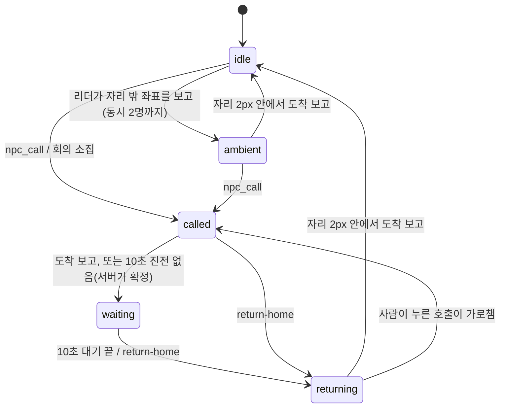
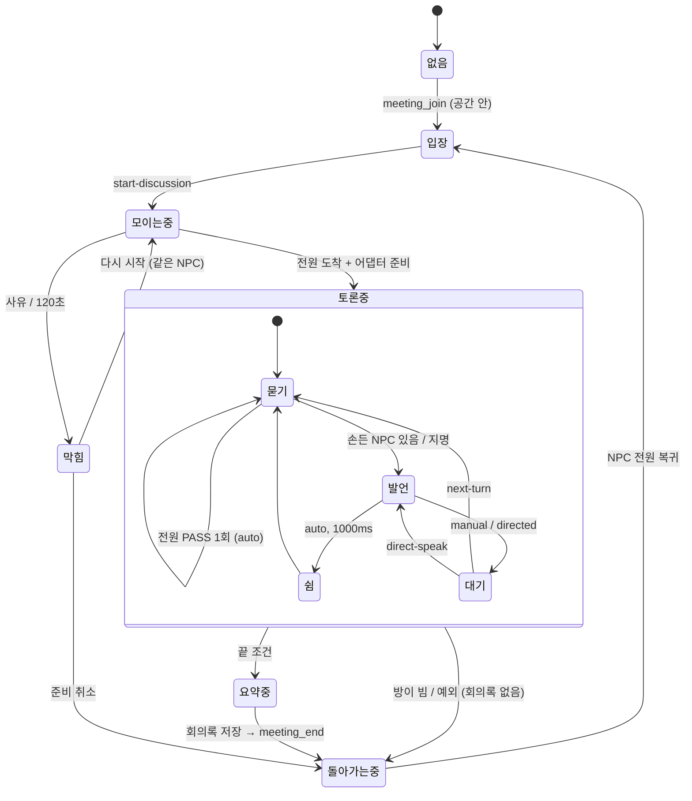
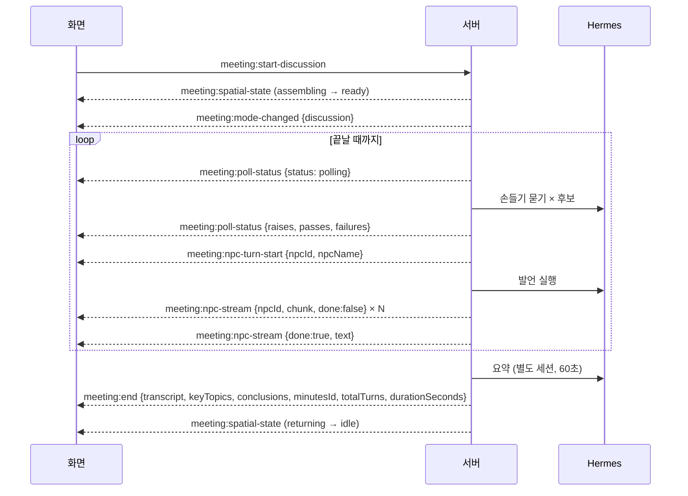
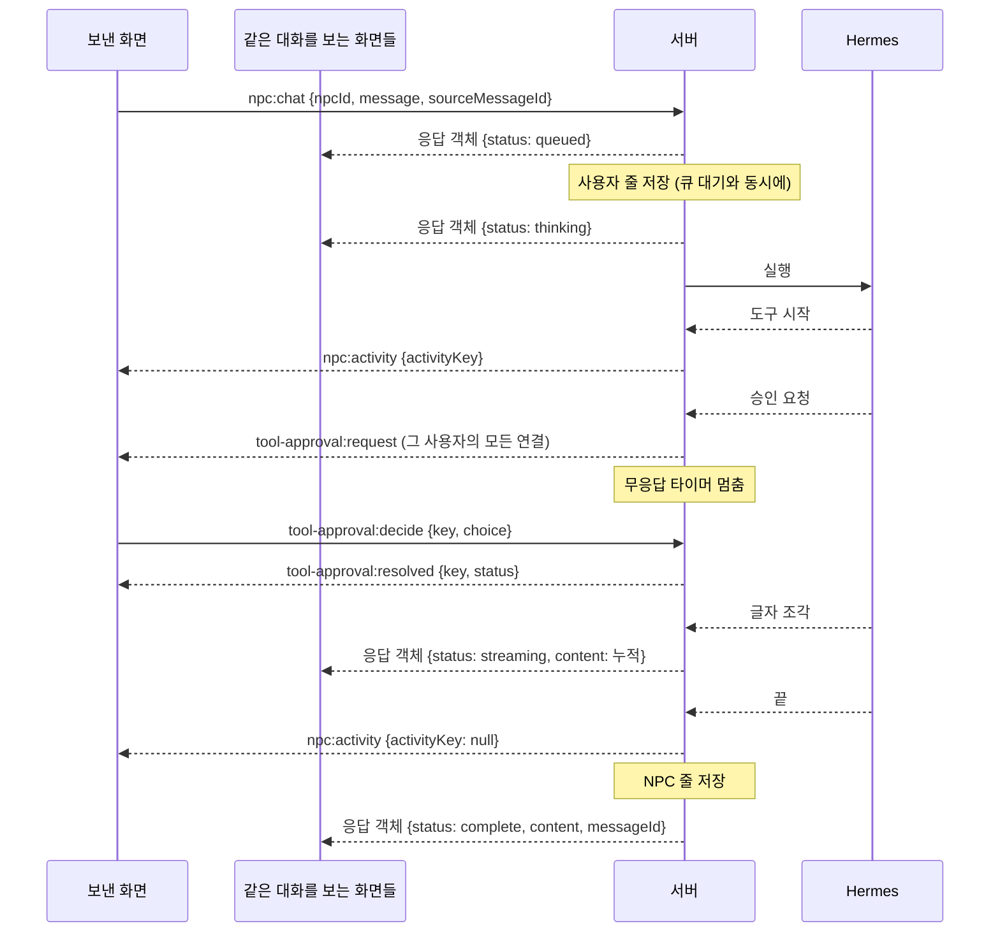
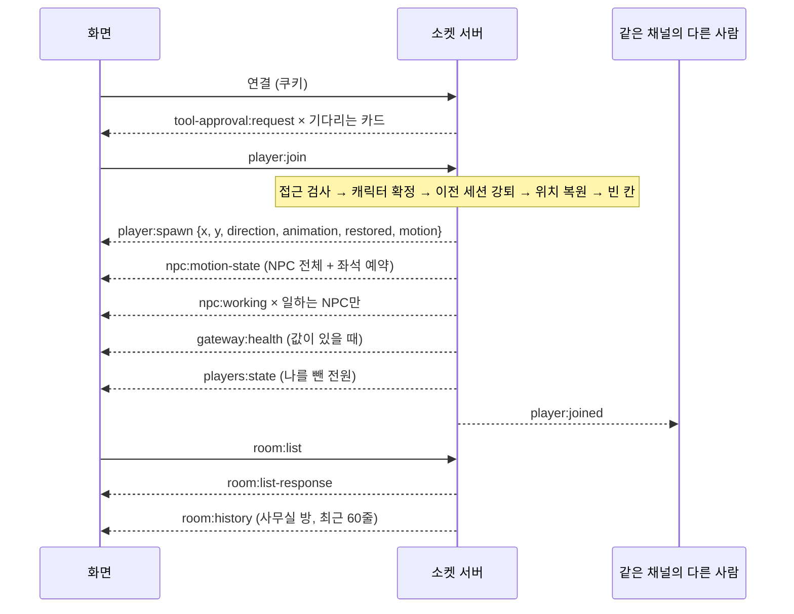
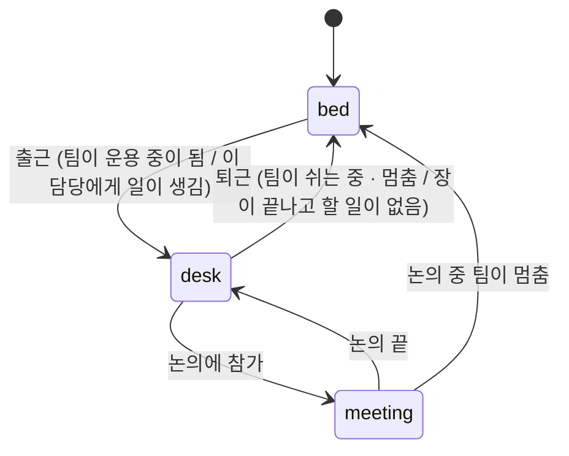

# 가상 사무실 화면과 그 서버 — 다시 만들 수 있는 깊이로 뜯기 (DeskRPG)

DeskRPG의 가상 사무실(3D 장면 · 캐릭터 · 회의 · 채팅 · 실시간 동기화 · 화면 상태 · 칸반과 알림 · 모바일 · NPC 설정)을 "이 글만 보고 같은 동작을 만들 수 있게" 순서 · 조건 · 상태 · 숫자 · 실패 처리까지 뜯었다. 가격인하의 작업 T20 · T21 · T22(구성 요소 A1 웹 화면, A3 사무실 서버)의 근거 문서다.

결론 다섯 줄:

1. **걷기는 서버가 계산하지 않는다.** 원본은 브라우저 한 대가 A*로 NPC를 걷게 하고 좌표를 서버에 보고한다. 서버는 "누가 몰 자격이 있나"와 자리 예약만 쥔다. 가격인하는 사용자가 한 명이므로 이 소유권 장치를 버리고 **서버는 "어느 자리에 있어야 하는가"만, 화면은 걷는 모습만** 맡으면 된다.
2. **실시간 연결에 이벤트 번호가 없다.** 원본은 다시 이으면 스냅샷을 통째로 다시 받는다. 가격인하의 `{seq, kind, payload, at}` + `last_seq`는 원본보다 강한 장치이고, 원본에서 가져올 것은 "스냅샷으로 받을 것과 변화분으로 받을 것의 구분"이다.
3. **채팅 응답은 "응답 객체 하나를 상태가 바뀔 때마다 통째로 다시 보내는" 구조다**(`queued → thinking → streaming → complete | failed | cancelled`, 누적 본문 포함). 다시 이어도 복구가 쉽다. 그대로 가져올 만하다.
4. **침대 · 집 · 출퇴근 걷기는 원본에 없다.** 원본의 "퇴근"은 지도에서 사라지는 것(`active=false`)뿐이다. 가격인하의 "방 침대에서 자고 출근하면 자리로"(R5-3)는 원본의 "자기 자리(home) 앵커 + 일 시작하면 자리로 걸어가 앉기" 위에 **두 번째 앵커(침대)** 를 얹어 새로 만든다.
5. **서비스 워커 · 웹 푸시 · 폰 전용 화면은 원본에 없다**(매니페스트만 있다). T22는 뜯을 원본이 없고 표준으로 만든다.

## 읽기 전에

- **라이선스**: DeskRPG는 Sustainable Use License(개인 · 비상업 용도, 고지 유지)다. 이 문서는 **방식만 참고한다. 코드와 자산(그림 · 모델 · 지도 자료)은 가져오지 않는다.** 아래에는 구조 · 흐름 · 식별자 이름 · 숫자만 적었고 원본 코드를 옮기지 않았다.
- **표시**: [관찰] = 원본 코드에서 직접 본 것. [추정] = 미루어 짐작한 것. "확인하지 못함" = 찾지 못했거나 읽지 않은 것.
- **근거 경로**: 따로 적지 않으면 DeskRPG 원본 루트 기준 상대경로(`src/...:줄`)다. 플러그인은 `P:`, Hermes는 `H:`를 붙였다.
- **단위**: 1타일 = 32px. 서버와 시뮬레이션은 px, 길 찾기와 교통 조율은 타일 단위 실수(`px/32 - 0.5`), 3D 렌더러는 `px/32`를 쓴다. 타일 중심의 px 좌표는 `(col + 0.5) * 32`. [관찰] `src/game/simulation/constants.ts`
- **기존 문서와의 관계**: 경로 목록 · 이벤트 이름 표 · 화면 구성 표는 `docs/research/deskrpg.md`(이하 "기존 문서")에 있다. 여기서는 되풀이하지 않고 절 번호로 가리킨다. 기존 문서가 원본과 다른 곳은 끝의 "바로잡을 곳"에 모았다.
- **가격인하 쪽 번호**: F7 · R4 · R5는 `docs/product/stock-team/spec.md` · `prd.md`, T20~T22 · A1 · A3 · C2 · C5 · C7 · D11 · E3 · E6 · E37 · N5 · M1 · M5는 `dev.md`, 실시간 연결은 `docs/dev/modules/gate.md`.

목차: [1 장면과 공간](#1-장면과-공간) · [2 캐릭터](#2-캐릭터) · [3 회의](#3-회의) · [4 채팅](#4-채팅) · [5 실시간 동기화](#5-실시간-동기화) · [6 화면 상태 관리](#6-화면-상태-관리) · [7 칸반 · 보고 · 알림](#7-칸반--보고--알림) · [8 모바일 · 웹앱](#8-모바일--웹앱) · [9 성능과 자원](#9-성능과-자원) · [10 NPC 설정](#10-npc-설정) · [11 가격인하 고유 요구](#11-가격인하-고유-요구-침대와-출근) · [바로잡을 곳](#기존-문서에서-바로잡을-곳) · [범위와 한계](#rea를-쓴-범위와-직접-읽은-범위)

---

## 1. 장면과 공간

환경 5종의 이름 · 크기 · 가구 수, 지도의 층 이름, 렌더러 설정의 요약, 화면 → 시뮬레이션 → 렌더러의 세 겹 구조는 기존 문서 7장에 있다. 여기는 다시 만들 때 필요한 나머지다.

### 1-1. 동작 원리

**지도의 정의** [관찰] `src/game/simulation/map-runtime.ts:19-168`, `src/game/three/bridge.ts:83-96`

1. 지도는 표준 Tiled JSON(직교, 타일 32px)이고 코드가 환경 id에서 결정적으로 만들어 낸다. 채널을 만들 때 그 복사본을 `channels.map_data`(JSON 칼럼)에 넣는다. [관찰] `src/db/schema.ts:68`
2. 화면은 채널을 REST로 읽을 때 지도 JSON과 개정 번호(`mapRevision`)를 받는다. 입장할 때 개정 번호를 서버에 내고, 다르면 `map:refresh`를 받아 다시 불러온다(5-1절).
3. 걸을 수 있는지는 세 가지로 정한다: ① 이름이 `collision`인 타일 층의 값(0이 아니면 막힘) ② `collision` 객체 층의 사각형이 덮는 칸 ③ 가구 객체가 차지한 칸. ②와 ③은 `"col,row"` 문자열 집합으로 합쳐 둔다. 가구가 바뀌면 이 집합만 다시 만든다.
4. 시작 칸은 객체 층에서 이름이나 종류가 `spawn`인 객체다.
5. 자리는 따로 저장하지 않는다. **가구 객체에서 유도한다**: 가구 정의(자산 목록)에 "이 가구의 몇 번째 타일에 어느 방향으로 앉는다"가 적혀 있고, 가구의 방향(4방향)만큼 돌려서 지도 좌표의 좌석을 만든다. [관찰] `src/game/three/seating.ts:4-41`
6. 좌석 하나는 값이 두 벌이다: **길 찾기 · 저장용 앵커**(타일 중심)와 **그릴 때의 위치**(모델에 맞춘 실수 좌표, 높이 포함). 앉은 모습은 그릴 때의 위치에, 예약과 도착 판정은 앵커에 쓴다. [관찰] `src/game/three/seating.ts:4-12`
7. 회의 공간은 지도에 붙는 별도 정의다: `{id, version, bounds(타일), entry(타일), seatIds(px 좌표 문자열), standingPositions[{x, y, direction}], wallObjectIds, wallTileKeys}`. [관찰] `src/game/meeting-space.ts:1-27`
8. 배회 구역 제한이 따로 있다(`src/game/ambient-zones.ts`). 세부는 확인하지 못함.

**지도 편집** [관찰] `src/game/three/bridge.ts:97-105`

- 사무실 화면에 **타일 편집 입구는 없다.** 화면에서 할 수 있는 것은 NPC 자리 바꾸기(자리 번호 배지를 띄우고 고름)와 시작 칸 고르기 둘뿐이고, 채널 소유자만 한다.
- 서버 소켓에는 `map:object-add / remove`, `map:tiles-update`, `map:layout-saved` 이벤트가 남아 있다(REA가 뽑은 이벤트 목록). 이것을 부르는 화면은 찾지 못했다. [관찰: 이름만] 처리 내용은 확인하지 못함.

**3D로 그리기** [관찰] `src/game/three/office-renderer.ts:147-330, 840-960`, `src/game/three/office-lighting.ts:3-25`

1. 좌표 대응: 3D의 x = `px_x / 32`, z = `px_y / 32`, y가 위. 즉 **타일 1칸 = 3D 1단위**, 타일 (col, row)의 중심은 `(col + 0.5, 0, row + 0.5)`. 바닥은 y ≈ 0. [관찰] `src/game/three/bridge.ts:78-83`
2. 렌더러: 계단 현상 줄임 켬, 픽셀 비율 `min(기기 값, 1.75)`, 그림자 켬(부드러운 PCF), sRGB 출력, ACES 톤 매핑(노출 1.05~1.12, 환경마다). 운영 빌드에서는 셰이더 오류 검사를 끈다(지도에 들어갈 때 긴 프레임의 원인이었다고 원본 주석에 적혀 있다).
3. 반사용 환경: 시작할 때 실내 환경 장면을 한 번 구워 장면 전체의 환경 맵으로 쓴다(세기 0.28).
4. 카메라: **원근**, 시야각 38도, 가까운 면 0.1 · 먼 면 250. 궤도 조작(감쇠 켬)에 거리 8~85, 내려다보는 각 0.15rad~`0.46π`(바닥 아래로 못 내려감).
5. 조작: 왼쪽 드래그 = 화면 이동, 오른쪽 드래그 = 회전, 휠 = 확대. 터치는 한 손가락 = 화면 이동, 두 손가락 = 확대 · 회전. **짧은 누름(5px 미만 움직임)만 "걷기 · 고르기"로 치고** 그 이상 움직이면 끌기로 본다. [관찰] `src/game/three/pointer-gesture.ts:3-26`
6. 따라가기: 사용자 캐릭터를 따라갈 때 매 프레임 `(목표 - 현재) × 0.08`만큼 카메라와 초점을 같이 옮긴다. 사용자가 카메라를 잡으면 따라가기가 꺼진다.
7. 전체 보기 거리: `(지도 대각선 / 2) / sin(min(세로 반각, 가로 반각)) × 1.1`. 창 크기가 바뀌면 다시 계산한다. [관찰] `src/game/three/bridge.ts:144-148`
8. 조명 셋: 해(방향광, 세기 2.35~2.8, 그림자를 드리움) + 보조 방향광(0.7~0.85) + 반구광(1.45~1.5). 해는 지도 중심 기준 `(-12, 26, -18)`, 즉 카메라 반대편(뒤쪽 창) 위에서 온다.
9. 그림자: 해 하나만 그림자를 만든다. 그림자 맵 2048×2048, 직교 그림자 카메라의 반폭 = `지도 대각선 / 2 + 4`(지도 전체가 들어가게), 먼 면 120.
10. 바닥과 벽: 환경 지도가 아니면 타일마다 상자 하나를 **인스턴스 메시 하나**로 그린다(칸 수만큼 인스턴스, 색만 다름). 환경 지도는 바닥재 조각 · 벽을 역시 인스턴스 메시로 그린다.
11. 가구: 지도를 다 지은 뒤 움직이지 않는 가구의 기하를 재질별로 **합쳐**(정적 배칭) 그리기 호출 수를 줄인다. 합치지 않는 것: 안 보이는 것, 그리기 순서를 바꾼 것, 움직이는 자산, 회의실 벽(가려질 때 투명해져야 해서), 뼈대 메시. [관찰] `src/game/three/static-batching.ts:4-28`, `src/game/three/office-renderer.ts:1406-1420`
12. 누르기 판정을 빠르게 하려고 지도를 지을 때 메시마다 경계 부피 트리를 만든다(`three-mesh-bvh`). 마우스 이동 판정은 **이벤트마다 하지 않고 마지막 좌표만 모아 프레임당 한 번** 한다(끌 때 CPU의 59%가 광선 판정이었다는 측정이 원본 주석에 있다). [관찰] `src/game/three/office-renderer.ts:205-214, 1477-1481`
13. 캐릭터: 룩마다 GLB 모델 하나(기존 문서 7장). 불러오기 실패 시 절차적 모델로 바꾼다(2-6절).
14. 이름표 · 말풍선 · 자리 번호 배지는 캔버스 위에 겹친 **DOM 요소**다. 매 프레임 3D 좌표를 화면 좌표로 투영해 `transform`으로 옮긴다. 서로 겹치면 배치 규칙으로 밀고, 넘치는 말풍선은 화면 가장자리의 "말 줄"에 순서대로 붙인다. [관찰] `src/game/three/office-renderer.ts:1544-1718`

**그리기 루프** [관찰] `src/game/three/office-renderer.ts:1468-1759`

1. `requestAnimationFrame`. **탭이 숨어 있으면 아무것도 그리지 않고 돌아간다**(측정값도 버린다).
2. 한 프레임의 순서: 밀린 마우스 이동 처리 → (1500ms마다) 지도 지문이 바뀌었는지 보고 바뀌었으면 지도를 다시 지음 → 시뮬레이션에서 캐릭터 목록을 **읽어 옴** → 사라진 캐릭터의 모델과 이름표를 치움 → 카메라 따라가기 → 회의 카메라 갱신 → 캐릭터마다 위치 · 회전 · 포즈 · 이름표 → 이름표 배치 → 그리기.
3. 렌더러는 시뮬레이션의 상태를 읽기만 한다. 소켓으로 무엇을 보내지 않는다.
4. 자동 해상도 낮춤: 3초 창마다 fps와 p95 프레임 시간을 재고, **fps < 55 또는 p95 > 25ms가 두 창 연속**이면 픽셀 비율을 0.25 내린다(최저 0.75). 올리는 규칙은 없다. [관찰] `src/game/three/render-scale.ts:1-11`

**React와 three의 이음** [관찰] `src/components/ThreeGame.tsx:42-215`

1. 컴포넌트는 빈 `div` 둘(캔버스 자리, 이름표 자리)만 그리고, 효과 훅 안에서 렌더러를 만든다. 만들다 실패하거나 WebGL 문맥을 잃으면 부모에 "치명적 오류"로 알린다.
2. 시뮬레이션이 준비되면 버스의 `three:bridge-ready`로 다리 객체를 받아 렌더러에 붙인다(`attach`).
3. 소켓 · 캐릭터 정보 · 채널 자료는 모두 ref에 담아 시뮬레이션에 넘긴다(값이 바뀌어도 장면을 다시 만들지 않으려고).
4. 치울 때: 버스 구독 해제 → 렌더러 `dispose`(이벤트 떼기, 장면의 기하 · 재질 · 텍스처 해제, 환경 맵 해제, **WebGL 문맥 강제로 버리기**, 캔버스 제거).

### 1-2. 상태와 자료 모양

| 것 | 모양 | 근거 |
|---|---|---|
| 지도 스냅샷(시뮬레이션 → 렌더러) | `{cols, rows, floor[][], walls[][], blocked[], objects[], tiled, environment?, environmentVersion?, meetingSpace?}` | `src/game/three/bridge.ts:83-96` |
| 지도 객체 | `{type, col, row, direction, variant, …}` (크기는 종류에서) | `src/lib/object-types.ts` |
| 좌석 | `{x, z, anchorX, anchorZ, elevation, direction}` | `src/game/three/seating.ts:4-12` |
| 캐릭터 스냅샷 | 기존 문서 7장 + `states`, `stateLabel`, `working`, `workingCount` | `src/game/three/bridge.ts:20-82` |
| 다리(`OfficeBridge`) | `actors()`, `mapKey()`, `map()`, `editor()`, `pointer(...)`, `walkable(col,row)`, `seatAvailable?`, `seatIntent?`, `setPresentation(active)` | `src/game/three/bridge.ts:106-127` |

회의 카메라의 숫자(탁자를 볼 때 올려본 각 30도, 말하는 사람을 볼 때 15도, 앉은 머리 높이 2.2, 선 머리 높이 2.9 등)는 `src/game/three/meeting-camera.ts:38-62`에 있다. 동작(누가 말할 때 어떻게 옮기는지)은 읽지 않았다 — 확인하지 못함.

### 1-3. 실패했을 때

- WebGL을 못 만들거나 문맥을 잃으면 3D 없이 쓰는 화면으로 바꾸지 않고 오류 화면을 낸다. [관찰] `src/components/ThreeGame.tsx:115-132`
- 지도가 바뀌는 중에 회의에 들어가려 했으면 `map_unavailable`로 실패를 알린다. [관찰] `src/components/ThreeGame.tsx:144`
- 모델을 못 불러오면 절차적 모델로 그린다(2-6절).

### 1-4. 가격인하에 옮길 때

| 원본의 것 | 판단 | 까닭 · 닿는 번호 |
|---|---|---|
| 타일 격자(32px = 3D 1단위)와 좌표 대응식 | 그대로 | 길 찾기 · 자리 · 그리기가 같은 좌표를 쓴다. T20 |
| 걸을 수 있는 칸 = 충돌 층 + 가구가 차지한 칸 | 그대로 | — |
| 자리를 가구 정의에서 유도하고 "앵커"와 "그릴 위치"를 따로 두기 | 그대로 + 넓힘 | 침대도 같은 방식의 앵커(눕는 위치와 방향)로 정의한다. 11절 |
| 원근 카메라 38도 · 궤도 조작 범위 · 짧은 누름과 끌기 구분(5px) | 그대로 | 폰에서 3D를 열 때(F7 1a2)도 같은 조작 |
| 해 하나만 그림자, 인스턴스 바닥, 정적 가구 합치기, 프레임당 한 번 판정 | 그대로 | 집 컴퓨터와 폰에서 가볍게 |
| 자동 해상도 낮춤(55fps · 25ms · 두 창) | 그대로 | 폰 대비 |
| 탭이 숨으면 그리지 않기, 치울 때 문맥 버리기 | 그대로 | 9절 |
| 이름표를 DOM으로 겹치기 | 그대로 | 글자가 선명하고 접근성 속성을 줄 수 있다 |
| Tiled JSON을 DB에 채널마다 복사, 지도 개정 번호와 새로 고침, 환경 5종 | 줄여서 | 사무실이 하나다. 지도는 화면 쪽 정적 정의 파일 하나로 두고 서버는 지도를 모른다 |
| 지도 편집 이벤트, 자리 바꾸기 모드, 시작 칸 고르기 | **안 가져옴** | 담당 6명의 자리와 방이 고정이다 |
| GLB 캐릭터 50종 · 가구 모델 · 지도 자료 | **안 가져옴** | 라이선스. 우리 자산을 새로 만든다(끝의 "사용자가 정해야 하는 것" 3번) |
| WebGL 실패 시 오류 화면 | 바꿈 | 우리는 3D 없이도 쓰는 가벼운 화면이 있다(F7 1a1). 실패하면 그 화면으로 떨어뜨린다 |

**서버(Rust)**: 지도를 모른다. **화면(웹)**: 지도 정의(격자 크기, 충돌, 가구, 담당별 자리 · 침대 앵커, 논의 자리), 길 찾기, 그리기 전부.

---

## 2. 캐릭터

### 2-1. 동작 원리: 상태는 두 축이다

캐릭터의 상태는 서로 독립인 두 축으로 되어 있고 화면에서만 합쳐진다. [관찰]

- **이동 축**: 어디로 걷고 있는가. 화면 쪽 `moveState` 5개와 서버 쪽 `phase` 5개.
- **일 축**: 에이전트가 무엇을 하고 있는가. 상태 목록 7개 + 응답 단계 3개.
- "앉음"은 상태가 아니다. **걷는 중이 아니고 좌석 앵커에서 0.22타일 이내면 앉은 모습으로 그린다**(위치에서 유도). [관찰] `src/game/three/seating.ts:117-122`, `src/game/three/office-renderer.ts:1564`

**이동 축 (화면)** — `NpcMoveState` [관찰] `src/game/simulation/npc-controller.ts:26, 142-251, 337-373`

| 상태 | 뜻 | 들어오는 조건 | 나가는 조건 |
|---|---|---|---|
| `idle` | 서 있거나 앉아 있음 | 처음, 이동 취소, 복귀 완료 | 아래 각 진입 |
| `moving-to-player` | 불려서 사용자(또는 지정 목적지)에게 감 | `moveTo()`가 경로를 찾음 | 사용자와 거리 < 36px(`TILE_SIZE+4`) → `waiting` |
| `waiting` | 사용자 옆에서 기다림 | 도착, 이미 가까움, 회의 자리 도착 | 10000ms(`waitDurationMs`) 동안 대화창이 없으면 자리로 복귀 |
| `returning` | 자기 자리로 돌아감 | `returnToHome()` | 경로 끝 → 자리 중심으로 맞추고 `idle` |
| `strolling` | 배회, 회의 소집(같은 경로 추종을 속도만 바꿔 재사용) | `startStroll(path, speed?)` | 경로 끝 · 막힘 · 금지 → `idle` |

**이동 축 (서버)** — `NpcMotionPhase`: `idle | called | waiting | returning | ambient`. `called`는 누가 불러서 가는 중(회의 소집 포함), `ambient`는 자리를 벗어나 배회 중. [관찰] `src/server/npc-coordination.ts:9, 635-838`



**일 축** — `NpcStateKind`, 앞이 우선: `unknown → awaiting_approval → stopped_after_failures → response_failed → responding → working → reporting`. 여러 개가 동시에 참일 수 있고, 목록 전체는 옆 패널에, **맨 앞 하나만** 머리 위 이름표에 나온다. [관찰] `src/lib/npc-state-map.ts:4-6, 14-32`

**화면 포즈** — `ActorPhase`: `idle | walking | seated | queued | thinking | streaming | done | attention | awaiting | failing | still`. [관찰] `src/game/three/characters.ts:11-23`

### 2-2. 에이전트의 실제 상태 → 화면의 캐릭터 (대응표)

T20에서 가장 필요한 표다. [관찰] 상태 → 표시 `src/game/three/bridge.ts:120-164`, 글리프 `src/game/three/office-renderer.ts:95-105`, 포즈 `src/game/three/characters.ts:116-154`

| 에이전트의 실제 상태 | 서버가 내는 신호 | 받는 범위 | 이동에 미치는 것 | 화면 |
|---|---|---|---|---|
| 답변 대기열에 들어감 | 응답 상태 이벤트 `status:"queued"` | 그 대화를 보는 소켓 | 배회 금지 | 이름표에 ⏳, 기본 자세 |
| 턴 실행 시작(생각 중) | 같은 이벤트 `status:"thinking"` | 같음 | 배회 금지 | 💭, 한 팔 올림, 머리 숙임 |
| 글자가 나오는 중 | 같은 이벤트 `status:"streaming"` + 누적 본문 | 같음 | 배회 금지 | 💬, 양팔 흔듦, 머리 끄덕임, 머리 위에 말 미리보기 |
| 도구 사용 중 | `npc:activity {npcId, activityKey}` | **요청한 소켓 하나** | 배회 금지 | 말풍선에 "검색 중…" 같은 문구 |
| 도구 끝 · 턴 끝 | `npc:activity {activityKey:null}` (성공 · 실패와 무관하게 마지막에 한 번 더) | 같음 | 배회 다시 허용 | 문구 사라짐 |
| 일감 카드 실행 · 예약 일 실행 중 | `npc:working {npcId, working, sources:{runningCards, cronRuns}}` | **채널 전체** | **자리로 걸어가 앉는다**, 배회 금지 | 🛠️ (2건 이상이면 숫자) |
| 승인 대기 | 승인 카드 목록 + 주의 수신함 행 | 승인자 | 영향 없음 | ✋, 한 팔 번쩍, 고정 포즈 |
| 연속 실패로 멈춤 | 주의 수신함의 실패 카드 | — | 영향 없음 | ⚠️, 머리 숙임, 숨쉬기 정지 |
| 마지막 답변 실패(아직 안 봄) | 응답 상태 `status:"failed"` | — | 영향 없음 | ❗ |
| 연결을 모름(게이트웨이 끊김 · 내 소켓 끊김) | `gateway:health` 또는 소켓 상태 | — | 영향 없음 | ❔, 완전 정지, 이름표 흐리게 |
| 보고하러 오는 중 | 화면이 만든 보고 대기열 | — | 사용자에게 걸어옴 | 도착하면 말풍선 |
| 쉬는 중 | 없음 | — | 배회 일정이 돈다 | 숨쉬기, 가끔 고개 돌림 · 손짓 |

**신호가 오는 길** (네 갈래, 모두 화면 안에서는 이벤트 버스를 거쳐 시뮬레이션 객체로 간다):

1. **응답 단계**: 서버 응답 추적기가 요청을 `queued`로 만들고 실행을 시작하면 `thinking`, 글자가 오면 `streaming`으로 바꾼다 → 소켓 `npc:response-state` / `room:response-state`(접속 때는 `*-snapshot`) → 화면 리듀서가 요청별 최신 기록을 모아 **NPC별로 가장 센 단계**(queued 1 < thinking 2 < streaming 3)로 접는다 → 버스 `npc:response-phases {phases}` → 시뮬레이션의 `responsePhases`를 통째로 바꾼다 → 다음 프레임에 렌더러가 포즈와 글리프를 고른다. [관찰] `src/server/chat-response-tracker.ts:20`, `src/app/game/chat-response-state.ts:213-229`, `src/app/game/GamePageClient.tsx:438-446, 917-997`, `src/game/simulation/office-simulation.ts:743-748`
2. **도구 사용**: Hermes 어댑터의 도구 진행 콜백 → 도구 이름의 접두사를 가장 긴 것 우선으로 문구 키에 대응(없으면 일반 키) → `npc:activity`. 화면은 그 NPC의 대화창이 열려 있으면 대화창 상태줄에만 쓰고, 아니면 지도 말풍선에 쓴다. [관찰] `src/server/socket-handlers.ts:681-685, 706-710`, `src/lib/npc-activity.ts:59-69`, `src/app/game/GamePageClient.tsx:1177-1190`
3. **일하는 중**: 플러그인 이벤트(`task.run.started/finished`, `task.status`, `task.deleted`, `cron.run.started/finished`)가 자동화 이벤트 싱크로 들어와 NPC별 실행 중 집합을 갱신한다 → `working = 실행 중 카드 + 실행 중 예약 일 > 0` → **값이 직전과 다를 때만** 방송, 접속 때는 일하는 NPC만 스냅샷 → 화면 리듀서(낙관적 갱신 없음) → 시뮬레이션이 **새로 일하기 시작한 NPC마다 자리로 보낸다**(`seatNpcForWork`). 걷는 중이었으면 매 틱 배회를 멈추고 `idle`이 될 때까지 다시 시도한다. [관찰] `src/server/automation-events.ts:99-155, 396-418`, `src/app/game/npc-working-state.ts:38-53`, `src/game/simulation/office-simulation.ts:752-761, 2389-2399, 2617-2630`
4. **상태 목록**(승인 대기 · 실패 · 연결): 화면에 아무것도 그리지 않는 React 컴포넌트 `NpcStatesBridge`가 입력 7개(연결 판정, 승인 수, 실패 카드 수, 답변 실패, 응답 중, 일하는 건수, 보고 중)를 모아 NPC별 목록과 맨 앞 상태의 문구를 만들어 버스 `npc:states {states, labels}`로 보낸다. 시뮬레이션은 저장만 하고 이동에는 쓰지 않는다. [관찰] `src/app/game/NpcStatesBridge.tsx:19-89`

주의할 점 둘. (가) "생각 중 · 도구 사용 중"을 **채널의 모든 사람에게** 알리는 이벤트는 원본에 없다. 채널 전체로 가는 것은 `npc:working`(카드 · 예약 일 실행)뿐이고 채팅 응답은 거기 들어가지 않는다. [관찰] `src/server/automation-events.ts:133-152` (나) 연결을 모르게 되면 실시간 상태 3개(`responding`, `working`, `reporting`)는 표시에서 빠지고 사람을 기다리는 상태는 남는다. 아직 판정 전(`null`)은 "모름"으로 치지 않는다(화면을 열 때마다 회색이 번쩍이는 것을 막는다). [관찰] `src/lib/npc-state-map.ts:39-77`

### 2-3. 길 찾기와 이동

**길 찾기 — A\*, 8방향** [관찰] `src/game/navigation.ts:3-145`

1. 도착 타일이 못 걷는 곳이면 실패. 출발 타일은 항상 걸을 수 있는 것으로 친다.
2. 8방향. 대각선은 양옆 두 직교 타일이 모두 걸을 수 있을 때만(모서리 끼어들기 금지). 비용은 직선 1, 대각선 √2. 휴리스틱은 유클리드 거리.
3. **탐색 한도 4096회.** 넘으면 실패.
4. 경로 다듬기: 몸통 반지름(`ACTOR_RADIUS = 0.22`타일)을 유지하며 직선으로 갈 수 있는 가장 먼 점으로 건너뛰어 꺾이는 점만 남긴다.
5. 걸을 수 있는 타일 = 지도 범위 안 + 충돌 값 0 + 가구가 차지하지 않음. [관찰] `src/game/simulation/office-simulation.ts:855-871`
6. NPC는 먼저 "다른 캐릭터를 피하는 경로"를 찾고, 없으면 캐릭터를 무시한 경로로 물러난다. [관찰] `src/game/traffic.ts:242-254`

**속도** (px/초) [관찰] `src/game/simulation/constants.ts:5`, `src/lib/npc-motion-config.ts:29-56`

| 이름 | 값 | 쓰이는 곳 |
|---|---|---|
| `PLAYER_SPEED` | 120 | 사용자 |
| `walk` | 150 | 자리로 복귀, 대화하러 접근 |
| `stroll` | 55 | 배회 |
| `summon` · `meetingSummon` | 300 | 호출 · 회의 소집(달려옴) |
| `NPC_SPEED_RANGE` | 20~480, 5 단위 | 채널 설정으로 조절 |
| `RUN_SPEED_THRESHOLD` | 225 | 이 이상이면 달리는 모습 |

한 틱 이동량 = `min(남은 거리, 속도 × min(dt, 100ms))`. 속도는 채널 전체가 같이 쓰는 설정이다(한 브라우저가 걷게 하고 나머지가 따라 그리므로). [관찰] `src/game/simulation/npc-controller.ts:442-445`

**경로 추종 한 틱** [관찰] `src/game/simulation/npc-controller.ts:287-529`

1. 경로가 없으면 1000ms마다 목표로 다시 찾는다. 못 찾으면 그 자리에 있는다(벽을 뚫고 순간이동하지 않는다).
2. 사용자에게 가는 중이면 3000ms마다 사용자의 현재 타일로 경로를 다시 잡는다.
3. 현재 경유점까지 2px 미만이면 다음 경유점으로 넘어간다.
4. 그 걸음이 벽을 스치면 경로를 버리고 다시 계산한다.
5. 한 걸음도 못 움직인 시간이 1500ms 쌓이면 전체 경로를 다시 찾아 우회한다.
6. 방향은 **실제로 움직인 벡터**에서 정한다(가로 성분이 크면 좌우, 아니면 상하).
7. 복귀가 끝나면 자리 중심으로 맞추고 저장된 방향을 본다.

**서로 겹치지 않게 — 교통 조율** [관찰] `src/game/traffic.ts:11-232`

- 캐릭터는 반지름 0.22타일 원, 최소 간격 0.44타일.
- 막히면 750ms마다 한 번만 우회를 찾는다(한 프레임에 탐색은 최대 2번). 국소 우회는 1/4타일 격자, 시작점 ±4타일, 최대 1200노드, **오른쪽 우선**.
- 양보: 상대가 사용자이거나, 상대의 출발 번호표가 더 작거나, 4번 연속 막혔으면 내가 비킨다. 비킬 때는 상대 진로에서 0.8타일 이상 떨어진 곳으로 물러나 최대 4000ms 기다린다.

**보간** [관찰] `src/game/remote-npc-presentation.ts:14-40`, `src/game/simulation/remote-player.ts:46-59`, `src/game/three/office-renderer.ts:1528-1584`

| 대상 | 방식 | 숫자 |
|---|---|---|
| 내가 걷게 하는 NPC | 보간 없음 | — |
| 남이 걷게 하는 NPC | 지수 추종 `1 - exp(-min(dt,100)/100)` (프레임 독립) | 0.25px 안이면 맞춤, 192px 넘게 벌어지면 순간이동 |
| 다른 사용자 | 프레임마다 고정 비율 0.2 (프레임 의존) | 0.5px 안이면 맞춤, 200px 넘으면 순간이동 |
| 몸 회전 | `차이 × (1 - exp(-14 × dt))`, dt 상한 0.1초 | 앉으면 좌석 방향으로 즉시 |

### 2-4. 자리 배정

- NPC의 자리는 DB의 `position_x`, `position_y`(타일 정수) 하나다. 이것이 곧 "집(home)"이다. [관찰] `src/game/simulation/npc-controller.ts:94-101`
- 책상 의자만 자리 후보다. 번호는 저장하지 않고 행 → 열 순서로 매번 1부터 매긴다. [관찰] `src/lib/seat-assignment.ts:8-34`
- 자동 배정: 자리 없는 NPC를 **id 순서**로, **번호가 가장 낮은 빈 책상**부터 채운다. 퇴근한 NPC의 자리도 찬 것으로 친다. [관찰] `src/lib/seat-assignment.ts:96-118`
- 자리가 모자라면 서 있을 타일에 놓는다: 8방향 이웃이 모두 바닥인 타일(통로를 막지 않게), 좌석과 입구 타일 제외, 시작 위치는 NPC id 해시(같은 NPC는 늘 같은 곳부터). [관찰] `src/lib/seat-assignment.ts:36-128`
- 동시 배정 충돌은 DB 유일 제약으로 잡고 최대 3번(`MAX_REPLANS`) 다시 계획한다. 서버가 뜰 때 전체 채널에 한 번 돌린다(여러 번 돌려도 결과가 같다). [관찰] `src/lib/npc-seating.ts:9, 98-160`
- 사용자가 자리를 바꾸는 길은 `PATCH /api/npcs/[id]` 하나, 바꿀 수 있는 칸은 `positionX, positionY, direction`뿐. 책상 의자가 아니면 400, 이미 찬 타일이면 409. [관찰] `src/app/api/npcs/[id]/route.ts:12-100`
- 공용 의자(회의 탁자 · 소파)는 앉기 전에 `seat:claim`으로 예약한다(3000ms 응답 대기). 예약은 60초 안에 도착(좌석 8px 이내)하지 않으면 사라진다. [관찰] `src/game/simulation/office-simulation.ts:1352-1390`, `src/server/npc-coordination.ts:839-895`

### 2-5. 배회

- 배회를 돌리는 것은 **리더 한 명**(채널에 입장한 소켓 id를 정렬한 첫 번째)뿐이다. [관찰] `src/server/npc-coordination.ts:312-321`
- 금지 조건(하나라도 참이면 배회하지 않음): 일하는 중, 응답 단계 있음, 도구 말풍선 있음, 대화창 열림, 방에서 불려 옴, 누가 소유 중, 회의 목표 있음. [관찰] `src/game/simulation/office-simulation.ts:2603-2616`
- 일정: 자리에서 60~100초 쉼(`rest`) → 20~35초 돌아다님(`roam`) → 자리로 돌아옴(`home`) → 다시 쉼. 걸음 사이 쉼은 2~6초. [관찰] `src/game/npc-ambient.ts:19-48`, `src/game/simulation/office-simulation.ts:2780-2781`
- 동시에 자리를 벗어날 수 있는 NPC는 2명. 직전 출발 뒤 15~25초가 지나야 다음이 출발하고, 가장 오래 기다린 NPC가 먼저 간다. 서버도 `ambient_limit`로 같은 한도를 지킨다. [관찰] `src/game/npc-ambient.ts:83-91`, `src/server/npc-coordination.ts:719`
- 목적지: 걸을 수 있는 타일을 섞어 **앞 12개만** 길 찾기를 돌려 처음 닿는 곳. 60% 확률로 공용 좌석을 후보 맨 앞에 넣고, 앉으면 8~16초 쉰다. [관찰] `src/game/simulation/office-simulation.ts:2699-2779`
- 잡담(화면 연출만, 서버 · 기록에 안 나감): 둘 다 한가하고 한쪽이 걷는 중이고 1.8타일 이내이고 사이에 벽이 없으면 시작. 둘 다 7500ms 멈춰 서로 본다. 개인 45초 · 같은 짝 90초 · 전체 12초의 재사용 대기. [관찰] `src/game/npc-smalltalk.ts:93-172`

### 2-6. 말풍선 · 이름표 · 애니메이션

- 머리 위 글의 우선순위: ① 대화 미리보기(공백을 줄이고 240자 넘으면 237자 + "...", 12000ms) ② 말풍선(글이 없으면 `···` = "할 말 있음") ③ 잡담 문장. [관찰] `src/game/speech-previews.ts:5-14`, `src/game/simulation/office-simulation.ts:435-444`
- 말풍선은 지속 시간이 지나면 **같은 객체일 때만** 지운다(오래된 인사가 새 보고 말풍선을 지우지 않게). 자동 인사는 사용자가 처음 64px 안에 들어올 때 한 번, 4500ms. [관찰] `src/game/simulation/office-simulation.ts:2224-2267`
- 이름표는 3D 위에 겹친 DOM 요소다. 위치는 서 있으면 머리 높이 2.7, 앉으면 2.0. 화면 밖이면 숨긴다. 상태는 `data-*` 속성으로 주고 모양은 CSS가 정한다. [관찰] `src/game/three/office-renderer.ts:1594-1664`
- 애니메이션은 프레임 그림이 아니라 **시간의 사인 함수로 만든 절차적 움직임**이다: 걷기 주기 `t × 9`(팔 ±0.55rad, 다리 ±0.5rad), 숨쉬기 `sin(t × 2.3) × 0.012`, 쉬는 손짓은 고개 돌림 13초 · 끄덕임 17초 · 손짓 19초 주기에 캐릭터마다 어긋남. [관찰] `src/game/three/characters.ts:104-155`, `src/game/three/idle-motion.ts:21-40`
- 달리기는 이동 종류가 아니라 **관찰한 속도**로 정한다: 0.15초 평활한 속도가 225px/초 이상이면 달리기, 그 80% 아래로 내려가야 걷기(깜빡임 방지). [관찰] `src/game/three/gait.ts:13-45`
- GLTF 모델을 쓸 때 클립은 idle · walk · sit 셋, 전환은 0.22초 교차. 불러오기에 실패하면 절차적 모델로 바꾼다. [관찰] `src/game/three/gltf-actor.ts:103-225`

### 2-7. 시뮬레이션은 어디서 도는가

| 일 | 어디서 |
|---|---|
| 길 찾기, 걸음, 배회 일정, 교통 조율, 잡담 | 브라우저(몰 자격이 있는 한 대) |
| 누가 모는가, 좌석 예약, 좌표 기록과 방송, 멈춘 이동의 마무리, 회의 자리 배정 | 서버(프로세스 메모리, DB에 쓰지 않음) |
| 자기 자리, 출근 여부 | DB |

- 틱: `requestAnimationFrame`, dt 상한 200ms(`MAX_FRAME_DELTA_MS`). 걷기와 타이머 안쪽에서는 한 번 더 100ms로 자른다. [관찰] `src/game/simulation/tick-loop.ts:14-28`
- 탭이 숨으면 250ms 간격 타이머로 바꾸고, 밀린 시간(최대 2000ms)을 200ms 조각으로 나눠 여러 번 돈다. [관찰] `src/game/simulation/tick-loop.ts:16-46, 89-106`
- 한 틱의 순서: 예약 호출 실행 → 다른 사용자 보간 → 남이 모는 NPC 보간 → (서버 스냅샷 2종이 다 와야 이후 진행) → NPC 갱신 → 근접 검사 → 키 입력 → 사용자 이동. [관찰] `src/game/simulation/office-simulation.ts:2471-2541`
- 서버로 보내는 주기: 사용자 위치 66ms(바뀐 게 있을 때만), NPC 위치 50~200ms(한 번에 30px를 넘지 않게), 산책 이어가기 정보 1000ms. [관찰] `src/game/simulation/constants.ts:6`, `src/game/simulation/office-simulation.ts:120-124, 1741-1751`

### 2-8. 실패했을 때 · 끊겼을 때

- **걷게 하던 탭이 숨거나 멈춤**: 서버가 2초마다 훑어 10초(`STALLED_MOTION_MS`) 동안 진전 없는 소유 이동을 도착으로 확정한다(호출이면 부른 사람 옆 칸에, 회의 이동이면 목표 좌표에 놓는다). 회의 이동의 "진전"은 목표에 1px 이상 더 가까워진 것만 친다. [관찰] `src/server/npc-coordination.ts:81-91, 458-478, 1479-1560`
- **걷게 하던 소켓이 끊김**: 같은 사용자의 다른 소켓 → 다음 리더 순으로 넘긴다. 30초(`NPC_RECONNECT_GRACE_MS`) 유예 뒤에도 안 돌아오면 그 NPC는 `returning`이 된다. [관찰] `src/server/npc-coordination.ts:377-411, 1043-1120`
- **길을 못 찾음**: 그 자리에 있고 1초마다 다시 찾는다. 회의 이동이면 `npc:spatial-failed`를 보내 서버가 목표에 그냥 놓는다. [관찰] `src/game/simulation/npc-controller.ts:290-314`, `src/game/simulation/office-simulation.ts:1068-1154`
- **일 끝 신호가 안 옴**(게이트웨이가 죽음): 표시에서는 `working`이 빠지지만 화면의 "일하는 중" 집합은 그대로라 배회 금지가 풀리지 않는다. [추정] `src/app/game/GamePageClient.tsx:2269`
- **도구 문구가 안 꺼지는 사고**: 턴이 끝날 때 성공 · 실패와 무관하게 `null`을 한 번 더 보내 막는다. [관찰] `src/server/socket-handlers.ts:706-710`

### 2-9. 가격인하에 옮길 때

| 원본의 것 | 판단 | 까닭 · 닿는 번호 |
|---|---|---|
| 두 축(이동 · 일)을 따로 두고 화면에서 합치기 | 그대로 | 일 상태가 바뀌어도 걷기가 끊기지 않는다. T20 |
| 2-2의 대응표(대기 · 생각 · 응답 · 도구 · 일하는 중 · 승인 대기 · 실패 · 모름) | 그대로 | R5-1 "자리에서 일하는 모습". 승인 대기 ✋는 FN2와 닿는다 |
| "일을 시작하면 자리로 걸어가 앉는다" | 그대로 | R5-1 · R5-3의 "출근하면 자기 자리로"의 뼈대 |
| "앉음은 위치에서 유도" | 그대로 + 넓힘 | 침대 앵커 근처면 누운 모습으로 넓힌다. 11절 |
| A\* 8방향 · 한도 4096 · 경로 다듬기 · 속도 표 | 그대로 | 숫자를 그대로 쓰면 움직임의 느낌이 같다 |
| 교통 조율(양보 · 우회) | 줄여서 | 6명뿐이다. "다른 캐릭터를 피한 경로 → 안 되면 무시한 경로"와 최소 간격만 남긴다 |
| 배회 · 잡담 | 줄여서 | 배회는 일정 숫자를 그대로 쓰되 동시 인원 1~2명. 잡담은 나중 |
| 소유권 · 리더 · 좌석 예약 · 속도 검증 · 30초 유예 | **안 가져옴** | 사용자가 한 명이고 사용자 캐릭터가 없으면(아래 결정 거리) 누가 걷게 할지 다툴 일이 없다 |
| 사용자 캐릭터(방향키 · 클릭 이동), "불러서 오게 하기" | 사용자가 정함 | F7은 "보고 말을 건다"만 요구한다. 끝의 "사용자가 정해야 하는 것" 1번 |

**서버(Rust)가 맡을 것**: 담당마다 ① 있어야 할 곳(자리 / 회의 자리 / 침대)과 ② 일 상태(쉬는 중 · 대기 · 생각 · 응답 · 도구 · 승인 대기 · 실패)를 쥐고, 바뀔 때마다 **번호 있는 이벤트**로 낸다. 접속하면 담당 6명의 현재 값을 스냅샷으로 준다. 서버는 좌표와 경로를 모른다(E37: 화면이 없어도 운용은 이어진다).

**화면(웹)이 맡을 것**: 스냅샷을 받으면 담당을 있어야 할 곳에 **바로 놓고**(원본도 첫 스냅샷에서는 강제로 다시 놓는다), 그 뒤 "있어야 할 곳"이 바뀌면 지금 위치에서 길을 찾아 걷게 한다. 걷는 좌표는 서버로 보내지 않는다. 탭이 숨었다 돌아오면 걷던 캐릭터는 목적지에 바로 놓는다.

---

## 3. 회의

시작 이벤트의 이름, 모드 3개의 이름, 요약 60초, 회의록 표의 칼럼 이름은 기존 문서 6장 · 3-2절 · 5-1절에 있다. 여기는 순서 · 조건 · 숫자 · 끝난 뒤다.

### 3-1. 동작 원리

**누가 지휘하는가**: 회의의 턴은 **DeskRPG 서버가 전부 지휘한다.** 서버 안의 대화 엔진이 "손들기 묻기 → 한 명 발언 → 쉼"을 되풀이하고, Hermes에는 "NPC 한 명에게 한 번 묻는" 호출만 보낸다. 엔진은 소켓 · DB를 모르고 NPC 어댑터 하나만 안다. [관찰] `src/lib/conversation/channel-runtime.ts:1-9, 352-533`

**Hermes의 hosted rooms와의 관계**: **이어지지 않는다.** DeskRPG 원본과 플러그인 본체에서 `hosted_room / hostedRoom`을 찾으면 한 건도 없다. Hermes 본체에는 hosted rooms가 있지만(`H:gateway/hosted_rooms.py`, `docs/research/hermes-agent.md` 6.5절) DeskRPG 회의는 그것을 쓰지 않고, 일반 실행 경로(`POST /v1/runs` + 이벤트 스트림)를 `multiParty` 깃발로 부른다. 이 경로는 Hermes에 저장된 세션을 쓰지 않으며 대화 기록은 DeskRPG가 매번 실어 보낸다. [관찰] `src/lib/adapters/hermes-adapter.ts:97-115`

**시작** [관찰] `src/server/meeting-discussion.ts:581-1026`, `src/server/socket-handlers.ts:2246-2275`

1. 소집은 **사람만** 한다(소켓 이벤트 `meeting:start-discussion {channelId, topic, settings, selectedNpcIds?}` 하나). NPC나 자동화가 여는 길은 찾지 못했다.
2. 소집하려면 먼저 `meeting:join`으로 회의 공간에 들어와 있어야 한다. 입장 조건은 사용자 캐릭터가 지도의 회의 공간 범위 안에 서 있는 것이다(아니면 `not_in_meeting_space`).
3. 채널당 회의는 하나다(이미 있으면 거절).
4. 참가 후보 = 채널의 출근한 NPC 전체, `selectedNpcIds`가 있으면 그것만.
5. 공간 조정기에 "모여라"를 시키고 **전원 도착할 때까지 기다린다.** 실패(막힘 · 취소 · 120초)면 조용히 끝나고, 화면은 공간 상태의 `blocked`와 사유로 안다.
6. 기다린 뒤 권한을 다시 확인한다(그 사이 소집자가 나갔을 수 있다).
7. NPC마다 어댑터를 한 번 만든다. **후보 가운데 한 명이라도 못 만들면 회의를 열지 않는다**(`backend_unavailable`).
8. 요약을 맡을 어댑터를 **첫 번째 후보 NPC**로, 회의와 다른 세션으로 따로 만든다.
9. 엔진을 기다리지 않고 돌리기 시작하고, 방 전체에 `meeting:mode-changed {mode, by, initiatorId, discussion}`를 보낸다. 이것이 "토론 시작" 신호다.

**모이기** [관찰] `src/server/meeting-spatial-coordinator.ts:116-223, 339-423`, `src/server/npc-coordination.ts:1249-1413`

1. 자리 순서: 좌석 먼저, 그다음 서는 자리. 각 묶음 안에서는 **입구에서 먼 곳부터**(입구 쪽부터 채우면 뒤 자리가 막힌다). 거리는 입구에서의 4방향 걸음 수.
2. NPC마다: 돌아올 자리를 기억 → 자리 목록을 차례로 예약 시도(20px 안에 다른 예약 · 캐릭터가 있으면 실패) → 전부 실패하면 **제자리에서 서서 참가**(방이 꽉 차도 회의는 열린다) → 걷게 한다(속도 300).
3. 서버는 목표만 정한다. 걷기는 리더 브라우저가 한다(2-7절). 브라우저가 한 대도 없으면 목표에 바로 놓는다.
4. "다 모였다" = 참가자 전원(NPC + 방에 있는 사람)의 상태가 `seated` 또는 `standing`.
5. 타임아웃 120000ms. 그때까지 걷는 중인 첫 참가자를 `arrival_timeout`으로 막는다. 멈춘 걸음은 10초 뒤 서버가 목표에 놓는다(2-8절).
6. 실패한 준비는 같은 NPC 집합이면 다시 시작할 수 있고, 집합이 달라졌으면 먼저 돌려보낸 뒤 한 번 더 눌러야 한다.

**턴 루프 한 바퀴** [관찰] `src/lib/conversation/channel-runtime.ts:352-533`, `src/lib/conversation/floor-controller.ts:109-224`

1. 모드 변경 명령과 사람 발언 큐를 비운다(사람 발언은 기록에 들어가고 연속 PASS 수가 0이 된다).
2. 다음 발언자를 정한다. 우선순위: **사람이 지명한 NPC > NPC가 멘션한 NPC > 손든 NPC 가운데 가장 오래 말하지 않은 NPC.** 사회자는 없고 역할 값은 전원 `Participant`다. 순번 돌리기가 아니다.
3. 손들기 묻기: 후보(남은 발언 수 > 0, 연속 실패로 빠지지 않음)에게 병렬로 묻는다. 한 번에 묻는 수는 Hermes의 동시 실행 한도(`max_concurrent_runs`, 3초 안에 못 읽으면 기본 4)로 자른다. 답의 첫 줄이 `SPEAK`로 시작하면 손든 것이고 **그 밖은 전부 PASS**다(빈 답 · 형식 어김 포함). 호출 실패는 PASS와 따로 센다.
4. 발언: 시작 알림 → 스트리밍(누적 원문을 정리해 **이미 보낸 길이 뒤의 새 부분만** 조각으로 보냄) → 끝 알림(정본 본문 포함). 답 첫 줄의 `TO: 이름`이나 본문의 `@[이름]`은 다음 지명이 된다.
5. `auto`면 1000ms 쉬고 다시 1로. `manual`이면 매 바퀴 끝에 멈춰 `meeting:next-turn`을 기다린다. `directed`면 묻지 않고 `meeting:direct-speak`으로 지명한 NPC만 말한다.
6. 사람 발언(`meeting:user-speak`, 500자)은 진행 중인 NPC 발언을 **끊지 않는다.** 다음 바퀴 시작에 기록에 들어간다. 사람 지명(`direct-speak`)과 모드 변경은 진행 중인 발언을 중단시킨다.
7. "대기 풀기"는 횟수가 아니라 불리언 하나로 기억한다(횟수로 세면 `manual`이 `auto`처럼 흘러간다).

**프롬프트에 들어가는 것** (구조만) [관찰] `src/lib/meeting-formatter.js:35-147, 240-303`, `src/lib/conversation/npc-runtime.ts:123-289`

- 손들기: 주제, 턴 수(현재 / 최대, 내 남은 발언 수), **최근 3턴**(각 150자에서 자름), 답 형식 지시(첫 줄에 `SPEAK: 한 줄 이유` 또는 `PASS`). 대화 기록은 싣지 않는다.
- 발언: 주제, 참석자 목록, 턴 수, **최근 10턴**(자르지 않음), "핵심만, 동료에게 말하듯, 목록 · 굵게 금지", 지명 방법. 길이의 숫자 한도는 없다.
- 스트리밍 중 정리: 지금까지 온 글이 `SPEAK:`나 `TO:`의 앞부분일 수 있으면 **아무것도 내보내지 않고 보류**했다가 확정되면 그 접두를 지운다.

**끝나는 조건** [관찰] `src/lib/conversation/channel-runtime.ts:436-487, 565-570`

| 이유 | 조건 |
|---|---|
| `max_turns` | 기록 길이(사람 발언 포함) ≥ 최대 턴(기본 50, 화면 입력 범위 5~50) |
| `consecutive_passes` | 전원 PASS인 바퀴가 **연속 2번** |
| `consecutive_failures` | 묻기가 아무에게도 닿지 못한 바퀴가 연속 3번 |
| `no_candidates` | 후보 0명(전원이 20턴을 다 씀 등) |
| `stopped` | 사람이 끝냄, 마지막 사람이 나감, 지도 새로 고침 |

"합의" 판정은 없다. 가장 가까운 것이 "아무도 더 말할 것이 없다 = 전원 PASS 2연속"이다. 끝난 이유는 `meeting:end`에 실리지 않아 화면은 왜 끝났는지 모른다. [관찰] `src/server/meeting-discussion.ts:495-509, 921-933`

**끝난 뒤** [관찰] `src/server/meeting-discussion.ts:870-946`, `src/server/socket-handlers.ts:932-1012`, `src/lib/meeting-outcome.ts:11-187`

1. 회의록 본문을 만든다: 마크다운(주제 / 일시 / 참석자 / 총 턴 / 턴마다 `순번 · 이름 · 시각 · 본문`).
2. 요약: 요약 담당 NPC에게 주제 + 회의록 전문 + 참가자 이름을 주고 JSON으로 답하게 한다. 60000ms 타임아웃. 결과는 `{핵심 주제[≤10], 결론(≤2000자), 결정[≤10], 후속 작업[≤12]{제목, 요약, 수락 기준, 담당자, 선행 작업}}`. JSON이 깨지면 `failed`.
3. `meeting_minutes`에 한 줄 저장 → 방에 `meeting:end` → 요약이 성공했고 후속 작업이 하나 이상이면 사무실 방에 알림(`meeting_outcome`) 하나.
4. 그 뒤에야 NPC를 원래 자리로 돌려보낸다(120초 타임아웃, 원래 자리가 막혔으면 가장 가까운 빈 칸).
5. **후속 작업은 카드로 자동 등록되지 않는다.** 사람이 회의록 화면에서 고른 것만 `POST /api/meetings/[id]/register`로 등록한다(멱등 키 `meeting:<회의록 id>:<순번>`, 승인 대기 카드로 만들어짐).

### 3-2. 상태와 자료 모양

공간 상태 `MeetingSpatialState` = `{channelId, spaceId, generation, phase, participants[{actorId, kind, state, seatId, target}], failure{actorId, reasonCode}|null}`. `phase`: `idle | assembling | ready | returning | blocked`. 참가자 `state`: `walking | seated | standing | returning | blocked`. 바뀔 때마다 방에 통째로 보낸다(화면은 세대가 더 낮은 것을 버린다). [관찰] `src/lib/meeting-discussion-state.ts`, `src/server/socket-handlers.ts:1240-1243`

막힘 사유(전부): `actor_unavailable`, `movement_unavailable`, `arrival_timeout`, `layout_unavailable`, `participant_left`, `backend_unavailable`, `driver_disconnected`, `destination_invalidated`, `return_timeout`, `return_space_full`, `return_unavailable`.



서버 → 화면 이벤트의 순서(`auto` 한 바퀴) [관찰] `src/server/meeting-discussion.ts:737-841, 921-933`



- 끝 신호의 `text`가 정본이다(조각 누적에는 다시 시도하기 전의 생성분이 섞일 수 있다).
- 다시 접속하면 `meeting:state {participants, messages(최근 50), discussion, spatial, isInitiator}`를 받는다. `discussion` 안에 `{topic, npcs, mode, isWaitingInput, currentSpeaker, rawStreams{npcId: 진행 중 발언의 누적 원문}}`이 있어 말풍선을 이어 그릴 수 있다. [관찰] `src/server/meeting-socket.ts:325-332`
- 숫자: NPC당 최대 20턴(고정), 방 메시지 보관 100개, 발언의 무응답 타임아웃 180초 · 전체 600초, NPC 한 명이 연속 3번 실패하면 후보에서 빠짐(회의는 계속).
- 저장: `meeting_minutes` = `{id, channel_id, topic, transcript(마크다운 전문), participants, total_turns, duration_seconds, initiator_id, key_topics, conclusions, outcome_json, summary_status(ok | failed | skipped), created_at}`. **진행 중인 회의나 턴 하나하나를 담는 표는 없다.** [관찰] `src/db/schema.ts:561-585`
- 화면에서 3D로 가는 신호: 말하는 사람을 `meeting:speaker {kind, id, utteranceId}`로 버스에 낸다. NPC는 **보이는 글이 처음 생긴 순간**에 한 번, 사람 발언은 4000ms 뒤 자동 해제. 회의 카메라가 이것을 받는다. [관찰] `src/components/meeting-room/speaker-tracker.ts`, `src/components/ThreeGame.tsx:161-175`

### 3-3. 실패했을 때 · 끊겼을 때

- **서버가 다시 시작됨**: 회의 상태는 전부 프로세스 메모리다. 진행 중인 회의는 사라지고 회의록도 남지 않는다. [관찰] `src/server/socket-handlers.ts:223-226`
- **마지막 사람이 나감 · 실행 예외 · 지도 새로 고침**: 요약도 회의록도 없이 끝난다. [관찰] `src/server/socket-handlers.ts:2353-2361`, `src/server/meeting-discussion.ts:1010-1017`
- **소집자만 나감**: 다른 사람이 남아 있으면 계속된다.
- **걷게 하던 브라우저가 사라짐**: 모이는 중이었으면 NPC를 제자리로 돌리고 `driver_disconnected`로 막는다. [관찰] `src/server/npc-coordination.ts:539-550`
- **발언 실패 · 타임아웃 · 빈 답**: 그 턴은 기록하지 않고 말풍선만 닫는다(끝 신호는 모든 갈래에서 나간다). 그 NPC의 연속 실패 수가 오른다.
- **도구 승인이 필요해짐**: 회의 소집자에게 승인 카드가 가고, 기다리는 동안 무응답 타이머가 멈춘다.

### 3-4. 가격인하에 옮길 때

| 원본의 것 | 판단 | 까닭 · 닿는 번호 |
|---|---|---|
| 서버가 턴을 지휘하는 엔진(기록 + 지명함 + 카운터 3개 + 모드) | 줄여서 | F2 · A4(에이전트 실행기)가 맡는다. 우리 논의 규칙(합의 점수 E27, 팀장)은 F2 쪽 스펙을 따르고 엔진의 뼈대만 참고한다 |
| "지명 > 멘션 > 손든 사람 중 오래 말 안 한 순" | 사용자가 정함 | 원본에는 사회자가 없다. 우리는 팀장이 있다. 끝의 "사용자가 정해야 하는 것" 4번 |
| 손들기 묻기(바퀴마다 후보 수만큼 AI 호출) | 줄여서 | 6명이면 바퀴마다 최대 6번 더 부른다. 비용이 크다 |
| 끝 조건 5가지와 숫자(50턴, 전원 PASS 2연속, 미도달 3연속, 1인 20턴) | 그대로 | 논의가 끝없이 돌지 않게 하는 안전장치 |
| 모이기: 자리 배정(먼 곳부터), "전원 도착하면 시작", 120초, 서서 참가 | 줄여서 | R5-1 "모여 논의하는 모습". 우리는 **논의를 화면 때문에 기다리게 하지 않는다**(E37). 서버는 "논의 시작"과 참가자만 알리고, 화면은 그때 걷게 한다 |
| 회의 뒤 자리로 돌아감 | 그대로 | 서버가 "있어야 할 곳"을 자리로 되돌린다 |
| 발언 스트리밍(시작 → 조각 → 정본이 든 끝), `SPEAK:` · `TO:` 접두 보류 | 그대로 | T21. 사무실 채팅에 팀의 대화가 보인다(F7 4) |
| 다시 접속 때 진행 중 발언의 누적 원문 주기 | 그대로 | 5-4절의 스냅샷 |
| 회의록 + 구조화 요약(결정 · 후속 작업) | 줄여서 | 우리는 매매 근거(R6)와 복기(R7)가 그 자리를 맡는다 |
| 진행 중인 회의를 메모리에만 두기 | **안 가져옴** | 우리는 턴마다 저장한다(E16 꺼졌다 다시 켜짐, conformance C7) |
| 끝난 이유를 화면에 안 주기 | **안 가져옴** | 논의가 왜 끝났는지는 판단 근거의 일부다 |
| 사람만 소집, 회의 공간 안에 서 있어야 함, 회의 카메라 | **안 가져옴** | 우리 논의는 일이 생기면 팀이 스스로 연다(F2). 사용자 캐릭터가 없으면 입장 조건도 없다 |
| Hermes hosted rooms | 해당 없음 | DeskRPG는 쓰지 않는다. 방 로그의 멱등 키 · 권한 세대는 `hermes-agent.md` 6.5절에서 따로 가져온다(conformance C7) |

**서버(Rust)**: 논의의 시작 · 턴 · 끝을 저장 이벤트로 낸다(누가 참가하는가, 누가 말하기 시작했는가, 본문, 왜 끝났는가). 논의가 시작되면 참가 담당의 "있어야 할 곳"을 논의 자리로, 끝나면 자리로 바꾼다. **화면(웹)**: 논의 자리 배정(지도의 논의 자리 앵커에 담당 순서대로), 걷기, 말하는 담당 표시, 채팅 창에 발언 흘리기.

---

## 4. 채팅

응답 수명주기의 상태 이름, 타임아웃 두 값, Hermes 쪽 호출과 이벤트 이름, 승인의 큰 흐름은 기존 문서 4-6 · 4-7절에 있다.

### 4-1. 동작 원리: 말을 거는 방법

대화 단위는 셋뿐이다: **사무실 방**(채널에 하나, 멘션한 NPC만 답함), **그룹 방**(초대한 구성원, 멘션이 없으면 NPC 구성원 전원이 답함), **개인 대화**(사용자 캐릭터 × NPC). 채널 · 답글 스레드는 없다. [관찰] `src/app/game/room-state.ts:57-60`

| 경로 | 조건 | 일어나는 일 | 근거 |
|---|---|---|---|
| 가까이 가서 `/` 키 | 거리 < 64px(`NPC_INTERACT_RADIUS`, 2타일), 입력 칸에 초점이 없을 때 | 대상이 하나면 바로 대화창, 둘 이상이면 고르는 목록 | `src/game/simulation/office-simulation.ts:2512-2538` |
| NPC를 누름 | 5px 미만 움직인 누름만 | 가까우면 바로, 멀면 옆 칸까지 걸어가서 도착하면 대화창 | `src/game/simulation/office-simulation.ts:1614-1684` |
| 왼쪽 목록에서 직원을 누름 | NPC가 `idle`일 때 | 걸어가서 대화 | `src/app/game/GamePageClient.tsx:1492-1499` |
| 왼쪽 목록의 개인 대화 줄을 누름 | 거리 조건 없음 | 바로 대화창과 기록. **여는 것만으로는 부르지 않고**, 보낼 때 필요하면 부른다 | `src/app/game/GamePageClient.tsx:1605-1661` |
| 직원 메뉴의 "부르기" | 서버가 거절할 수 있음(회의 중, 남이 부름) | NPC가 달려오고 도착하면 대화창이 열림 | `src/app/game/GamePageClient.tsx:1472-1490` |
| 방 채팅에서 `@멘션` | — | 서버가 멘션된 NPC를 부르고 **답은 방에** 나온다. 이렇게 걸어온 NPC는 도착해도 개인 대화창을 열지 않는다 | `src/app/game/GamePageClient.tsx:1686-1731` |

서버는 개인 대화에 **거리 검사를 하지 않는다**(거리는 화면의 규칙이다). [관찰] `src/server/socket-handlers.ts:1672-1729`

창의 구조 [관찰] `src/components/conversation/ConversationWorkspace.tsx:55-58`, `src/components/ChatPanel.tsx:270-282, 704-705`

- 세 칸: 왼쪽 목록(264px 고정: 방 목록 + 개인 대화 줄 + 사람들과 NPC 줄) | 가운데 3D | 오른쪽 대화창(기본 388px, 250~600px로 끌어 조절).
- 대화창은 **한 번에 한 대화만** 보인다. 개인 대화 안에는 탭 5개(`chat | cron | cards | skills | connectors`).
- 대화마다 입력 초안과 스크롤 위치를 기억했다가 돌아오면 되살린다.
- 입력: Enter 전송, Shift+Enter 줄바꿈, 한글 조합 중에는 전송하지 않음, 500자, 키 이벤트가 3D로 새지 않게 막음. [관찰] `src/components/ChatInput.tsx:69-181`
- 멘션은 줄 처음이나 공백 뒤의 `@`에서만 후보 창이 열리고, 고르면 칩이 되며 보낼 때 `@[이름]` 문자열이 된다. [관찰] `src/components/mention-input/mention-model.ts:2-53`

### 4-2. 동작 원리: 개인 대화의 서버 흐름

[관찰] `src/server/socket-handlers.ts:603-711, 1647-1960`, `src/server/dm-response-runtime.ts:19-150`

1. 화면이 `sourceMessageId`(UUID)를 만들고 **내 줄을 먼저 그린 뒤** `npc:chat {npcId, message, sourceMessageId, characterId, skills?, 첨부?}`를 보낸다.
2. 서버 검사 순서: 형식 → 500자 자르기 → 2초 간격 → NPC 설정 읽기 → 채널 접근과 기록 주인 확정.
3. `requestId`를 만든다. 그 사용자 × NPC의 큐가 찼으면(8) 거절한다.
4. 응답 객체를 `queued`로 만들어 방송한다. 사용자 줄 저장은 **큐를 기다리는 것과 동시에** 시작한다.
5. 차례가 오면 저장 결과를 확인하고(실패면 `failed / persistence_error`) `thinking`으로 바꾼다.
6. Hermes를 부른다. 세션 키는 NPC × 사용자마다 하나다.
7. 글자 조각이 올 때마다: 보낸 소켓에 조각(`npc:response`) + 그 대화를 보는 모든 소켓에 **누적 본문이 든 응답 객체**(`streaming`). 모으거나 늦추는 장치는 없다.
8. 끝나면 NPC 줄을 저장하고 `complete`(본문, 메시지 id). 실패면 `failed`(`empty_response`, `adapter_error`, 타임아웃 등).
9. 다른 사용자는 같은 NPC와 **동시에** 대화할 수 있다(큐가 사용자 × NPC마다 따로다).



### 4-3. 동작 원리: 방 대화의 서버 흐름

[관찰] `src/server/room-socket.ts:296-481`, `src/lib/conversation/open-chat-runtime.ts:207-421`, `src/server/room-runtime.ts:290-411`

1. 검사 순서: 방 id → 입장 여부 → 방 접근 → 열어 둔 방인지 → 내용 없음 → 2초 간격. 거절은 언제나 `room:error {roomId, code}` 하나다.
2. 사용자 줄을 저장하고 `room:message`로 방송한다.
3. 답할 NPC를 정한다(멘션 → 방 정책). 멘션은 있는데 아무도 안 맞으면 `room:mention-skipped`.
4. NPC마다: 연속 실패 3회면 건너뜀, 그 NPC의 큐가 찼으면(8) `room:npc-aborted {reason:"queue_full"}`, 아니면 `queued`로 방송하고 NPC별 큐에 넣는다.
5. 턴이 시작되면 `thinking` + **NPC가 부른 사람에게 걸어온다**(걷기와 말하기가 동시에 시작).
6. 프롬프트에 방의 **최근 10줄**을 매번 넣는다(개인 대화는 Hermes 세션이 기억한다).
7. 조각마다 누적 본문이 든 응답 객체를 방송한다. 방에는 조각 이벤트가 따로 없다.
8. 끝나면 NPC 줄 저장 → `complete` → `room:message` 순서.
9. 사슬: NPC의 답에 다른 NPC 멘션이 있으면 그 NPC를 부른다. 사람이 말할 때마다 예산 6, NPC가 부를 때마다 1씩 깎인다.

### 4-4. 동작 원리: 화면이 스트리밍을 그리는 방법

[관찰] `src/app/game/chat-response-state.ts:25-229`, `src/components/chat/ResponseProgress.tsx:24-67`, `src/components/ChatPanel.tsx:460-471, 1090-1124`

1. **조각을 붙이지 않는다.** 응답 객체가 올 때마다 `requestId`별로 `updatedAt`이 크거나 같은 것으로 **덮어쓴다**(늦게 온 옛 상태는 버린다).
2. 개인 대화에서는 응답 객체를 "자리 표시 메시지"로 바꿔 **자기 질문 바로 뒤**에 끼우고, 그 뒤로 본문을 덮어쓴다.
3. 중간 표시: 내 줄 아래 "받았음" 표시 → 상태 줄("이름: 대기 / 생각 중 / 쓰는 중", 깜박이는 점) → 본문이 생기면 깜박이는 커서가 달린 말풍선.
4. 도구 사용 문구는 진행 중인 응답이 없을 때만 입력 칸 위 한 줄로 보인다(본문과 섞지 않는다).
5. 승인 카드는 메시지 목록과 입력 칸 사이에 쌓인다. 선택지는 `once | session | deny`. 누르면 잠기고, 결과가 뜬 뒤 5000ms에 접힌다.
6. 스크롤: 메시지 목록이 바뀌면 무조건 맨 아래로, 응답 상태만 바뀌면 **바닥에서 80px 안에 있을 때만** 따라간다.
7. 취소: 진행 중인 응답이 있으면 전송 단추가 "중지"로 바뀐다. 개인 대화는 가장 최근 진행 중인 응답, 방은 **내가 보낸 줄에 대한** 응답만 취소할 수 있다.
8. 화면 쪽 줄이기는 없다. 이벤트 하나 = 다시 그리기 한 번이고, 마크다운은 누적 본문 전체를 매번 다시 읽는다.
9. 마크다운은 NPC 말풍선에만 적용한다(GFM, 원시 HTML 없음, URL 거르기, 코드 블록에 복사 단추, 구문 강조 없음). [관찰] `src/components/ui/MarkdownContent.tsx:18-191`

**취소의 서버 쪽** [관찰] `src/server/socket-handlers.ts:2026-2086`, `src/server/room-runtime.ts:403-411`

- 개인 대화: 자기 범위의 진행 중인 요청만 `cancelled`로 바꾸고 Hermes 실행을 멈춘다. 실행 id가 생기기 전에 취소됐으면 id가 늦게 올 때 한 번 더 멈춘다.
- 방: 먼저 `cancelled`를 방송한다. 대기 중이면 차례가 올 때 버리고, 실행 중이면 멈춘다. 저장도 사슬도 없다.
- 취소 뒤 늦게 오는 방출은 "아직 유효한가" 검사로 버린다.

### 4-5. 상태와 자료 모양

응답 객체 `ChatResponse` = `{requestId, sourceMessageId, npcId, npcName, status, content, updatedAt, messageId?, error?}`. `status`: `queued → thinking → streaming → complete | failed | cancelled`. 승인 대기는 **새 상태가 아니다**(`thinking` / `streaming` 그대로, 무응답 타이머만 멈춘다). [관찰] `src/lib/chat-response.ts`, `src/server/dm-response-runtime.ts:145-150`

타임아웃: 무응답 180000ms(조각 · 도구 진행 · 실행 시작에 다시 감김, 승인 요청에서 멈췄다가 다음 진행 신호에 다시 감김), 전체 600000ms(승인 대기 중에도 흐름). [관찰] `src/lib/conversation/turn-timeout.ts:12-47`

도구 승인 [관찰] `src/server/tool-approvals.ts:33-393`

| 항목 | 내용 |
|---|---|
| 승인자 | 요청이 온 순간에 정함. 개인 대화 = 말 건 사용자, 방 = 그 턴을 부른 사람, 회의 = 소집자. 없으면 카드를 만들지 않는다 |
| 만료 | `지금 + 초 × 1000`, 기본 300초 |
| 묶음 | 같은 맥락 · 승인자 · NPC · 명령의 해시. 같은 묶음의 카드가 열려 있으면 새 카드 대신 횟수만 올린다. 묶음 기록은 1시간 |
| 이벤트 | 승인자에게 `tool-approval:request`(요약이 준비되면 같은 카드를 다시 보냄), 방 사람들에게 `tool-approval:pending {key, npcId, approverName}`, 닫힐 때 `tool-approval:resolved {key, status}` |
| 응답 | `tool-approval:decide {key, choice}` → 결과 `ok | not_approver | closed | invalid_choice | failed` |
| 저장 | 메모리에만 있다 |

기록 표(칼럼 이름은 기존 문서 5-1절): 개인 대화 `chat_messages`(요청 id · 상태 칸 없음), 방 `chat_room_messages`(id가 시간순 UUIDv7), 읽음 `conversation_reads {user_id, kind(room | dm | report), target_id, read_at, seen_ids}`. [관찰] `src/db/schema.ts:484-559, 734-747`

기록 다시 불러오기 [관찰] `src/server/socket-handlers.ts:1971-2022`, `src/server/room-socket.ts:265-282`

- **REST 기록 API가 없다.** 기록은 소켓으로만 온다.
- 개인 대화: 그 캐릭터 × NPC의 **전체**를 시간순으로(개수 제한 · 커서 없음). 화면은 통째로 갈아 끼운다.
- 방: 최근 60줄. **위로 올려 더 받기(쪽 나누기)가 없다.**
- 읽음: `conversation:read {kind, id, at?}`. 서버는 미래 시각을 지금으로 자르고 **앞으로만** 움직이게 저장한 뒤 그 사용자의 모든 연결에 돌려준다. "보고 있다" = 그 대화가 화면에 보이고 브라우저 탭이 앞에 있다. [관찰] `src/lib/conversation-reads.ts:39-59`, `src/app/game/read-marks.ts:7-24`

첨부: 올리기는 REST(파일당 5MB, 메시지당 3개), 전송 때 첨부 id를 싣는다. 요청 상태 `pending → preparing → ready → running → done`(+ `failed`, `cancelled`, `outcome_unknown`). [관찰] `src/lib/conversation-attachments/types.ts:26-27`, `src/server/conversation-attachment-runtime.ts:4-91`

### 4-6. 실패했을 때 · 끊겼을 때

- **끊김**: 화면은 진행 중인 응답(대기 · 생각 · 쓰는 중)만 지우고 끝난 것은 둔다. 입력을 잠근다. 다시 보내기 큐는 없다(끊긴 채 보내려 하면 알림만 띄우고 버린다). 서버의 응답은 끊겨도 끝까지 돌아 저장된다(5-3절). [관찰] `src/app/game/GamePageClient.tsx:725-740, 1628-1634`
- **다시 이음**: 방을 다시 열면 기록(60줄)과 응답 스냅샷이 통째로 온다. 개인 대화는 기록을 다시 요청한다.
- **응답 실패**: 상태 줄에 "이름: 실패"와 사유. **다시 시도 단추는 없다**(다시 보내면 새 요청이 된다).
- **기록을 못 읽음**: 빈 배열이 온다. 화면에서는 "기록 없음"과 구별되지 않는다. [관찰] `src/server/socket-handlers.ts:1973-1989`
- **도구 문구가 요청한 연결에만 간다**: 같은 사용자의 다른 탭 · 기기에서는 도구 사용 중인지 보이지 않는다. [관찰] `src/server/socket-handlers.ts:684`

### 4-7. 가격인하에 옮길 때

| 원본의 것 | 판단 | 까닭 · 닿는 번호 |
|---|---|---|
| 응답 객체를 통째로 보내고 `requestId` + `updatedAt`으로 덮어쓰기 | 그대로 | C5 · conformance D20. 컴퓨터와 폰이 같은 응답을 같이 본다 |
| 상태 6개와 순서, 승인 대기를 새 상태로 만들지 않기 | 그대로 | E6(담당 응답 실패)이 `failed`에 닿는다 |
| 사용자 줄을 먼저 그리고 `sourceMessageId`로 짝 맞추기 | 그대로 | 응답이 자기 질문 뒤에 붙는다 |
| 무응답 180초 · 전체 600초, 승인 중 무응답 타이머 멈춤 | 그대로 | FN2의 답 없음 처리와 따로 돈다 |
| 사용자 × 담당마다 큐(8) | 줄여서 | 사용자가 한 명이다. 담당마다 큐 하나 |
| 취소(먼저 `cancelled` 방송, 늦은 방출 버리기) | 그대로 | — |
| 도구 사용 문구(이름 접두사 → 문구 키, 끝에 반드시 지움) | 그대로 + 넓힘 | 요청한 연결만이 아니라 **모든 연결**에 보낸다(지나가는 이벤트) |
| 스크롤 규칙(80px), 중지 단추, 상태 줄 | 그대로 | T21 |
| 조각마다 누적 본문 전체 보내기 | 줄여서 | 서버가 일정 간격(예: 프레임 한 번 분량)으로 묶어 보내고, 화면도 프레임당 한 번만 반영한다(9절) |
| 사무실 방 하나 + 담당별 개인 대화 | 그대로 | F7 4("사무실 채팅에 팀의 대화가 보인다")와 5("담당에게 묻는다") |
| 그룹 방, 방 만들기 · 초대, 스킬 칩, 커넥터 탭 | **안 가져옴** | 팀이 하나다 |
| 가까이 가야 말을 걸 수 있음, 부르면 달려옴 | 사용자가 정함 | 사용자 캐릭터가 있는가에 달렸다(끝의 1번). 없으면 "담당을 누르거나 목록에서 고름" 하나면 된다 |
| 기록: 개인 대화 전체 · 방 60줄 · 쪽 나누기 없음 | **안 가져옴** | 우리는 REST로 "이 번호 앞의 N줄"을 받는 쪽 나누기를 둔다(conformance T21 항목) |
| 도구 승인 카드(메모리에만) | **안 가져옴** | 우리 승인은 A7 승인 관리(M5: 내용 지문, 6자리 재확인, 저장됨)가 맡는다. 가져올 것은 "채팅 흐름 사이에 카드로 끼어드는 모양"과 "연결하자마자 다시 보내기"뿐 |
| 다시 시도 단추 없음, 실패한 내 줄 표시 없음 | 바꿈 | 폰에서 연결이 자주 끊긴다. 실패한 줄에 "다시 보내기"를 둔다 |

**서버(Rust)**: 응답 객체의 수명주기와 방송, 담당별 큐, 타임아웃, 취소, 메시지 저장(번호 있는 이벤트), 기록 REST. **화면(웹)**: 덮어쓰기 리듀서, 상태 줄 · 말풍선 · 승인 카드, 스크롤 규칙, 입력.

---

## 5. 실시간 동기화

이벤트 이름과 내용 칸의 표는 기존 문서 3-2절에 있다. 여기는 순서 · 조건 · 한도다.

### 5-1. 동작 원리

**서버의 뼈대** [관찰] `server.js:91-97, 111-242, 259-262`

1. Socket.IO 서버는 웹과 **다른 포트**(`PORT+1`, 기본 3001)의 HTTP 서버에 붙는다. 같은 프로세스 안이다.
2. 모든 실시간 상태는 프로세스 메모리의 `Map`이다. Redis 같은 어댑터가 없다. **프로세스 하나가 전제다.**
3. REST 쪽에서 소켓 쪽으로 넘어가는 길은 같은 포트의 `/_internal/*` 다리 4개(`rpc`, `map-refresh`, `emit`, `room-members`)다.

**접속 → 입장** [관찰] `src/server/socket-handlers.ts:1027-1069, 1305-1328, 1348-1586`

1. 연결 핸들러 안에서 쿠키 `token`(JWT)을 검사한다. 실패하면 이유를 보내지 않고 끊는다.
2. 성공하면 `user:<userId>` 방에 넣고, 그 사용자 앞으로 기다리는 도구 승인 카드를 **연결 즉시**(입장 전에) 다시 보낸다.
3. 이 시점의 소켓은 "연결됨 · 미입장"이다. 기록 요청은 빈 배열, 방 채팅 전송은 `not_joined`를 받는다.
4. `player:join {mapId, mapRevision?, characterId?, x, y}`가 오면: 형식 검사 → 채널 접근 검사 → 서버가 "내 캐릭터"를 정함 → **같은 사용자의 이미 입장한 다른 소켓을 모두 강퇴**(`session:kicked`) → 위치 정하기 → 지도 개정 검사 → 빈 칸 찾기.
5. 거절은 강퇴보다 먼저 일어난다(실패한 입장 시도가 살아 있는 세션을 끊지 못하게).
6. 위치를 정하는 우선순위: 메모리의 이어가기 저장소 → DB의 마지막 위치 → 지도의 시작 칸 → 화면이 보낸 좌표.
7. 중간의 비동기 대기마다 "아직 유효한 입장인가"를 다시 본다.



**통째로 받는 것과 변화분으로 받는 것** [관찰] `src/server/socket-handlers.ts:1555-1586, 1993-1997`, `src/server/npc-coordination.ts:429-453`, `src/server/room-socket.ts:255-283`

| 통째(스냅샷) | 언제 | 그 뒤 변화분 |
|---|---|---|
| `player:spawn`, `players:state` | 입장 | `player:joined`, `player:moved`, `player:left` |
| `npc:motion-state {protocolVersion:1, revision, ambientLeaderId, npcs[], seats[]}` | 입장 + **NPC 상태가 바뀔 때마다 전체** | `npc:position-sync`, `npc:come-to-player`, `npc:returning`, `npc:stop-moving` |
| `npc:working` (일하는 것만) | 입장 | `npc:working` (값이 바뀔 때만) |
| `room:list-response`, `room:history` (60줄) | 방 목록 · 방 열기 | `room:message`, `room:activity`, `room:created/updated/deleted` |
| `room:response-snapshot`, `npc:response-snapshot` | 방 열기 · 기록 요청 | `room:response-state`, `npc:response-state` |
| `npc:history {messages: 전체}` | 기록 요청 | `npc:response` (조각) |
| `tool-approval:request` × N | 연결 | `tool-approval:request / resolved / pending` |

**위치 갱신** [관찰] `src/server/socket-handlers.ts:1591-1614`, `src/game/simulation/office-simulation.ts:2179-2208`

1. 화면은 `player:move {x, y, direction, animation, motion?}`를 66ms 이상 간격으로, **바뀐 게 있을 때만**(좌표 0.5px · 방향 · 애니메이션 · 목적지) 보낸다. 스냅샷 2종을 받기 전에는 보내지 않는다.
2. 서버의 검사는 **좌표가 유한수인지뿐**이다. 속도 · 범위 · 충돌로 거절하지 않는다.
3. 서버는 마지막 값을 덮어쓰고, 보낸 사람을 뺀 채널 전체에 `player:moved`를 보낸다. 서버 쪽 줄이기 · 합치기 · 시야 범위 거르기는 없다.
4. 즉 **사용자 위치는 화면이 진실**이고 서버는 기억 · 중계 · 복원만 한다.
5. NPC 위치는 서버가 상태를 쥐되 걸음은 자격 있는 브라우저 한 대가 계산해 보고한다(2-7절). 보고 한 번마다 서버는 채널 전체에 `npc:motion-state` **전체 스냅샷**과 `npc:position-sync`를 보낸다. [관찰] `src/server/npc-coordination.ts:709-755`
6. 화면이 서버에 보내는 조정 이벤트는 모두 응답(ack) `{ok, error?, revision?}`을 받는다. 거절이면 그 소켓에만 최신 스냅샷을 다시 보내 스스로 고치게 한다. [관찰] `src/server/npc-coordination.ts:598-633`

**놓친 이벤트** [관찰] `src/server/room-socket.ts:49`, `src/server/chat-response-tracker.ts:13, 44, 55-59`, `src/server/npc-coordination.ts:191-198`

1. **이벤트 번호 · 커서 · 재생 버퍼가 없다.** 메우는 방법은 "다시 물어 통째로 받기"다.
2. 한도: 방 기록 최근 60줄(`HISTORY_LIMIT`), 개인 대화 기록 전체, 응답 스냅샷은 진행 중 전부 + 끝난 것 최근 100개.
3. 중복과 순서는 내용 안의 값으로 막는다: 응답 객체의 `updatedAt`은 단조 증가(`max(지금, 이전+1)`), NPC 스냅샷의 `revision`은 채널별 단조 증가(화면은 더 낮은 것을 버린다), 방 메시지 id는 시간순으로 정렬되는 UUIDv7.
4. 끊긴 동안 지나간 `player:moved`와 `room:message`는 다시 오지 않는다. 60줄보다 오래 놓친 방 메시지를 메우는 길은 원본에 없다.

**여러 탭 · 여러 기기** [관찰] `src/server/socket-handlers.ts:359-375, 1419-1431, 2054, 2306`

- 같은 사용자가 입장하면 이전에 입장한 소켓은 채널이 달라도 모두 강퇴된다. 사무실 화면은 **사용자당 하나**다.
- 강퇴 대상은 "입장한" 소켓뿐이다. 입장하지 않은 같은 사용자의 소켓은 남아서 승인 카드를 계속 받는다.
- 승인 카드 · 읽음 표시는 `user:<userId>` 방으로 그 사용자의 모든 소켓에 간다.

### 5-2. 상태와 자료 모양

서버가 메모리에 쥐는 것 [관찰] `src/server/socket-handlers.ts:159-255`, `src/server/player-resume-state.ts:10-77`, `src/server/npc-coordination.ts:61-80`, `src/server/room-runtime.ts:134-141`

| 저장소 | 키 | 값 | 한도 · 정리 |
|---|---|---|---|
| `players` | 소켓 id | `{id, userId, characterId, characterName, appearance, mapId, x, y, direction, animation, motion?}` | 입장 때 넣고 끊김 · 강퇴 때 지움 |
| 이어가기 저장소 | `[userId, characterId, mapId]` | `{x, y, direction, animation, motion}` | 24시간, 최대 10,000개 |
| NPC 조정 `channels` | 채널 id | `{npcs, reservations, players, revision, excursions, ambientLeaderId, …}` | 사람이 없으면 24시간, 빈 채널 최대 256 |
| NPC 한 명 `NpcMotion` | — | `{npcId, x, y, homeX, homeY, direction, ownerSocketId, phase, moving, revision, continuation?, spatialTarget?}` | — |
| 개인 대화 응답 큐 | `사용자:NPC` | FIFO | 키당 8 (실행 중 포함) |
| 개인 대화 응답 추적기 | `dm-response:사용자:캐릭터:NPC` | 응답 객체들 | 256개, 한가한 것만 내보냄 |
| 개인 대화 기록 캐시 | `캐릭터:NPC` | 메시지 배열 | **한도 없음** |
| 방 런타임 | 방 id | NPC 어댑터 묶음, 응답 추적기, 취소 함수 | 구성원이 바뀔 때만 버림 |
| 도구 승인 | 카드 키 · 묶음 키 | 4-5절 | 만료 타이머, 1시간 지난 묶음 삭제 |

숫자 [관찰] `src/server/socket-handlers.ts:303, 1689`, `src/server/room-socket.ts:47`, `server.js:93-97`, `src/app/game/GamePageClient.tsx:689-698`

| 항목 | 값 |
|---|---|
| 채팅 연속 전송 간격 | 2000ms(`CHAT_COOLDOWN_MS`), 소켓당 하나를 개인 · 방 · 회의 채팅이 같이 씀 |
| 메시지 길이 | 500자에서 잘라냄(거절 아님) |
| 소켓 메시지 크기 | 20MB(`maxHttpBufferSize`) |
| 위치 보고 빈도 제한(서버) | 없음 |
| 화면의 연결 설정 | `transports:["websocket"]`, `upgrade:false`, 무한 재시도, 지연 500~3000ms, 연결 타임아웃 10000ms |
| ping 주기 · 타임아웃 | 코드에 지정 없음. 라이브러리 기본값(25초 · 20초) [추정] |

### 5-3. 실패했을 때 · 끊겼을 때

**나감** [관찰] `src/server/socket-handlers.ts:2314-2364`

1. 이어가기 저장소에 저장 → 다른 사람에게 `player:left` → DB의 마지막 위치에 반올림한 정수로 저장(실패는 기록만) → `players`에서 삭제.
2. 회의 참가자였으면 `meeting:participant-left`, 참가자가 0이 된 회의는 정리한다.
3. **진행 중인 채팅 응답은 끊겨도 멈추지 않는다.** 추적기와 큐는 사용자 범위라 소켓과 무관하게 끝까지 돌고 DB에 저장된다.
4. 사용자 자체의 유예 시간은 없다. 끊기면 바로 `player:left`가 나간다.

**다시 이음** [관찰] `src/game/simulation/office-simulation.ts:1809-1820`, `src/server/npc-coordination.ts:934-974`

1. 새 소켓 id로 `player:join`을 다시 보낸다. `not_joined` 오류를 받아도 다시 입장한다.
2. 서버는 **신원**(`[userId, characterId, channelId]`)으로 이전 것을 넘겨준다: 위치 · 방향 · 걷던 목적지는 이어가기 저장소에서, NPC 소유권과 좌석 예약은 새 소켓으로 옮긴다.
3. 방 구독은 소켓 상태라 사라진다. 화면이 방 목록 → 방 열기를 다시 하고, 개인 대화는 기록을 다시 요청해야 그 대화의 응답 상태를 다시 받는다.

**탭이 뒤로 갔을 때**: 연결은 살아 있지만 걸음 계산이 느려진다. 서버가 10초 진전 없는 이동을 도착으로 확정한다(2-8절). 느린 연결에 대한 서버 쪽 처리(보내기 버퍼 한도, 느린 소켓 끊기)는 원본에 없다. [관찰]

### 5-4. 가격인하에 옮길 때

| 원본의 것 | 판단 | 까닭 · 닿는 번호 |
|---|---|---|
| 스냅샷으로 받을 것과 변화분으로 받을 것의 구분 | 그대로 | C2. 우리 표로 옮기면 아래와 같다 |
| "연결 즉시 기다리는 승인 카드를 다시 보낸다" | 그대로 | C7 · FN2 · N5. 승인은 놓치면 안 되므로 입장 절차보다 먼저 |
| 응답 객체의 단조 증가 `updatedAt`, 스냅샷의 `revision` | 그대로 | 다시 보낸 것 · 늦게 온 것을 화면이 버릴 수 있다. conformance D20 |
| "끊겨도 진행 중인 응답은 멈추지 않는다" | 그대로 | F7 실패 시 보장 · E37 |
| 이벤트 번호 없이 스냅샷 다시 받기 | **안 가져옴** | 우리는 `last_seq`로 이어 받는다(D11 · gate.md 6번). 원본의 60줄 한도 같은 구멍이 없다 |
| 같은 사용자의 이전 소켓 강퇴 | **안 가져옴** | 우리는 컴퓨터와 폰을 **같이** 쓴다(F7 1a). 화면이 걸음을 보고하지 않으므로 여러 연결이 다툴 것이 없다 |
| 사용자 위치 동기화, NPC 소유권 프로토콜, 좌석 예약 | **안 가져옴** | 2-9절 |
| Socket.IO, 별도 포트, `/_internal` 다리 | **안 가져옴** | 서버가 Rust 한 프로그램이다(D1 · D11) |
| 500자 자르기 · 2초 간격 | 줄여서 | 사용자가 한 명이다. 길이 한도는 두되 값은 우리가 정한다 |

**우리 연결로 옮긴 표** (제안. 종류 이름은 T20 · T21 지시서에서 정한다):

| 구분 | 내용 | 번호 |
|---|---|---|
| 연결 직후 스냅샷(번호 없음) | 담당 6명의 있어야 할 곳과 일 상태, 진행 중인 응답 객체, 기다리는 승인 요청, 팀 상태(M1), 가장 최근 시세 묶음 | 없음 |
| 저장되는 이벤트(번호 있음) | 채팅 메시지, 응답의 시작과 끝(최종 본문), 담당의 "있어야 할 곳" 변경, 논의 시작 · 끝, 승인 요청과 결과, 알림 | 있음 |
| 지나가는 이벤트(번호 없음) | 응답 스트리밍의 중간 본문, 도구 사용 문구, 시세 | 없음 |

스트리밍 중간 본문을 번호 없는 이벤트로 두는 까닭: 원본은 조각마다 누적 본문 전체를 다시 보낸다(5-2 · 9절). 이것을 다 저장하면 이벤트 표가 길이의 제곱으로 분다. 끊겼다 이으면 스냅샷의 "진행 중인 응답 객체"가 지금까지의 누적 본문을 주므로 잃는 것이 없다.

**서버(Rust)**: 스냅샷을 만드는 함수 하나, 저장 이벤트 발행, 느린 연결은 끊기(gate.md 6번에 이미 있다). **화면(웹)**: 스냅샷으로 상태를 통째로 갈아 끼운 뒤 그 뒤 번호의 이벤트를 차례로 적용, 응답 객체는 `updatedAt`이 더 큰 것만 받아들임.

---

## 6. 화면 상태 관리

conformance의 "더 뜯어야 할 것" T20 항목(`GamePageClient.tsx` · `office-simulation.ts`의 화면 상태 관리)이 이 절이다.

### 6-1. 동작 원리

1. **전역 상태 라이브러리가 없다.** 사무실 화면의 상태는 컴포넌트 하나(`GamePageInner`)의 `useState` / `useReducer` / `useRef`와, 모듈 전역의 단순한 이벤트 버스(`on / off / emit`) 하나로 돌아간다. [관찰] `src/app/game/GamePageClient.tsx:258-575`, `src/game/EventBus.ts:1-36`
2. 복잡한 상태 셋만 순수 리듀서로 뺐다: 방 채팅, 응답 수명주기, 산출물 창. 리듀서는 소켓도 React도 모르는 순수 함수라 따로 시험한다. [관찰] `src/app/game/room-state.ts:8-27`, `src/app/game/chat-response-state.ts:6-65`
3. 소켓 핸들러는 처음 한 번만 등록되므로, 핸들러 안에서 최신 값을 읽어야 하는 상태는 **같은 값을 ref에 복사**해 둔다. [관찰] `src/app/game/GamePageClient.tsx:369-372, 472-475`
4. "한 번만 적용할 요청"은 `{..., seq}` 객체로 내려보내고 받는 쪽이 `seq`가 바뀌었을 때만 적용한다. [관찰] `src/components/ChatPanel.tsx:272-276, 402-416`
5. 3D는 React 밖에 산다. 겹은 넷이다: **React ↔ 이벤트 버스 ↔ 시뮬레이션 객체 → 다리(읽기 전용) → 렌더러.** 렌더러는 매 프레임 다리에서 캐릭터 목록을 **끌어다 읽고**, React는 매 프레임 바뀌는 값에 관여하지 않는다. [관찰] `src/game/three/bridge.ts:106-127`, `src/game/three/office-renderer.ts:1482-1493`
6. 서버 이벤트가 상태를 바꾸는 길은 세 갈래이고 한 핸들러가 셋을 같이 하기도 한다: (가) `setState` / `dispatch` (나) ref 변경 (다) 버스로 3D에 전달.
7. 소켓에는 여러 곳이 직접 붙는다: 페이지(핸들러 약 35개), 시뮬레이션(위치 · NPC 이동), 승인 카드 훅, 질문 카드, 연결 배너. 기능별 작은 효과 훅이 이름 붙은 핸들러를 달았다 뗀다. [관찰] `src/app/game/GamePageClient.tsx:676-1267, 2132-2280`

**처음 접속의 순서** [관찰] `src/app/game/GamePageClient.tsx:1873-2041`, `src/game/simulation/office-simulation.ts:2128-2177`

1. WebGL 검사를 통과해야 화면이 뜬다. 실패하면 소켓도 REST도 시작하지 않는다.
2. 소켓 연결과 REST가 **동시에** 시작한다.
3. REST: 채널(지도 포함) → 내 캐릭터 → (필요하면 채널 가입) → NPC 목록 2종(실패하면 1000ms · 3000ms 뒤 다시, 모두 3번).
4. 채널과 캐릭터가 준비되면 3D 컴포넌트를 올린다(동적으로 불러옴).
5. 시뮬레이션이 `player:join` → 서버의 스냅샷들 → 화면이 방 목록 요청 → 현재 방 결정 → 방 열기 → 기록과 응답 스냅샷.

정리하면 **REST = 채널과 지도, 내 캐릭터, NPC 목록, 배지 수, 칸반 · 예약 일 · 첨부. 소켓 = 접속자, 방 목록과 기록, 개인 대화 기록, 응답 상태, 이동, 일하는 중, 승인.**

### 6-2. 상태와 자료 모양: 무엇이 어디에 있는가

| 대상 | 있는 곳 | 근거 |
|---|---|---|
| 내 위치, 다른 사람 · NPC의 위치와 걷기, 카메라 | **시뮬레이션 · 렌더러 객체**(React 상태 아님) | `src/game/simulation/office-simulation.ts:2142-2271` |
| 이름표 · 말풍선 | 렌더러가 **직접 만든 DOM**(React가 빈 `div`를 넘겨줌) | `src/game/three/office-renderer.ts:1700-1709` |
| NPC 목록(이름 · 겉모습), 접속자 목록 | React 상태 | `src/app/game/GamePageClient.tsx:358-373` |
| NPC 이동 단계, 누가 불렀나 | React 상태 + 서버 스냅샷 원본은 ref | `src/app/game/GamePageClient.tsx:542-556, 1100-1122` |
| "일하는 중", 게이트웨이 상태 | React 상태(소켓 값만 반영, 미리 그리지 않음) | `src/app/game/GamePageClient.tsx:349-352` |
| 열린 개인 대화와 그 메시지 | React 상태 + ref | `src/app/game/GamePageClient.tsx:377-381, 432` |
| 스트리밍 중인 응답 | 리듀서 `{rooms: {방 id: 응답[]}, npcs: {NPC id: 응답[]}}` | `src/app/game/chat-response-state.ts:6-9` |
| 방 채팅 | 리듀서 `{rooms, viewerUserId, currentRoomId, messages: {방 id: 줄[]}, view(list | room | compose)}` | `src/app/game/room-state.ts:14-27` |
| 승인 카드 | 페이지 전체에 하나인 컨텍스트 `{cards[{request, status, deciding}], waiting[]}` | `src/components/approvals/use-tool-approvals.ts:21-31` |
| 알림 | React 상태(최대 20개) + 지금 뜬 알림 하나 | `src/app/game/notification-list.ts:1-19` |
| 칸반 · 예약 일 | "다시 읽어라" 숫자(이벤트마다 +1)만 상태. 자료는 창이 열릴 때 REST로 읽음 | `src/app/game/GamePageClient.tsx:2155-2199` |
| 창 열림 여부 | 각각 React 상태 | `src/app/game/GamePageClient.tsx:299-304, 514-540` |
| 입력 초안 · 스크롤 위치 | 대화 키마다 메모리 표 | `src/app/game/conversation-session.ts:9-45` |
| 마지막으로 본 방, 회의 카메라 설정 | `localStorage` | `src/app/game/room-state.ts:83-85` |

React와 3D 사이를 오가는 것(이름만. 전부 버스 이벤트이거나 렌더러의 메서드다):

- **3D → React**: 대화 시작(`npc:interact`), 대상 고르기, 멀어져서 대화창 닫기, 근처에 말 걸 대상이 있는가, 자동 인사, 근접 안내 문구, 우클릭 메뉴, 부른 NPC의 도착 · 복귀, 지도의 칸반 보드를 누름. [관찰] `src/app/game/GamePageClient.tsx:1289-1429`
- **React → 3D**: 소켓과 지도 자료 넘기기, 대화창 열림 · 닫힘, 지금 보이는 방, NPC별 응답 단계, 일하는 중 집합, 상태 목록, 머리 위 말, 말풍선 · 도구 문구, 부르기 · 돌려보내기, 다시 입장하라. 카메라 단추는 렌더러 메서드를 직접 부른다(전체 보기, 회전, 확대 0.8 · 1.25, 따라가기). [관찰] `src/app/game/GamePageClient.tsx:438-459, 1151-1193`, `src/components/ThreeGame.tsx:133-161, 268-335`

**매 프레임 바뀌는 값이 React를 다시 그리지 않게 하는 방법** [관찰]

1. 위치 · 걷기 · 카메라는 객체의 필드로만 둔다.
2. React가 그 값을 알아야 하면 주기적으로 **묻는다**: 회의 공간 안인가 250ms, 내 위치 15000ms. `src/components/ThreeGame.tsx:165-172`, `src/app/game/GamePageClient.tsx:619-631`
3. 3D가 React에 알릴 것은 **값이 바뀔 때만** 이벤트를 낸다(직전 값을 기억해 비교). `src/game/simulation/office-simulation.ts:2295-2316`
4. 마우스 이동 판정은 프레임당 한 번, 지도 지문 비교는 1500ms마다.

**다시 그리기 줄이기의 실제**: `React.memo`와 가상 목록을 **쓰지 않는다**(찾아서 0건). 메시지는 전부 그린다. 스트리밍 글 갱신에 줄이기가 없어, 응답 객체가 올 때마다 페이지 컴포넌트 전체가 다시 그려진다. 묶기(400ms)는 카드 탭의 다시 읽기 한 곳뿐이다. [관찰] `src/components/ChatPanel.tsx:63, 343-361, 991, 1189`

### 6-3. 실패했을 때 · 끊겼을 때

[관찰] `src/components/SocketConnectionNotice.tsx`, `src/app/game/GamePageClient.tsx:703-764`

1. 끊기면 화면 위 가운데에 배너가 뜨고 **실제로 다시 붙을 때까지** 남는다(잠깐 뜨는 알림이 아니다). "다시 시도" 단추가 있다.
2. 끊김 핸들러가 하는 일: NPC 이동 스냅샷 버림, 진행 중인 응답만 지움, 도구 문구 지움, 임시 메시지 지움, "연 방" 기억을 비움(다시 붙으면 다시 열게).
3. 다시 붙으면: 방 목록 요청 → 시뮬레이션이 다시 입장 → 스냅샷 → 열린 개인 대화의 기록 다시 요청 → 현재 방 다시 열기(기록과 응답 스냅샷이 통째로 옴).
4. 다시 붙은 직후 보낸 것이 입장보다 먼저 도착해 `not_joined`를 받으면 다시 입장한다(같은 소켓 id로는 한 번만).
5. 승인 카드는 서버가 다시 보내고, 같은 키는 제자리에서 갱신되어 겹치지 않는다.
6. 렌더러를 못 만들거나 WebGL 문맥을 잃으면 소켓을 끊고 화면 전체를 "WebGL 불가" 화면으로 바꾼다(다시 시도 = 새로 고침). 3D 없는 대체 화면은 없다.

### 6-4. 가격인하에 옮길 때

| 원본의 것 | 판단 | 까닭 · 닿는 번호 |
|---|---|---|
| React ↔ 버스 ↔ 시뮬레이션 → 다리 → 렌더러(끌어다 읽기) | 그대로 | T20의 뼈대. 3D를 끄고 켜도(F7 1a) 나머지 화면이 그대로다 |
| 매 프레임 값은 객체 안에, 이름표는 렌더러의 DOM | 그대로 | — |
| 3D가 React에 "바뀔 때만" 알리기 | 그대로 | — |
| 순수 리듀서(응답, 방 채팅) | 그대로 | 시험하기 쉽다. 우리는 "스냅샷으로 갈아 끼우기 + 번호 순서로 이벤트 적용"이 리듀서의 입력이다 |
| 끊김 배너가 다시 붙을 때까지 남음, 끊기면 진행 중인 것만 지움 | 그대로 | F7 1b1 "연결이 끊겼다는 안내와 마지막으로 받은 상태가 보인다" · E3 |
| 상태를 컴포넌트 하나에 몰아 두기(4000줄) | 줄여서 | 우리 화면은 사무실 · 폰 화면 둘이 **같은 상태**를 쓴다. 상태 저장소를 화면 밖 모듈 하나로 빼고 두 화면이 구독한다 |
| 소켓에 여러 곳이 직접 붙기 | 바꿈 | WebSocket 하나를 받는 곳을 하나로 두고 `kind`로 나눠 리듀서에 넣는다 |
| 스트리밍 갱신에 줄이기 없음, `memo` 없음, 가상 목록 없음 | 바꿈 | 폰에서 무겁다. 프레임당 한 번만 반영, 메시지 목록은 개수 상한 또는 가상 목록 |
| WebGL 실패 = 화면 전체 오류 | 바꿈 | 가벼운 화면으로 떨어뜨린다(1-4절) |

**서버(Rust)**: 관여하지 않는다. **화면(웹)**: 상태 저장소(연결 상태, 마지막 번호, 담당 6명의 곳과 일 상태, 응답 객체, 채팅, 승인, 알림, 시세) 하나 → 사무실 화면과 폰 화면이 구독 → 사무실 화면만 시뮬레이션과 렌더러를 붙인다.

---

## 7. 칸반 · 보고 · 알림

폴링 주기, 이벤트 종류, 예약 일(cron)의 자료 모양, 승인의 큰 흐름은 기존 문서 4-7 · 4-8절과 `deskrpg-hermes-plugin.md` 3-4절에 있다.

### 7-1. 동작 원리: 일감 판

1. **판의 정본은 Hermes다.** DeskRPG는 카드를 한 장도 저장하지 않는다. 가진 것은 연결 행(`channel_kanban_boards`: 채널, 보드 이름, 커서, 마지막 폴링 시각, 마지막 오류)뿐이다. 브라우저는 Hermes를 직접 부르지 않고 DeskRPG의 REST가 대신 부른다. [관찰] `src/lib/kanban-boards.ts:1-28`, `src/lib/kanban-access.ts:20-22`
2. 열(상태)은 9개 고정이다: `triage, todo, scheduled, ready, running, blocked, review, done, archived`. 화면은 열을 만들거나 없애지 않는다. [관찰] `src/lib/hermes/deskrpg-plugin-types.ts:125-135`
3. 카드가 생기는 길: 사용자가 판에서 만듦 / NPC가 대화 중에 제안하고 사용자가 받아들임 / 회의 뒤 후속 작업을 사람이 등록함(이 길만 실행 전 승인을 탄다) / Hermes 안에서 생김(예약 일 · 작업 분해). [관찰] `src/lib/kanban-routes.ts:387-451`, `src/lib/card-proposals.ts:149-289`, `src/lib/approvals.ts:83-209`
4. 상태를 바꾸는 것은 Hermes다. `ready → running`과 `running → review / done / blocked`는 Hermes의 디스패처와 일꾼이 바꾸고, DeskRPG는 상태를 해석하지 않는다. 사람은 끌어 옮기되 **`running` 열로는 못 옮긴다.** [관찰] `src/components/kanban/kanban-card-move.ts:33-95`
5. `blocked`는 두 뜻을 겸한다: "실행 전 승인 대기"와 "오류로 막힘". 구별은 그 카드가 대기 중인 승인의 대상인가 하나뿐이고 배지로만 보인다. [관찰] `src/lib/needs-attention.ts:13-28`
6. **화면 갱신 = 소켓 신호 + REST 다시 읽기.** 소켓의 `kanban:event`는 내용을 반영하는 데 쓰지 않고 "다시 읽어라" 숫자만 올린다. 판 화면은 400ms 묶은 뒤 다시 읽는다. 판 자체의 주기 폴링은 없다. [관찰] `src/app/game/GamePageClient.tsx:2151-2165`, `src/components/kanban/KanbanBoardModal.tsx:83, 390-403`
7. **미리 그리지 않는다.** 카드 옮기기: 놓음 → `pending` 표시 → 서버에 요청 → 성공하면 판을 다시 읽어 **Hermes의 실제 상태**로 표시(목표와 다를 수 있음) → 요청은 성공했는데 다시 읽기가 실패하면 `unconfirmed`(다시 확인 단추) → 요청이 실패하면 판을 다시 읽고 오류 표시. 한 번에 한 이동만. [관찰] `src/components/kanban/KanbanBoardModal.tsx:88-99, 643-769`
8. 늦게 도착한 옛 응답은 순번으로 버린다. [관찰] `src/components/kanban/KanbanBoardModal.tsx:330-383`
9. 시간선 보기는 계획이 아니라 **실적**이다: 줄 = 담당자, 막대 = 실행 기록 한 건, 기간은 오늘 또는 최근 7일, 색은 6종(실행 중 · 끝 · 실패 · 사람이 할 일 있음 · 중립 · 모름). [관찰] `src/lib/timeline-layout.ts:1-230`

### 7-2. 동작 원리: 자동화 폴러

[관찰] `src/server/automation-poller.ts:69-78, 337-529, 585-663`

1. 게이트웨이가 연결된 채널마다 타이머 하나. 채널에 연결된 화면이 있으면 **5초**, 없으면 **60초**. 고정 간격이 아니라 **한 번이 끝난 뒤** 다음 타이머를 건다.
2. 사람이 들어오면 즉시 한 번 돌고, 화면에서 조작한 직후에도 즉시 한 번 돈다(이미 도는 중이면 끝난 뒤 한 번만 더).
3. 한 번에 200건 × 최대 10쪽, 요청 타임아웃 15초. 못 읽은 나머지는 다음 번이 잇는다.
4. 커서는 보드마다 DB에 둔다. 그래서 서버가 내려가 있던 동안의 이벤트는 다시 켠 뒤 재생된다.
5. 커서가 없거나(첫 연결) Hermes가 커서를 모른다고 하면 **과거를 재생하지 않고 "지금"부터** 다시 받는다(그 사이 이벤트는 잃는다).
6. 같은 이벤트 id는 채널당 최근 1000개 집합으로 한 번만 처리한다(메모리).
7. 이벤트 하나의 처리가 실패해도 커서는 전진한다(그 이벤트는 다시 오지 않는다).
8. 채널 안에서는 직렬, 채널 사이의 전역 동시 실행 한도는 없다. **물러서기(백오프)가 없다**: 실패해도 같은 주기로 다시 시도한다.
9. 결과를 게이트웨이 상태(`ok | unreachable | unauthorized | unknown`)로 접어 **바뀔 때만** 방송한다. [관찰] `src/server/gateway-health.ts`

"일하는 중"의 세부 [관찰] `src/server/automation-events.ts:333-435`, `src/server/automation-poller.ts:239-327`

- 더하기: 카드 실행 시작, 예약 일 실행 시작. 빼기: 실행 끝, **카드 상태가 `running`이 아니게 됨**(검토 요청 · 막힘으로 끝난 실행은 끝 이벤트 없이 상태 변화로만 온다), 카드 삭제.
- 서버가 다시 시작되면 메모리가 비므로, 채널당 한 번 판의 `running` 열에서 담당 있는 카드를 읽어 "실행 시작" 모양의 이벤트로 만들어 같은 입구에 넣는다.

### 7-3. 동작 원리: 보고

1. **"걸어와서 보고"는 서버가 아니라 화면이 시킨다.** 화면이 사무실 방의 알림을 보고 NPC를 부른다(`npc:call {reason:"report"}`). 연결된 화면이 없으면 걸어오지 않고 방에 알림만 남는다. [관찰] `src/app/game/GamePageClient.tsx:2438-2444`
2. 보고 거리 4종: 카드가 검토로 감, 카드가 막힘, 카드가 끝남, 예약 일이 실패함. [관찰] `src/game/report-queue.ts:105-116`
3. 한 번에 한 명, 생긴 순서대로. 대화창 · 칸반 · 예약 일 창이 열려 있거나 회의 중이면 보류한다. [관찰] `src/app/game/npc-report-dispatch.ts:186-232`
4. 부르기가 거절되면(회의 중, 남이 부름) 시간이 아니라 **그 NPC의 상태 서명**(`이동 단계:누가 소유:자리에 있는가`)이 바뀔 때 다시 시도한다. [관찰] `src/app/game/npc-report-dispatch.ts:73-87`
5. NPC가 와서 대화창이 열렸는데 확인 없이 닫으면 그 보고만 접고, 10분 뒤나 다른 보고를 확인할 때 되살린다. [관찰] `src/app/game/npc-report-dispatch.ts:65, 264-292`
6. 확인 기록은 서버에 둔다(`conversation_reads`의 `kind="report"`, 확인한 id 최대 500개). 카드를 열면 **그 카드의** 보고가 전부 확인된다. [관찰] `src/lib/conversation-reads.ts:1-27`
7. **하루 보고 전용 기능은 없다.** `daily`, `digest`로 찾으면 예약 일의 주기 프리셋과 무관한 것만 나온다. 그 자리를 대신하는 것은 "매일 도는 예약 일의 결과가 사무실 방에 알림(`cron_result`, 본문 최대 2000자)으로 올라오는 것"이다. [관찰 + 추정] `src/server/automation-events.ts:90-91, 579-612`

### 7-4. 동작 원리: 알림

1. **알림의 정본은 사무실 방 메시지 하나다**(`chat_room_messages.notice_json`). 보고 대기열 · 주의 수신함 · 배지는 모두 거기서 계산한다. 문장은 저장하지 않고 화면이 보는 사람의 언어로 만든다. [관찰] `src/lib/chat-rooms-policy.ts:29-128`
2. 알림 8종과 생기는 조건 [관찰] `src/server/automation-events.ts:493-682`, `src/lib/approvals.ts:248-291`

| 종류 | 생기는 조건 |
|---|---|
| `card_blocked` | 카드가 막힘. **단 그 카드가 대기 중인 승인의 대상이면 내지 않는다**(승인 요청이 이미 같은 말을 한다) |
| `card_review` | 카드가 검토로 감 |
| `card_done` | 카드가 끝났고 부모가 없음. 부모가 있어도 승인 묶음에 들었던 카드면 냄 |
| `approval_requested` | 실행 전 승인 묶음이 만들어짐 |
| `card_proposal` | NPC가 대화 중에 카드를 제안함 |
| `meeting_outcome` | 후속 작업이 나온 회의가 끝남 |
| `cron_result` | 이 채널에서 만든 예약 일이 끝남(`ok | error`) |
| `approval_blocked` | 사람 없는 실행이 승인 정책에 걸림. **한 사람에게만 보인다**(만든 사람, 없으면 채널 소유자). 거르기는 서버가 한다 |

3. 결정이 나면 방 알림을 **다시 쓴다**(`resolved`를 채움). 단추 대신 결과가 보인다.
4. 보낸 이: 담당 NPC가 출근 중이면 NPC가 말한 것으로, 아니면 시스템 메시지로 바꾸고 본문 앞에 이름을 붙인다. 알림은 빠지지 않는다. [관찰] `src/server/automation-events.ts:446-468`
5. **주의 수신함**은 저장하지 않는 조립 결과다. 열 때마다 "사람이 답해야 하는 것만" 모은다: 승인, 막힌 카드, 검토, 실패한 예약 일(작업마다 가장 최근 결과가 실패일 때만 한 줄), 실행 차단, NPC의 질문. 읽음 개념이 없고 해결되면 사라진다. 정렬은 **오래된 것이 위**. [관찰] `src/lib/attention-inbox.ts:1-205`, `src/lib/attention-routes.ts:137-229`
6. 수신함 갱신: 입장 때 한 번 + 칸반 이벤트 뒤 2초 묶음 + 60초 주기. 읽기 실패하면 마지막 줄을 유지한다. [관찰] `src/app/game/use-attention-rows.ts:8-65`
7. 화면 안 알림: 한 번에 하나, 4000ms, 새 것이 앞 것을 덮는다. 알림 목록은 20개.
8. **소리 · 진동 · 브라우저 알림 · 탭 제목 바꾸기 · 앱 배지는 없다**(`new Notification`, `navigator.vibrate`, `new Audio(`, `AudioContext`, `setAppBadge`를 `src` 전체에서 찾아 0건). [관찰]

**실행 전 승인의 순서** [관찰] `src/lib/approvals.ts:83-209`, `src/lib/approval-routes.ts:56-201`

1. 카드를 **처음부터 막힌 상태로** 만든다(만든 뒤 막으면 그 사이 실행이 샐 수 있다). 한 장도 못 만들면 승인을 만들지 않는다.
2. 같은 출처의 대기 중 승인이 있으면 새로 만들지 않고 빠진 대상만 더한다(다시 시도가 승인을 둘로 만들지 않게).
3. 결정할 때 **상태를 조건부 갱신으로 먼저 닫는다**(두 탭이 동시에 눌러도 하나만 이긴다) → 승인된 카드마다 막힘을 푼다 → 전부 실패하면 승인을 대기로 되돌리고 502, 일부만 실패하면 되돌리지 않고 실패 목록을 알린다(이미 실행이 시작됐을 수 있다).
4. 거절 · 수정 요청의 메모는 대상 카드에 댓글로 남긴다.

### 7-5. 상태와 자료 모양

- 카드(목록용): `{id, title, body?, status, assignee?, priority?, tenant?, created_at?, latest_summary?, comment_count?, link_counts?{parents, children}, progress?{done, total}, warnings?, started_at?, consecutive_failures?, review?}`. [관찰] `src/lib/hermes/deskrpg-plugin-types.ts:212-232`
- 실행 기록: `{id, profile?, status, outcome?, summary?, error?, started_at?, ended_at?}`.
- 승인 표: `approvals {id, channel_id, type, status(pending | approved | rejected | revision_requested), requested_by, title, source_json, payload_json, decided_by, decided_at, decision_note}`, `approval_targets {approval_id, task_id, decision}`.
- 수신함 줄: `{kind(approval | blocked | review | cron_failed | approval_blocked | question), id, title, at, requestedBy, count, failures?, assignee?}`, 응답에 `counts {awaiting_approval, blocked, review, total}`.
- 예약 일의 주기: 화면 프리셋 7개가 5칸 cron 식 문자열이 된다(`daily "0 9 * * *"`, `weekdays "0 9 * * 1-5"` 등). 상태 6개: `scheduled, paused, running, error, completed, disabled`. "지금 실행"은 요청만 넣고 202로 바로 돌아온다. [관찰] `src/components/cron/cron-schedule.ts:16-101`, `src/lib/cron-routes.ts:399-405`
- 산출물: 정본은 Hermes 플러그인. 종류 8개(`document, image, media, web, react, data, file, link`), 출처 3개(`chat, kanban, cron`), 버전 목록. 소켓 `artifact:event`로 생김 · 새 버전 · 삭제를 알리고, 열려 있는 대화에서 저장된 것이면 대화창에 "저장됨" 표시를 단다. [관찰] `src/lib/hermes/deskrpg-plugin-types.ts:758-820`, `src/server/automation-events.ts:307-331`

### 7-6. 실패했을 때 · 끊겼을 때

- 폴러는 **절대 예외를 밖으로 던지지 않는다.** 실패는 연결 행의 마지막 오류 칸과 기록 한 줄에만 남는다. 화면은 상태 조회로 까닭을 본다(이 조회는 연결이 안 돼 있어도 오류를 내지 않는다 — 왜 안 되는지 보여야 하므로). [관찰] `src/lib/kanban-routes.ts:1041-1084`
- 커서를 저장하기 전에 프로세스가 죽으면 그 번의 이벤트가 다시 처리되어 방 알림이 두 번 저장될 수 있다. 막는 DB 제약은 확인하지 못함. [추정]
- 소켓이 끊기면 응답 없는 보고 호출을 "거절됨"으로 바꿔 다시 붙은 직후 다시 후보가 되게 한다. [관찰] `src/app/game/npc-report-dispatch.ts:94-142`
- 탭이 닫혀 있으면 알림을 받을 길이 없다. 다시 열면 방 기록 · 수신함 · 보고 대기열로 따라잡는다.

### 7-7. 가격인하에 옮길 때

| 원본의 것 | 판단 | 까닭 · 닿는 번호 |
|---|---|---|
| 알림의 정본을 한 곳(저장되는 줄)에 두고 수신함 · 배지를 거기서 계산 | 그대로 | 우리는 저장되는 이벤트 표가 그 한 곳이다. 폰의 알림 목록과 사무실 채팅이 어긋나지 않는다. T22 |
| 문장을 저장하지 않고 종류와 칸만 저장 | 그대로 | 쉬운 말(R6)을 나중에 고쳐도 옛 알림이 따라온다 |
| 결정이 나면 알림을 다시 써서 결과 표시 | 그대로 | C7(승인 답하기). 컴퓨터에서 답한 것이 폰에서도 "답함"으로 보인다 |
| 수신함 = "사람이 답해야 하는 것만", 오래된 것이 위, 해결되면 사라짐 | 그대로 | F7 1a1의 폰 첫 화면. R4-1 |
| 승인 결정: 조건부 갱신으로 먼저 닫기, 전부 실패하면 되돌리기 | 그대로 | M5 "기다림에서 한 번만 바뀐다". 컴퓨터와 폰에서 동시에 눌러도 하나만 이긴다 |
| 값이 바뀔 때만 방송(일하는 중, 연결 상태) | 그대로 | — |
| 판을 미리 그리지 않고 서버의 실제 상태로 표시 | 그대로 | 매매와 승인은 서버가 진실이다 |
| 소켓은 "다시 읽어라" 신호만, 자료는 REST | 줄여서 | 우리 이벤트는 번호가 있고 내용을 싣는다. 목록 화면은 이벤트로 바로 갱신하고, 긴 자료(매매 근거 C6, 하루 정리)만 REST로 읽는다 |
| 걸어와서 보고 | 줄여서 | 사용자 캐릭터가 없으면 "걸어올 곳"이 없다. 담당 머리 위 "할 말 있음" 말풍선과 채팅의 보고 줄로 대신한다(끝의 1번에 달렸다) |
| 일감 판(칸반 9열, 끌어 옮기기, 시간선, Swarm), 카드 제안, 산출물, 예약 일 화면 | **안 가져옴** | 우리 일의 단위는 카드가 아니라 매매 판단(F2~F5)이다. 시간선의 "실적 막대" 생각만 하루 정리에 참고한다 |
| 5초 · 60초 폴러, 커서 | **안 가져옴** | 에이전트 실행기(A4)가 같은 프로그램 안에 있다. 물어 올 바깥이 없다 |
| 물러서기 없는 재시도, 실패해도 커서 전진 | **안 가져옴** | 우리 원칙과 반대다(gate.md 2차 1번: 실패하면 간격을 늘린다) |
| 하루 보고 | 원본 없음, 새로 | R4-3 · F7 8~9. 원본에는 "예약 일의 결과 알림"뿐이다. 하루 정리(오늘 한 일 · 손익 · 복기)는 우리가 정한다 |
| 소리 · 진동 · 브라우저 알림 | 원본 없음, 새로 | 8-3절 |

**서버(Rust)**: 알림을 저장 이벤트로 발행(종류와 칸), 수신함 조립 REST("답해야 하는 것"), 승인 결정의 조건부 갱신, 하루 정리 조립, 웹 푸시 보내기. **화면(웹)**: 종류와 칸에서 문장 만들기, 수신함 · 알림 목록 · 배지 계산, 답한 알림을 결과로 바꿔 그리기.

---

## 8. 모바일 · 웹앱

있음 · 없음의 표는 기존 문서 7-1절에 있다. 여기는 그 표를 고치고 보탠 것이다.

### 8-1. 동작 원리

1. 좁은 화면 대응은 **CSS 미디어 쿼리만**으로 한다. 화면 폭을 코드로 재는 곳도, 폰 전용 컴포넌트도 없다. 같은 세 칸 화면이 서랍으로 바뀐다. [관찰] `src/game/three/office.css:66-157, 316-330`, `src/styles/theme-game.css:11-18`

| 폭 | 바뀌는 것 |
|---|---|
| ≤ 1199px | 왼쪽 목록이 숨고, 왼쪽 아래 단추(높이 44px 이상)로 여는 **왼쪽 서랍**(폭 `min(320px, 86vw)`)이 된다 |
| ≤ 1000px | 머리줄 높이 48px → 80px |
| ≤ 767px | 오른쪽 대화창도 숨고 오른쪽 아래 단추로 여는 **오른쪽 서랍**(폭 `min(420px, 94vw)`)이 된다. 3D가 화면 전체를 쓴다 |
| ≤ 700px | 카메라 단추 위치 조정, 이동 안내 문구 숨김 |

2. 서랍은 한 번에 하나만 열린다. Esc나 뒤 배경을 누르면 닫히고 초점이 여는 단추로 돌아간다. [관찰] `src/components/conversation/ConversationWorkspace.tsx:35-136`
3. 3D가 자리를 비키는 방법: 왼쪽 · 오른쪽 칸의 폭을 CSS 변수로 두고, 화면에 고정된 3D 영역이 같은 변수를 읽는다. [관찰] `src/game/three/office.css:1-24`
4. 터치: **짧게 누름 = 그 칸으로 걷기**(또는 NPC에게 다가가 대화), 한 손가락 끌기(5px 이상) = 카메라 이동, 두 손가락 = 확대와 회전. 포인터 이벤트라 마우스와 같은 코드다. 가상 조이스틱은 없다. 길게 눌러 메뉴 열기도 없다(같은 메뉴가 왼쪽 목록에 있다). [관찰] `src/game/three/office-renderer.ts:276-286`, `src/game/three/pointer-gesture.ts:3-26`
5. 화면 단추: 전체 보기, 좌 · 우 회전, 기울여 보기 · 위에서 보기, 따라가기, 확대 · 축소. [관찰] `src/components/ThreeGame.tsx:262-341`
6. **3D를 끄는 방법이 없다.** 줄이는 것은 자동 해상도 낮춤뿐이다(1-1절). 저사양 기기를 가려내는 분기도 없다.
7. 화면 배율 고정, 노치 여백(`safe-area`) 처리가 없다(찾아서 0건). [관찰]

**웹앱** [관찰] `public/manifest.json`, `src/app/layout.tsx:19-47`, `next.config.ts`

| 항목 | 결과 |
|---|---|
| 매니페스트 파일 | 있다. 칸: `name, short_name, description, start_url:"/", display:"standalone", background_color, theme_color, icons(192 · 512)`. `scope · id · orientation` 없음, 마스크 아이콘 없음 |
| 매니페스트 연결 | **없다.** 페이지 머리에 연결하는 곳이 없다(`manifest.json`, `rel="manifest"`를 `src`에서 찾아 0건) |
| 서비스 워커 | **없다**(`serviceWorker`, `sw.js`, `workbox`, `next-pwa`를 `src` · `public` · `package.json` · 설정에서 찾아 0건) |
| 푸시 알림 | **없다**(`PushManager`, `web-push`, `Notification.requestPermission`, `showNotification`, `beforeinstallprompt` 0건) |
| 알림 | 화면 안의 잠깐 뜨는 알림(4000ms)과 알림 목록(20개)뿐 |

앱을 닫으면 아무 알림도 받지 못한다. [관찰에서 따라 나옴]

### 8-2. 실패했을 때

- 탭을 떠나면(`pagehide`) 소켓을 끊고, 브라우저의 뒤로 가기 캐시에서 돌아오면(`pageshow` + `persisted`) 다시 잇는다. [관찰] `src/app/game/GamePageClient.tsx:680-685`
- 창을 닫을 때 마지막 위치를 `keepalive` 요청으로 저장한다. [관찰] `src/app/game/GamePageClient.tsx:634-654`
- 폰에서 WebGL이 안 되면 화면 전체가 오류 화면이 된다(6-3절).

### 8-3. 가격인하에 옮길 때

| 원본의 것 | 판단 | 까닭 · 닿는 번호 |
|---|---|---|
| 터치 조작(짧게 누름 / 한 손가락 끌기 / 두 손가락 확대 · 회전), 화면 단추 | 그대로 | F7 1a2(폰에서 3D 사무실을 누르면 열린다) |
| 칸 폭을 CSS 변수로 두고 3D가 비키기, 서랍 | 줄여서 | 컴퓨터 화면의 좁은 창 대응에만 쓴다 |
| 폰에서도 3D가 화면 전체인 구성 | **안 가져옴** | 우리 폰 화면은 승인 · 알림 · 채팅 · 하루 정리가 먼저이고 3D는 눌러야 열린다(F7 1a1 · 1a2). 폰 화면은 3D 코드를 **불러오지도 않게** 따로 나눈다 |
| 매니페스트 | 표준대로 새로 | 연결까지 한다. `scope`, `id`, 마스크 아이콘, 노치 여백을 더한다 |
| 서비스 워커 · 웹 푸시 | 원본 없음, 표준대로 새로 | R4-1 · R4-2 · N5(10초 안에 폰에 닿는다). 뜯을 원본이 없다. `docs/research/remote-access-security.md`와 표준 문서로 만든다 |

**서버(Rust)**: 웹 푸시 구독 저장과 보내기(T22 지시서에서 정한다). **화면(웹)**: 폰 화면과 사무실 화면을 따로 묶고(코드 나누기), 서비스 워커, 알림 권한 요청, 홈 화면 추가 안내.

---

## 9. 성능과 자원

서버 쪽 메모리를 많이 쓰는 지점의 표는 기존 문서 8-2절에 있다. 여기는 화면과 실시간 쪽이다.

### 9-1. 화면

| 곳 | 왜 무거운가 | 원본의 대책 | 근거 |
|---|---|---|---|
| 그리기 | 그림자 맵 2048², 가구 수백 개 | 해 하나만 그림자, 인스턴스 바닥 · 벽, 정적 가구 합치기, 자동 해상도 낮춤(1.75 → 최저 0.75) | 1-1절 |
| 지도에 들어갈 때 | 셰이더 컴파일로 긴 프레임 | 운영 빌드에서 셰이더 오류 검사 끔 | `src/game/three/office-renderer.ts:231-234` |
| 누르기 판정 | 장면 전체에 광선 판정 | 경계 부피 트리, 프레임당 한 번, 카메라를 끄는 동안에는 건너뜀 | `src/game/three/office-renderer.ts:205-215` |
| 캐릭터 모델 | 룩 50종의 GLB(합쳐 21MB) | 캐릭터가 생길 때 그 룩만 불러오고 URL별로 캐시. 미리 받지 않음 [추정] | `src/game/three/gltf-actor.ts:19-20, 118-137` |
| 길 찾기 | 넓은 지도의 A\* | 한도 4096회, 배회 후보는 앞 12개만, 우회 탐색은 프레임당 2번 · 750ms마다 | 2-3 · 2-5절 |
| 스트리밍 표시 | 조각마다 페이지 전체 다시 그림 + 마크다운 전체 다시 읽음 | **없음** | 6-2절 |
| 메시지 목록 | 방 메시지 배열에 상한 없음(처음 60줄 + 온 것이 계속 쌓임), 가상 목록 없음 | 없음(다시 열면 60줄로 줄어듦) | `src/app/game/room-state.ts:106-145` |
| 처음 불러오기 | three.js와 시뮬레이션 묶음 | 3D 컴포넌트, 소켓 라이브러리, 시뮬레이션, 문서 보기 창을 모두 필요할 때 불러옴 | `src/app/game/GamePageClient.tsx:190-193, 687`, `src/components/ThreeGame.tsx:217` |
| 치울 때 | WebGL 자원이 남음 | 장면의 기하 · 재질 · 텍스처 해제, 문맥 강제로 버리기, 사라진 캐릭터는 그 프레임에 해제 | `src/game/three/office-renderer.ts:1494-1503, 1788-1823` |

### 9-2. 탭이 뒤로 갔을 때

[관찰] `src/game/simulation/tick-loop.ts:14-114`, `src/game/three/office-renderer.ts:1468-1476`, `src/app/game/GamePageClient.tsx:2282-2289`

1. **렌더러는 그리지 않는다**(프레임 콜백 맨 앞에서 돌아간다).
2. **시뮬레이션은 계속 돈다**: 250ms 타이머로 바꾸고, 밀린 시간(최대 2000ms)을 200ms 조각으로 나눠 적용한다. 숨은 탭에서 프레임 콜백이 멈춰 NPC 걷기와 도착 알림이 멎던 문제 때문이다(그 탭이 NPC를 걷게 하는 탭일 수 있다).
3. 읽음 처리를 멈춘다(탭이 뒤에 있으면 읽은 것으로 치지 않는다).
4. 소켓은 끊지 않는다.
5. 창이 초점을 잃으면 눌린 키를 지운다.

### 9-3. 서버(실시간)

[관찰] 근거는 5-2절과 같다.

| 곳 | 왜 무거운가 | 원본의 대책 |
|---|---|---|
| NPC 스냅샷 방송 | NPC 위치 보고 한 번마다(50~200ms) 채널 전체에 **전체 스냅샷** | 없음 |
| 스트리밍 상태 방송 | 조각마다 누적 본문 전체(길이의 제곱) | 없음 |
| 개인 대화 기록 캐시 | 캐릭터 × NPC의 전체 대화를 무기한 | 없음 |
| 응답 추적기 | 대화 범위마다 하나 | 256개, 끝난 응답은 범위당 100개 |
| NPC 조정 상태 | 채널마다 | 24시간, 256채널 |
| 자동화 폴링 | 채널마다 Hermes에 묻기 | 사람이 있으면 5초, 없으면 60초(7절) |
| 타이머 | 첨부 정리 60초, 멈춘 이동 훑기 2초 | 프로세스 종료를 막지 않게 표시 |

### 9-4. 가격인하에 옮길 때

| 것 | 판단 | 까닭 |
|---|---|---|
| 그리기 쪽 대책 전부(9-1의 위 네 줄) | 그대로 | 집 컴퓨터와 폰 모두에서 가볍게 |
| 탭이 숨으면 그리지 않기 | 그대로 | — |
| 탭이 숨어도 시뮬레이션을 250ms로 돌리기 | **안 가져옴** | 우리 화면은 걸음을 서버에 보고하지 않는다. 숨은 동안은 멈추고, 돌아오면 담당을 "있어야 할 곳"에 바로 놓는다(2-9절) |
| 필요할 때 불러오기 | 그대로 + 넓힘 | 폰 화면은 three.js를 불러오지 않는다 |
| 스트리밍 방송과 표시에 줄이기 없음 | 바꿈 | 서버가 묶어 보내고 화면이 프레임당 한 번 반영(4-7절) |
| 메시지 목록에 상한 없음 | 바꿈 | 화면에 두는 줄 수에 상한, 더 오래된 것은 REST로 |
| 전체 스냅샷을 자주 방송 | **안 가져옴** | 우리는 변화분만 번호 있는 이벤트로 낸다 |
| 무기한 캐시 | **안 가져옴** | SQLite에서 읽는다 |

**서버(Rust)**: 스트리밍 묶기 간격, 연결별 보내기 한도(gate.md에 있다). **화면(웹)**: 그리기 대책, 프레임당 한 번 반영, 목록 상한.

---

## 10. NPC 설정

### 10-1. 동작 원리

1. NPC는 "Hermes 프로필 하나를 사무실 한 곳에 앉힌 것"이다. NPC 행에는 자리와 출근 여부만 있고, **이름 · 겉모습은 프로필 표가, 지시문(정체성)은 Hermes 쪽 프로필의 `SOUL.md`가 주인**이다. DeskRPG DB에는 지시문이 없다. [관찰] `src/db/schema.ts:136-160, 426-454`, `src/lib/npc-prompt-layers.ts:2-23`
2. DeskRPG가 턴마다 덧붙이는 것은 태그가 붙은 지시 층(작업 규약, 회의 지시 등)뿐이다. [관찰] `src/lib/npc-prompt-layers.ts:2-23`
3. 새 프로필이 등록되면 그 게이트웨이에 묶인 **모든 채널**에 NPC 행이 생기고(겹치면 조용히 넘어감), 바로 자리가 배정되고(2-4절), 열려 있는 다른 화면에는 `npc:added` / `npc:updated`로 새로고침 없이 나타난다. [관찰] `src/lib/npc-roster.ts:11-90`, `src/lib/npc-seating.ts:47-48`
4. 만드는 화면은 4단계 마법사다: `profile → identity → appearance → config`(AI 모델). 예전의 "자리 배치" 단계는 없어졌다(자리는 자동, 바꾸기는 지도에서). [관찰] `src/components/hermes/hire-wizard-steps.ts:11-60`
5. 단계가 열리는 조건: `appearance`는 프로필만 있으면 되고(DeskRPG가 저장), `identity`와 `config`는 플러그인이 준비돼야 한다. 잠긴 까닭은 401(키 교체) · 404(플러그인 설치) · 모름으로 나눠 보여 준다. [관찰] 같은 파일
6. 정체성 쓰기는 `revision`으로 충돌을 알아채고, 충돌하면 원격 본문을 보여 준 뒤 유지 · 새로 쓰기 · 불러오기 가운데 고르게 한다. [관찰] `src/components/hermes/NpcHireWizard.tsx:72-77, 242-250`
7. 겉모습은 "룩 id" 하나다. 새 프로필에는 같은 게이트웨이에서 **아직 안 쓴 룩**을 무작위로 준다(전부 50개). [관찰] `src/lib/profile-look-assignment.ts:4-26`
8. 퇴근은 `active=false`다. 행을 지우지 않는다(지우면 자리를 잃는다). 화면에서는 캐릭터가 사라지고, 다시 출근하면 그 자리에 나타난다(걷지 않는다). [관찰] `src/db/schema.ts:444-445`, `src/lib/npc-roster.ts:20-26, 115-128`, `src/game/simulation/office-simulation.ts:2041-2057`

### 10-2. 상태와 자료 모양

`npcs` 표 [관찰] `src/db/schema.ts:426-454`

| 칼럼 | 뜻 |
|---|---|
| `id`, `channel_id` | 채널이 지워지면 같이 지워짐 |
| `name` | 있지만 **읽지 않는다**. 표시 이름은 프로필의 `display_name ?? profile_name` |
| `position_x`, `position_y` | 자리 타일. 비어 있으면 미배정 |
| `direction` | 자리에서 보는 방향, 기본 `down` |
| `appearance` | 보관만 하고 쓰지 않음(정본은 프로필 표) |
| `adapter_type`, `adapter_config`, `agent_config` | 기본 `hermes` |
| `hermes_profile_id` | 연결된 프로필, 필수 |
| `active` | 출근 여부, 기본 참 |

제약: `(channel_id, position_x, position_y)` 유일, `(channel_id, hermes_profile_id)` 유일(한 사무실에 한 프로필은 한 명). 역할(role) 칼럼은 없다.

`hermes_profiles` 표: `gateway_id, profile_name, token_encrypted, display_name, description, appearance(겉모습의 정본), provisioned_by_deskrpg, last_validated_*`. [관찰] `src/db/schema.ts:136-160`

룩(`OfficeLook`)의 칸: `id, name, category(classic | casual | creative | leadership), skin, hair, hairStyle(9종), outfit(9종), coat, shirt, trousers, shoes` + 선택 칸(`tie, glasses, bag, neckwear, bodyType, build, stance` 등). [관찰] `src/game/three/office-looks.ts:4-32`

마법사가 부르는 경로 [관찰] `src/components/hermes/NpcHireWizard.tsx:305-695`

| 단계 | 호출 |
|---|---|
| 기존 프로필 목록 | `GET /api/gateways/{gatewayId}/profiles` |
| 프로필 만들기 · 되돌리기 | `POST` · `DELETE /api/gateways/{gatewayId}/plugin/profiles` |
| 정체성 읽기 · 쓰기 | `GET` · `PUT …/identity` — `{body, isDefaultTemplate, revision}` |
| 설정 읽기 · 쓰기 | `GET` · `PUT …/config` (모델, 추론 강도, 도구 묶음, 꺼 둘 스킬) |
| 고를 수 있는 값 | `GET …/catalog` |

새 프로필 이름 규칙: `^[a-z0-9][a-z0-9_-]{0,63}$`, `default`와 예약어(`hermes, test, tmp, root, sudo`) 금지. [관찰] `src/lib/hermes/creatable-profile-name.ts:21-35`

### 10-3. 실패했을 때

- 자리 배정이 3번 다시 계획해도 실패하면 고용 자체는 깨지 않고 실패 수만 센다. [관찰] `src/lib/npc-seating.ts:98-141`
- NPC 목록을 못 받으면 화면은 0명으로 그리고 경고만 남긴다. [관찰] `src/game/simulation/office-simulation.ts:1716-1732`
- 채널당 NPC 수 상한, 프리셋 파일(`npc-preset-apply-decision.ts`)의 내용, 겉모습 저장 객체의 정확한 키: 확인하지 못함.

### 10-4. 가격인하에 옮길 때

| 원본의 것 | 판단 | 까닭 |
|---|---|---|
| "자리 + 출근 여부만 가진 행, 정체성은 에이전트 쪽이 주인" | 그대로 | 화면 설정과 에이전트 지시문이 섞이지 않는다 |
| 자리 자동 배정(번호 낮은 빈 책상부터) | 줄여서 | 담당 6명이 정해져 있다. 지도에 담당별 자리 · 침대를 미리 적어 둔다 |
| 룩 id 하나로 겉모습 정하기 | 그대로 | 담당 6명에게 서로 다른 룩 하나씩. 룩 자료 자체는 우리가 새로 만든다(자산을 가져오지 않는다) |
| 4단계 고용 마법사, 프로필 만들기, 게이트웨이 | **안 가져옴** | 담당은 6명으로 고정이고 템플릿(F6)이 규칙을 정한다. 사람을 뽑는 화면이 없다 |
| `active=false`면 사라짐 | **안 가져옴** | 우리는 사라지지 않고 침대로 걸어간다(11절) |

**서버(Rust)**: 담당 정의(id, 표시 이름, 역할, 룩 id)는 코드나 설정의 표 하나. **화면(웹)**: 지도 정의에 담당 id별 자리 · 침대 앵커를 둔다.

---

## 11. 가격인하 고유 요구: 침대와 출근

요구: "일을 안 하는 담당은 각자 방 침대에서 자고 출근하면 사무실 자기 자리로 간다"(R5-3, F7 기본 흐름 2~3).

### 11-1. 원본에 있는 것과 없는 것

- **없다**: 침대, 집, 방, 누운 자세, 퇴근해서 걸어 나가기, 출근해서 걸어 들어오기. `bed`, `sleeping`, `off-duty`를 원본 전체에서 찾았으나 사무실 시뮬레이션에는 없다. [관찰]
- `commute-*` 파일들은 **로그인 화면의 배경 도시 장면**이다. 사무실과 무관하다. [관찰] `src/app/auth/AuthPageClient.tsx:12-14, 100-108`
- 원본의 "퇴근 · 재우기"는 `active=false` 하나이고, 캐릭터가 지도에서 **사라질** 뿐이다(10-1절 8번).

### 11-2. 얹을 수 있는 원본의 부품

| 원본의 부품 | 어떻게 쓰는가 |
|---|---|
| "자기 자리(home)" 앵커 하나와 `returnToHome` | 담당마다 앵커를 **둘**(자리, 침대) 두고, "지금의 집"을 서버가 정한 곳으로 바꿔 같은 복귀 걸음을 쓴다 |
| 일을 시작하면 자리로 걸어가 앉기(`seatNpcForWork`: `idle`일 때만, 아니면 매 틱 다시 시도) | "있어야 할 곳"이 바뀌면 그곳으로 걷게 하는 규칙으로 일반화한다 |
| "앉음은 위치에서 유도"(걷는 중이 아니고 좌석 앵커 0.22타일 안) | 침대 앵커 0.22타일 안이면 **누운 모습**으로 그린다. 상태를 따로 두지 않으므로 다시 접속해도 모습이 맞는다 |
| 좌석의 두 벌 값(길 찾기용 앵커 + 그릴 때의 위치 · 높이 · 방향) | 침대도 같다: 앵커는 침대 옆 걸을 수 있는 칸, 그릴 위치는 침대 위 |
| 첫 스냅샷에서는 걷지 않고 바로 놓기 | 화면을 열었을 때 자는 담당은 이미 침대에 있다(F7 기본 흐름 3) |
| 배회 금지 조건(일하는 중이면 안 돌아다님) | 자는 중에도 배회 · 잡담을 금지한다 |
| 상태 글리프와 고정 포즈(`still`, 숨쉬기만) | 자는 모습의 느린 숨쉬기, 머리 위 표시 |

### 11-3. 제안하는 구조 [추정 — 설계 제안이며 원본에 없는 것이다]

서버가 담당마다 쥐는 값은 **"있어야 할 곳" 하나**다: `bed | desk | meeting`. 좌표가 아니다.



1. 서버는 값이 바뀔 때 번호 있는 이벤트를 낸다. 접속 스냅샷에 6명의 현재 값을 싣는다.
2. 화면은 스냅샷이면 그곳에 바로 놓고, 변경 이벤트면 그곳의 앵커로 길을 찾아 걷게 한다(속도 150, 논의 소집은 300).
3. 도착하면 위치에서 포즈를 유도한다: 자리 앵커 근처 = 앉음, 침대 앵커 근처 = 누움, 논의 자리 = 앉거나 섬.
4. 일 상태(생각 · 응답 · 도구 · 승인 대기 · 실패)는 따로 흐르고 포즈 위에 겹친다(2-2절). 침대에 있을 때는 일 상태가 없어야 정상이다. 일 상태가 생기면 서버가 먼저 "있어야 할 곳"을 자리로 바꾼다.
5. 탭이 숨었다 돌아오거나 다시 이었으면 걷던 담당을 목적지에 바로 놓는다.

"출근 · 퇴근"을 무엇에 묶을지는 사용자가 정한다(끝의 2번). 후보: (가) 팀 상태(M1: 운용 중이면 자리, 쉬는 중 · 멈춤이면 침대) (나) 장 시간 (다) 담당별(자기 일이 있을 때만 자리). (가)가 가장 단순하고 F1(하루 운용 시작과 쉬기)과 바로 닿는다.

**서버(Rust)**: "있어야 할 곳"의 결정과 이벤트. **화면(웹)**: 침대 · 방의 지도 정의, 걷기, 누운 포즈, 자는 표시.

---

## 기존 문서에서 바로잡을 곳

`docs/research/deskrpg.md`:

| 절 | 지금 적힌 것 | 원본 | 근거 |
|---|---|---|---|
| 3-2 NPC 이동 | 화면 → 서버 목록에 `npc:motion-state`, `npc:come-to-player` | 둘은 서버 → 화면 전용이다. 화면 → 서버는 `npc:call`, `npc:return-home`, `npc:position-update`, `npc:continuation-update`, `npc:arrived`, `npc:spatial-failed`, `seat:claim`, `seat:release`(모두 응답 있음)와 `npc:set-active` | `src/server/npc-coordination.ts:635-928` |
| 3-2 연결 | 포트 설명 없음, 연결 설정 일부 | 소켓은 웹과 다른 포트(`PORT+1`)의 HTTP 서버다. 화면 설정에 `upgrade:false`, `timeout:10000`이 더 있다 | `server.js:90-97`, `src/app/game/GamePageClient.tsx:689-698` |
| 3-2 세션 끊기 | "같은 계정의 이전 세션을 끊는다" | **입장한** 소켓만 끊는다. 입장하지 않은 같은 사용자의 소켓은 남아 승인 카드를 받는다 | `src/server/socket-handlers.ts:359-365, 1421` |
| 3-2 개인 대화 | `npc:response` 조각이 화면의 표시 경로인 것처럼 읽힘 | 화면은 요청 id가 있는 `npc:response`를 **무시**하고 `npc:response-state`만 쓴다. `npc:response-complete`는 화면에서 빈 핸들러다. `npc:response`에는 `attachmentRequest`, `errorCode` 칸도 있다 | `src/app/game/GamePageClient.tsx:1173, 1197-1198` |
| 3-2 · 4-6 기록 | 방 60줄만 언급 | 개인 대화 기록은 **개수 제한 없이 전체**를 보낸다. 어느 쪽도 쪽 나누기가 없다 | `src/lib/npc-chat-history.ts:153-169` |
| 4-6 큐 | "NPC × 사용자마다 FIFO" | 개인 대화만 그렇다. 방은 방 안의 NPC별 큐다 | `src/lib/conversation/open-chat-runtime.ts:102, 286` |
| 4-6 회의 세션 키 | `meeting-*` | `<접두 또는 npcId>-meeting-meet-<ms>`, 손들기는 뒤에 `-poll`, 요약은 따로 | `src/server/meeting-discussion.ts:295-350, 692-698` |
| 4-7 실행 전 승인 | "회의 · 수동 · 채팅 제안 카드가 승인을 탄다" | 실제로 부르는 곳은 **회의 후속 작업 등록 하나**다. 판에서 직접 만든 카드와 받아들인 제안은 승인을 타지 않는다 | `src/lib/approvals.ts:29`, `src/app/api/meetings/[id]/register/route.ts:69` |
| 4-8 방 알림 | 막힘 · 끝남 | 검토로 감(`card_review`)도 알린다. 대기 중 승인의 대상인 카드의 막힘은 알리지 않는다. 승인 묶음에 들었던 카드의 끝남은 부모가 있어도 알린다 | `src/server/automation-events.ts:493-525` |
| 4-8 폴링 | 채널마다 한 번 | 채널의 **모든 보드**를 보드별 커서로 읽는다. 예약 일 이벤트는 수신 보드에서만 받는다 | `src/server/automation-poller.ts:329-410` |
| 4-8 일하는 중 | 실행 시작 · 끝 | 빼는 조건에 "카드 상태가 `running`이 아니게 됨"과 카드 삭제가 있고, 다시 시작한 뒤 판에서 복원한다 | `src/server/automation-events.ts:396-418` |
| 6 회의 | "전원 PASS가 이어지면 종료" | 끝 이유는 5가지이고 전원 PASS는 **연속 2바퀴**, 아무에게도 닿지 못한 것은 따로 세어 연속 3바퀴다 | `src/lib/conversation/channel-runtime.ts:436-487` |
| 6 회의 | "모두 도착해야 시작" | 120초 한도, 자리가 없으면 서서 참가, **후보 한 명이라도 어댑터를 못 만들면 열지 않는다** | `src/server/meeting-discussion.ts:974-981` |
| 6 회의 | "끝나면 요약 → 저장 → 알림" | 마지막 사람이 나감 · 예외 · 지도 새로 고침으로 끝난 회의는 요약도 회의록도 없다. 알림은 요약 성공 + 후속 작업이 있을 때만 | `src/server/socket-handlers.ts:2353-2361` |
| 6 회의 제어 | `abort-turn`, 모드 `directed` | 서버는 받지만 화면에 보내는 곳이 없다. `directed`는 화면에서 고를 수 없다. `meeting:turn-aborted`는 서버가 보내지 않는다 | `src/components/MeetingRoom.tsx:280, 859-860` |
| 7 구조 | "고정 틱 `tick-loop.ts`의 setInterval" | `requestAnimationFrame`이고 실제 경과 시간(상한 200ms)을 쓴다. 탭이 숨었을 때만 250ms 타이머다 | `src/game/simulation/tick-loop.ts:14-114` |
| 7-1 반응형 | 760 · 767 · 700px 몇 개 | 사무실 화면의 분기는 1199 · 1000 · 767 · 700px이고 **좌우 서랍 화면이 있다**. 760px는 로그인 화면 것이다 | `src/game/three/office.css:66-157` |
| 7-1 터치 | "한 손가락 이동" | 한 손가락 끌기는 **카메라** 이동이다. 캐릭터는 짧게 눌러 이동한다 | `src/game/three/pointer-gesture.ts:3-26` |
| 2 주의 수신함 | 알림 목록처럼 읽힘 | 저장하지 않는 조립 결과이고 읽음 개념이 없으며 머리줄 단추에 숫자 배지가 없다 | `src/lib/attention-inbox.ts:1-9` |

`docs/dev/conformance.md`: "더 뜯어야 할 것"의 T20 항목(화면 상태 관리)은 이 문서 6절로, T21 항목(60줄 넘게 놓친 방 메시지)은 4-5절("원본에 쪽 나누기가 없음"을 찾은 범위와 함께 확인)로 채워졌다. "다음 모듈의 지시서가 가리켜야 할 절" 표의 T20 · T21 · T22 줄에 이 문서의 절(T20: 1 · 2 · 5 · 6 · 11, T21: 3 · 4 · 5, T22: 7 · 8 · 9)을 더할 만하다.

`docs/research/deskrpg-hermes-plugin.md`: 바로잡을 곳을 찾지 못했다(이번에 플러그인 본체는 "회의 · 방 관련 코드가 없다"는 것만 확인했다).

## REA를 쓴 범위와 직접 읽은 범위

**REA로 본 것** (`rea` v6.7.0). 주제별로 관련 파일만 빈 폴더에 복사해 그 폴더를 루트로 분석했다(작업 폴더: 임시 폴더의 `rea-office/`).

```text
cd rea-office/<묶음>
rea analyze-javascript-application . --artifact-format directory \
  --source-path <파일> (묶음의 파일마다 되풀이) --format json > ../<묶음>.json
```

| 묶음 | 넣은 파일 | 결과 | 쓴 곳 |
|---|---|---|---|
| `t1-move` | `office-simulation.ts`, `npc-controller.ts`, `tick-loop.ts`, `navigation.ts`, `traffic.ts`, `npc-ambient.ts`, `motion-snapshot.ts`, `bridge.ts`, `seating.ts`, `npc-coordination.ts` (10개) | 의미 노드 21,575 · 관계 18,727 · 이벤트 이름 약 75개, 파싱 실패 0 | 시뮬레이션이 주고받는 이벤트 이름의 전체 목록(6-2절의 React ↔ 3D 목록, 2-2절의 버스 이벤트)을 빠짐없이 대조 |
| `t2-realtime` | `socket-handlers.ts`, `room-socket.ts`, `room-runtime.ts`, `chat-response-tracker.ts`, `dm-response-runtime.ts`, `tool-approvals.ts`, `automation-events.ts`, `player-resume-state.ts` (8개) | 노드 15,519 · 관계 17,448 | 소켓 이벤트 이름 목록 대조(5-1절 표). **지도 편집 이벤트(`map:object-add` 등)가 서버에 남아 있다는 것은 REA 목록에서 찾았다**(1-1절) |
| `t3-meeting` | `meeting-discussion.ts`, `meeting-socket.ts`, `meeting-spatial-coordinator.ts`, `meeting-map-normalization.ts`, `meeting-camera.ts` (5개) | 노드 13,226 · 관계 13,315 | 회의 이벤트 이름 대조(3-2절). `meeting:turn-aborted` · `meeting:abort-turn`이 서버 쪽 이름으로는 존재함을 확인 |

REA가 준 것은 **이름의 전체 목록과 "어느 파일이 어느 이벤트를 다루는가"**다. 순서 · 조건 · 숫자는 REA 결과에서 뽑지 않았고 전부 원본을 직접 읽어 적었다. 예전 실행 결과(`rea-out/deskrpg/`의 12개 묶음)는 기존 문서가 쓴 것이라 다시 쓰지 않았다.

**직접 읽은 것**: 이 문서의 `경로:줄` 근거가 달린 것 전부. 주로 `src/game/simulation/*`, `src/game/*.ts`(길 찾기 · 교통 · 배회 · 잡담), `src/game/three/`의 렌더러 · 다리 · 좌석 · 조명 · 포즈 · 걸음, `src/server/`의 소켓 · 방 · 회의 · NPC 조정 · 승인 · 자동화, `src/lib/conversation/*`, `src/app/game/*`, `src/components/`의 대화창 · 회의 화면 · 칸반 · 수신함 · 고용 마법사, `src/db/schema.ts`, `public/manifest.json`, `server.js`. 읽기는 주제별로 보조 에이전트 다섯에게 나눠 맡겼고(캐릭터, 실시간과 채팅 서버, 회의, 화면, 칸반 · 알림), 장면과 공간은 직접 읽었다. 숫자 가운데 속도 · 주기 · 한도 15개가량은 원본에서 다시 찾아 맞는지 확인했다.

## 확인하지 못한 것

- **화면을 실제로 띄워 보지 않았다.** 원본을 설치 · 실행하지 않았으므로, 이 문서의 모든 동작은 코드를 읽어 안 것이다. 움직임의 느낌(속도 · 보간 · 카메라)과 실제 이벤트 빈도는 눈으로 확인하지 않았다.
- 장면: 회의 카메라의 동작(누가 말할 때 어떻게 옮기는가), 회의실 벽이 가려질 때 투명해지는 처리, 이름표 겹침 배치 규칙의 세부(`label-layout.ts`), 배회 구역 제한(`ambient-zones.ts`), 가구 자산 목록의 구조(`scene-asset-definitions.ts` 1172줄), 서버에 남은 지도 편집 이벤트의 처리 내용, 지도에 회의실을 덧붙이는 알고리즘(`meeting-map-normalization.ts:387-717`).
- 캐릭터: `npc:set-active`의 서버 처리(회의 중 차단 조건), 겉모습 저장 객체의 정확한 키, 채널당 NPC 수 상한, 프리셋 파일의 내용.
- 실시간: Socket.IO의 ping 값(코드에 지정이 없어 기본값으로 추정), 강퇴된 소켓에 대해 `player:left`가 실제로 나가는지, 서버가 응답 상태를 보내는 실제 빈도.
- 채팅: 첨부 올리기의 폼 칸과 허용 형식의 서버 쪽 검사, 사람 멘션 알림과 입력 중 표시의 유무, 멘션 후보 창의 키 조작.
- 회의: 예약 일이 회의를 여는 길이 있는지(주석에 언급만 있음), 회의 방 일반 채팅의 프롬프트, `meeting:stop` 뒤 회의록의 소집자 칸이 비는지(코드 순서로 추정).
- 칸반 · 알림: Hermes 쪽 카드 상태 전이 규칙과 디스패처 주기, 방의 읽지 않음 개수 계산식, 방 알림이 두 번 저장되는 것을 막는 DB 제약의 유무.
- Hermes 대시보드 · 칸반 화면과 OpenClaw 제어 화면 · 모바일 대응은 이번에 읽지 않았다(가상 사무실은 DeskRPG에만 있고, T22의 웹 푸시는 세 원본 어디에도 없어 표준 문서로 가야 한다고 판단했다. OpenClaw의 모바일 대응이 폰 화면 구성에 참고가 되는지는 보지 못했다).

## 사용자가 정해야 하는 것

1. **사용자 캐릭터를 둘 것인가.** 원본은 사용자가 사무실을 걸어 다니고, 가까이 가야 말을 걸고, 부르면 NPC가 달려오고, 일이 끝난 NPC가 걸어와 보고한다. F7은 "보고 말을 건다"만 요구한다. 두지 않으면 서버의 위치 동기화 · 소유권 · 좌석 예약 · 거리 조건을 전부 버릴 수 있다(2-9 · 5-4절). 권하는 쪽: **두지 않는다.**
2. **출근 · 퇴근을 무엇에 묶을 것인가**(11-3절): 팀 상태 / 장 시간 / 담당별. 권하는 쪽: 팀 상태(M1).
3. **캐릭터 · 가구 · 지도 자산을 어떻게 마련할 것인가.** 원본의 것은 라이선스 때문에 가져오지 않는다. 절차적 모델(상자와 원기둥으로 만든 캐릭터, 원본에도 대체 수단으로 있다)로 시작할지, 쓸 수 있는 라이선스의 모델을 구할지.
4. **논의의 발언 순서.** 원본은 사회자 없이 "지명 > 멘션 > 손든 사람"이고 바퀴마다 전원에게 손들기를 묻는다(AI 호출이 많다). 팀장이 다음 발언자를 정하게 할지, 정해진 순서로 돌릴지는 F2의 규칙과 함께 정한다.
5. **스트리밍 중간 본문을 저장할 것인가.** 이 문서는 "지나가는 이벤트로 두고 스냅샷이 메운다"를 권했다(5-4절). 저장하면 번호 이어 받기 하나로 단순해지지만 이벤트 표가 크게 분다.
6. **사무실 채팅의 구조**: 팀 방 하나 + 담당별 개인 대화(원본의 모양, 권하는 쪽)로 할지, 방 하나에서 멘션으로만 할지.
7. **폰 화면과 사무실 화면을 따로 묶을 것인가**(8-3 · 9-4절). 권하는 쪽: 따로 묶어 폰은 3D 코드를 받지 않게 한다.

